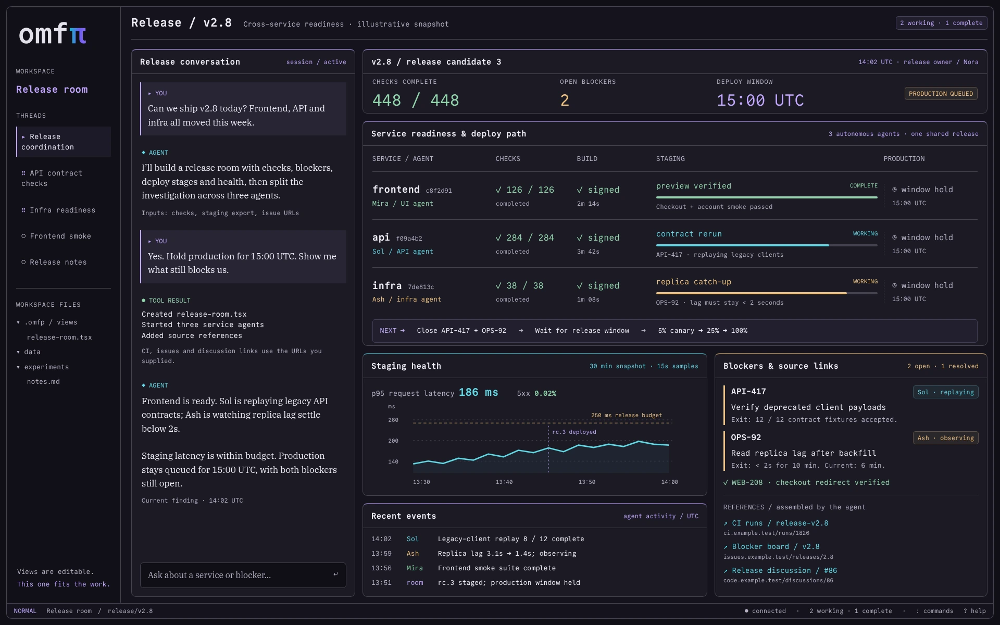
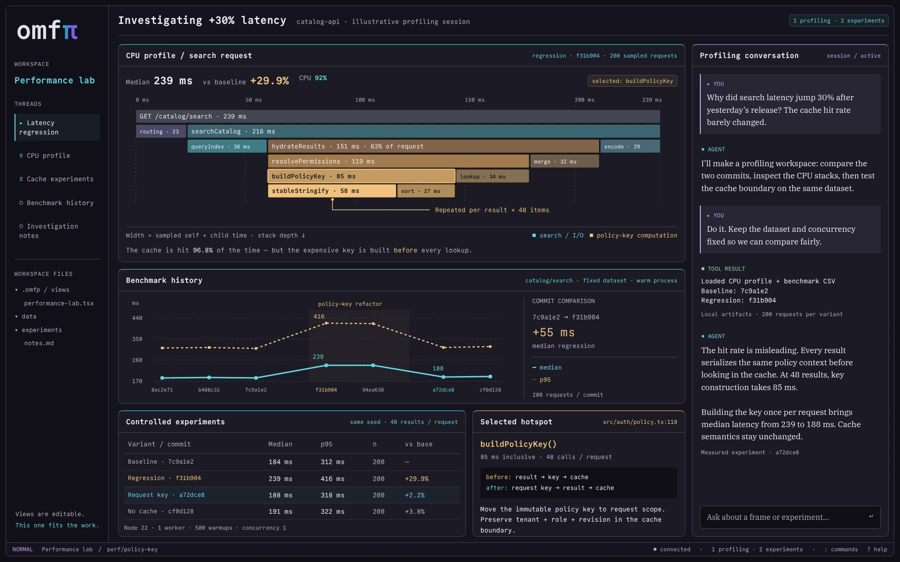
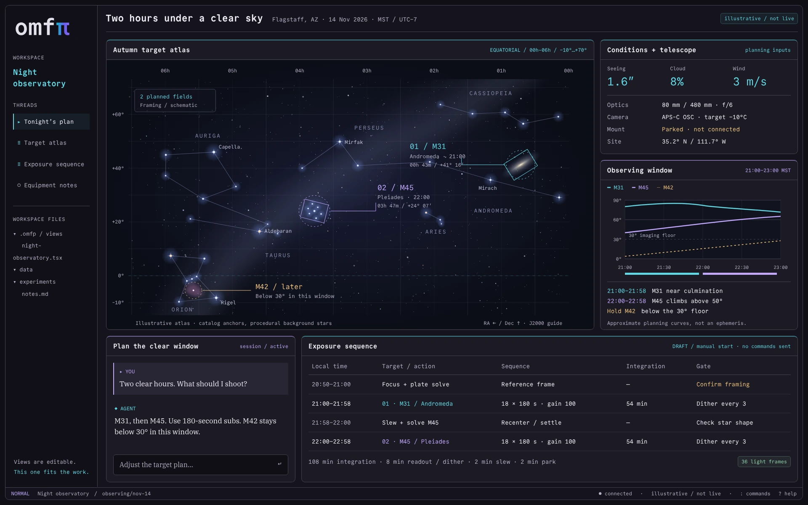

<!-- markdownlint-disable MD033 MD041 -->
<h1 align="right">
  <picture>
    <source media="(prefers-color-scheme: dark)" srcset="docs/brand/wordmark-dark.svg">
    
  </picture>
  A workspace your agents can reshape.
</h1>

The f stands for fabulous, right?

A browser and desktop app for the
[oh-my-pi](https://github.com/can1357/oh-my-pi) coding agent. Agents work in
parallel and reshape the interface around the work as it changes. Each
conversation has its own oh-my-pi running in the background.

- **Agents reshape the UI live.** Everything around the chat is made of React
  widgets. Ask for a test dashboard or a deploy button and it shows up live;
  the built-ins work the same way, so agents can change those too.
- **Run agents in parallel.** Every conversation (a thread) is a separate
  oh-my-pi and keeps working when you close the window. Pick it up from your
  laptop or your phone.
- **Workspaces are directories.** Keep repositories, worktrees, skills and
  omfp's view and widget declarations together. Threads share the directory;
  its contents remain ordinary files.
- **One daemon, many windows.** A local headless daemon keeps the work running.
  Connect from a browser, phone or desktop app, and open as many windows as the
  workflow needs.
- **Bring your subscription.** Works with your ChatGPT or Claude plan, or any
  API key oh-my-pi supports.
- **Small core, explicit primitives.** omfp defines threads and how widgets
  plug into a workspace. What those primitives become is up to you and your
  agents.
- **Emacs philosophy at heart.** Change the tool from inside it, while it runs.
  No rebuilds.

Early and changing fast.

## Interfaces shaped by the work

Agents build and reshape these views live. They are examples, not prescribed
workflows.

*Release coordination — agents, CI checks and rollout health in one room.*

*Performance investigation — flamegraphs, benchmarks and the next
experiment kept together.*

*Astronomy — targets, observing windows and exposure plans beside the conversation.*

[See more ways a workspace can take shape →](https://omfp.dev/#showcase)

---

This README is for humans. The slop lives in
[docs/overview.md](docs/overview.md); anything else, ask your agent how omfp
works.\*

\* OK, this one is AI-generated too, but at least I read it.
