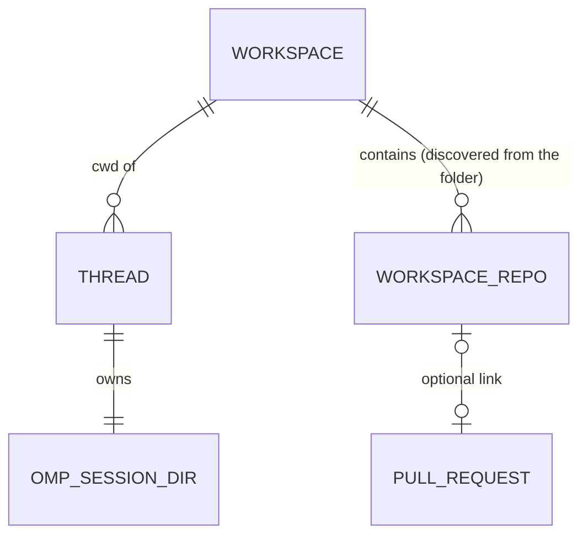
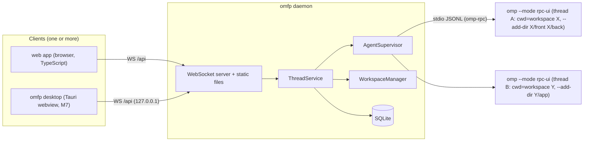
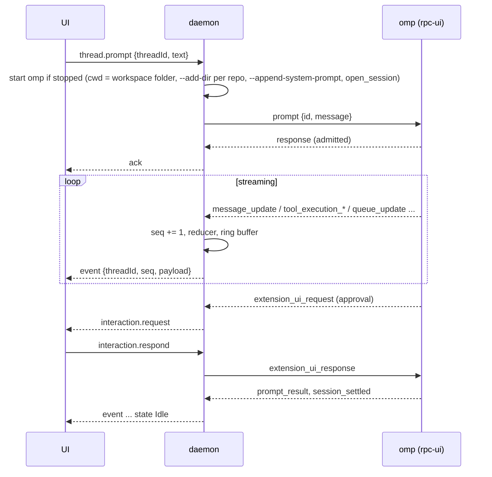

# 00 — Overview and architecture

## Goal

An application for working with many omp agents in parallel:

- **threads** are conversations with an omp agent; each thread lives in one **workspace**, and several threads may
  share it;
- a **workspace** is a folder the daemon creates under its workspaces root, the agent's cwd; its **repositories** are
  its top-level entries — clones, git worktrees, or links to projects elsewhere — so one thread can span several
  repositories (e.g. a frontend PR and a backend PR); the agent adds or removes repos itself and the UI always shows
  them, rescanning the folder on its own (D-11, DMN-023);
- adding a repository is quick without any registry: the daemon suggests the repositories it has already seen and
  completes paths on its own machine (DMN-021); starting from an existing project is one step: typing its path in
  "+ workspace" makes a workspace holding a link to it (UI-023);
- conversations stream live, with readable tool cards, approvals, agent questions, the message queue, subagents and the
  session tree;
- the same interface (a TypeScript web app, D-18) runs **in the browser** and **as a desktop app** (Tauri webview, M7),
  connected to the same daemon;
- agents **build UI**: the window shows a workspace's views manifest of React widgets that agents write as files
  (`views.json`, init files, TSX views; the user adds widgets with `:widget add`), reloaded live (M4, M14,
  [08](08-agent-control.md#agent-made-ui-views-and-widgets-m4));
- **agents drive the interface** (M10, [08](08-agent-control.md)): they spawn threads, create workspaces, mount widgets
  and run the window's commands through the same protocol as the UI, also from outside omfp over MCP (M13).

## Non-goals (for now)

- Rewriting the omp TUI: TUI-only features are out of scope; the terminal handoff once designed for them was removed (D-06).
- An IDE (no LSP, debugger, refactoring): only quick edits, in the file viewer (`omfp:file`, M5c); real work stays in the user's editor ("open in editor").
- Multi-user accounts and permissions. The daemon is personal (one OS user), protected by a token.
- An app store or auto-updater: releases are the Nix flake (`nix profile install`) and the downloads without Nix of
  M15 (tarball, Flatpak, `.dmg`); no Windows build.

## Domain model



| Entity | Meaning |
| --- | --- |
| Workspace | A folder created by the daemon under the workspaces root (`<root>/<slug>`). The cwd of its threads. An existing project comes in as a link inside it, never as the workspace folder itself. |
| Workspace repo | A git repository among the workspace's top-level entries: a `link` (symlink to a project elsewhere), a `worktree` (linked worktree of another repository) or a `clone`; or the folder itself when it is a repository. Not stored: discovered by scanning the folder. |
| Thread | One omp session (its own session directory) in one workspace, title, model settings, provenance. |

## Components



| ID | Requirement |
| --- | --- |
| ARC-001 | The daemon (`omfp daemon`) MUST be the only process that launches omp and speaks the RPC protocol. |
| ARC-002 | The UI MUST communicate only with the daemon, through the protocol in [03](03-protocol.md), on both web and desktop. |
| ARC-003 | `omfp desktop` MUST connect to the local daemon for its data directory when one is running (DMN-007), otherwise start one in the background and connect to it; the UI connects like a web client (D-15, D-16). The background daemon is `omfp daemon --tray` (in the system tray, DMN-128) in its own process group, stdin `/dev/null`, output appended to `<data-dir>/daemon.log` (mode `0600` in the `0700` data directory, DMN-180; it never holds the token, DMN-181); it binds the configured or default address (DMN-002, `127.0.0.1:7420`) first, so the window's origin and its `localStorage` survive daemon restarts (S-04), and only when that port is taken retries on a random port of the same interface (never replacing a `--bind` passed to it). The window loads the daemon's own UI (`http://<addr>/#token=…&local=1`, plus `&thread=<id>` with `--thread`, UI-218; `local=1` tells the app it runs on the daemon's machine) with no Tauri IPC and no capabilities, keeps its web storage under `<data-dir>/webview`, and stays on the daemon's origin (DMN-182). |
| ARC-004 | Several clients MUST be able to connect to the same daemon at once and see the same state. |
| ARC-005 | Each thread MUST have at most one live omp process at a time. |
| ARC-006 | A thread's visible state MUST derive from the `omfp-core` reducer applied to its event sequence; the UI runs its TypeScript port (`@omfp/core`), which produces the same state on every recorded fixture (D-04). |
| ARC-007 | **API-first** (D-12): every action available in the UI MUST be a protocol method; the UI holds no business logic that another client could not reproduce through the protocol. |
| ARC-008 | Threads MUST NOT be bound to a single repository: a thread lives in a workspace folder that holds zero or more repositories, and repositories can be added to and removed from the workspace during the thread's life, by the user or by the agent (D-11). |
| ARC-009 | Every created entity (thread, workspace, view) MUST record its provenance: `user` or the id of the thread whose agent created it (needed by 08). |

## Cargo workspace and UI packages

```text
crates/
  omfp-protocol/   UI↔daemon protocol types (serde), JSON Schemas.
  omfp-core/       Domain model and pure reducer over omp events. No I/O.
  omfp-daemon/     Daemon library (tokio, axum, rusqlite, omp-rpc): `omfp_daemon::start`, `omfp_daemon::run`.
  omfp/            The single `omfp` binary (D-15): `omfp daemon`, `omfp theme set`, `omfp mcp config`, and with the
                   `desktop` feature `omfp desktop` (Tauri, M7, M11).
  fake-llm/       Scripted OpenAI-compatible server for tests (library).
  omfp-testkit/    Test helpers: temporary git repos, isolated omp agent dir, test daemon.
e2e/              End-to-end tests (WebDriver) against the web build.
ui/packages/      The TypeScript UI (Bun workspace, 04-ui): protocol (generated types), core (reducer port),
                  client (transport, session, model), kit (React Aria wrappers, tokens), app (the web app).
```

| ID | Requirement |
| --- | --- |
| ARC-010 | (Removed, QA: no client runs a wasm build of the shared crates since the UI became a TypeScript port, D-18; `just check-wasm` and the toolchain's wasm target are gone.) `omfp-protocol` and `omfp-core` compiled for `wasm32-unknown-unknown` and used no tokio, `std::process` or the filesystem; they still do no I/O. |
| ARC-011 | `omfp-core` MUST reuse `omp_rpc::wire` types for omp events and messages instead of redefining them. The whole `omp-rpc` crate compiles for wasm (S-01), but `omfp-core` uses only its `wire` module; its process client is for the daemon. |
| ARC-012 | System dependencies (git, omp, clock, ID generation) MUST sit behind traits ("ports") in `omfp-daemon`, so component tests can use fake implementations. |

## Main flow: one prompt



## On-disk data

```text
$XDG_DATA_HOME/omfp/            (default ~/.local/share/omfp; macOS ~/Library/Application Support/omfp, DMN-170)
  omfp.db                        SQLite: seen repositories, workspaces, threads, settings, widget state
  token                         access token (mode 0600)
  omp-profile/                  isolated omp user configuration, credentials, models and runtime state (ARC-021)
    agent/                      config.yml, models.yml, agent.db (provider and MCP credentials), mcp.json, agents/…
  threads/<thread-id>/sessions/ sessionDir passed to omp (open_session)
  threads/<thread-id>/omp.log   omp stderr
  widgets/<name>/               the user's widget library (`user:<name>`, AGT-023)

~/.omfp/<slug>/                  workspaces created by the daemon (--workspaces-root); repos are top-level entries
```

| ID | Requirement |
| --- | --- |
| ARC-020 | A thread's omp sessions MUST live in a dedicated directory opened with `open_session { sessionDir }`, so the thread resumes its session after a process restart, independent of which workspaces it uses. |
| ARC-021 | Every daemon-owned omp process MUST use the fresh isolated profile `<data-dir>/omp-profile`, with native user configuration in `agent/` and runtime/cache state contained in that profile. This includes launches/restarts/forks, session-lease/version probes, login/logout/provider and model enumeration, title generation, MCP credentials/configuration, user settings and agent discovery. The apps MUST NOT read or write each other's omp user-level state (`~/.omp`, including `~/.omp/agent`, or standalone omp's mutable XDG state), with two exceptions. The first, the user — or an agent or MCP client with `Drive` acting for them — asks for: copying standalone omp's model-provider logins into omfp's profile through the pinned omp's own commands (DMN-229, DMN-230). Since the export opens its store read-write (it creates, migrates and extends it), omfp never runs it on standalone omp's store: the daemon finds that store with the pinned omp's directory rules, copies it into a private snapshot directory under `<data-dir>/login/` without SQLite opening standalone omp's files (they are read as bytes under SQLite's own SHARED lock and a read lock on the `-shm` checkpoint byte, nothing written beside them), runs `omp auth export` on the snapshot with omfp's profile environment, and deletes the snapshot right after; the export is piped into `omp auth import -` run with omfp's profile. The daemon reads no credential itself, the logins never reach the protocol, logs or disk outside omfp's data directory, and nothing is written to standalone omp's state. The copy is serialized with omfp's logins and logouts, and each omp run has a deadline. The second runs once by itself: the images omfp's own threads stored in standalone omp's blob store before this profile existed — the blobs their session files reference and omfp's profile lacks — are hard-linked (else copied) into the profile's blob store, standalone omp's `blobs/` only listed and read (DMN-385). There MUST be no sharing switch or fallback, and nothing else is copied: no MCP credentials, configuration, `models.yml`, `mcp.json`, settings, history or caches; users configure omfp's profile anew. Workspace/project configuration, cwd, repository roots, `HOME` and `XDG_CONFIG_HOME` remain unchanged; preserving the host XDG configuration root keeps agent shell tools authenticated to host CLIs while omp's own user configuration remains isolated by its native profile variables. Explicit provider keys in the daemon's environment remain supported; this is profile isolation, not a filesystem sandbox against agent tools. |
