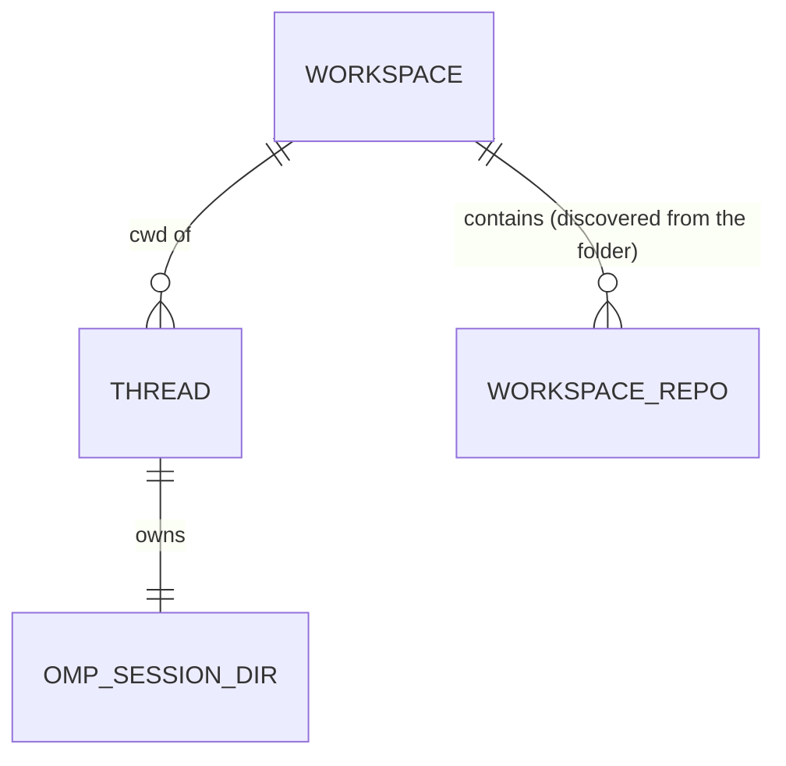
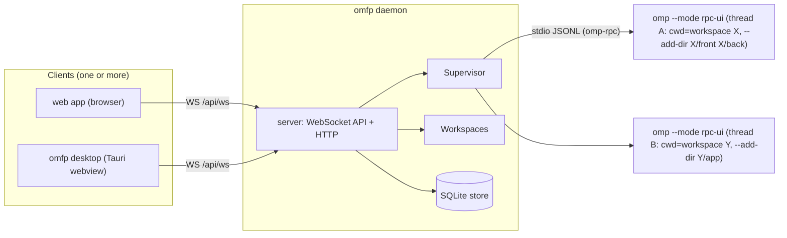
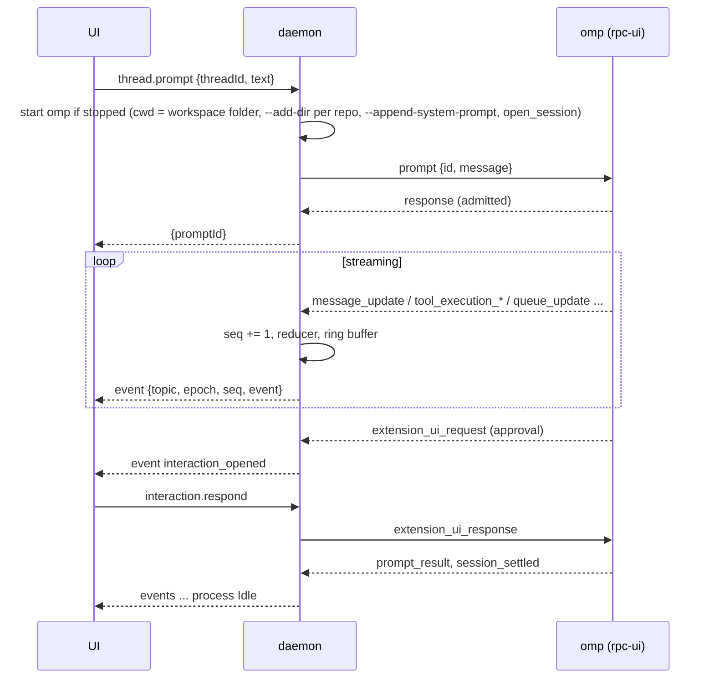

# 00 — Overview and architecture

## Goal

An application for working with many omp agents in parallel:

- **threads** are conversations with an omp agent; each thread lives in one **workspace**, and several threads may
  share it;
- a **workspace** is a folder the daemon creates under its workspaces root, the agent's cwd; its **repositories** are
  its top-level entries — clones, git worktrees, or links to projects elsewhere — so one thread can span several
  repositories; the agent adds or removes repos itself and the UI shows them (D-11, DMN-023);
- adding a repository needs no registry: the daemon suggests repositories it has seen and completes paths on its own
  machine (DMN-021); an existing project comes in as a link (UI-023);
- conversations stream live, with readable tool cards, approvals, agent questions, the message queue, subagents and the
  session tree;
- the same TypeScript UI (D-18) runs **in the browser** and **as a desktop app** (Tauri webview), connected to the same
  daemon;
- agents **build UI**: the window shows a workspace's views manifest of React widgets that agents write as files,
  reloaded live ([08](08-agent-control.md));
- **agents drive the interface** ([08](08-agent-control.md)): they spawn threads, create workspaces, mount widgets and
  run the window's commands through the same protocol as the UI, also from outside omfp over MCP.

## Non-goals (for now)

- Rewriting the omp TUI: TUI-only features are out of scope (D-06).
- An IDE (no LSP, debugger, refactoring): only quick edits in the file viewer (`omfp:file`); real work stays in the
  user's editor.
- Multi-user accounts and permissions. The daemon is personal (one OS user), protected by a token.
- An app store or auto-updater: releases are the Nix flake and the downloads without Nix (tarball, Flatpak, `.dmg`); no
  Windows build.

## Domain model



| Entity | Meaning |
| --- | --- |
| Workspace | A folder created by the daemon under the workspaces root (`<root>/<slug>`), the cwd of its threads. An existing project comes in as a link inside it, never as the workspace folder itself. |
| Workspace repo | A git repository among the workspace's top-level entries — a `link`, a `worktree` or a `clone` — or the folder itself when it is a repository. Not stored: discovered by scanning the folder. |
| Thread | One omp session (its own session directory) in one workspace, with title, model settings and provenance. |

## Components



| ID | Requirement |
| --- | --- |
| ARC-001 | The daemon (`omfp daemon`) MUST be the only process that launches omp and speaks the RPC protocol. |
| ARC-003 | `omfp desktop` MUST connect to its data directory's running daemon (DMN-007), waiting for one that restarts in place (DMN-392) or holds the lock while it starts (at most 30 s), else start `omfp daemon --tray --no-wait` in the background (own process group, stdin `/dev/null`, output appended to `daemon.log`, DMN-390) bound to the configured or default address, a random port only when that is taken. The window loads `http://<addr>/#token=…&local=1` (`&thread=<id>` with `--thread`, UI-218) like a web client, with no Tauri IPC and web storage under `<data-dir>/webview` (D-15, D-16, DMN-182). |
| ARC-004 | Several clients MUST be able to connect to the same daemon at once and see the same state. |
| ARC-005 | Each thread MUST have at most one live omp process at a time. |
| ARC-006 | A thread's visible state MUST derive from the `omfp-core` reducer applied to its event sequence; the UI runs its TypeScript port (`@omfp/core`), which produces the same state on every recorded fixture (D-04). |
| ARC-007 | **API-first** (D-12): every action available in the UI MUST be a protocol method; the UI holds no business logic that another client could not reproduce through the protocol. |
| ARC-008 | Threads MUST NOT be bound to a single repository: a thread lives in a workspace folder that holds zero or more repositories, which the user or the agent can add and remove during the thread's life (D-11). |
| ARC-009 | Every created entity (thread, workspace, view) MUST record its provenance: `user` or the id of the thread whose agent created it (08). |

## Code boundaries

The crates and UI packages are listed in [AGENTS.md](../../AGENTS.md#layout).

| ID | Requirement |
| --- | --- |
| ARC-011 | `omfp-core` MUST reuse `omp_rpc::wire` types for omp events and messages instead of redefining them, and use only that module of `omp-rpc`. |
| ARC-012 | System dependencies (git, omp, clock, ID generation) MUST sit behind traits ("ports") in `omfp-daemon`, so component tests can use fake implementations. |

## Main flow: one prompt



## On-disk data

```text
$XDG_DATA_HOME/omfp/            (default ~/.local/share/omfp; macOS ~/Library/Application Support/omfp, DMN-170)
  omfp.db                        SQLite: seen repositories, workspaces, threads, settings, widget state, jobs
  token                          access token (mode 0600)
  daemon.json, daemon.log        the running daemon's address (DMN-007) and log (DMN-390)
  omp-profile/                   isolated omp user configuration, credentials and runtime state (ARC-021)
  threads/<thread-id>/sessions/  sessionDir passed to omp (open_session)
  threads/<thread-id>/omp.log    omp stderr

~/.omfp/<slug>/                  workspaces created by the daemon (--workspaces-root); repos are top-level entries
```

| ID | Requirement |
| --- | --- |
| ARC-020 | A thread's omp sessions MUST live in a dedicated directory opened with `open_session { sessionDir }`, so the thread resumes its session after a process restart, independent of which workspaces it uses. |
| ARC-021 | Every daemon-owned omp process (threads, probes, logins, model lists, titles) MUST use the isolated profile `<data-dir>/omp-profile`, user configuration in its `agent/`, and MUST NOT read or write standalone omp's user state (`~/.omp`, its XDG state) except for the login copy the user asks for (DMN-229, DMN-230); no other setting, credential or file is shared. Workspace configuration, cwd, `HOME` and `XDG_CONFIG_HOME` stay the user's, and provider keys in the daemon's environment still apply. |
