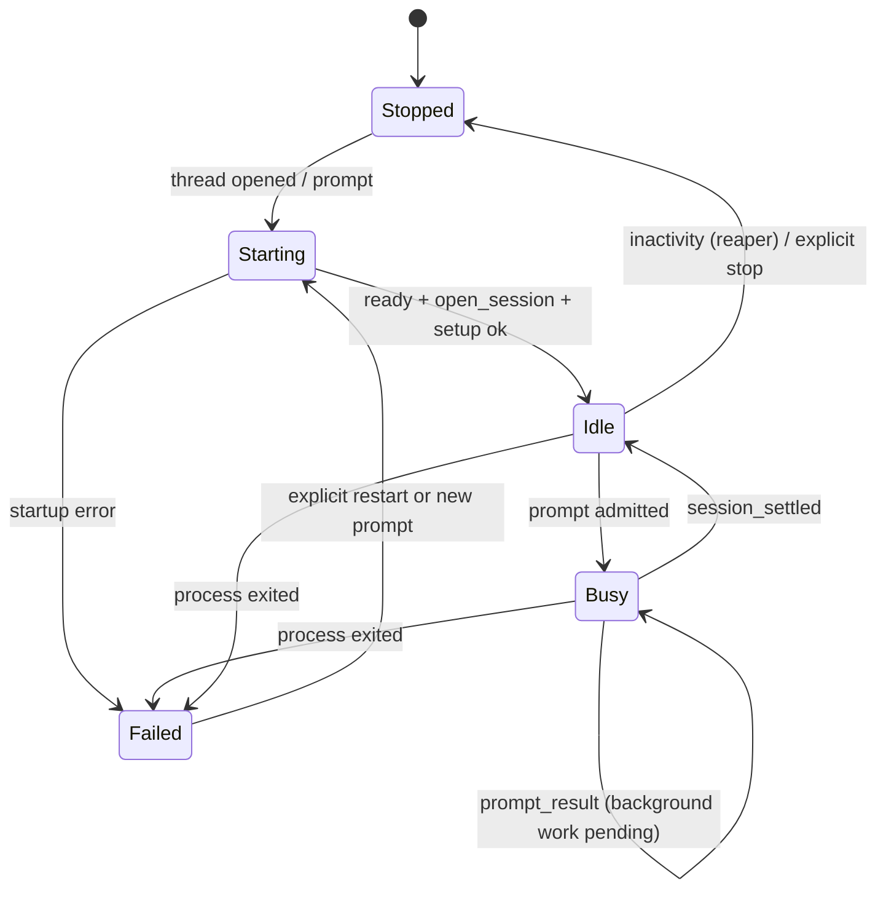

# 02 — Daemon (`omfp daemon`)

The daemon owns workspaces, threads and omp processes. It serves the protocol in [03](03-protocol.md) and the web UI.

## Startup and configuration

```text
omfp daemon [--bind 127.0.0.1:7420] [--data-dir DIR] [--omp-bin PATH] [--static-dir DIR] [--allow-omp-mismatch]
            [--allowed-origin ORIGIN]… [--theme-file PATH] [--no-title-generation] [--config FILE]
omfp daemon restart [--data-dir DIR] [--config FILE]
```

| ID | Requirement |
| --- | --- |
| DMN-001 | On startup the daemon MUST run `omp --version` and compare it with the pinned omp version ([01](01-dev-environment.md)); on mismatch it MUST refuse to start unless `--allow-omp-mismatch` is given, which also shows a warning in the UI. |
| DMN-002 | The default `--bind` MUST be `127.0.0.1:7420`; any address and port MAY be configured. Exposure beyond the machine (tunnels, reverse proxies, TLS) is the deployer's job (D-13). |
| DMN-003 | On first run the daemon MUST generate a random token (≥ 256 bits) in `<data-dir>/token`, mode `0600`, which every WebSocket connection presents (PRT-002). A token file group or others may access MUST be tightened to `0600` on load with a warning; one that cannot be tightened fails startup. |
| DMN-004 | The daemon MUST also run in-process as a library, exposing its bound address and token (used by the desktop app's smoke run and the test daemon). |
| DMN-005 | On SIGTERM/SIGINT or a library shutdown the daemon MUST stop every omp process and finish within 10 s: omp's stdin is closed, then its process group gets SIGTERM and, after 1 s, SIGKILL. |
| DMN-006 | The omp binary MUST be resolved in this order: `--omp-bin`; the omp bundled next to the daemon executable (D-14); `omp` on `PATH`. The resolved path is logged at startup. |
| DMN-007 | At most one daemon MUST run per data directory (exclusive lock file). A running daemon MUST publish its address in `<data-dir>/daemon.json` (removed on shutdown, marked during a restart in place, DMN-392) so local clients such as `omfp desktop` find it and authenticate with the `token` file (D-16). |
| DMN-008 | The web bundle MUST be resolved in this order: `--static-dir`; `web/` next to the executable; `Resources/web/` beside the executable's folder (`omfp.app`, ENV-063); else only the API is served, with a warning. It is served at `/`, unknown paths fall back to `index.html`, sent `Cache-Control: no-store` and, except at `/kit` (UI-173), with the `[ui]` appearance on `<html>` (UI-091). |
| DMN-009 | The daemon MUST read an optional TOML config file, `$XDG_CONFIG_HOME/omfp/config.toml` (else `~/.config/omfp/config.toml`, or `--config <file>`): `[daemon]` holds each `omfp daemon` flag in snake case (`allowed_origins` for `--allowed-origin`, `~` expanded), flag > file > default, unknown keys an error naming the key; `[ui]` (UI-097) and `[keymap]` are settings it serves and applies live on change, while `[daemon]` changes need a restart. An invalid file is fatal at startup; on reload it is logged and shown in the UI, the previous settings staying. |
| DMN-091 | A file the daemon follows by polling (the theme file, DMN-075; the config file, DMN-009) MUST apply a change only once two consecutive reads (1 s apart) agree on its size, modification time and content, or both find it missing, so a non-atomic writer is never read halfway. |
| DMN-128 | **Tray icon** (desktop build): `omfp daemon --tray`, which `omfp desktop` passes to the daemon it starts, MUST show a StatusNotifierItem with a `com.canonical.dbusmenu` menu on the session bus and register with every `org.kde.StatusNotifierWatcher`, later ones included. Without a bus or watcher it logs once and runs on; when its bus closes it keeps running and registers again on the next session bus. `Activate` opens a new window (`omfp desktop --data-dir <dir>`). Menu and icon: UI-217..219. |
| DMN-129 | The tray MUST follow the daemon's thread index live: a change that alters what it shows raises the menu's revision with `LayoutUpdated(revision, 0)` and emits `NewToolTip`, and an icon change `NewIcon`, `NewAttentionIcon` and `NewStatus` (`Active`, `NeedsAttention` while a thread needs the user). |
| DMN-130 | The tray's `Quit daemon` MUST stop the daemon with one click as SIGTERM does (DMN-005: omp processes and jobs stop, `daemon.json` is removed, exit status 0), removing the icon before the shutdown starts. |
| DMN-170 | **Data directory default**: without `--data-dir` or `data_dir` the data directory MUST be `$XDG_DATA_HOME/omfp` when `XDG_DATA_HOME` is absolute, else `~/.local/share/omfp` on Linux and `~/Library/Application Support/omfp` on macOS, for every `omfp` subcommand. The config and theme files stay in `$XDG_CONFIG_HOME/omfp`, else `~/.config/omfp`, on macOS too. |
| DMN-171 | **Menu bar item on macOS**: `omfp daemon --tray` on macOS MUST run as an accessory app (no window, Dock icon or app menu) showing the tray of DMN-128..DMN-130 as an `NSStatusItem` (UI-254), removed before the shutdown starts; the daemon ending, a panic included, ends the app. Without a menu bar it logs `no menu bar item: …` and runs on; with one, `in the menu bar`. |
| DMN-180 | **Private data directory**: the daemon (and `omfp desktop` when it starts one) MUST create the data directory with mode `0700` and tighten an existing one this user owns to `0700` with a log line; the files it writes there (`token`, `daemon.json`, `daemon.lock`, `omfp.db` and its journals, `daemon.log`, each thread's `omp.log`) are `0600`, an existing log others may read tightened when opened. |
| DMN-225 | **Files replaced in one step**: every file the daemon rewrites (a workspace file, DMN-090; `views.json`, DMN-083; a mount's code, PRT-080; the config file; `daemon.json`; the `widget-builder` agent, DMN-107) MUST be written to a temporary file in its folder and renamed over it, keeping the old file's mode unless given one, creating a missing folder, so a reader never sees half a file. |
| DMN-181 | **The token URL only to a terminal**: `omfp daemon` MUST print `omfp daemon listening on http://<addr>/#token=<token>` only when stdout is a terminal, otherwise the URL without the token plus ``(open it with `omfp desktop`, or add #token=<token> from <data-dir>/token)``; `omfp desktop` does the same (UI-004). The tray's children get stdout `/dev/null`. |
| DMN-355 | **Outliving its terminal**: `omfp daemon` and `omfp desktop` started from a terminal that is closed later MUST keep running and serving: output that can no longer be written (`EIO`, `EPIPE`) is dropped, never a panic. |
| DMN-390 | **One log, whoever started the daemon**: `omfp daemon` MUST append its log to `<data-dir>/daemon.log` (`0600`) besides stderr, whoever started it; when stderr already is that file each line is written once. ANSI colours go only to a stderr that is a terminal. |
| DMN-391 | **Restart in place**: `omfp daemon restart` MUST make the data directory's daemon stop as on SIGTERM (DMN-370) and replace itself (`exec`: same pid, environment, streams and arguments, same address) with the `omfp` the command runs from, through its Nix wrapper if any. It waits up to 60 s and prints program, version, pid and URL; it fails, sending nothing, with no daemon, without `"restarts_in_place": true` in `daemon.json` (DMN-394) or across PID namespaces, and fails when the daemon exits or misses the deadline (naming `daemon.log`). |
| DMN-392 | **No second daemon during a restart**: a daemon restarting in place MUST first mark `daemon.json` `"restarting": true` and leave the file to its successor; a client that would start a daemon (`omfp desktop`) waits instead, at most 60 s, while the mark stands and its process lives, then uses the restarted one. A mark whose process is gone, or in another PID namespace, is stale. |
| DMN-393 | **A thread's shell finds its daemon**: every daemon-owned omp MUST get `OMFP_DATA_DIR=<absolute data directory>`, and `omfp daemon restart` MUST take the data directory from `--data-dir`, else `$OMFP_DATA_DIR`, else as `omfp daemon` does (DMN-009, DMN-170). |
| DMN-394 | **The restart signal**: `omfp daemon` MUST catch `SIGUSR2` from before it writes `daemon.json`, and only a daemon that catches it MAY write `"restarts_in_place": true` (an in-process daemon writes no such flag). The request file `<data-dir>/daemon.restart` (`{"program": <absolute path>}`) is removed once read; a signal without a valid request is logged (`restart signal ignored: …`) and the daemon runs on. If `exec` fails the process exits with the error. |
| DMN-182 | **The desktop window stays on the daemon's origin**: the window MUST grant permissions (notifications; the microphone on macOS, UI-251) only while its top-level page is on the daemon's origin. A top-level navigation to an external `http(s)` URL returns to the daemon's page and opens the URL in the system browser (UI-678); `mailto:` and other schemes are cancelled; `about:`, `blob:` and `data:` load. New-window requests never open a webview: external `http(s)` and `mailto:` URLs go to the system opener. On macOS `omfp-notify:` (UI-252) is honoured only with the window's nonce. |
| DMN-184 | **WebSocket connections before `system.hello`**: a connection without a completed hello within 10 s MUST be closed with 4401 (`system.hello timed out`, PRT-001), and at most 64 MAY await their hello at once: a further upgrade gets `503` until one authenticates or closes. |
| DMN-140 | **`Origin` allow-list** (D-13): `[daemon] allowed_origins = [...]`, or the repeatable `--allowed-origin <origin>` (replacing the file's list), MUST name the origins a browser may open the WebSocket from besides the daemon's own (PRT-003, PRT-070). It only widens the `Origin` check (the token is still required); HTTP routes check no `Origin`. A refused upgrade is `403`, logged with its `Origin` and `Host`. |
| DMN-141 | Every allow-list entry MUST be an origin `http(s)://host[:port]`, normalized (lowercase scheme and host, default port and trailing `/` dropped). Another scheme, a path, query, fragment, user info or bad port MUST fail startup naming the entry, its source and the expected form; `*` and any wildcard MUST be refused with the reason (cross-site WebSocket hijacking). |

A proxy that passes the browser's `Host` on needs no configuration; one that rewrites it (nginx's default
`proxy_set_header Host $proxy_host`, a Cloudflare Tunnel's `httpHostHeader`) needs the public URL listed:

```toml
[daemon]
allowed_origins = ["https://omfp.example.ts.net"]  # exactly scheme://host[:port], no path, no `*`
```

## Persistence (SQLite)

The schema is `store/0001_baseline.sql` plus the later `store/NNNN_*.sql` migrations. Repositories inside a workspace
are not stored: they are discovered from the folder (DMN-022).

| ID | Requirement |
| --- | --- |
| DMN-010 | Migrations MUST be embedded in the binary and applied in order using `PRAGMA user_version`, each in its own transaction. An empty database (version 0) MUST get the first release's schema as version 12, then the later migrations; a database from before the first release (versions 1 to 11) or from a newer daemon MUST be refused, unchanged, with an error saying so. |
| DMN-011 | The database MUST use `journal_mode=WAL` and `foreign_keys=ON`. |
| DMN-012 | Transcripts are NOT stored in the database: the source of truth is omp's `.jsonl` session in the thread's session directory. |

## Workspaces and their repositories

A workspace is a folder; its repositories are the folder's top-level entries (D-11). Git runs through the `git` CLI.

| ID | Requirement |
| --- | --- |
| DMN-020 | Creating a workspace MUST make a new folder `<workspaces-root>/<slug>` (`--workspaces-root`, default `~/.omfp`); an existing folder is never recorded as one. With `link { path }` the same call adds a link to that repository (DMN-024; checked first, so a bad path creates nothing), the name defaulting to the target's folder name. Names and paths are unique. `threads.create` MUST require an explicit `workspace` (`{ id }` or `{ new: { name?, link? } }`); without one it is rejected before anything is created. |
| DMN-021 | There is no repository registry. `repos.suggest { query? }` MUST return the repositories seen in any workspace (canonical path of links and clones, main repository of worktrees; recorded on every scan, most recent first, filtered by `query`), and `fs.complete { path }` the child directories of a path on the daemon host (`~` expanded), marking git roots. |
| DMN-022 | The daemon MUST discover a workspace's repositories by scanning its folder: the folder itself when it is a git root, and every top-level entry that is one, following symlinks. Each repo has a `name` (entry name), its `path` inside the workspace (never a link's target), a `kind` (`link` with its target, `worktree` with its main repository, or `clone`), branch and HEAD. Non-git, hidden (`.`-prefixed) and deeper entries are ignored. |
| DMN-023 | The daemon MUST rescan a workspace on startup, on every workspace method, on `workspaces.rescan` and after every `tool_execution_end` of a thread in it except read-only tools (unknown tools count as writers), also refreshing `workspace/<id>`'s git status. A workspace open in a window or holding a running omp MUST also be checked every 2 s by the metadata of its folder, top-level entries and each repository's `HEAD` and `index`, rescanned only when that changed and fully every 30 s; others are not polled, and no filesystem watcher is used. |
| DMN-024 | Adding a repository to a workspace MUST support `link` (a symlink `<name> → <path>`), `worktree` (`git worktree add <workspace>/<name>`, on a new branch from `baseRef`, default `omfp/<slug>-<suffix>`, or an existing branch; the repository given by any path inside it) and `clone` (`git clone <url> <name>`). The UI offers link and clone only (UI-025). |
| DMN-025 | Removing a repository from a workspace MUST: for `link`, delete the symlink only (never the target); for `worktree`, run `git worktree remove`, refusing with uncommitted changes unless forced, keeping the branch unless asked; for `clone`, delete the folder only when forced or clean. Git operations on the same repository MUST be serialized. |
| DMN-026 | For each repository in a workspace the daemon MUST report branch, commits ahead/behind its upstream or base, changed files and the diff (`git diff <base>...HEAD` plus uncommitted changes) for `omfp:changes` (UI-080). |
| DMN-027 | The daemon MUST expose which threads use each workspace and which workspaces contain the same repository (same canonical path), so the UI can warn about concurrent edits. It MUST NOT forbid either. |
| DMN-028 | Removing a workspace MUST refuse while it has threads not yet deleted (DMN-039), then remove its repositories as DMN-025 does (unforced: dirty clones and worktrees refuse) and delete the folder. Nothing outside the workspace folder is ever deleted. |
| DMN-382 | A repository without commits (an unborn `HEAD`) MUST report status and diff like any other, never an error: its branch to be born, no ahead/behind, and its files as added against the empty tree. |
| DMN-383 | A repository whose git status or diff fails MUST NOT fail its workspace's status: `workspace/<id>` (and `thread.git`) carries that repository with an empty `status` and the failure as `error`, the others as usual; `workspaces.status` on it answers `git_error`. |
| DMN-384 | A repository's status failure (DMN-383) MUST be logged as a warning once per change of its error, not on every poll or rescan. |

### Files of a workspace

The file viewer and editor (`omfp:file`, UI-110..116) reads and writes files through the daemon, which may run on
another machine than the window.

| ID | Requirement |
| --- | --- |
| DMN-089 | `workspaces.read_file` MUST answer the file `path`, relative to the workspace folder (`..` resolved lexically; leaving the folder is `bad_request`) or absolute (DMN-310); a relative path the folder lacks is looked up in each repository, in scan order. Missing: `not_found`; a directory: `bad_request`. `kind` is `text` (UTF-8 without NUL; cut before 2 MiB, `truncated`), `image` (by extension; base64 ≤ 8 MiB, `mime`) or `binary`; `hash` is hex SHA-1; repository files get `repo` and `head` (text at `HEAD`). A matching `knownHash` answers `unchanged: true` without content. |
| DMN-090 | `workspaces.write_file` MUST write `content` to `path` (resolved as in DMN-089, without repository lookup; outside the folder refused, DMN-313) only while the file still has `expectedHash`, or, without it, does not exist; else `conflict`, nothing written. The write is atomic, keeps the file's permissions, writes through a symlink and creates no folder; then the workspace is rescanned and the git status of `workspace/<id>` refreshed (DMN-023). |
| DMN-092 | `workspaces.find_file` MUST search the whole inventory before keeping the best 50: each repository's tracked and untracked, not ignored, existing files, and the folder's other non-hidden files (directory links not followed). Strict by default: a bare or partial path, `..` as in DMN-089, none for an outside absolute path (DMN-312). `fuzzy: true` matches the query's non-whitespace characters as a case-insensitive subsequence of the path; empty lists files. Order: `exact`, `suffix`, `basename`, `fuzzy`; ties prefer files the thread's tool cards mention, then shallower paths. |
| DMN-250 | **Raw workspace files**: `GET <fileBase>/<workspaceId>/<path>` (percent-encoded; an absolute path after one more `/`, DMN-314) MUST answer the bytes of the file `path`, resolved and looked up as in DMN-089, any size and kind. `<fileBase>` is `/files/<key>` (PRT-150), `<key>` a random 128-bit secret made at startup, distinct from the widget key (DMN-084). A wrong key, an unknown workspace, a relative path leaving the folder, a missing file and a directory are the same `404` (`Cache-Control: no-store`). The query string is ignored. |
| DMN-251 | A raw file's `Content-Type` MUST come from its extension (case-insensitive: the images of DMN-089, `mp4`/`m4v`, `webm`, `mov`, `mkv`, `ogv`, `mp3`, `ogg`/`oga`/`opus`, `wav`, `flac`, `m4a`, `aac`, `pdf`, `json`, `wasm`, `csv`), else from its first 512 bytes (PDF, PNG, JPEG, GIF, WebP, WAV, Ogg, FLAC, MP3 with ID3, MP4, WebM; UTF-8 without NUL as `text/plain; charset=utf-8`), else `application/octet-stream`. |
| DMN-252 | **Byte ranges**: every raw file answer MUST carry `Accept-Ranges: bytes`. One `bytes=` range (`a-b`, `b` capped at the last byte; `a-`; suffix `-n`) is answered `206` with `Content-Range: bytes a-b/<size>`; a start at or past the end, or `-0`, is `416` with `Content-Range: bytes */<size>`; several ranges or a malformed header get the whole file (`200`). `HEAD` answers the same headers without body. |
| DMN-253 | **Validators**: raw file answers MUST carry a strong `ETag` from the file's size and modification time, and `Last-Modified`; `If-None-Match` naming the tag (or `*`) is `304`, and so is, without `If-None-Match`, an `If-Modified-Since` not before the modification time (to the second). With `If-Range`, a `Range` applies only when it names the current tag or date; otherwise the whole file is sent. |
| DMN-254 | **Raw files stay inert**: raw file answers MUST carry `X-Content-Type-Options: nosniff`, `Content-Security-Policy: sandbox` (so a workspace's HTML or SVG runs nothing in the daemon's origin), `Cross-Origin-Resource-Policy: same-origin` and `Cache-Control: private, no-cache`. |
| DMN-255 | **A file at `HEAD`**: `GET <fileBase>/<workspaceId>/<path>?rev=HEAD` (other query pairs ignored) MUST answer the file's bytes at `HEAD` of the workspace repository holding it (path as in DMN-250; the working copy need not exist), whole (`Accept-Ranges: none`), typed as in DMN-251, with the bytes' hex SHA-1 as strong `ETag` (`304` on `If-None-Match`) and DMN-254's headers. A file `HEAD` lacks, a path outside every repository and every DMN-250 refusal are `404`. `workspaces.read_file` gives that SHA-1 as an image's `headHash`. |

### Files outside the workspace folder

Agents may work on files outside the workspace folder (a worktree elsewhere, `/etc/hosts`, a log); windows read them by
absolute path, read-only: reading shows nothing the daemon's agents could not read already (D-17), and writes stay
where the workspace's rescans, git status and conflict checks see them.

| ID | Requirement |
| --- | --- |
| DMN-310 | **Read by absolute path**: `workspaces.read_file` with an absolute `path` that, `..` resolved without following links, lies outside the workspace folder MUST read that file (any the daemon's user may read), never looked up in repositories, answering the resolved path and `outside: true` (PRT-195); the rest is as in DMN-089. |
| DMN-311 | **`HEAD` of a file outside**: a file read as in DMN-310 inside a git working tree (a worktree included) MUST come with `repo` (the working tree folder's name) and `head` / `headHash` from its `HEAD` as in DMN-089; outside any working tree, or when git cannot tell, it has neither and is still read. An `unchanged` answer carries no `repo`. `?rev=HEAD` (DMN-255) serves its bytes at that `HEAD`. |
| DMN-312 | **Only absolute paths leave the folder**: a relative path escaping the workspace (`../x`, `app/../../x`) MUST be `bad_request` for reads, writes and strict `workspaces.find_file`, and `404` on the raw route. Strict `find_file` answers no candidate for an outside absolute path (UI-705); fuzzy search only searches the workspace inventory (DMN-092). |
| DMN-313 | **Writes stay in the folder**: `workspaces.write_file` MUST refuse an absolute path outside the workspace folder with `bad_request` (`"<path>" is outside the workspace folder: it can be read, not written`), before touching the disk: no file is written or created there, whatever `expectedHash` says. |
| DMN-314 | **Raw bytes of a file outside**: `GET <fileBase>/<workspaceId>/<absolute path>` (after one more `/`, DMN-250) MUST serve a file outside the folder as DMN-310 reads it, with the types, ranges, validators and headers of DMN-251..DMN-254 and the `404`s of DMN-250. |
| DMN-315 | **Unreadable files**: a file the daemon's user may not read (`EACCES`, inside the folder or outside it) MUST be `bad_request` `"<path>" cannot be read: permission denied` for `workspaces.read_file` (and a `404` on the raw route), never `internal`. |

### Threads in a workspace

| ID | Requirement |
| --- | --- |
| DMN-029 | A thread's omp MUST run with cwd = its workspace folder and one `--add-dir <repo path>` per discovered repository except the folder itself. After start and every rescan of a live thread the daemon MUST sync omp's roots with `/add-dir` and `/remove-dir` (once the session settles, when busy); their output never reaches the thread's log, changes neither its state nor its `updatedAt` (UI-020) and is no activity of the thread (DMN-034). |
| DMN-280 | **The order of the left column** MUST be kept by the daemon: `workspaces.position` orders the workspaces, `threads.position` the threads of a workspace, archived ones included (smallest first, ties by id). A new workspace goes after every other, a new thread after every other of its workspace. |
| DMN-281 | `workspaces.reorder { workspaceId, beforeId? }` MUST put the workspace just before `beforeId`, or last, and number the workspaces again from 0, in one transaction; unknown `workspaceId` is `not_found`, `beforeId` = `workspaceId` `bad_request`. |
| DMN-282 | `threads.reorder { threadId, workspaceId?, beforeId? }` MUST put the thread just before `beforeId` (a thread of the target workspace), or last, in its own workspace or in `workspaceId`, in one transaction; unknown thread or workspace is `not_found`, `beforeId` = `threadId` `bad_request`. Archived threads have their place too. |
| DMN-283 | **Moving a thread to another workspace** (`threads.reorder` with another `workspaceId`) MUST be refused with `conflict`, nothing moved, while its omp runs a turn or waits on a dialog (DMN-227); else the record moves and a running omp restarts at once in the new folder, resuming its session with the new roots (DMN-029), whatever background work it had; a stopped thread starts there next time. |
| DMN-284 | The `index` topic MUST carry the order as `position` on every `Workspace` and `ThreadSummary` (within its workspace), from 0 without gaps; a reorder or move publishes the summaries whose place changed without changing their `updatedAt`, so no window marks them unread (UI-020). |
| DMN-285 | **Concurrent reorders** from several windows MUST apply one after another, each to the order the previous left; a `beforeId` no longer in the target (moved or deleted meanwhile) is `conflict` and nothing changes. |

Each thread keeps a private directory `threads/<id>/` (omp sessions, `omp.log`); it is not the cwd and never a
workspace.

## Agent supervision

### Process states



`AwaitingInput` is not a process state but an attribute: there are pending interactive requests (approval, `ask`,
dialogs).

| ID | Requirement |
| --- | --- |
| DMN-030 | omp MUST be started as `omp --mode rpc-ui --session-dir <thread sessions> --continue` with cwd = the workspace folder, `--add-dir` per repository (DMN-029), `--approval-mode` and `--model` when set on the thread (DMN-339), `--append-system-prompt` (the workspace's id, name, path and repository layout; the widgets note, AGT-024; the control note, AGT-045; then `<workspace>/.omp/APPEND_SYSTEM.md`, else `<agent dir>/APPEND_SYSTEM.md`), then `--extension <data-dir>/omp` (DMN-107), and `PI_INTENT_TRACING=1` unless the environment omp gets sets it (the launch's overrides, else the daemon's; an override removing it sets nothing). |
| DMN-031 | After `ready` the daemon MUST check that protocol v2 was negotiated and register its host tools, then send in order `open_session { sessionDir }`, `set_event_filter { events: null, messageUpdates: "delta" }`, `set_subagent_subscription { level: "progress" }` and `set_ask_dialog { enabled: true }`; a failing step moves the thread to `Failed` with its error. |
| DMN-032 | After `open_session` the daemon MUST store the `sessionId` as the thread's omp session and load the history with `get_messages` as the reducer's initial event; when omp does not start, the history comes from the session file (DMN-337). |
| DMN-033 | Before starting omp on a thread that already has an omp session, the daemon MUST check the session lease (`omp session lease --json -- <id>`): if another omp process owns the session, startup MUST fail with an error saying so (e.g. the session is open in an external terminal). |
| DMN-034 | A process that is `Idle`, settled and watched by no subscription (PRT-025, PRT-222) MUST be stopped after `idle_timeout` (default 15 minutes, configurable), counted from when the last watching subscription ended or stopped watching. A `Busy` process or one with pending interactive requests is never stopped. |
| DMN-356 | **Kept threads do not hold their omp**: a thread only kept by unwatched subscriptions (`watch: false`, PRT-222) MUST be stopped by the idle reaper like an unwatched one (DMN-034); those subscriptions stay and receive the stop. Watching again (PRT-223) blocks the reaper; nothing restarts omp until a command needs it (DMN-070). |
| DMN-365 | **Dormant threads give their memory back**: the idle reaper MUST forget the in-memory conversation of a thread without omp, unused for `idle_timeout` (counted as in DMN-034), `Stopped` and settled with nothing needing attention or restarting, holding nothing a session file cannot give back (live session, fork source, saved model of a failed start, title generation) and held by no subscription, operation or reader. Records and files stay; showing it again reads the session file (DMN-359) in a new epoch (PRT-020); daemon notices are gone. |
| DMN-035 | If the process exits unexpectedly, the thread MUST move to `Failed` with the last stderr lines (and the exit code when available); pending interactive requests MUST be cancelled towards the UI. Restart happens only on the user's next command. |
| DMN-036 | omp's stderr MUST be written to a per-thread log file (`<data-dir>/threads/<id>/omp.log`, rotated) and never mixed with protocol stdout. |
| DMN-337 | **History without omp**: when a thread's omp cannot start (the launch fails, e.g. on a saved model omp cannot restore; a session another process owns, DMN-033; a failing lease probe or host URI registration), the daemon MUST read the stored session's file itself (the thread's session in its session directory, else the newest `*.jsonl`) and push its current branch, as `get_messages` answers after a resume, as the thread's `history` before the `Failed` state. Without a session file nothing is pushed; an unreadable one is only logged. |
| DMN-338 | **The saved model**: the same read MUST give the model the session restores: `provider/id` of the branch's last `model_change` of role `default`, else the last assistant message's `provider/model`; it is `thread.session`'s `sessionModel` (PRT-211) until omp next starts. The daemon never selects or stores a model by itself (DMN-339, UI-751). |
| DMN-339 | **Model change without a running omp**: `thread.set_model` on a thread whose omp runs MUST forward omp `set_model`, then store the model on the thread; when omp does not run (stopped, or failed on an unusable saved model) it MUST store it first, then start omp with that `--model` on the same session (DMN-030); a failed start answers its error (DMN-212) and keeps the stored choice. |
| DMN-037 | Lifecycle operations on a thread (start, stop, restart, root sync, DMN-029) MUST run one at a time; omp commands are forwarded without waiting for each other, so `abort` can overtake `compact` and `steer` a turn. Different threads proceed in parallel. |
| DMN-038 | The maximum number of concurrent omp processes MUST be configurable (default 64); beyond the limit, starting a stopped thread MUST fail with an explicit error (no silent queueing). |
| DMN-913 | **The first omp of a profile starts alone**: until one omp invocation on an agent directory has succeeded in this daemon process (an RPC omp got ready; a probe, title run or `omp auth` command exited well), the daemon MUST run that directory's omp invocations one at a time, so two omps creating a fresh `agent.db` at once never make one exit at startup; afterwards they run in parallel. |
| DMN-039 | **Deleting a thread** (`threads.delete`, or a thread `threads.create`, `threads.fork` or a prompt run made whose omp could not start) MUST delete its records, stop its omp (waiting for a start under way) and remove `threads/<id>/` before answering and publishing the index; no omp starts for it or recreates its directory afterwards, and its workspace cannot be removed (DMN-028) until the directory is gone. |

On Linux the `omfp` binary allocates with jemalloc and its background threads, so memory the daemon frees (DMN-365)
goes back to the system while it idles (DMN-366); macOS keeps its system allocator.

### Turns interrupted by a daemon restart

Stopping the daemon (an upgrade, `omfp desktop` restarting it, the tray's Quit) stops every omp, also mid-turn. The
daemon remembers those turns so that, once it runs again, the user and agents see the interruption and can continue it
with one action.

| ID | Requirement |
| --- | --- |
| DMN-370 | **Marking at shutdown**: before the shutdown (DMN-005) stops any omp, the daemon MUST record in its store, with the stop time (unix ms), every thread whose omp runs unsettled: mid-turn, waiting on async work that can resume the run (a background job, a running subagent), or sent agent work omp has not reported yet. It waits at most 2 s for messages on their way to omp, then refuses new ones (`the daemon is shutting down`). A thread marked already takes the later time; a failed write is only logged. |
| DMN-371 | **The mark outlives the daemon**: the mark MUST stay through any number of restarts until something continues the turn (DMN-372, DMN-373); a restart never starts omp for it. The summary carries it as `interruptedAt` (PRT-229); deleting the thread removes it. |
| DMN-372 | **Resume**: `thread.resume` (PRT-230) MUST take the thread's mark, start omp when needed (DMN-070) and send as a prompt (a follow-up while the agent works) the notice "Your previous turn was interrupted by a daemon restart: … Check what was in progress and continue.". When it cannot be sent (DMN-212) the mark comes back with its time; a caller going away never leaves the mark taken without the notice sent. Like a prompt, it makes the sender's window the one last used on the thread (DMN-060). |
| DMN-373 | **A message continues the turn**: a prompt omp admits as agent work (not a local `/` command), a steer or a follow-up (DMN-226), from a window, an agent or a job, MUST clear the thread's mark and publish the summary without it, even when the caller went away. Once the shutdown began nothing clears a mark, so a message admitted just before the stop never loses the mark of its turn. |
| DMN-374 | **Only the daemon's stop marks**: stopping a thread (`thread.stop`, the idle reaper, DMN-034), its omp exiting (DMN-035) or a restart of its omp (DMN-227) MUST NOT mark it: the user or the daemon chose that stop, or the thread shows it as `Failed`. |

### Events

| ID | Requirement |
| --- | --- |
| DMN-040 | Every frame received from omp (session events, `prompt_result`, `session_settled`, subagent frames, `available_commands_update`, `notice`, …) MUST get a per-thread increasing `seq` and an `epoch` (identifies the process start), and MUST be applied to the reducer before being forwarded to clients. |
| DMN-041 | The daemon MUST keep, per thread, the last N events in memory (default 2000) so reconnecting clients can catch up (PRT-020). |
| DMN-042 | Frames the daemon does not know MUST be forwarded as `unknown` and logged, without stalling the thread. A frame that fails to decode only because omp sent a fractional number for an integer field (`auto_retry_start.delayMs`) MUST be forwarded as the typed frame with that number rounded. |
| DMN-043 | `agent_end.messages` MUST NOT be used as the complete transcript (it can be compacted); the transcript is built from `message_end` events and the initial history. |

### Interactive requests

| ID | Requirement |
| --- | --- |
| DMN-050 | `extension_ui_request` frames with method `select`, `confirm`, `input`, `editor`, `ask` or `form` MUST become interactive requests on the thread, forwarded to every connected client and kept until answered (even if no client is connected), with omp's fields as sent (a `select`'s `optionDetails`, `initialIndex`, `selectionMarker`, `checkedIndices` and `markableCount`; a `form`'s whole `html`). |
| DMN-051 | The first valid answer from any client MUST be forwarded to omp as `extension_ui_response`; later answers to the same request MUST get an `already_resolved` error. |
| DMN-052 | A `cancel` from omp (with `targetId`) MUST close the matching request in every client. |
| DMN-053 | Presentation-only methods (`notify`, `setStatus`, `setWidget`, `set_editor_text`, `open_url`, `setTitle`) MUST become UI events with no reply to omp. |
| DMN-054 | `ask` answers MUST match omp's required shape (one entry per question, in order, exact labels); the daemon MUST validate them before forwarding and reject malformed ones with an error. The `ask` method serves extension `ui.askDialog` calls; the `ask` tool sends a `form` (DMN-055). |
| DMN-055 | A `form` request (the `ask` tool's HTML `<form>`, extension `ui.formDialog` calls) MUST be answered with `data` (the values by control `name`, each a string, a number or an array of strings) or cancelled; the daemon rejects any other value shape before forwarding and the request stays open. The window runs omp's own check of the reply first (UI-074). |
| DMN-911 | **Waiting cards need the user**: the daemon MUST keep, per thread, the `omfp_card` calls waiting for an answer (AGT-097); `needsAttention` is true while the thread has a pending interaction or a waiting card, and a card starting or ending its wait publishes the thread's status (windows, UI-096, init files' `attention` events). The first answer (PRT-224) ends the wait; a later one, or one to a call omp cancelled (DMN-151), is `already_resolved`. |

### Daemon-provided tools (host tools)

| ID | Requirement |
| --- | --- |
| DMN-060 | When it launches a thread's omp the daemon MUST register its host tools `omfp_open_file { path, line? }`, `omfp_notify` (DMN-125) and `set_thread_title { title }` (a `set` title, at most 200 characters, also naming the omp session, DMN-073). `omfp_open_file` sends an `open_file` event to the window last used on the thread (among watching subscriptions, the latest to subscribe, watch again or drive it), which opens `path` as a click would (UI-116); with no watching window it is a tool error the agent can act on. |
| DMN-357 | **Kept threads are no last-used window**: a subscription that only keeps a thread (`watch: false`, PRT-222) MUST NOT make its window the one last used on it (DMN-060, DMN-125), whenever it subscribed or drove the thread; a thread only kept has no such window (`omfp_notify` falls back to the keeping window, DMN-376). Watching again (PRT-223) makes its window the most recent. |
| DMN-061 | Every host tool MUST honour cancellation and return an error (`isError: true`) instead of panicking. |
| DMN-062 | When it launches a thread's omp the daemon MUST register the read-only host URI scheme `omfp://`: `omfp://docs/widgets` (AGT-025), `omfp://schemas/views.json` (AGT-010), `omfp://widgets/builtin` (the built-ins and their files), `…/<name>` (one built-in's files with line counts, then its entry's source), `…/<name>/<path>` (one file, never outside the folder), `omfp://docs`, `omfp://docs/shell` (DMN-198) and `omfp://keymap` (DMN-199); any other URL is an error listing them. |
| DMN-063 | **`omfp_widget_check { name, workspaceId? }`** (agent tool, AGT-040; `workspaceId` required over MCP) MUST reload the workspace's views (DMN-082), then report in text the widget's version and entry, its compile errors as `file:line:column: message` (DMN-085) or that it compiles, an invalid `views.json`, and per window showing the workspace (`Window <id> (<client>)`) each instance's state, errors, console errors, text snapshot and jobs, waiting at most 5 s for those windows to report. No window or placement is said plainly (DMN-208, DMN-209); an unknown widget is a tool error. |
| DMN-106 | Every host tool the daemon registers (DMN-060, DMN-125, DMN-151) MUST carry `loadMode: "essential"`, so it is a direct tool of the thread's agent, not only a command of its `bash` tool. |
| DMN-107 | **Widget-builder agent** (AGT-029): at startup the daemon MUST write `<data-dir>/omp/agents/widget-builder.md` (rewritten only when its content differs; never in a workspace or `~/.omp`) and pass `--extension <data-dir>/omp` to every omp launch, after the other flags (DMN-030). The directory holds only `agents/` and omfp's extension `index.ts` (DMN-113, DMN-116). A project or user agent of the same name overrides it. |
| DMN-108 | **`omfp://widgets/check/<name>`** (a thread's host URI, DMN-062; not an MCP resource) MUST return the `omfp_widget_check { name }` report (DMN-063) and its errors as plain text marked not immutable, so every read checks again; init file names work too (DMN-197). Subagents, which reach host URIs but not host tools, check widgets this way. |

### Agent tools

| ID | Requirement |
| --- | --- |
| DMN-150 | **Agent principal**: calls through the agent tool registry (AGT-040) MUST run as the agent principal of their thread and client, authorized like a connection's (PRT-034): full access (D-17) except `Connect`. What they create records `created_by` = the thread id and `created_client` = the client, `omp` for host tools (ARC-009, PRT-033). |
| DMN-151 | **Host tool adapter**: when it launches a thread's omp, the daemon MUST register every registry tool (AGT-040) as an essential host tool (DMN-106) acting as that thread's agent principal (client `omp`) on its workspace; a `host_tool_cancel` drops the call within 100 ms and answers `cancelled` (DMN-061); a tool's error is the host tool's error. |
| DMN-152 | **Last prompt**: the daemon MUST remember per thread the id of the last prompt omp admitted with agent work (`thread.prompt`, `threads.create`'s first message), forgotten when omp starts again (PRT-030), and count prompts sent but not yet admitted or failed. `omfp_thread_wait` without `promptId` waits for that prompt's `prompt_result`, and while one is on its way, for omp to admit it first (AGT-043). |

### MCP server

The MCP server (AGT-050..054) is the agent tool registry over the [Streamable HTTP][mcp-http] transport at `/mcp` on
the daemon's address. It speaks the stateless current revision **2026-07-28** and, for clients that open with
`initialize`, the legacy revisions 2025-11-25, 2025-06-18 and 2025-03-26 with a session.

[mcp-http]: https://modelcontextprotocol.io/specification/2026-07-28/basic/transports/streamable-http

| ID | Requirement |
| --- | --- |
| DMN-155 | **Endpoint**: `POST /mcp` MUST take one JSON-RPC 2.0 request per body (at most 4 MiB) serving `server/discover`, `initialize`, `ping`, `tools/list`, `tools/call` (AGT-050), `resources/list`, `resources/templates/list` and `resources/read` (AGT-052). A notification is `202` without body; an unknown method `404`/`-32601`; non-JSON `400`/`-32700`; anything else not a request `400`/`-32600`. `tools/call` answers as an SSE stream with a `:` comment every 15 s, cancelled when the client closes it; the rest `application/json`. `GET /mcp` is `405`. |
| DMN-156 | **Current revision**: a request without `Mcp-Session-Id` MUST be served statelessly. No current version in `_meta` or `MCP-Protocol-Version` is `400`/`-32600`; `_meta` lacking `io.modelcontextprotocol/protocolVersion` or `clientCapabilities` `400`/`-32602`; a version other than `2026-07-28` `400`/`-32022` with `data: { supported, requested }`; `MCP-Protocol-Version`, `Mcp-Method` or `Mcp-Name` differing from the body `400`/`-32020`. Results carry `resultType: "complete"`; lists, `server/discover` and `resources/read` carry `ttlMs: 3600000`, `cacheScope: "private"`. |
| DMN-157 | **Legacy sessions**: `initialize` MUST answer the client's `protocolVersion` when it is 2025-11-25, 2025-06-18 or 2025-03-26, else `2025-11-25`, and open a session: a random 128-bit `Mcp-Session-Id` keeping the client's `clientInfo.name` (AGT-051). An unknown or ended session is `404`; an unsupported `MCP-Protocol-Version` `400`; `DELETE /mcp` ends the session. Sessions live in memory, at most 256, the least recently used forgotten first. |
| DMN-158 | **Authentication and origin**: every `/mcp` request MUST carry `Authorization: Bearer <token>` with the daemon's token (DMN-003, compared in constant time), else `401` with `WWW-Authenticate: Bearer`, before the body is read; before that, an `Origin` the WebSocket upgrade would refuse (PRT-003) is `403`. There is no other MCP credential. |
| DMN-159 | **`omfp mcp config [--daemon <url>] [--token <token>] [--data-dir <dir>] [--name <name>] [--literal-token]`** MUST print `{ "mcpServers": { <name, default "omfp">: { "type": "http", "url": "<daemon>/mcp", "headers": { "Authorization": "Bearer ${OMFP_TOKEN}" }, "timeout": 0 } } }` for `--daemon` (`http(s)`/`ws(s)`, path ignored) or the data directory's local daemon, saying on stderr how to set `OMFP_TOKEN`; `--literal-token` puts the token itself in the header, silently. With no daemon running and no `--daemon` it fails saying so. |

## Jobs

A job is a shell command the daemon runs for a workspace, so widgets and agents can follow long commands without a
model turn (AGT-019). Jobs started with `jobs.start` are *transient runs*: in memory only, of no declared job.

| ID | Requirement |
| --- | --- |
| DMN-080 | `jobs.start { workspaceId, command }` MUST run `sh -c <command>` in the workspace folder with the daemon's environment, stdin `/dev/null`, in a new process group, and return the job (`status` `running`). Output lines (lines over 64 KiB split) go as `job_output { stream, text }` on `job/<id>`, then `job_exited { code, signal, endedAt }`; the state keeps the newest 1 MiB of lines plus `dropped` (PRT-020..023). Unknown workspace: `not_found`; empty command: `bad_request`. |
| DMN-081 | A job belongs to its workspace, not a client: closing windows never stops it. `jobs.kill { jobId }` MUST send SIGTERM to the job's process group, then SIGKILL 2 s later if not exited; leftover group members are killed the same way, an empty group is not signalled. A detached process (`setsid`) is out of reach. Running jobs are killed on workspace removal (after its checks passed) and daemon shutdown. At most 32 finished jobs per workspace are kept (oldest forgotten); a forgotten or unknown job is `not_found`. |
| DMN-215 | `jobs.start { …, replaces? }` MUST start the new job, then kill the replaced job of the same workspace if running (DMN-081) and forget it at once (`not_found` for new subscribers; current ones still get `job_exited`). An unknown `replaces` is ignored; a job of another workspace is `bad_request` and starts nothing. `useJob` relies on it (AGT-086). |

## Declared jobs (M18)

A workspace may declare jobs in `<workspace>/.omfp/jobs.json`: named commands or prompts run by hand, on a schedule
or kept running. A **job** is the definition, a **run** one execution. The file travels with the folder; runs and
schedule state live in the daemon's store, so another daemon starts without them.

```json
{
  "jobs": {
    "test": { "command": "just test" },
    "mail": { "trigger": "schedule", "schedule": "0 8 * * 1-5", "prompt": { "text": "Summarize my mail.", "thread": "reuse" } },
    "watch": { "trigger": "service", "command": "./watch.sh", "restart": "on-failure" }
  }
}
```

| ID | Requirement |
| --- | --- |
| DMN-320 | **The jobs file** MUST be `{ "$schema"?, "jobs": { <name>: Job } }`; name: 1–64 chars of `a-z0-9._-`, starting alphanumeric (renaming = remove + declare). `Job`: `description?` (≤200 chars), `trigger?` `manual` (default) \| `schedule` \| `service`, `schedule` (only and required with `schedule`), `missed?` `skip`\|`run`, exactly one of `command` or `prompt { text, thread? new\|reuse, model?, thinkingLevel?, approvalMode? }`, `cwd?` (command only, inside the workspace, DMN-089), `restart?` `always`\|`on-failure` (service only, needs `command`), `enabled?`. Unknown keys are refused. |
| DMN-321 | **Checking the file**: the daemon MUST check `jobs.json` against its JSON Schema (DMN-331) and DMN-320, refusing it with the first rule it breaks as `<JSON path>: <reason>` (`jobs.mail.schedule: …`), or saying it cannot be read or is not JSON, as the workspace keymap does (DMN-120). |
| DMN-322 | **Applying it**: the daemon MUST read `jobs.json` at startup, on rescans and on each poll round (watched or not) when its size or mtime changed, and apply it by name: new/enabled jobs set up, removed/disabled ones torn down (command runs killed, prompt runs left going); a changed job keeps its running run except a `service` run, which restarts with the new definition. An invalid file keeps the last valid jobs running, with its error; a removed or empty file tears all down. |
| DMN-323 | **Schedules**: five-field cron (minute, hour, day of month, month `1-12`/`jan`…, day of week `0-7`/`sun`…, case-insensitive) with `*`, `n`, `a-b`, lists and steps; day-of-month and day-of-week both restricted fire on either. Macros `@yearly`/`@annually`, `@monthly`, `@weekly`, `@daily`/`@midnight`, `@hourly`; no seconds, no `@reboot`. Host local time: skipped DST times don't fire, repeated ones fire once. Invalid: file error naming the field. |
| DMN-324 | **One run per job**: a job MUST have at most one running run: a due time while it runs records a `skipped` run (reason `running`); running it by hand is `conflict`. A prompt run left by a removed job counts for a job redeclared under that name. A disabled job never runs. |
| DMN-325 | **Missed times**: a due time reached more than 60 s late is missed: `missed: "skip"` drops it, `"run"` runs the job once (trigger `missed`) however many were missed. Counting starts when the daemon first sees the job or it is re-enabled (no catch-up before that), and survives daemon restarts. |
| DMN-326 | **Services**: an enabled `service` MUST run whenever the daemon runs, restarted per `restart` (`always`: any end; `on-failure`: non-zero exit or foreign signal) after 1 s, doubled per run shorter than 60 s up to 60 s, reset by a run of 60 s. A run killed with `jobs.kill` stays stopped until run by hand, re-enabled, changed or the daemon restarts. |
| DMN-327 | **Command runs**: a `command` run MUST run as DMN-080/DMN-081 in its `cwd`, ending `succeeded` on exit 0, `failed` on another code or a signal, `killed` when killed by the protocol or the daemon. |
| DMN-328 | **Prompt runs**: `thread: "new"` MUST create a thread as `threads.create` (DMN-211) with the prompt's settings (else defaults, DMN-074), titled `<name> · <YYYY-MM-DD HH:MM>`. `reuse` sends to the job's thread (DMN-226), creating one titled `<name>` if none, deleted, archived or moved; a busy reused thread gives a `skipped` run (reason `busy`). The run ends `succeeded`/`failed` with `prompt_result`; killing it aborts the turn; never recorded in prompt history. |
| DMN-329 | **A declared job belongs to its workspace**: stopping, archiving or deleting any thread, cascade stops included (DMN-162), MUST leave declared jobs and runs running. Removing the workspace tears its jobs down before its folder is deleted and deletes their runs and state. |
| DMN-330 | **Stored runs**: each declared-job run MUST be stored with workspace, job, `trigger` (`manual`\|`schedule`\|`missed`\|`service`), `started_by` (`user`, `mcp`, a thread id or `null`), thread, command, times, `status` (`running`\|`succeeded`\|`failed`\|`killed`\|`skipped`\|`interrupted`), `reason`, exit code/signal and last 200 lines (≤64 KiB); 50 newest finished per job. Runs `running` at startup become `interrupted`; old runs' `job/<id>` serve stored lines. Transient runs aren't stored. |
| DMN-331 | **Schema**: `omfp://schemas/jobs.json` (DMN-062) MUST return the jobs file's JSON Schema, listed in `omfp://docs` (DMN-198), and the daemon's conventions MUST tell agents that a workspace's recurring commands, schedules, watchers and prompts are declared there. |
| DMN-332 | **Writing the jobs file**: `jobs.define`, `jobs.remove`, `jobs.enable` (PRT-205..207) MUST, one at a time per workspace, change only the named job of the current file (missing: `{ "jobs": {} }`; invalid: refused, never overwritten), check it (DMN-321), write it as DMN-083 (2-space indent, sorted keys, final newline) and apply it (DMN-322) before answering. Removing the last job leaves `{ "jobs": {} }`. |
| DMN-333 | **Closing a thread with its runs** (PRT-208): `threads.archive`/`threads.delete` of a thread that started running transient runs MUST answer `conflict` listing them without `jobs`; `kill` kills them (DMN-081) without waiting; `keep` leaves them running, still killed by a later cascade stop of the thread. Archiving a `reuse` job's thread is allowed (DMN-328). |
| DMN-334 | **Threads made by a job**: a thread a prompt run creates (DMN-328) MUST be stored with `created_by` `job:<name>` and `created_client` `null`; its omp runs like any thread (the job's `approvalMode`, else `yolo`, DMN-074), its agent principal is its own (DMN-150), and it never joins a spawned tree (AGT-070). |
| DMN-335 | **Counts**: the daemon MUST keep each workspace's `JobCounts` (PRT-210) and publish a `workspace_upserted` when they change: on applying or refusing the file, and when a run starts or ends. |
| DMN-336 | **The jobs topic**: every change of a job's `status`, `run`, `lastRun` or `nextAt` MUST publish `job_updated` on `jobs/<id>`; `run_started` precedes the `job_updated` showing it running, `run_ended` (skipped runs too) the one showing it ended; an applied or refused file publishes one `jobs_set`. |

## Cascade stop and activity log

| ID | Requirement |
| --- | --- |
| DMN-160 | **Activity log** (AGT-072): each logged call MUST be one row with `seq`, `at` (Unix ms), `thread_id` (`null` for MCP), `client`, `method`, `params` and `error` (`null` on success). Rows survive their thread's deletion; the newest 10,000 are kept. |
| DMN-161 | The daemon MUST log each answered call of a thread or `mcp` principal (AGT-053) whose permission is not `Connect` or `Read` (PRT-034), strings in params over 200 chars cut to 200 + `…`. A failed log write is a daemon-log warning, never a call failure. |
| DMN-162 | **Cascade stop** (AGT-071): the daemon MUST stop the thread, then every member of its spawned tree (AGT-070) including members spawned during the stop, and kill every running job an agent of a stopped thread started (DMN-081). A failure stops nothing less: every member is tried, then the first error is returned. |
| DMN-216 | **Prompt history**: the daemon MUST store each prompt text sent from omfp once; resending updates its thread, workspace and time; the 1,000 newest are kept. |
| DMN-217 | `prompts.history` (PRT-127) MUST rank prompts last sent to `threadId`, then `workspaceId`, then the rest, newest first within each, without filtering by them. |
| DMN-218 | The daemon MUST record a prompt only once omp admitted it (`thread.prompt`, `thread.steer`, `thread.follow_up`, the first message of `threads.create`), only for the owner principal, and only when not blank. Commands the daemon itself sends omp (DMN-029, DMN-191) are never recorded. A failed record is a log warning, never a call failure. |

## MCP servers of a workspace and a thread (M13, M19)

MCP servers belong to a workspace: the daemon reads the config files omp reads, asks a thread's omp to check its
servers, reconnects by restarting the thread, and restarts a running thread itself when its servers change once the
thread is free. It is also an MCP client of the workspace's remote servers, using omp's OAuth logins.

| ID | Requirement |
| --- | --- |
| DMN-190 | **Configured servers** (PRT-110, PRT-113): the daemon MUST read, in this precedence, the workspace's `.omp/mcp.json`, `.omp/.mcp.json`, `.claude/.mcp.json` else `.claude/mcp.json`, `.cursor/mcp.json`, `.vscode/mcp.json` (`mcp.servers`), then `mcp.json` else `.mcp.json`; each name from the first file defining it. Missing or invalid files are skipped; no user-level config is read. |
| DMN-191 | **Checks by omp** (PRT-111): the daemon MUST check a running thread's server by sending omp `/mcp test <name>` and reading its `command_output`: `Server "<name>" connected (<n> tools).` → `connected`, `Connection to "<name>" failed: <error>` → `failed`, `not found` or nothing within 10 s → `configured`. One check per thread at a time; a stopped thread is not started. |
| DMN-192 | **Reconnect** (PRT-112): `thread.mcp_reconnect` MUST restart the thread's omp on the same session (DMN-032), then check as DMN-191; an unsettled thread is `conflict`. |
| DMN-200 | **Own checks stay out of the chat**: output answering the daemon's own `/mcp test` (DMN-191) or a root sync (DMN-029) MUST NOT enter the thread's log; every other `command_output` is logged as a notice (PRT-120). |
| DMN-201 | **MCP config changes**: each workspace poll round (DMN-023) MUST make a reload due for a running thread whose MCP server entries (DMN-190's files, server sections only) changed since its launch. |
| DMN-202 | **Reload after a command**: a thread's `command_output` starting `✓ Reauthorized "<name>"` (unless it ends `Server reconnected.`) or `Added MCP server "<name>"` MUST make a reload due. |
| DMN-203 | **Reload when free**: a due reload MUST restart the thread's omp on the same session (DMN-032) once it runs, is settled and nothing holds it back (DMN-204): at once when idle, after the turn when working, after the prompt that asked for it was answered. A stopped thread needs none; any launch or stop clears it. |
| DMN-204 | **Background work holds it back**: while omp background jobs, subagents, a pending dialog or a live session run, a due reload MUST wait with its reasons in `restartPending` (PRT-121, PRT-134; `thread_upserted` on change); it runs when that work ends or at once on `thread.mcp_reconnect` (UI-349). |
| DMN-227 | **One restart routine**: every restart (`thread.restart`, `thread.mcp_reconnect`, due restarts DMN-203/DMN-224) MUST wait until no user message is on its way to omp (DMN-226) and no lifecycle operation runs, then restart on the same session. `thread.restart` has no guard (DMN-038); reconnect refuses an unsettled session with `conflict`; a due restart re-waits if work started meanwhile. Each restart is logged with kind and reasons. |
| DMN-228 | **Why a restart is due**: the daemon MUST record each owed restart's reasons once, in order (PRT-134): `mcp_config` (DMN-201, `Added MCP server`), `mcp_reauth` (`✓ Reauthorized`), `login` (DMN-224). A process start or stop clears them. |
| DMN-350 | **No user-level MCP config**: `thread.prompt` and `threads.create`'s first message MUST refuse with `bad_request`, before omp sees it, a `/mcp` command that would write omp's user config: `--scope user` (before any `--`), and `/mcp enable\|disable <name>` of a server the workspace's `.omp/mcp.json` does not define. |
| DMN-351 | **The daemon's MCP client** (PRT-220, PRT-221): the daemon MUST call a workspace's `http` (Streamable HTTP, MCP 2025-11-25) and `sse` servers itself, without omp, with entries from DMN-190, `${VAR}`/`${VAR:-default}` expanded and header values resolved as omp does (`!command` via `sh -c` in the workspace, ≤10 s). Sessions are kept per server and reopened once on 404. Operations time out after the entry's `timeout` ms, else 60 s; `tools/list` follows ≤50 pages. stdio servers are refused. |
| DMN-352 | **omp's login for the server**: each request MUST carry `Authorization: Bearer <access>` of the OAuth credential omp stored for that server in the profile's `agent.db`, found as omp finds it (the entry's `auth.credentialId`, else per server URL, unless the entry sets its own `Authorization`); a non-`oauth` `auth.type` or no credential sends none. |
| DMN-353 | **Refreshing it like omp**: the daemon MUST refresh the credential when it expires within 5 minutes and once on a 401/403 (then retry once), when it has a refresh token and `tokenUrl`, coordinating with running omps through omp's refresh lease and saving the new token into omp's row so they see it. A refresh started completes even if the request stops waiting. A failed refresh keeps the stored token; omp's row is never disabled. |
| DMN-354 | **Errors of the daemon's MCP calls**: an unknown server MUST be `not_found`; a disabled, stdio or URL-less one `bad_request`; a JSON-RPC error of the server `bad_request` with its code in `details.mcpCode`; a refusal of the credentials after the retry `unauthorized` with `details { status, reauth: "/mcp reauth <name>" }`; transport failures, timeouts and failed refreshes `internal`. A tool failure is a result with `isError: true`. |

## Logging in to a provider

omp cannot start in RPC mode without a usable model, as on a fresh install, so the daemon runs logins on a
short-lived omp of its own. "User configuration" and "agent directory" here mean omfp's isolated
`<data-dir>/omp-profile/agent` (ARC-021): every omp the daemon runs (threads, logins, model discovery, probes, titles)
uses that profile, and no inherited profile or config-directory variable redirects it to standalone omp. Nothing of
standalone omp is shared; users log in again or copy its provider logins on request (DMN-229, DMN-230).

| ID | Requirement |
| --- | --- |
| DMN-219 | **The login omp**: `auth.providers`, `auth.login` and `auth.logout` (PRT-129..133) MUST each start their own omp in `<data-dir>/login/` (stderr to `login/omp.log`) with the threads' environment, no extras, and `--model anthropic/claude-sonnet-4-5` (never called), retrying once without `--model`; if both fail: `thread_failed` with `details.stderrTail` (DMN-212). It stops once its call answered. |
| DMN-220 | **Login**: `auth.login { providerId }` MUST refuse an unknown or unavailable provider with `bad_request` (naming the known ones), then run omp's login (10-minute deadline) and answer `LoggedIn { providerId, name }` once stored, or omp's error as `omp_error`. |
| DMN-221 | **The flow goes to one window**: the login's frames MUST go to the calling connection's window (else the most recently focused; none: `conflict`) (PRT-131): `open_url` as `login_url`, `notify` as `login_progress`, `input` as `login_input` answered with `login_input { value }`; `null`, a wrong answer, a closed window or 10 minutes cancel it. Other dialogs are cancelled at once. |
| DMN-222 | **One login at a time**: a new `auth.login`, `auth.login_cancel`, closing the showing window's connection, or daemon shutdown MUST stop the running login; the cancelled call fails with `conflict` (`the login to <name> was cancelled`). |
| DMN-223 | **Logout** (PRT-133): `auth.logout` MUST remove every account omp stored for the provider; running threads are left running. |
| DMN-224 | **Running threads see a new login**: after a successful login every running thread MUST owe a `login` restart (DMN-228), run like an MCP reload (DMN-203, DMN-204), so it lists the new provider's models. A thread whose start failed retries on its next command (DMN-212). |
| DMN-290 | **Every window sees the running login**: while `auth.login` runs, the `index` topic MUST carry `login { providerId, name, url, instructions, progress }` (latest `open_url`/`notify`, `null` before), updated with `login_changed { login }` at start, each frame, and `login: null` at the end, whoever called. A replaced login (DMN-222) never touches the newer one's. |
| DMN-229 | **Reading omp's logins**: `auth.importable` (PRT-136) MUST list standalone omp's provider logins from a private, transaction-consistent copy of its credential store, never writing, creating or write-locking anything beside that store and never running omp on it. |
| DMN-230 | **Copying omp's logins**: `auth.import` (PRT-137) MUST complete even if its caller goes away, never overlap a login or logout, and fail with `conflict` "a login is running; copy omp's logins after it ends" during a login. It reads as DMN-229 (unreadable store: `omp_error` `standalone omp's login store cannot be read: <reason>`; none: `{ providers: [] }`), drops MCP credentials and imports the rest into omfp's profile; then running threads owe a `login` restart (DMN-224) and models are rechecked (DMN-236). Failed import: `omp_error`. |
| DMN-235 | **Usable models without a thread**: `auth.status` (PRT-140) MUST be served from a count the daemon checks on a login omp (DMN-219) on first ask, cached afterwards; concurrent callers share one check, and a changed count updates the `index` topic's `models` (`models_changed`, PRT-141). Nothing checks before someone asks. `auth.models` lists usable models on a fresh login omp without changing the cached count. |
| DMN-236 | **A login changes the count**: after `auth.login` stored a credential and after `auth.logout`, the daemon MUST check the usable models again in the background (DMN-235) when the count is known or being checked, so every window follows (UI-503). |
| DMN-237 | **A start contradicting the count**: a thread's omp refusing to start with `No default model selected` while the count is above 0, or a thread without its own model starting while it is 0, MUST trigger DMN-236's background check. |
| DMN-340 | **OAuth sign-ins waiting for their callback**: the daemon MUST record the `http` `localhost`/`127.0.0.1` `redirect_uri` of each OAuth authorization URL a thread's omp or the login omp opened. It stops waiting on a 2xx relay (DMN-342), when the thread's `/mcp reauth` ends, when the omp that opened it starts, stops, exits or the login ends, and 5 minutes after it was opened. |
| DMN-341 | **The SSRF guard**: `oauth.callback` (PRT-212) MUST relay a pasted URL only when, after URL normalization, it is `http`, without credentials, host `localhost` or `127.0.0.1`, and port (default 80) and path match a waiting sign-in of that thread or the login (DMN-340); query kept, fragment dropped. Else, before any request: `conflict` when nothing waits, `bad_request` otherwise. |
| DMN-342 | **The relay**: an accepted address MUST be requested once with `GET` on `127.0.0.1` at that port and path, without a proxy or following redirects, with a 10 s timeout; a 2xx answers `{ status }` and completes the sign-in, anything else is `omp_error` and the sign-in keeps waiting. |

## Word completion

omp completes the word being typed from one predictor shared by every omp of omfp's profile; omp's
`spelling.autocomplete` setting (`auto`, `ngram`, `smollm`, `off`) decides how. The daemon relays the protocol's word
completion to that predictor through an omp of its own, so it works without any thread, the draft thread included.

| ID | Requirement |
| --- | --- |
| DMN-360 | **Relaying word completion**: `prompts.predict_word` (PRT-226) and `prompts.predict_word_feedback` (PRT-227) MUST pass text, caret and feedback unchanged to omp's `predict_word` and `predict_word_feedback`; omp's error is the method's error (`omp_error`), and omp's `spelling.autocomplete` in omfp's profile decides the answer (`off`: always `null`). |
| DMN-361 | **The predictor omp**: both methods MUST go to one omp of the daemon's own, never a thread's, started on the first request like the login omp (DMN-219: `--model anthropic/claude-sonnet-4-5` when available; no roots, conventions, extension or host tools) in `predict/work` with `predict/sessions` and stderr in `predict/omp.log`, so a request starts no thread (DMN-070). A request failing other than by omp's refusal (exit, timeout) MUST drop that omp; the next request starts another. |
| DMN-362 | **A failed start**: when the predictor omp cannot start, the request MUST fail with `thread_failed` and `stderrTail` (DMN-212), and every request during the next minute MUST get that error without starting omp again. |
| DMN-363 | **Idle and shutdown**: the idle reaper (DMN-034) MUST stop the predictor omp once unused for the idle timeout (not during a start), and shutdown (DMN-005) MUST stop it within its grace period without waiting for a start; a request whose omp finishes starting after shutdown began fails with `internal` ("the daemon is shutting down"). |

## Views and widgets

The daemon reads, checks and serves what a window shows: the views manifest, the widget folders, the workspace
keymap, init files and widget state (08, AGT-010..025).

| ID | Requirement |
| --- | --- |
| DMN-082 | The topic `views/<workspaceId>` MUST carry `ViewsState`: `manifest` (`.omfp/views.json` when valid per AGT-010, else `null`), `error` (unreadable, not JSON, or the first broken rule as `<JSON path>: <reason>`; `null` when valid or absent), `widgets` (each folder of `.omfp/widgets/`: `name`, `version`, `entry` or `null`) and `stored` (DMN-086). They are re-read on every rescan (DMN-023) and poll round while watched, publishing only changes (`views_manifest`, `views_widgets`); any saved file change gives a widget a new `version`. |
| DMN-083 | `views.set` MUST check the manifest against AGT-010 (`bad_request` with the error), write `.omfp/views.json` atomically (creating `.omfp/`) as JSON with two-space indentation, object keys sorted at every level and a final newline, and publish it on `views/<id>` before answering. |
| DMN-364 | **`views.set` over a known file**: with `expected`, `views.set` MUST write only while `.omfp/views.json` holds the same JSON (numbers by value, any key order or spacing), or with `expected: null` only while there is no file, checked atomically with the write (mounts too, PRT-080..082); otherwise `conflict`, the file untouched. A non-JSON file matches nothing; without `expected` it always writes. Layout tab closes and Undo use it (UI-375, UI-376). |
| DMN-084 | Widget files MUST be served at `GET /widgets/<key>/<source>/<name>/<version>/<path>`: `<key>` is a random 128-bit secret per daemon start, given to authenticated clients as `system.hello` `widgetBase`; any other key is `404`. `<source>` is a workspace id, `<version>` any string. `.ts`, `.tsx`, `.mts`, `.jsx` are transpiled (types stripped, JSX via `react/jsx-runtime`, inline source map), others served as they are; an extensionless path tries `.tsx`, `.ts`, `.jsx`, `.js`. Paths never leave the folder; missing is `404`; every response is `Cache-Control: no-store`. |
| DMN-085 | Serving a widget's entry MUST first compile every `.ts`, `.tsx`, `.mts`, `.jsx` file of its folder; on failure it serves (status 200) a **stand-in module** exporting `compileError = { file, line, column, message }` and a default component rendering it, for the first failing file in path order (a file served alone: its own error). Failures are syntax and semantic errors, an import neither relative nor in the import map (`react`, `react/jsx-runtime`, `react-dom`, `omfp/sdk`, `omfp/kit`), and an imported name its module does not export. |
| DMN-086 | Widget state (`useStored`, AGT-018) MUST persist per workspace, instance and key: `widgets.state_set` stores a JSON value (`null` deletes the key; over 256 KiB of JSON is `bad_request`) and publishes `widget_stored { instance, key, value }` on `views/<id>`; `ViewsState.stored` holds every instance's keys. Removing the workspace deletes its state. |
| DMN-087 | `widgets.copy { workspaceId, widget, name? }` MUST copy built-in widget `omfp:<name>` into `.omfp/widgets/<name>/` (the given `name`, else its own), answer `{ name }` and publish the folder on `views/<id>`; an existing folder is `conflict`, an unknown widget (or no bundle) `not_found`, a bad name or other reference `bad_request`. |
| DMN-088 | **`views.json` always present**: creating a workspace MUST write `.omfp/views.json` with the default manifest (AGT-010, as `views.set` writes it), and startup writes it for every workspace lacking one unless its folder is a repository (DMN-030). An existing file is never rewritten, even when omfp ships a new default; `:view-reset` (UI-107) restores the current default. The write never replaces a file created meanwhile. |
| DMN-120 | **Workspace keymap** (UI-210, AGT-030): the daemon MUST read `.omfp/keymap.json` — `{ "$schema"?, "bindings": [{ "mode"?: "normal" \| "insert" \| "cmdline", "keys", "command", "args"?: string[] }] }`, `mode` defaulting to `normal`, `keys` not blank, unknown keys ignored — refusing it per its JSON Schema (DMN-122) with the first broken rule as `<JSON path>: <reason>` (`bindings[1].keys: …`), or as unreadable or not JSON. The daemon never writes the file. |
| DMN-121 | `ViewsState` MUST carry `keymap` (the bindings of a valid `.omfp/keymap.json` in file order, `[]` without a file) and `keymapError` (`null` when valid or absent), re-read with the manifest and published as one `views_keymap` event on change. An invalid file keeps the last valid bindings (none if never valid) with its error; a removed file drops them. |
| DMN-122 | `omfp://schemas/keymap.json` (DMN-062) MUST return the JSON Schema of the workspace keymap (DMN-120), and `omfp_widget_check` (DMN-063) MUST add a line quoting the error of an invalid `.omfp/keymap.json` (windows keep its last valid bindings). |
| DMN-185 | **Init files**: the daemon MUST follow the user's init file `$XDG_CONFIG_HOME/omfp/init.ts` (else `~/.config/omfp/init.ts`) like the theme file (DMN-091), publishing its version as `IndexSnapshot.init` (`init_changed`), and each workspace's `.omfp/init.ts` with the manifest, as `ViewsState.init` (`views_init`). A version is the file's FNV-1a 64 hash as 16 lowercase hex digits, `null` when missing. Both are served at `<widgetBase>/init/<scope>/<version>/init.ts` (`<scope>`: `user` or a workspace id) compiled like widget files (DMN-085), `no-store`; anything else is `404`. |
| DMN-195 | **Runtime errors of init files**: the daemon MUST keep the `fileErrors` of each window's latest `widgets.report` (PRT-115) until its next report or the connection closes, at most the last 20, each `message` at most 2,000 characters, and answer them with `views.errors` (PRT-116) and `omfp_views_errors` (DMN-196). |
| DMN-196 | **`omfp_views_errors { workspaceId? }`** (agent tool, AGT-040, permission `views.errors`; `workspaceId` required over MCP) MUST answer the init file errors (DMN-195) of each window showing the workspace: `<n> window(s) show this workspace`, then per window `Window <id> (<client>)` with `<file>: <message>` lines (`the user's init file` for `user`) or none; or that no window shows it, naming `omfp_widget_check`. It first re-reads the views and waits up to 5 s for every window to report after the latest change, naming one that did not. |
| DMN-197 | **Checking init files**: `omfp_widget_check` and `omfp://widgets/check/<name>` (DMN-063, DMN-108) MUST also take `init` or `.omfp/init.ts` and `user:init`: path and version, the daemon's compile (`<path>:<line>:<column>: message` or that it compiles) or that the file is missing, then, after waiting as DMN-196, each showing window's `fileErrors` for it (`no error for <file>` per clean window; `No window reports an error for it.`), or that no window shows the workspace. An unknown name's error lists these forms. |
| DMN-198 | **Docs index and shell reference**: `omfp://docs` (and `omfp://docs/`) MUST return a Markdown index, one line per docs resource (`omfp://docs/widgets`, `omfp://docs/shell`, `omfp://keymap`, `omfp://schemas/views.json`, `omfp://schemas/keymap.json`, `omfp://widgets/builtin`, `omfp://protocol/methods`) and a pointer to the `omfp_widget_check` and `omfp_windows` tools; `omfp://docs/shell` the window's Markdown reference (left column, mode line, view tabs, `:` commands, default keys). |
| DMN-199 | **`omfp://keymap`** MUST return Markdown of the app's defaults: "Default bindings" by mode (`` `keys` → `command` `` with arguments), "Commands" (id, title, `:` aliases, description, widget scope), then "Window-specific additions": the config's `[keymap]` (DMN-009), the thread's workspace `.omfp/keymap.json` bindings or error (DMN-120), and that init files and workspace widgets add commands per window, seen with `:describe-command`, `:describe-key` and `:help`. |
| DMN-378 | **Line selectors on `omfp://` reads**: a thread's read of any `omfp://` URI (DMN-062) MUST accept omp's selector suffix: `:N` (line N alone), `:N-M`/`:N..M`, `:N+K`, `:N-`, `:-N` (last N lines), comma lists (`:5-16,40-80`), `:raw` alone or combined (`:raw:N-M`, `:N-M:raw`); names like `omfp://widgets/check/user:init` stay intact. A malformed selector (`:0`, `:9-5`, `:conflicts`, `:img`) or a first line past the end is an error naming the accepted selectors. |
| DMN-379 | **Paging `omfp://` reads**: every `omfp://` answer MUST be paged at 300 lines / 32 KB: a whole text that fits comes back untouched; otherwise it ends with `[omfp: this answer holds lines A-B of T of <url>…; read <url>:<next> to continue]` in the document's numbering, noting that omp numbers the answer from 1. A slice that fits ends with the same line-count note (not for `:raw`); comma lists put `[<url> lines A-B of T]` above each range. |
| DMN-380 | **Selectors in errors**: the unknown `omfp://` URL error (DMN-062) MUST end by listing the selectors a thread's read takes (DMN-378). |
| DMN-205 | **The windows**: per connection the daemon MUST keep its latest reported window state (PRT-122), trimmed (besides DMN-195: 50 views of 100 widgets, 100 commands of 20 aliases and bindings, titles of 200 characters), the order windows gained focus, and its pending window requests (PRT-124); all is forgotten when the connection closes, pending requests failing with `omfp window <id> closed before it answered`. `windows.list` and `windows.state` (PRT-123) answer from it. |
| DMN-206 | **Running a command in a window** (`windows.run`, PRT-124): the target is `windowId`, else the most recently focused window showing `workspaceId`, else the most recently focused (then newest), `not_found` without one; the daemon waits at most 5 s (`conflict`: `omfp window <id> (<client>) did not answer within 5 s`). `not_run` becomes `not_found` (`unknown`), `conflict` (`disabled`) or `bad_request` (`failed`), naming the window and quoting its message. |
| DMN-207 | **Rendering a widget out of sight** (`windows.check_widget`, PRT-124): the daemon MUST resolve `widget` like `omfp_widget_check` (`bad_request` if unknown), re-read the views (DMN-082) and send `check_widget` with the folder's current version and `timeoutMs` 4,000 to `windowId`, else the most recently focused window showing the workspace (`conflict` for one showing another), waiting at most 6 s for its `checked` answer. |
| DMN-208 | **`omfp_widget_check` renders what no window shows**: when windows show the workspace but none shows the widget in its current view, the answer MUST add DMN-207's render in the most recently focused one, `Out-of-sight render in window <id> (<client>), mounted in a hidden container for this check` (`, which neither rendered nor failed within 4 s` if unsettled) and the instance, or `No out-of-sight render: <why>.`; with no window it says `No omfp window shows this workspace now, so nothing rendered the widget, not even out of sight: only the daemon's compile check above applies.` |
| DMN-209 | **Where the widget is placed**: when no window shows the widget in its current view, `omfp_widget_check` MUST find the views holding it (reported by windows, PRT-122, or in `views.json`) and say `It is in view "<id>" (<where it comes from>), …: show it with omfp_window_run { "command": "view.switch", "args": ["<id>"] } instead of mounting it again.`; with none, `No view uses it: mount it with omfp_ui_mount { "id": "<name>", "widget": "<reference>" }.` |
| DMN-125 | **`omfp_notify { title, body }`** (host tool; UI-215) MUST add a `notify` event `{ id, connection, title, body }` (PRT-065, trimmed title and body) naming the window the user last used on the thread, as `omfp_open_file` picks it (DMN-060), else per DMN-376 and DMN-375, and answer that the user's window notified them. Its description says to use it when a long task finished or the user is needed, once per occasion, never for progress, and that it fails only when no omfp window is open. |
| DMN-126 | When no omfp window is connected at all (none watches or keeps the thread, none reported a state, DMN-205), `omfp_notify` MUST add no event and return a tool error the agent can act on: say it in the reply instead, the user reads it when they open the thread. |
| DMN-127 | `omfp_notify` MUST refuse, as tool errors that add no event, a missing, non-string or blank `title` or `body`, a title over 100 characters and a body over 500 (the schema's `maxLength`), and honour cancellation (DMN-061). |
| DMN-376 | **A kept thread's window is notified**: when no window watches the thread but one keeps it (`watch: false`, PRT-222), `omfp_notify` MUST name the connection of the keeping subscription made or used most recently (DMN-357). `omfp_open_file` does not fall back this way: it would navigate a window that moved away. |
| DMN-375 | **Else the focused window is notified**: when no window subscribes the thread, `omfp_notify` MUST send the most recently focused window (DMN-205), whatever it shows, a `notify` window request `{ threadId, title, body }` (PRT-124) and add no event; a window too busy or closing to take it is the tool's error. |
| DMN-183 | **Mount code never takes a folder it did not write** (AGT-061, AGT-062): `views.mount` and `views.mount_update` with `code` MUST answer `conflict` and write nothing when `<id>` names a built-in widget (`omfp:<id>`), or `.omfp/widgets/<id>` is not a folder (a link to one included), lacks the marker `.omfp-mount` such mounts write beside `index.tsx`, or has another entry file (`index.ts`, `index.jsx`, `index.js`). The marker is never listed, served, versioned or copied. `replaced` (PRT-080) is also `true` when the mount's own code was replaced. |

## Commands towards omp

Protocol commands ([03](03-protocol.md)) and the omp RPC commands they send, all through the thread's actor.

| omfp command | omp RPC |
| --- | --- |
| `thread.prompt` | `prompt` (with `streamingBehavior` `steer`/`followUp` when the thread is `Busy`) |
| `thread.steer` / `thread.follow_up` | `steer` / `follow_up` |
| `thread.abort` | `abort_and_restore_queue` (queued messages go back to the composer) |
| `thread.queue.remove` / `thread.queue.promote` | `remove_queued_message` / `promote_queued_message` |
| `thread.set_model` / `thread.set_thinking` | `set_model` / `set_thinking_level` (also stored on the thread; without omp, `thread.set_model` starts it with `--model`, DMN-339) |
| `thread.models` / `thread.thinking_levels` | `get_available_models` / `get_available_thinking_levels` |
| `thread.commands` | `get_available_commands` (without omp: the last announced, DMN-358) |
| `thread.compact` | `compact` |
| `thread.tree` / `thread.navigate` / `thread.fork` / `thread.label` | `get_tree` / `navigate_tree` / `fork` / `set_label` |
| `thread.subagents` / `.messages` / `.steer` / `.cancel` | `get_subagents` / `get_subagent_messages` / `steer_subagent` / `cancel_subagent` |
| `thread.goal` | `goal` |
| `thread.btw` | `btw` |
| `thread.bash` | `bash` (with `excludeFromContext` when the `ready` frame supports it) |
| `thread.state` | `get_state` |
| `threads.update { title }`, host tool `set_thread_title`, a generated title (DMN-073) | `set_session_name` (when the thread's omp runs) |
| `thread.live_connect { sdpOffer, voice? }` / `thread.live_stop` / `thread.live_mute { muted }` | `live_connect` / `live_stop` / `live_mute` |
| `thread.live_start { voice? }` | `live_start` |

| ID | Requirement |
| --- | --- |
| DMN-070 | A command on a `Stopped` thread that needs omp (e.g. `thread.prompt`) MUST start it first. Showing or keeping a thread MUST NOT: only what the user sends (message, steer, follow-up, `/` command, model or thinking change, restart) or an explicit read only omp answers (`thread.state`, `thread.tree`, `thread.models`, `thread.subagent_messages`, …) starts omp; `thread.commands` (DMN-358), `thread.session` (DMN-214), `thread.mcp_servers` and `thread/<id>` subscriptions (DMN-359) never do. |
| DMN-358 | **`/` commands without omp**: `thread.commands` MUST answer a running omp's `get_available_commands`; otherwise the commands omp last announced (`available_commands_update`), kept across daemon restarts in `threads/<id>/commands.json`, else `{ commands: [] }`. It never starts omp and is no activity of the thread (DMN-034). |
| DMN-359 | **History on show**: subscribing to `thread/<id>` (watching or keeping, PRT-222) while no session was loaded since the daemon started MUST read the stored session's current branch from its file without omp (as DMN-337) and record it as a `history` event before answering. It leaves DMN-338's saved model unset, reads nothing during a start or stop, and never replaces a history omp gave. |
| DMN-071 | omp errors (`success: false`, with `code` when present: `session_busy`, `stale_cursor`, `entry_not_found`, …) MUST reach the UI with the same `code`. |
| DMN-072 | After a `fork` the daemon MUST re-read `get_state` and update `omp_session_id` (fork moves the process to a new session file). |
| DMN-111 | After a `fork` or `navigate_tree` that succeeded (neither `cancelled` nor `aborted`), the daemon MUST re-read the session (`get_state`) and its messages (`get_messages`) and record them as a `history` event, so every client's transcript and todo list (PRT-057) follow the new branch; a fork stores the new session id first (DMN-072). |
| DMN-910 | **A compaction may take minutes**: `thread.compact` MUST wait up to 600 s for omp's `compact` answer (as for `navigate_tree`), not the 30 s default of other commands. |
| DMN-073 | **Thread titles**: an unnamed thread MUST show a placeholder from its first admitted message (six words, at most 48 characters, `…` when cut), then a generated title (at most 80 characters), reconsidered only after ≥4 new user messages (≥400 characters) and ≥5 min, published once the next reconsideration confirms it, sent to omp as `set_session_name`, never over a `set` title (`threads.update`, `set_thread_title`); a failed run keeps the title. `--no-title-generation` (`title_generation = false`) disables generation. |
| DMN-912 | **A thread started by voice**: the user's final `live_transcript` line (role `user`, `final`) MUST name a still-unnamed thread as a first message does (DMN-073), before the line reaches the log. Partials, the assistant's lines and a named thread's lines never count, and speech never counts toward reconsideration. |
| DMN-226 | **One path for the user's messages**: `thread.prompt` (with or without `behavior`), `thread.steer` and `thread.follow_up` MUST differ only in the omp command: omp started when needed (DMN-070), a pending root sync done first, the send held against a reload's restart, the first message naming the thread (DMN-073), and the text added to the prompt history once omp admitted it (DMN-218). |
| DMN-074 | A new thread's approval mode defaults to `yolo` (the thread's `approval_mode`, passed as `--approval-mode`); `threads.create` and `threads.update` may set another mode (DMN-210), which applies from the next start of the thread's omp. |
| DMN-210 | An approval mode MUST be one of omp's `--approval-mode` values `always-ask`, `always-ask-cached`, `write` or `yolo`; `threads.create` and `threads.update` MUST refuse any other as `bad_request` naming the accepted values, before creating or changing anything. |
| DMN-211 | **A thread that cannot start is not created**: when `threads.create` with a first message (`prompt`, `images` or both) cannot start omp (`thread_failed` or `limit_reached`), the daemon MUST delete the thread and any workspace it created for it, then answer that error. Any other failure of the first prompt keeps the thread and adds `details.threadId`, so the client can send it again. |
| DMN-212 | A `thread_failed` error from a failed omp start (any command that starts omp, DMN-070) MUST carry `details.stderrTail`, the last lines of the thread's omp stderr log (`""` when empty), as in the thread's `Failed { stderrTail }` process state, which stays until the next start or the thread's deletion. |
| DMN-076 | `threads.search { query }` MUST return the ids of threads whose user and assistant text contains `query` (case-insensitive, without starting omp), with a short snippet around the first match, most recently updated first, at most 200; queries shorter than 2 characters return nothing. |
| DMN-213 | `thread.session` (PRT-125) MUST be answered from the thread's record, its workspace folder, the roots last given to its session (DMN-029) and its state on the thread topic, without starting omp. The session file is the one omp reported on load, else the newest `<timestamp>_<sessionId>.jsonl` of the stored session id in the session directory. |
| DMN-214 | While the thread's omp runs, `thread.session` MUST add `usage` from omp's `get_session_stats`, which is no activity of the thread (DMN-034); without a running omp `usage` is absent and nothing goes to omp. |

### Live voice

The browser owns the WebRTC peer (audio never crosses the daemon); the daemon relays the SDP offer and answer and
omp's `live_*` frames. A desktop window, whose webview has no WebRTC, starts omp's own session on the daemon's machine
instead (`live_start`). A thread has at most one live session, however it started.

| ID | Requirement |
| --- | --- |
| DMN-100 | `thread.live_connect` (PRT-050) MUST start the thread's omp when needed (DMN-070), record the requesting connection and its `system.hello` client as a `live_session { owner }` event, forward `live_connect { sdpOffer }` and answer omp's `{ sdpAnswer, voice }` once omp signaled the call; a blank `sdpOffer` is `bad_request` without reaching omp. omp's `live_phase`, `live_transcript` and `live_end` reach subscribers as `omp` events (DMN-040). |
| DMN-101 | A thread MUST have at most one live session: from `thread.live_connect` or `thread.live_start` until omp's `live_end`, a refused connect omp ends without a session (closed by `live_session { owner: null }`) or the process ending, another one fails with `conflict` without reaching omp. |
| DMN-102 | `thread.live_stop { threadId }` MUST forward `live_stop` when the thread's omp runs (it never starts omp) and succeed when no session is active. `thread.live_mute { threadId, muted }` MUST forward `live_mute { muted }` and answer omp's `{ muted }`; without a live session it fails with `conflict` and does not start omp. |
| DMN-103 | When a connection closes, the daemon MUST send `live_stop` for every live session it owns, `live_start` sessions included. A live session ends with its process; the idle reaper (DMN-034) never stops a process with a live session. |
| DMN-104 | Live failures MUST be readable, omp's message kept in `details.ompError`: a missing Codex OAuth credential becomes `omp_error` "live voice needs an `openai-codex` login in omp: run `:login openai-codex`, then try again"; `Codex live signaling failed (401)`/`(403)`: "live voice: the `openai-codex` login was rejected; log in again with `:login openai-codex`"; `A live session is already active`: `conflict`; `End dictation before starting live voice`: "end dictation before starting live voice"; else `live voice failed: <omp message>`. |
| DMN-105 | **Live instructions**: `thread.live_connect` and `thread.live_start` MUST send omp `instructions`: omfp's live prompt (DMN-115), where the voice runs (DMN-117), then the thread's context: title, a line on reading it, the last compaction summary (4,000 characters, `…` when cut) and the turns after it, oldest first, as `User:`, `User (spoken):` (delegated requests) and `Assistant:` (led by `[used: …]`, at most 8 tools then `and N more`; no thinking or tool output; images `[image]`), each ≤2,000 characters (middle cut), the latest ~16,000 characters kept; `{{` renders literally. |
| DMN-109 | `thread.live_start { threadId, voice? }` MUST start omp's own live session on the daemon's machine as `thread.live_connect` starts one (owner event, `live_start { instructions }`, DMN-105) and answer `{ voice }` once omp records; DMN-101..104 apply. Without a sound device it fails with `live voice failed: Failed to open the default speaker: …` and omp ends the session with `live_end`. |
| DMN-110 | omp's `live_levels` (at most ten a second, `live_start` sessions only) MUST NOT enter the thread's event log; each MUST go to the connections subscribed to `thread/<id>` at that moment as a transient frame `{ kind: "live_levels", input, output }` (PRT-054), dropped for a full queue, a slow subscriber skipping to the latest levels. |
| DMN-112 | `thread.live_connect` and `thread.live_start` MUST pass their `voice` (PRT-228) to omp's `live_connect`/`live_start` by omp's name, and none without one (omp then picks its own); the answer's `voice` is the one omp took. The daemon keeps no voice of its own: windows send `[ui] live_voice` (UI-999). |
| DMN-113 | **The spoken conversation stays in the thread**: after omp's `live_end`, the daemon MUST append the session's final lines to the thread's session as one shown `custom` message (`customType: "omfp-voice"`) starting no model turn: `Voice conversation · <n> turn(s)`, a line marking it as already answered context, then a `User:`/`Assistant:` line per turn. It goes through omfp's omp extension command `/omfp-voice-log` (DMN-107), in order, only while the session is settled and omp announces the command, kept for the next process if omp went away; a silent session adds nothing. |
| DMN-114 | **A forgotten session ends**: the daemon MUST `live_stop` a live session 10 minutes after it opened and after its last `live_transcript` or `live_phase` frame, unless omp's phase is `working`; a muted session counts as silent from the mute on. What was said is kept (DMN-113). |
| DMN-115 | **The voice is a relay**: the live prompt (DMN-105) MUST replace omp's and tell the voice that it stands between the user and the thread's agent, a separate model doing the work; that it forwards everything but small talk, and anything in doubt, in the user's own words; that it never does, claims or refuses work itself; and that it tells the user the agent's answers. Its only `{{` are omp's `firstName` and `username`. |
| DMN-116 | **The agent knows a request came by voice**: omfp's omp extension (DMN-107) MUST send the model each request the voice delegated inside `<voice-request>`: a note that the voice model relayed and worded it and reads the answer aloud, the session's transcript when it arrived in `<voice-conversation>` (`User:`/`Voice:` lines, partial ones too, each ≤2,000 characters, the latest ~16,000 kept), then `<request>`. A request reads the same on every later model call and after a restart; a session's words never reach another session's requests, and an earlier request kept without its transcript gets none. |
| DMN-117 | **The voice knows who it is and where it runs**: the live instructions MUST carry, also for a thread without a conversation, an `<about>` section saying that the voice is omfp's voice, that omfp, omp and the agent run on the user's computer and only the speech model is OpenAI's, what the agent can reach, the thread's workspace name and folder, its repositories (the folder itself when it is one; `none` without one) and, when known, the agent's model (the thread's choice, else its last answer's); the prompt tells the voice to answer who it is and where it runs from it, never as ChatGPT or from the cloud. |

### User theme

| ID | Requirement |
| --- | --- |
| DMN-075 | The daemon MUST keep one persisted user theme (CSS): `theme.get`/`theme.set` (`null` clears; over 1 MiB `bad_request`), pushed as `theme_changed` on `index` (`IndexSnapshot.theme`), served at `GET /theme.css` (`text/css`, `no-store`, no token; empty unless `[ui] theme` is `matugen`, DMN-240). It follows `--theme-file` (default `$XDG_CONFIG_HOME/omfp/theme.css`, else `~/.config/omfp/theme.css`), polled each second (DMN-091): new content sets it, removal clears it, over 1 MiB is ignored with a warning; the last change wins. `omfp theme set <file>` uses `theme.set`. |
| DMN-238 | **The built-in theme setting**: `[ui] theme` MUST name a theme of PRT-143 (absent: `synth`; `matugen` is the user theme, DMN-240); any other value is an error naming it (DMN-009). `settings.set` writes it back like the other `[ui]` values, keeping the comments around it. |
| DMN-239 | A change of the built-in theme, by `settings.set` (`:theme`, `:set theme=`) or by an edit of the config file, MUST reach every window as `settings_changed` (DMN-009), so every window draws the same theme while each keeps its own colour scheme (UI-091). |
| DMN-240 | **Built-in and user theme are independent**: `theme.set` and the theme file (DMN-075) MUST NOT change `[ui] theme`, and `settings.set` MUST NOT change the user theme. Windows apply the user theme over Synth only while `[ui] theme` is `matugen` (UI-510); otherwise they still receive `theme_changed` and hold it, so choosing `matugen` again shows the latest. `matugen` without a user theme shows Synth. |

### Forking a thread

`threads.fork` makes a new thread from another one's conversation, leaving the source untouched. The new thread's omp
copies the source session itself on its first start (`--fork`), then, for a fork at an entry, cuts its copy with
`fork { entryId }`; the daemon only reads the source session file.

| ID | Requirement |
| --- | --- |
| DMN-300 | `threads.fork` (PRT-180) MUST create a thread in the source's workspace with its model, thinking level and approval mode, a placeholder title `<source title> (fork)` (`Fork` for an untitled source, DMN-073) and its lineage (PRT-181: source id, its title then, the entry, the entry message's first line), leaving the source's record, process and session files as they were. |
| DMN-301 | A forked thread's first start MUST pass `--fork <source session file>` (the source's current session file, DMN-213) instead of `--continue`; every later start resumes with `--continue`. |
| DMN-302 | With `entryId`, the daemon MUST then send the new omp `fork { entryId }`, store the new session id (DMN-072) and delete the full copy's session file, so the conversation search (DMN-076) and `--continue` only see the branch. |
| DMN-303 | Nothing MUST be created when the source has no session file yet (`bad_request`) or `entryId` is no `message` entry of its session file (`not_found`); when the new omp cannot start or refuses the fork, the new thread and its directory MUST be deleted again and the error returned (`thread_failed` with `stderrTail`, or omp's error; DMN-211, DMN-212). |
| DMN-304 | The lineage's message MUST be the first non-empty line of the entry's user or assistant text read from the source session file (as the search reads it), cut to 120 characters with `…`; absent for a message without text and for a fork of the whole session. |
| DMN-305 | Deleting the source MUST keep its forks' lineage (with the title it had); deleting a fork removes its lineage. |
| DMN-306 | The source thread's omp MUST get no command for a fork: forking works whether it runs, is busy or is stopped. |
