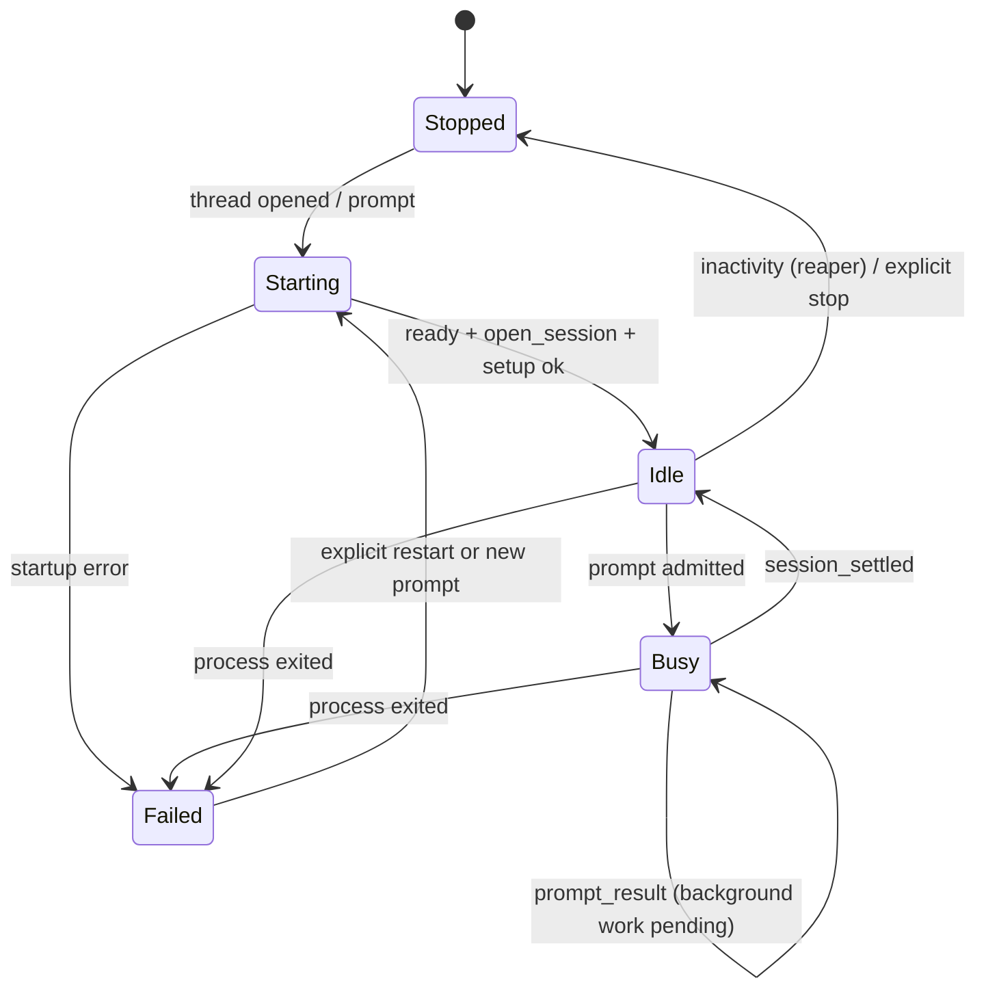

# 02 — Daemon (`omfp daemon`)

The daemon owns repositories, workspaces, threads and omp processes. It serves the protocol in [03](03-protocol.md) and, in web
mode, the UI's static files.

## Startup and configuration

```text
omfp daemon [--bind 127.0.0.1:7420] [--data-dir DIR] [--omp-bin PATH] [--static-dir DIR] [--allow-omp-mismatch]
            [--allowed-origin ORIGIN]… [--theme-file PATH] [--no-title-generation] [--config FILE]
```

| ID | Requirement |
| --- | --- |
| DMN-001 | On startup the daemon MUST run `omp --version` and compare it with `omfp_core::OMP_VERSION` (the version of the `omp-rpc` tag, see [01](01-dev-environment.md)). On mismatch it MUST refuse to start unless `--allow-omp-mismatch` is given, in which case a warning is also shown in the UI. |
| DMN-002 | The default `--bind` MUST be `127.0.0.1:7420`; any address and port MAY be configured. Exposure beyond the machine (tunnels, reverse proxies, TLS) is the deployer's job (D-13). |
| DMN-003 | On first run the daemon MUST generate a random token (≥ 256 bits) in `<data-dir>/token` with mode `0600`; every WebSocket connection MUST present it (see PRT-002). A stored token file that group or others may access MUST be tightened to `0600` on load, with a warning (delete it and restart to get a new token if others could read it); one that cannot be tightened (another user's file) fails startup. |
| DMN-004 | The daemon MUST also work as a library (`omfp_daemon::start(config) -> DaemonHandle` exposing the bound address and token) for in-process use by the desktop app (ARC-003). |
| DMN-005 | On SIGTERM/SIGINT or `DaemonHandle::shutdown` the daemon MUST stop every omp process and finish within 10 s. Stopping closes the `omp-rpc` client, which closes omp's stdin and then terminates its process group (SIGTERM, SIGKILL after 1 s); omp-rpc 18.22.0 gives omp no longer drain window. |
| DMN-006 | The omp binary MUST be resolved in this order: `--omp-bin`; the omp bundled next to the daemon executable (packaging, D-14); `omp` on `PATH` (dev shell). The resolved path is logged at startup. |
| DMN-007 | At most one daemon MUST run per data directory (exclusive lock file). A running daemon MUST publish its address in `<data-dir>/daemon.json` (removed on shutdown), so local clients such as `omfp desktop` can find it and authenticate with the `token` file (D-16). |
| DMN-008 | The web UI bundle MUST be resolved in this order: `--static-dir`; the `web/` directory next to the daemon executable when it holds an `index.html` (packaging: the release bundle of `just build-web`, `ui/packages/app/dist`, ships there); the `Resources/web/` directory beside the executable's directory when it holds an `index.html` (the release `omfp.app`: `Contents/MacOS/omfp` and `Contents/Resources/web`, ENV-063); otherwise only the API is served and a warning is logged. The bundle is served at `/`, unknown paths fall back to `index.html`. `index.html` is sent with `Cache-Control: no-store` and, except at `/kit` (UI-173), with the window's appearance from `[ui]` on its `<html>` tag (UI-091). |
| DMN-009 | The daemon MUST read an optional TOML config file, `$XDG_CONFIG_HOME/omfp/config.toml` (else `~/.config/omfp/config.toml`; `--config <file>` picks another): `[daemon]` holds every `omfp daemon` option under the flag's name in snake case (`bind`, `data_dir`, `workspaces_root`, `omp_bin`, `static_dir`, `idle_timeout_minutes`, `max_processes`, `event_buffer`, `theme_file`, `title_generation`, …; `~` expanded), except the repeatable `--allowed-origin`, which is the list `allowed_origins` (DMN-140); precedence is flag > file > default; unknown keys are an error naming the key. `[ui]` (UI-097) and `[keymap]` are UI settings the daemon keeps and serves (`settings.get`, pushed to every window on change); the daemon re-reads the file when it changes (polling; a change applies once the file settled, DMN-091) and applies `[ui]`/`[keymap]` live, while `[daemon]` changes need a restart (logged). `settings.set` (e.g. from `:set`) writes the change back into the file, preserving comments and other keys where possible. An invalid file is reported at startup (fatal) or, on reload, logged and shown in the UI while the previous settings stay. |
| DMN-091 | A file the daemon follows by polling — the theme file (DMN-075) and the config file (DMN-009) — MUST apply a change only once two consecutive reads agree on its size, modification time and content (or both find it missing): a writer that is not atomic (matugen truncates, then writes) is never read halfway. The startup read applies the file only when an immediate second read agrees; otherwise the first poll that sees it settled does. A change therefore applies one poll (1 s) after the file settled. |
| DMN-128 | **Tray icon** (desktop build): `omfp daemon --tray` (the flag exists only with the `desktop` feature; `omfp desktop` passes it to the background daemon it starts, ARC-003, so a daemon on a server stays headless) MUST show itself as a KDE/freedesktop StatusNotifierItem (`org.kde.StatusNotifierItem`, object `/StatusNotifierItem`, owning `org.kde.StatusNotifierItem-<pid>-1`) with a `com.canonical.dbusmenu` menu (`/MenuBar`) on the session bus, over gio's D-Bus API (no other D-Bus crate), and register with `org.kde.StatusNotifierWatcher` (`RegisterStatusNotifierItem`) — again with every watcher that appears later (a panel restart). Without a session bus it logs `no tray icon: no session bus` once and runs without a tray; without a watcher it logs once that none is on the bus and registers when one appears. The tray has a private connection to the session bus (gio's shared one exits the process when the bus goes away): when its bus closes, the daemon MUST keep running, log once that the session bus closed, look for a session bus every 2 s and register again on the first one that answers. The SIGINT/SIGTERM handlers are installed before the daemon prints its URL. `Activate` (left click) opens a new window (`omfp desktop --data-dir <data dir>`, detached like the daemon). The menu and icon are UI-217..219. |
| DMN-129 | The tray MUST follow the daemon's own thread index live (`DaemonHandle::threads()`, a watch of the `index` topic's thread summaries replaced on every thread event): on a change that alters what it shows, the menu's revision goes up with `LayoutUpdated(revision, 0)`, the item emits `NewToolTip`, and when the icon changes `NewIcon`, `NewAttentionIcon` and `NewStatus` (`Active`, `NeedsAttention` while a thread needs the user). |
| DMN-130 | The tray's `Quit daemon` MUST stop the daemon with one click through the shutdown of DMN-005 (`StopRequest`, as SIGTERM: omp processes and jobs stop cleanly, `daemon.json` is removed, the process exits 0); the icon is removed (the bus name released) before the shutdown starts. |
| DMN-170 | (M11) **Data directory default**: without `--data-dir` (or `data_dir` in the config file) the data directory MUST be `$XDG_DATA_HOME/omfp` when `XDG_DATA_HOME` is absolute, else `~/.local/share/omfp` on Linux and `~/Library/Application Support/omfp` on macOS (`omfp_daemon::config::default_data_dir`, which every `omfp` subcommand that finds the local daemon shares). The config and theme files stay in `$XDG_CONFIG_HOME/omfp`, else `~/.config/omfp`, on macOS too (dotfiles and theme generators write there). Moving from an earlier macOS build: `mv ~/.local/share/omfp ~/Library/Application\ Support/omfp` while no daemon runs. |
| DMN-171 | (M11) **Menu bar item on macOS**: `omfp daemon --tray` on macOS MUST run AppKit's event loop (Tauri's, with no window, no Dock icon and no app menu: an accessory app) on the main thread and the daemon (`run_with`, its own tokio runtime) on another thread, and show the tray model of DMN-128..DMN-130 as an `NSStatusItem` (UI-254) that follows `DaemonHandle::threads()`. AppKit objects are built, updated and dropped on the main thread only (`run_on_main_thread`); the item is removed before the shutdown starts; the end of the daemon thread, a panic included, ends the event loop. Without a menu bar the daemon logs `no menu bar item: …` and runs on; with it, `in the menu bar`. |
| DMN-180 | **Private data directory**: the daemon (and `omfp desktop` when it starts one) MUST create the data directory with mode `0700`; an existing one this user owns that group or others may access is tightened to `0700` with a log line (`omfp desktop`: on stderr), one of another user is left alone. The files they write there are created `0600`: `token`, `daemon.json`, `daemon.lock`, `omfp.db` (SQLite gives its journal files the database's mode), `daemon.log` and each thread's `omp.log` (an existing log others may read is tightened when opened). |
| DMN-225 | **Files replaced in one step**: every file the daemon rewrites — a workspace file (DMN-090), `views.json` (`views.set`, DMN-083) and a mount's code (`views.mount`, PRT-080), the config file (`settings.set`, DMN-009), `daemon.json` and the `widget-builder` agent (DMN-107) — MUST go through one helper (`paths::replace_file`): a temporary file in the target's folder named after the target, the daemon's pid and a per-call counter (two writes of one file never share it), flushed to disk (`fsync`) and renamed over the target, removed when any step fails; it takes the mode of the file it replaces unless the caller gives one (`daemon.json`: `0600`), and creates a missing folder. A reader never sees half a file. |
| DMN-181 | **The token URL only to a terminal**: `omfp daemon` MUST print `omfp daemon listening on http://<addr>/#token=<token>` only when its stdout is a terminal; otherwise (`daemon.log`, a pipe) it prints the URL without the token, ``omfp daemon listening on http://<addr>/ (open it with `omfp desktop`, or add #token=<token> from <data-dir>/token)``. `omfp desktop` prints `omfp desktop: <url>` the same way (UI-004): `#token=` only to a terminal, else `omfp desktop: http://<addr>/ (add #token=<token> from <data-dir>/token)` (with `--connect`, without the file). The tray's children (`omfp desktop`, `xdg-open`, `open`) get stdout `/dev/null`, so nothing they print reaches `daemon.log`. |
| DMN-355 | **Outliving its terminal**: `omfp daemon` (and `omfp desktop`) started from a terminal that is closed later MUST keep running and serving: every write to its stdout and stderr then fails (`EIO`, or `EPIPE` for a closed pipe), so a log line or diagnostic that cannot be written is dropped (the log subscriber reports no internal write errors; the binary's own diagnostics go through a `note!` that ignores the write's result), never a panic of the task that wrote it. A daemon meant to outlive a session is better started by `omfp desktop` or a service, which log to `daemon.log` or the journal. |
| DMN-182 | **The desktop window stays on the daemon's origin** (Linux and macOS): the window MUST grant its permissions (notifications, on macOS the microphone, UI-251) only while its top-level page (as its page loads report it) is on the daemon's origin, and deny them to any other page. Neither WebKitGTK nor WKWebView tells Tauri's navigation handler whether a frame or the page navigates, so a navigation to another `http(s)` URL loads — the web frames of `omfp:web` (UI-677) — and the top-level page turns back from it once its load starts: the window goes back to the daemon's page it showed last and the system's browser opens the URL (UI-678), so a top-level external navigation without `_blank` (a plain link or `location` change in widget code) ends in the browser too, at the cost of a reload of the UI. A `mailto:` link is cancelled without opening anything (a widget's frame must not open the mail client at every render of every window); `about:`, `blob:` and `data:` documents load; any other scheme (`file:`…) is cancelled. A new-window request (`target="_blank"`, `window.open`) never opens a webview: an external `http(s)` or `mailto:` URL is opened by the system (`OpenURI` of the desktop portal, else `xdg-open`; `/usr/bin/open` on macOS); the UI's Markdown and tool-card links use `_blank`. The same handlers serve Linux and macOS. On macOS `omfp-notify:` (UI-252) is honoured only with the window's random nonce, which only the notification script of the daemon's top-level page knows. |
| DMN-184 | **WebSocket connections before `system.hello`**: a connection that has not completed `system.hello` within 10 s MUST be closed with 4401 (`system.hello timed out`, PRT-001), and at most 64 connections MAY wait for their hello at once: a further upgrade gets `503` until one of them authenticates (its place is freed once its token checked out, before the answer) or closes. |
| DMN-140 | **`Origin` allow-list** (D-13, M9): `[daemon] allowed_origins = ["https://omfp.example.ts.net", …]` in the config file, or the repeatable `--allowed-origin <origin>` (the flags replace the file's list, DMN-009), MUST name the origins a browser may open the WebSocket from besides the daemon's own (PRT-003, PRT-070): the URL the UI is reached at through a tunnel or a reverse proxy that does not pass the browser's `Host` on. The list only widens the `Origin` check; the token (PRT-002) is still required. The HTTP routes (bundle, `/theme.css`, keyed widget modules) check no `Origin`, as before. A refused upgrade is `403` and logged with its `Origin` and `Host`. |
| DMN-141 | Every allow-list entry MUST be an origin as a browser sends it, `http(s)://host[:port]`, and is normalized to that form (scheme and host lowercased, the scheme's default port and a trailing `/` dropped: `HTTPS://Omfp.Example.ts.net:443/` is `https://omfp.example.ts.net`). An invalid entry — another scheme, no scheme, a path, a query, a fragment, user info, a bad port — MUST fail startup with a message naming the entry, where it comes from (`--allowed-origin` or `allowed_origins` in `<file>`) and the expected form. `*` and any other wildcard MUST be refused with the reason: any page matching it could drive the daemon's WebSocket (cross-site WebSocket hijacking), so each origin is listed. |

Behind a tunnel or reverse proxy (DMN-140): a proxy that passes the browser's `Host` on makes the page's origin the
daemon's own (`http(s)://<Host>`), so nothing needs configuring; one that sets `Host` to the daemon's address (nginx's
default `proxy_set_header Host $proxy_host`, a Cloudflare Tunnel's `httpHostHeader`) needs the public URL listed:

```toml
[daemon]
allowed_origins = ["https://omfp.example.ts.net"]  # exactly scheme://host[:port], no path, no `*`
```

## Persistence (SQLite)

Schema (`PRAGMA user_version = 11`; migration 2 adds `created_client`; migration 3 moves to workspace folders, D-11;
migration 4 adds `title_source`, DMN-073; migration 5 drops the old `repositories` registry and adds `seen_repositories`;
migration 6 drops `thread_tags` and `workspaces.owned` and moves every workspace into a folder under the workspaces
root, DMN-020; migration 7 adds `widget_state`, DMN-086; migration 8 adds `activity`, DMN-160; migration 9 makes
`activity.thread_id` nullable for the MCP principal's calls, AGT-053; migration 10 adds `prompt_history`, DMN-216;
migration 11 adds `workspaces.position` and `threads.position`, DMN-280):

| Table | Main columns |
| --- | --- |
| `seen_repositories` | `path` (canonical, unique), `last_seen_at` — every repository the daemon has found in any workspace, for suggestions (DMN-021) |
| `workspaces` | `id` (ULID), `name`, `path` (absolute, unique; a folder the daemon made under the workspaces root), `created_by` (`user` \| `mcp` \| thread id), `created_client` (nullable, PRT-033), `created_at` |
| `threads` | `id` (ULID), `title`, `title_source` (`placeholder` \| `generated` \| `set`; `set` for threads older than migration 4), `workspace_id`, `session_dir`, `omp_session_id` (nullable), `approval_mode` (nullable; new threads get `yolo`, DMN-074), `model` (nullable, `provider/id`), `thinking_level` (nullable), `created_by` (`user` \| `mcp` \| thread id), `created_client` (nullable), `created_at`, `archived_at` (nullable) |
| `thread_roots` | `thread_id`, `path` — the `--add-dir` roots last given to the thread's omp session (DMN-029) |
| `settings` | `key`, `value` (JSON); `theme`: the user's theme CSS, a string or `null` (DMN-075) |
| `widget_state` | `workspace_id`, `instance`, `key`, `value` (JSON) — what widgets keep with `useStored` (DMN-086); deleted with the workspace |
| `activity` | `seq` (increasing), `at`, `thread_id` (nullable: `null` for the MCP principal), `client`, `method`, `params` (JSON), `error` (nullable) — the agent-originated actions (AGT-072, DMN-160); no foreign key, so entries outlive their thread |
| `prompt_history` | `text` (primary key), `thread_id`, `workspace_id`, `at` — the prompts the user sent from omfp, each text once with its latest submission (DMN-216); no foreign key, so prompts outlive their thread and workspace |

Repositories inside a workspace are not stored: they are discovered from the folder (DMN-022).

| ID | Requirement |
| --- | --- |
| DMN-010 | Migrations MUST be embedded in the binary and applied in order using `PRAGMA user_version`, each in its own transaction. |
| DMN-011 | The database MUST use `journal_mode=WAL` and `foreign_keys=ON`. |
| DMN-012 | Transcripts are NOT stored in the database: the source of truth is omp's `.jsonl` session in the thread's `session_dir`. |

## Workspaces and their repositories

A workspace is a folder; its repositories are the folder's top-level entries (D-11, verified in S-10). A `Git` port
(trait) with a real implementation over the `git` CLI (`tokio::process`) and a fake one for tests. A `Forge` port
resolves PRs; first implementation over the `gh` CLI **[VERIFY in S-08]** (postponed with PR repositories, 07 "Later").

| ID | Requirement |
| --- | --- |
| DMN-020 | Creating a workspace MUST make a new folder `<workspaces-root>/<slug>` (`--workspaces-root`, default `~/.omfp`, a hidden folder in the home directory); there is no other kind of workspace (an existing folder is never recorded as one). With `link { path }` the same call also adds a link to that repository as `workspaces.add_repo` does (DMN-024; checked before anything is created, so a bad path creates nothing), and the name defaults to the target's folder name (made unique). Names and paths are unique. Migration 6 moves every older workspace whose folder is not under the workspaces root into a new folder `<root>/<slug of its name>` (unique) holding one link, named after the old folder, to it (whatever it holds); the workspace keeps its id and name, so its threads keep their sessions (omp resumes a session whatever the cwd, S-10) and the old folder is never touched. `threads.create` MUST require an explicit `workspace`: `{ id }` uses an existing workspace and `{ new: { name?, link? } }` creates one, including explicit `{ new: {} }`. A missing workspace is rejected with both choices before creating any thread or workspace; it never implies a current workspace. |
| DMN-021 | There is no repository registry. To make adding repos quick the daemon MUST offer **suggestions**: `repos.suggest { query? }` returns the repositories it has seen in any workspace (the canonical path of links and clones, the main repository of worktrees; recorded on every scan, most recent first, filtered by `query`), and `fs.complete { path }` returns the child directories of a path on the daemon host (`~` expanded), marking git roots, so a path can be typed with completion even when the browser is remote. |
| DMN-022 | The daemon MUST discover a workspace's repositories by scanning its folder: the folder itself when it is a git root, and every top-level entry that is a git root, following symlinks. Each repo has a `name` (entry name), its `path` inside the workspace (the symlink path, never the target), and a `kind`: `link` (symlink; with its target), `worktree` (linked worktree; with the main repository from `git rev-parse --git-common-dir`), or `clone`; plus branch and HEAD. Non-git entries, hidden entries (names starting with `.`, such as `.omp`) and anything deeper are ignored. |
| DMN-023 | The daemon MUST rescan a workspace on startup, on every workspace method, after every `tool_execution_end` of a thread in it except read-only tools (`read`, `grep`, `glob`, `find`, `ast_grep`, `web_search`, `todo`, `ask`, `lsp` and omfp's read-only tools; unknown tools count as writers), and on `workspaces.rescan`; a change updates the `index` topic. After such a `tool_execution_end` it also refreshes the git status of `workspace/<id>` (a full scan), since an edit of a tracked file changes nothing the cheap check below sees. It MUST also poll every **watched** workspace — open in a window (a subscriber of `workspace/<id>` or of the `thread/<id>` topic of one of its threads) or holding a thread whose omp runs — every 2 s with a **cheap check**: the metadata (mtime, size, inode) of the folder and of its top-level entries, and of `HEAD` and `index` in the git dir of each repository (resolved through links, and through the `.git` file of linked worktrees). A full scan (git calls: the rescan, then the git status of `workspace/<id>`) runs only when that fingerprint changed, and the fingerprint is taken after the scan, so files git rewrites while scanning do not trigger another. Each watched workspace also gets a full scan every 30 s (edits outside omfp that touch no index). Unwatched workspaces are not polled; no filesystem watcher is used. |
| DMN-024 | Adding a repository to a workspace MUST support: `link` (create a symlink `<name> → <path>`), `worktree` (`git worktree add <workspace>/<name>` on a new branch from `baseRef`, default branch `omfp/<slug>-<suffix>` unique in the repo, or on an existing branch; the repository given by any path inside it, e.g. a suggestion of DMN-021) and `clone` (`git clone <url> <name>`). There is no pull request source: the user left PRs to the agent, which runs `gh pr checkout` itself (S-08, 07 "Later"). The UI offers link and clone only (UI-025); `worktree` stays in the protocol for scripts and agents, which also create worktrees with `git worktree add`. |
| DMN-025 | Removing a repository from a workspace MUST: for `link`, delete the symlink only (never the target); for `worktree`, run `git worktree remove`, refusing with uncommitted changes unless forced, keeping the branch unless asked; for `clone`, delete the folder only when forced or clean. Git operations on the same repository MUST be serialized (per-repository lock). |
| DMN-026 | For each repository in a workspace the daemon MUST report: branch, commits ahead/behind its upstream or base, changed files, the diff (`git diff <base>...HEAD` plus uncommitted changes) and, once PR repositories exist (07 "Later"), the linked PR, for the `omfp:changes` widget (UI-080). |
| DMN-027 | The daemon MUST expose which threads use each workspace and which workspaces contain the same repository (same canonical path), so the UI can warn about concurrent edits. It MUST NOT forbid either. |
| DMN-028 | Removing a workspace MUST refuse while it has threads that are not deleted (the UI offers to delete them first), a thread whose deletion has not finished included (DMN-039). Then it removes the workspace's repositories as in DMN-025 — links unlinked (never the target), clones deleted only when clean or forced, worktrees removed with `git worktree remove`, refusing when dirty unless forced — and deletes the folder. Nothing outside the workspace folder is ever deleted. |

### Files of a workspace (M5c)

The file viewer and editor (`omfp:file`, UI-110..116) reads and writes files through the daemon, which may run on
another machine than the window.

| ID | Requirement |
| --- | --- |
| DMN-089 | `workspaces.read_file { workspaceId, path, knownHash? }` MUST return the file `path` of the workspace: `path` is relative to the workspace folder or absolute; `..` is resolved without following links, and a relative path that then leaves the workspace folder is `bad_request` (links inside the folder, such as linked repositories, are followed when reading: they are the workspace's); an absolute path outside the folder is read as DMN-310 says. A relative path the folder does not hold is looked up in each repository of the workspace (`<repo>/<path>`, in scan order); the result's `path` is the one found, relative to the workspace folder. A missing file is `not_found`, a directory `bad_request`. The result carries `kind` (`text`: UTF-8 without NUL bytes; `image` by extension; else `binary`), `size`, `hash` (hex SHA-1 of the bytes), `content` (the text, cut at the last line end before 2 MiB with `truncated: true`; an image's bytes in base64 up to 8 MiB with its `mime`; nothing for binaries), `repo` (the name of the workspace repository holding it) and `head` (its text at `HEAD` of that repository, `git show HEAD:<path>`; absent when `HEAD` does not have it, for binary or truncated files and outside repositories) and, for an image, `headHash` (the hex SHA-1 of its bytes at `HEAD`, whatever its size, DMN-255; absent when `HEAD` does not have it and outside repositories). When `knownHash` equals the file's hash the result is `unchanged: true` without `content`, `head` or `headHash`, so a window can check an open file cheaply. |
| DMN-090 | `workspaces.write_file { workspaceId, path, content, expectedHash? }` MUST write `content` to the file `path` (resolved and refused as in DMN-089, without the lookup in repositories; an absolute path outside the folder is refused, DMN-313) only when the file still has `expectedHash`, or, without `expectedHash`, when it does not exist; otherwise it answers `conflict` and writes nothing, so a change on disk is never overwritten silently. The write is atomic (a temporary file in the target's folder renamed over it, keeping its permissions; a symbolic link is written through, to its target) and creates no folder. It answers `{ path, hash, size }`, then rescans the workspace and refreshes the git status of `workspace/<id>` (DMN-023), as after an agent's edit. |
| DMN-092 | `workspaces.find_file { workspaceId, query, threadId?, fuzzy? }` MUST search files across **all** repositories and the workspace folder, returning `{ candidates: [{ path, repo?, match, mentioned }], truncated }`, best first, at most 50 with `truncated` when more matched. By default lookup is strict: a bare/partial path (`theme.ts`, `src/theme.ts`), `..` resolved/refused as DMN-089, no match for an absolute path outside (DMN-312). With `fuzzy: true`, `query` is text, not a path to resolve: its non-whitespace characters match a case-insensitive subsequence of the workspace-relative path; empty query lists files. The entire eligible inventory MUST be searched before limiting results, including nested workspace-folder files beyond 20,000 entries. Eligible repository files are tracked/untracked but not ignored (`git ls-files --cached --others --exclude-standard`), existing files only; outside repositories, non-hidden workspace files are walked without following directory links or imposing an enumeration cutoff. `path` is workspace-relative; `repo` names its repository. Match order is `exact` (relative path in workspace/repo), `suffix` (component-boundary suffix), `basename`, then `fuzzy`; ties prefer files mentioned by the selected thread's tool cards, then depth/path. Fuzzy mode never enumerates files outside the workspace inventory. |
| DMN-250 | **Raw workspace files** (M16): `GET <fileBase>/<workspaceId>/<path>` MUST answer the bytes of the workspace file `path` (resolved, refused and looked up in the repositories as in DMN-089, an absolute path outside the folder included, DMN-314; percent-encoded; an absolute path follows the id after one more `/`), any size and kind, for media elements and `fetch`, which cannot send the token in a header. `<fileBase>` is `/files/<key>`: `<key>` is a random 128-bit secret the daemon makes at startup, distinct from the widget key (DMN-084: a widget module's URL may show in an error report without opening the files), and gives only to authenticated clients in `system.hello` (PRT-150); it is valid until the daemon stops. A wrong or missing key, an unknown workspace, a relative path leaving the folder, a missing file and a directory are all the same `404` (`Cache-Control: no-store`). The query string is ignored, so a client may add one to load a changed file again. |
| DMN-251 | A raw file's `Content-Type` MUST come from its extension (case-insensitive: the images of DMN-089, `mp4`/`m4v`, `webm`, `mov`, `mkv`, `ogv`, `mp3`, `ogg`/`oga`/`opus`, `wav`, `flac`, `m4a`, `aac`, `pdf`, `json`, `wasm`, `csv`), else from its first 512 bytes (the magic numbers of PDF, PNG, JPEG, GIF, WebP, WAV, Ogg, FLAC, MP3 with ID3, MP4 and WebM; UTF-8 without NUL bytes as `text/plain; charset=utf-8`, HTML included), else `application/octet-stream`. |
| DMN-252 | **Byte ranges**: every raw file answer MUST carry `Accept-Ranges: bytes`. A `Range` of one `bytes=` range (`a-b`, `b` capped at the last byte; `a-`; the suffix `-n`) is answered `206` with `Content-Range: bytes a-b/<size>` and those bytes; a range starting at or past the end, or the suffix `-0`, is `416` with `Content-Range: bytes */<size>`; several ranges or a malformed header get the whole file (`200`). `HEAD` answers the same headers without the body. |
| DMN-253 | **Validators**: raw file answers MUST carry a strong `ETag` made of the file's size and modification time (not a hash: hashing a video on every request would cost more than sending it) and `Last-Modified`; `If-None-Match` naming that tag (or `*`) is answered `304`, and so is, without `If-None-Match`, an `If-Modified-Since` not before the modification time (to the second). With `If-Range`, a `Range` applies only when it names the current tag or `Last-Modified` date; otherwise the whole file is sent. |
| DMN-254 | **Raw files stay inert**: raw file answers MUST carry `X-Content-Type-Options: nosniff`, `Content-Security-Policy: sandbox` (a workspace's HTML or SVG opened at its URL runs nothing in the daemon's origin, where the window keeps its token), `Cross-Origin-Resource-Policy: same-origin` and `Cache-Control: private, no-cache` (revalidated on every use). The body is streamed a chunk at a time, never held whole. |
| DMN-255 | (M16) **A file at `HEAD`**: `GET <fileBase>/<workspaceId>/<path>?rev=HEAD` (the pair `rev=HEAD` among the query's, others ignored) MUST answer the bytes of the file at `HEAD` of the workspace repository holding it (`git show HEAD:<path>`, the path resolved as in DMN-250, the working copy need not exist), whole (`Accept-Ranges: none`), typed like the working copy (DMN-251), with the hex SHA-1 of the bytes as a strong `ETag` (`304` for an `If-None-Match` naming it) and the headers of DMN-254; a file `HEAD` does not have, a path outside every repository and every DMN-250 refusal are the same `404`. `workspaces.read_file` gives the same SHA-1 as an image's `headHash` (DMN-089), so a window knows whether the image differs from `HEAD` without fetching it. |

### Files outside the workspace folder (M17)

An agent may work on files outside its workspace folder — a git worktree it made elsewhere, `/etc/hosts`, a log — and
its tool cards name them by their absolute paths. The window reads them like workspace files, read-only. Why reading
is allowed: the protocol, the raw file route and every widget sit behind the daemon's token or the `fileBase` secret
given only to authenticated clients (PRT-002, PRT-150), and the daemon's agents already run with the user's full
access (D-17), reading anything the user's account may read; a window showing such a file reveals nothing an agent
of the same daemon could not read. Why writing is not: edits made through omfp stay where the workspace's rescans,
git status and conflict checks see them, and a slip of the editor cannot change a file elsewhere on the machine.

| ID | Requirement |
| --- | --- |
| DMN-310 | **Read by absolute path**: `workspaces.read_file` MUST read a file whose `path` is absolute and, `..` resolved without following links, outside the workspace folder (a path inside it stays a workspace file, DMN-089): any file the daemon's user may read, never looked up in the workspace's repositories, with the result's `path` the absolute path `..` resolved and `outside: true` (PRT-195); `kind`, `size`, `hash`, `content`, `truncated`, `mime` and `knownHash` behave as in DMN-089. A missing file is `not_found`, a directory `bad_request`. |
| DMN-311 | **`HEAD` of a file outside**: a file read as DMN-310 says that lies in a git working tree (`git rev-parse --show-toplevel` from its folder, a worktree included) MUST come with `repo`, the name of that working tree's folder, and `head` / `headHash` from its `HEAD` as in DMN-089; outside every working tree (or when git cannot tell) it has neither, and the file is still read. An `unchanged` answer skips git (the window polls open files, UI-110) and carries no `repo`. `?rev=HEAD` of the raw route (DMN-255) serves such a file's bytes at that `HEAD`. |
| DMN-312 | **Only absolute paths leave the folder**: a relative path escaping the workspace (`../x`, `app/../../x`) MUST be `bad_request` for reads, writes and default strict `workspaces.find_file`, and `404` on the raw route. Only an explicit absolute path reads outside; strict `find_file` answers no candidate for an outside absolute path (UI-705). Fuzzy search accepts query text, not a path to resolve, and searches only the workspace inventory (DMN-092). |
| DMN-313 | **Writes stay in the folder**: `workspaces.write_file` MUST refuse an absolute path outside the workspace folder with `bad_request` (`"<path>" is outside the workspace folder: it can be read, not written`), before touching the disk: no file is written or created there, whatever `expectedHash` says. |
| DMN-314 | **Raw bytes of a file outside**: `GET <fileBase>/<workspaceId>/<absolute path>` (the path after one more `/`, DMN-250) MUST serve a file outside the workspace folder as DMN-310 reads it, with the types, ranges, validators and headers of DMN-251..DMN-254, so `useFileUrl` (UI-703) and the viewers of `omfp:file` (images, media, PDF) show it; the `404`s of DMN-250 apply (a wrong key, an unknown workspace, a relative path leaving the folder, a missing file, a folder). |
| DMN-315 | **Unreadable files**: a file the daemon's user may not read (`EACCES`, inside the folder or outside it) MUST be `bad_request` `"<path>" cannot be read: permission denied` for `workspaces.read_file` (and a `404` on the raw route), never `internal`. |

### Threads in a workspace

| ID | Requirement |
| --- | --- |
| DMN-029 | A thread's omp MUST run with cwd = its workspace folder and one `--add-dir <repo path>` per discovered repository except the folder itself (S-10: without them omp sees no repo context). Because omp merges roots saved in the session with the flags, the daemon MUST keep `thread_roots` in sync: after start and after every rescan of a live thread it sends `/add-dir` for new repos and `/remove-dir` for roots that disappeared, through `prompt` (local commands, no model turn). omp refuses both while the agent streams, so a busy thread's sync runs once its session settles. The sync is the daemon's housekeeping, not the thread's doing: the one `command_output` omp writes before answering each command MUST NOT reach the thread's log (no notice, no state change, so no index change and no new `updatedAt`, UI-020) and the sync is no activity of the thread (DMN-034). Its commands run one at a time with the daemon's other local commands (DMN-191); the frames carry no id, so while a command waits (up to 10 s) only a text omp writes for that command and path is its output (`Added <path>.`, `Removed <path>.`, `Already in the workspace: <path>`, `Not a workspace directory: <path>`, `Directory does not exist: <path>`, `Not a directory: <path>`, `Cannot add/remove a directory while streaming.`, `Cannot remove the working directory…`; `supervisor/roots.rs`); any other `command_output` meanwhile, such as a background `/mcp reauth`'s, is logged and acted on as usual (DMN-200, DMN-202). |
| DMN-280 | **The order of the left column** (M17) MUST be kept by the daemon: `workspaces.position` orders the workspaces, `threads.position` the threads of a workspace, archived ones included (smallest first, ties by id; migration 11 starts with the order the column showed: workspaces by name ignoring case, then id, threads oldest first). A new workspace goes after every other, a new thread after every other of its workspace. |
| DMN-281 | `workspaces.reorder { workspaceId, beforeId? }` MUST put the workspace just before `beforeId`, or last, and number the workspaces again from 0, in one transaction; unknown `workspaceId` is `not_found`, `beforeId` = `workspaceId` `bad_request`. |
| DMN-282 | `threads.reorder { threadId, workspaceId?, beforeId? }` MUST put the thread just before `beforeId` (a thread of the target workspace), or last, in its own workspace or in `workspaceId`, in one transaction; unknown thread or workspace is `not_found`, `beforeId` = `threadId` `bad_request`. Archived threads have their place too. |
| DMN-283 | **Moving a thread to another workspace** (`threads.reorder` with another `workspaceId`) MUST go through the restart routine's locks (DMN-227, `Supervisor::relocate`): refused with `conflict` while its omp runs a turn or waits on a dialog (nothing moves); else the record changes and a running omp stops and starts at once in the new folder (its roots follow at start, DMN-029; the session resumes), whatever background work it had; a stopped thread starts there next time. |
| DMN-284 | The `index` topic MUST carry the order: `position` on every `Workspace` (among the workspaces) and `ThreadSummary` (among its workspace's threads), counted from 0 without gaps; a reorder publishes the summaries whose place changed and never changes their `updatedAt`, a move to another workspace included (a new place is the user's own doing, not news: no window marks the thread unread, UI-020). |
| DMN-285 | **Concurrent reorders** from several windows MUST apply one after the other, each to the order the previous left (one transaction each; a reorder within a thread's workspace reads that workspace in the same transaction); a `beforeId` no longer in the target (moved or deleted meanwhile) is `conflict` and nothing changes. |

Each thread keeps a private directory `threads/<id>/` (omp sessions, `omp.log`); it is not the cwd and never a
workspace.

## Agent supervision

Each thread has an actor (tokio task) that owns its `omp_rpc::Client`. The client is blocking: calls go through
`spawn_blocking`, and a dedicated thread reads the event receiver and forwards into a tokio channel.

### Process states



`AwaitingInput` is not a process state but an attribute: there are pending interactive requests (approval, `ask`,
dialogs).

| ID | Requirement |
| --- | --- |
| DMN-030 | The process MUST be started as `omp --mode rpc-ui --session-dir <thread sessions> --continue` with cwd = the thread's workspace folder, one `--add-dir <repo path>` per discovered repository (DMN-029), `--approval-mode` and `--model` when set on the thread (`threads.create`, `thread.set_model`: an explicit `--model` overrides the model the session saved, which omp otherwise restores or refuses to start without, DMN-339), and `--append-system-prompt` carrying the daemon's workspace conventions (actual workspace id, name and path; repositories are its top-level entries; bring a project in with a symlink, isolate a branch with `git worktree add` into the workspace, clone into it; never nest repos deeper) followed by the widgets note (AGT-024), the control note (AGT-045) and the user's own append prompt, which the flag would otherwise disable: `<workspace>/.omp/APPEND_SYSTEM.md` if present, else `<agent dir>/APPEND_SYSTEM.md` (S-10), then `--extension <data-dir>/omp` (DMN-107). The daemon MUST NOT write files into the repositories of a workspace for this: the workspace folder itself is omfp's, and its `.omfp/` is omfp's configuration of the workspace (DMN-088). Binding the session at launch is required: S-07 found that `--add-dir` roots do not survive a later `open_session` to another session. |
| DMN-031 | After the `ready` frame the daemon MUST check that protocol v2 was negotiated (`omp-rpc` does it), register its host tools (at connect, through `omp-rpc`), then send in order: `open_session { sessionDir }` (a no-op on the session bound at launch that reports whether it was resumed), `set_event_filter { events: null, messageUpdates: "delta" }` (sent as the daemon's own frame: the generated command of omp-rpc 18.22.0 lacks `messageUpdates`), `set_subagent_subscription { level: "progress" }`, `set_ask_dialog { enabled: true }`. A failure in any step moves the thread to `Failed` with the error message. |
| DMN-032 | After `open_session` the daemon MUST store `sessionId` in `threads.omp_session_id` and load history with `get_messages` (paged by `omp-rpc`) as the reducer's initial event. When omp does not start, the history comes from the session file instead (DMN-337). |
| DMN-033 | Before starting omp on a thread that already has `omp_session_id`, the daemon MUST check the session lease (`omp session lease --json -- <id>`): if another omp process owns the session, startup MUST fail with an error saying so (e.g. the session is open in an external terminal). |
| DMN-034 | A process that is `Idle`, settled, and not watched by any client (PRT-025: a subscription that only keeps the thread does not watch it, PRT-222) MUST be stopped after `idle_timeout` (default 15 minutes, configurable), counted from the moment the last watching subscription ended or stopped watching. A `Busy` process or one with pending interactive requests is never stopped. |
| DMN-356 | **Kept threads do not hold their omp**: a thread whose only subscriptions keep it unwatched (`watch: false`, PRT-222: windows keep hidden threads this way, UI-997) MUST be stopped by the idle reaper like an unwatched one (DMN-034); those subscriptions stay and receive the stop, so the window keeps the transcript and shows the stopped state. A subscription switched back to watching (`watch`, PRT-223) blocks the reaper again; nothing restarts the process until the thread is used (a command that needs omp, DMN-070), as for any stopped thread. |
| DMN-365 | (M9) **Dormant threads give their memory back**: the idle reaper (DMN-034) MUST forget, on each pass, the in-memory actor (its event log: the reduced conversation and the replay tail, DMN-041) of every thread that has no omp process, whose status is the one the thread list shows for a thread the daemon never loaded (`Stopped`, settled, nothing needing attention, no restart pending), that holds nothing a session file cannot give back (no live session or unrecorded voice conversation, DMN-113; no fork source, DMN-301; no saved model of a failed start, DMN-338; no running title generation) and that has not been used for `idle_timeout`, counted like DMN-034's, and only when nothing else holds the actor or its log (a subscription, watching or kept, PRT-222, which takes its hold before it reads the history, DMN-359, so the history it reads is the one it shows; an operation under way; a reader such as `omfp_thread_wait` or a prompt job): that check runs under the lock of the actor map, the only way to reach either. The thread's records and files stay. Showing it again reads its history from its session file (DMN-359) in a new epoch (PRT-020: a client's old position gets a snapshot), as after a daemon restart; what only memory held (the daemon's notices) is gone, as after one. |
| DMN-366 | (M9) **Freed memory goes back to the system**: on Linux the `omfp` binary MUST allocate with jemalloc and its background threads (`tikv-jemallocator`, `background_threads`), which give the pages of freed memory back to the system within seconds while the daemon idles; the Nix package links nixpkgs' `rust-jemalloc-sys` (the cargo setup hook's `JEMALLOC_OVERRIDE`) built with the same `background_thread:true` default. glibc's malloc keeps freed memory in its arenas, so a daemon that read long conversations and forgot them (DMN-365) stayed near the size of its largest moment: with 20 long threads shown, then forgotten, the daemon's RSS went from 1.27 GB to 1.14 GB with glibc, from 1.07 GB to 53 MB with jemalloc within 30 s. macOS keeps its system allocator. |
| DMN-035 | If the process exits unexpectedly, the thread MUST move to `Failed` with the last stderr lines (and the exit code when available — omp-rpc 18.22.0 does not expose it); pending interactive requests MUST be cancelled towards the UI. Restart happens only on the user's next command. |
| DMN-036 | omp's stderr MUST be written to a per-thread log file (`<data-dir>/threads/<id>/omp.log`, rotated) and never mixed with protocol stdout. |
| DMN-337 | **History without omp**: when a thread's omp cannot start (the launch fails, e.g. omp 18.22.0 exits with `SessionModelRestoreError: Could not restore model <provider/id>` when the session's saved model is unusable and no `--model` overrides it; a session another process owns, DMN-033; the session lease probe or the host URIs fail), the daemon MUST read the stored session's file without omp (`session_file.rs`: the file of `omp_session_id` in the session directory, DMN-213, else its newest `*.jsonl`, as `--continue` resumes) and push its current branch as the thread's `history` event before the `Failed` state, so the conversation stays readable. The branch is omp's (`resolveSessionLeafId`, `buildSessionContext`): from the leaf the last entry selects (its `activeLeafId`, else itself; a missing leaf falls back to the newest entry selecting itself) up its `parentId`s; its messages are what `get_messages` answers after a resume: after the latest `reset_boundary` when it follows the latest `compaction`; else with a compaction, its summary, the entries from its `firstKeptEntryId` and those after it; `message` entries (not an assistant's `retryRecovery` nor an empty error turn), `custom_message` (not omp's hidden `prewalk-plan`/`vibe-mode-context`) and `branch_summary` (not a rewind's, whose `rewind-report` follows) entries. Without a session file nothing is pushed; an unreadable one is only logged. |
| DMN-338 | **The saved model**: the same read MUST give the model the stored session restores, `provider/id` of the last `model_change` of role `default` on the branch, else (sessions older than `model_change`) the last assistant message's `provider/model`; the daemon keeps it for `thread.session`'s `sessionModel` (PRT-211) until omp next starts. It never selects or stores a model by itself: the user decides (DMN-339, UI-751). |
| DMN-339 | **Model change without a running omp**: `thread.set_model { provider, modelId }` on a thread whose omp runs MUST forward omp `set_model`, then store `provider/id` on the thread; on a thread whose omp does not run (stopped, or failed because its saved model is unusable) it MUST store it first, then start omp under the lifecycle lock with that `--model` (DMN-030) on the same session (`--continue`), never needing the saved model; a failed start answers its error (DMN-212) and keeps the stored choice. |
| DMN-037 | Lifecycle operations on a thread (start, stop, restart, root sync after a rescan (DMN-029)) MUST be serialized by its actor. omp commands are forwarded without waiting for each other, because omp orders them itself and some must overtake a running one (`abort` during `compact`, `steer` during a turn). Different threads proceed in parallel. |
| DMN-038 | The maximum number of concurrent omp processes MUST be configurable (default 64); beyond the limit, starting a stopped thread MUST fail with an explicit error (no silent queueing). |
| DMN-039 | **Deleting a thread** (`threads.delete`, and a thread `threads.create`, `threads.fork` or a prompt run made whose omp could not start) MUST delete the thread's records first, then stop its omp process (waiting for a start already under way, which holds the thread's lifecycle lock, DMN-037), then remove its directory, and only then answer and publish the index: every start reads the records under that lock, so none begins once they are gone, and no omp (which creates `threads/<id>/` at launch) recreates the directory after its removal. From before its records go until its directory is removed, the deletion holds off the removal of the thread's workspace (DMN-028), whose folder a start under way would create again: the workspace the records name when they are deleted (they are deleted only if the thread still lives in the workspace held, else the deletion holds the one it moved to, DMN-283, and tries again). |

### Events

| ID | Requirement |
| --- | --- |
| DMN-040 | Every frame received from omp (session events, `prompt_result`, `session_settled`, subagent frames, `available_commands_update`, `notice`, …) MUST get a per-thread increasing `seq` and an `epoch` (identifies the process start), and MUST be applied to the reducer before being forwarded to clients. |
| DMN-041 | The daemon MUST keep, per thread, the last N events in memory (default 2000) so reconnecting clients can catch up (PRT-020). |
| DMN-042 | Unknown frames (`Unknown(Value)` from `omp-rpc`) MUST be forwarded as `unknown` and logged, without stalling the thread. A frame `omp-rpc` cannot decode only because omp sent a fractional number where omp-rpc declares an integer (omp 18.22.0: `auto_retry_start.delayMs`, a jittered backoff) MUST be decoded again with that number rounded and forwarded as the typed frame. |
| DMN-043 | `agent_end.messages` MUST NOT be used as the complete transcript (it can be compacted); the transcript is built from `message_end` events and the initial history. |

### Interactive requests

| ID | Requirement |
| --- | --- |
| DMN-050 | `extension_ui_request` frames with method `select`, `confirm`, `input`, `editor` or `ask` MUST become interactive requests on the thread, forwarded to every connected client and kept until answered (even if no client is connected), with omp's fields as sent (a `select`'s `optionDetails`, `initialIndex`, `selectionMarker`, `checkedIndices` and `markableCount`, omp 18.20). |
| DMN-051 | The first valid answer from any client MUST be forwarded to omp as `extension_ui_response`; later answers to the same request MUST get an `already_resolved` error. |
| DMN-052 | A `cancel` from omp (with `targetId`) MUST close the matching request in every client. |
| DMN-053 | Presentation-only methods (`notify`, `setStatus`, `setWidget`, `set_editor_text`, `open_url`, `setTitle`) MUST become UI events with no reply to omp. |
| DMN-054 | `ask` answers MUST match omp's required shape (one entry per question, in order, exact labels); the daemon MUST validate them before forwarding and reject malformed ones with an error. Note: omp 18.22.0's `ask` tool takes one HTML form and walks it with `select`/`input`/`editor` dialogs instead of the RPC `ask` dialog (contract scenario `ask_answered`); the `ask` method stays supported for extensions that use it. |
| DMN-911 | (M17) **Waiting cards need the user**: the supervisor MUST keep, per thread and in memory, the `omfp_card` calls that wait for an answer (AGT-097); a thread's `needsAttention` is true while it has a pending interaction or a waiting card, and a card starting or ending its wait publishes the thread's status like any other change of it, so windows, notifications (UI-096) and init files' `attention` events see it. The first answer (PRT-224) removes the call before the tool answers, so a second one is `already_resolved`; a dropped call (omp cancelled it, DMN-151) removes it too. |

### Daemon-provided tools (host tools)

| ID | Requirement |
| --- | --- |
| DMN-060 | The daemon MUST register its host tools when it launches a thread's omp (they are per thread). Initial set: `omfp_open_file { path, line? }` (named `open_in_editor` until M7) and `set_thread_title { title }` (renames the thread with a `set` title, at most 200 characters, and names the omp session, DMN-073); M5b added the widget tools `omfp_widget_check` (DMN-063) and `omfp_view_add` (DMN-064, removed), and `omfp_notify` (DMN-125) came later; `omfp_widget_check` and `omfp_views_errors` (DMN-196) are now agent tools (AGT-040), so the thread-only host tools are `omfp_open_file`, `omfp_notify` and `set_thread_title`. `omfp_open_file` opens the file in omfp itself, exactly as a click on its path does (UI-116), on web and desktop alike: the daemon adds an `open_file` event `{ id, connection, path, line }` to the thread naming the window the user last used on it — among the connections whose subscription to `thread/<id>` watches it (a subscription that only keeps the thread does not count, DMN-357), the one that subscribed or watched it again most recently or since sent the thread a prompt, steer, follow-up, abort, shell command, side question, interaction answer or live session — and that window (its `system.hello` `connection`, PRT-051) selects the requesting thread, then opens `path`, as the agent wrote it, with `openFile(path, { line })` (UI-115; a missing or partial path goes through the file picker, UI-117). When no window watches the thread, the tool returns an error the agent can act on (give the user the path, or ask them to open the thread in omfp). |
| DMN-357 | **Kept threads are no last-used window**: a subscription that only keeps a thread (`watch: false`, PRT-222) MUST NOT count for the window the user last used on it (DMN-060, DMN-125): neither when it subscribed last nor when its connection drives the thread; a thread only kept by windows has no such window (`omfp_open_file` answers its no-window error; `omfp_notify` falls back to the keeping window, DMN-376). Watching again (`watch`, PRT-223) makes its window the most recent one. |
| DMN-061 | Every host tool MUST honour cancellation (`HostToolContext::is_cancelled`) and return an error (`isError: true`) instead of panicking. |
| DMN-062 | The daemon MUST register the host URI scheme `omfp://` (`set_host_uri_schemes`, read-only) when it launches a thread's omp, next to its host tools: `omfp://docs/widgets` returns the widget SDK and kit reference (Markdown, AGT-025), `omfp://schemas/views.json` the JSON Schema of the views manifest (AGT-010), `omfp://widgets/builtin` the list of built-in widgets with their files, `omfp://widgets/builtin/<name>` one built-in's folder (its files with their line counts, then its entry's source) and `omfp://widgets/builtin/<name>/<path>` one file of it, read from `<static-dir>/builtin-widgets/` (DMN-087; without a bundle, an error saying so; paths never leave the folder); any other `omfp://` URL is an error listing the URIs every reader has (DMN-198). The request counter of the launch (PRT-030) counts the registration. It also serves `omfp://docs`, `omfp://docs/shell` (DMN-198) and `omfp://keymap` (DMN-199). |
| DMN-063 | **`omfp_widget_check { name, workspaceId? }`** (agent tool, AGT-040, `agent_tools/checks.rs`, permission `windows.check_widget`; a host tool of every thread through DMN-151 and an MCP tool, where `workspaceId` is required): checks the widget `name` (`<name>`, `./widgets/<name>` or `user:<name>`; a bare name is the workspace's folder, else the user library's) for the agent, without a browser. The daemon first reads the workspace's views again (DMN-082, so open windows get the current version), then answers in text: the folder's version and entry; its own compile of every compiled file of the folder (oxc errors, import specifiers outside the import map and imported names the bundle does not export, each as `file:line:column: message`, DMN-085), or that it compiles; the error of `views.json` when it is invalid; and the latest report of every window showing the workspace (AGT-026, PRT-043), each named `Window <id> (<client>)` by its `windowId` (PRT-123): per instance of the widget its state (`loading`, `rendered`, `compile_error`, `load_error`, `render_error`), its errors, console errors from its module, a text snapshot of what it renders, and its jobs (command, status, exit code, runs, last output lines). It waits (at most 5 s, honouring cancellation) until each such window has reported after the latest change of the views topic, no longer loads the widget and no longer starts one of its jobs (`pending`, AGT-019); a window that did not is named as such. When no window shows the workspace the answer says so plainly (DMN-208); when none shows the widget in its current view, it says where the widget is placed or names `omfp_ui_mount` (DMN-209) and adds a render out of sight (DMN-207, DMN-208). An unknown widget or a bad name is a tool error. `init`, `user:init` and `views/<file>` check an init file or a TSX view instead (DMN-197). |
| DMN-064 | (Removed: `omfp_ui_mount`, AGT-061, is the one way to place a widget; its `place` replaces `where`.) **`omfp_view_add { widget, props?, view?, where? }`** (host tool): adds the widget reference `widget` (a bare name means `./widgets/<name>`) with `props` to the view `view` (default: the manifest's default view) of the thread's workspace and writes `views.json` as `views.set` does (DMN-083), so windows show it at once. `where`: `side-tab` (default: a tab of the `tabs` container whose `id` prop is `side`), `main-tab` (a tab of the one whose `id` is `main`, after the chat), `end` (the end of the view's root container; a root widget becomes a `row` of both). A view id the manifest lacks becomes a new view showing only the widget. Tool errors that name the fix: an invalid `views.json` (never overwritten; its error is quoted), a view without the `where` container, a widget the view already shows with the same instance (AGT-010; another `instance` prop adds a second one). Without `views.json` it starts from the default manifest (DMN-088). |
| DMN-106 | Every host tool the daemon registers (DMN-060, DMN-125, and the registry tools of DMN-151, among them DMN-063 and DMN-196) MUST carry `loadMode: "essential"`, so it is a direct tool of the thread's agent; without it omp 18.22.0 lists host tools only as `xd://` devices (S-14). |
| DMN-107 | **Widget-builder agent** (AGT-029): at startup the daemon MUST write `<data-dir>/omp/agents/widget-builder.md` (rewritten only when its content differs; never in a workspace or `~/.omp`) and pass `--extension <data-dir>/omp` to every omp launch, after the other flags (DMN-030). Besides `agents/` the directory holds only omfp's extension module `index.ts` (DMN-113), which omp loads from it (S-14). A project or user agent of the same name overrides it (omp's precedence). |
| DMN-108 | **`omfp://widgets/check/<name>`** (read-only host URI of a thread, DMN-062; not an MCP resource): returns the same report as `omfp_widget_check { name }` (DMN-063; the same code), as plain text marked not immutable so every read checks again; its errors are those of the tool. Subagents reach host URIs but not host tools (S-14), so this is how the widget builder checks its work. It takes the init file and TSX view names too (DMN-197). |

### Agent tools (M10)

| ID | Requirement |
| --- | --- |
| DMN-150 | **Agent principal**: calls made through the agent tool registry (AGT-040) run as `Principal::Agent { thread_id, client }`, checked by the same `authorize` as a connection's principal (PRT-034). It has full access by default (D-17): every permission except `Connect`, whose methods need a window's connection. What it creates records the provenance `created_by` = `thread_id` (ARC-009, AGT-002) and `created_client` = `client` (PRT-033): `omp` for a thread's host tools. |
| DMN-151 | **Host tool adapter**: when it launches a thread's omp, the daemon MUST register every registry tool (AGT-040) as an essential host tool (DMN-106) of that thread, acting as `Principal::Agent { thread_id: <the thread>, client: "omp" }` with the thread's workspace. The tool's body runs on the daemon's runtime while the `omp-rpc` handler thread blocks on it; a `host_tool_cancel` drops it within 100 ms and answers `cancelled` (DMN-061); its error is the tool's error. |
| DMN-152 | **Last prompt**: the supervisor MUST remember, per thread, the id of the last prompt omp admitted with agent work (`agentInvoked`: from `thread.prompt` and from the first message of `threads.create`), and forget it when the thread's omp process starts again, since omp numbers prompts per process (PRT-030); it MUST also count the thread's prompts on their way to omp (sent, not admitted yet, nor failed). `omfp_thread_wait` without `promptId` waits for that prompt's `prompt_result`, and while a prompt is on its way for omp to admit it first, since it becomes the last one (AGT-043). |

### MCP server (M10)

The MCP server (AGT-050..054) is the agent tool registry over the [Streamable HTTP][mcp-http] transport of the Model
Context Protocol, at `/mcp` on the daemon's own address. It is **dual-era**: it speaks the current revision
**2026-07-28** (stateless: every request carries its version and client in `_meta`) and, for clients that still open
with `initialize` (omp 18.22.0 speaks 2025-11-25), the legacy revisions 2025-11-25, 2025-06-18 and 2025-03-26 with a
session.

[mcp-http]: https://modelcontextprotocol.io/specification/2026-07-28/basic/transports/streamable-http

| ID | Requirement |
| --- | --- |
| DMN-155 | **Endpoint**: `POST /mcp` MUST take one JSON-RPC 2.0 message per request (4 MiB at most) and serve `server/discover`, `initialize`, `ping`, `tools/list`, `tools/call` (AGT-050), `resources/list`, `resources/templates/list` and `resources/read` (AGT-052); a notification is answered `202 Accepted` without a body, an unknown method `404` with the error `-32601`, a body that is not JSON `400` with `-32700`, and a batch, a response or anything else that is not a request `400` with `-32600`. Requests are answered `application/json`, except `tools/call`, answered as an SSE stream (`text/event-stream`, `X-Accel-Buffering: no`) whose one `message` event is the response, with a `:` comment every 15 s while the tool runs: a client that closes the stream cancels the call (its body is dropped, DMN-151's cancellation), and long waits (`omfp_thread_wait`) keep the connection alive through proxies. `GET /mcp` is `405` (no standalone stream: the server sends nothing unasked). |
| DMN-156 | **Current revision** (2026-07-28): a request without an `Mcp-Session-Id` header is served statelessly. Its `params._meta` MUST carry `io.modelcontextprotocol/protocolVersion` and `io.modelcontextprotocol/clientCapabilities` (else `400`, `-32602`), except that a request with neither the `_meta` version nor an `MCP-Protocol-Version` header of the current revision (no header, or a legacy version) is `400` with `-32600` (invalid request: it is neither a stateless request nor one of a session) saying to send `initialize` first or to use the current revision; a version other than `2026-07-28` is `400` with `-32022` and `data: { supported, requested }` listing every supported version; the headers `MCP-Protocol-Version` and `Mcp-Method` and, for `tools/call` and `resources/read`, `Mcp-Name` (decoded when it is `=?base64?…?=`) MUST be present and equal the body's version, `method` and `params.name`/`params.uri`, else `400` with `-32020` naming the header. Results carry `resultType: "complete"` and `_meta["io.modelcontextprotocol/serverInfo"] = { name: "omfp", version }`; `server/discover` answers `supportedVersions`, `capabilities` (`tools`, `resources`) and `instructions`; the lists, `server/discover` and `resources/read` carry `ttlMs: 3600000` and `cacheScope: "private"` (they change only with the daemon's version). |
| DMN-157 | **Legacy sessions** (2025-11-25, 2025-06-18, 2025-03-26): `initialize` MUST answer the client's `protocolVersion` when it is one of them, else `2025-11-25`, with `capabilities` (`tools`, `resources`), `serverInfo` and `instructions`, and open a session: a random 128-bit `Mcp-Session-Id` header remembering the client's `clientInfo.name` (AGT-051) and the version. Later requests of the session carry that header (an unknown or ended id is `404`, so the client opens a new session; a request with neither a session nor `_meta` but a legacy `MCP-Protocol-Version` is `400`); a `MCP-Protocol-Version` header, when present, MUST be a supported version (else `400`). `DELETE /mcp` with the header ends the session. Sessions live in memory (a restarted daemon answers `404` and the client initializes again), at most 256: opening one more forgets the least recently used. |
| DMN-158 | **Authentication and origin**: every `/mcp` request MUST carry `Authorization: Bearer <token>` with the daemon's token (DMN-003, compared in constant time), else `401` with `WWW-Authenticate: Bearer` and a JSON-RPC error, before anything else of the request is read; there is no other MCP credential (the token already grants full access, D-17; per-thread tokens wait for threads in terminal mode). Before that, a request whose `Origin` the WebSocket upgrade would refuse (PRT-003, DMN-140: neither the daemon's own origin nor an allowed one) MUST be refused with `403`, which stops DNS rebinding. |
| DMN-159 | **`omfp mcp config [--daemon <url>] [--token <token>] [--data-dir <dir>] [--name <name>] [--literal-token]`** MUST print the `mcp.json` document `{ "mcpServers": { <name, default "omfp">: { "type": "http", "url": "<daemon>/mcp", "headers": { "Authorization": "Bearer ${OMFP_TOKEN}" }, "timeout": 0 } } }` for the daemon `--daemon` (an `http(s)://` or `ws(s)://` URL, its path ignored) or the local daemon of the data directory (DMN-007, reached on loopback when it listens on every interface), and say on stderr how to set the variable (`export OMFP_TOKEN="$(cat '<data-dir>/token')"`; omp 18.22.0 expands `${VAR}` in `mcp.json`, AGT-054); with `--literal-token` the header holds the token itself (`--token` or the data directory's token) and nothing is said. With no daemon running and no `--daemon` it fails saying so. `timeout: 0` turns off omp's 30 s MCP request timeout, which a `omfp_thread_wait` outlasts (AGT-054). |

## Jobs (M4)

A job is a shell command the daemon runs for a workspace, so widgets (and later agents) can follow long commands
without a model turn (08, AGT-019). Jobs are in memory only. M18 adds jobs a workspace declares (below): what
`jobs.start` runs is then a *transient run*, a run of no declared job.

| ID | Requirement |
| --- | --- |
| DMN-080 | `jobs.start { workspaceId, command }` MUST run `sh -c <command>` with cwd = the workspace folder, the daemon's environment and stdin from `/dev/null`, in a new process group, and return the job (`id`, `workspaceId`, `command`, `startedAt`, `status` `running`). Its stdout and stderr are read as lines (invalid UTF-8 replaced, `\r` before `\n` dropped, a line longer than 64 KiB cut into pieces), each published as `job_output { stream, text }` on the topic `job/<id>`, then `job_exited { code, signal, endedAt }` once the shell exited and both outputs closed. The topic's state (`JobState`: the job, its newest lines totalling at most 1 MiB of text, and `dropped`, the number of older lines left out) and its catch-up follow PRT-020..023, with the last 4096 events kept for replay. An unknown workspace is `not_found`, an empty command `bad_request`. |
| DMN-081 | A job belongs to its workspace, not to a client: closing or reloading windows never stops it, and every client sees it. `jobs.kill { jobId }` MUST send SIGTERM to the job's process group and SIGKILL to the group 2 s later if the shell has not exited by then Once the shell exited (reaped), what is left in the group (a background `sleep 60 &`) MUST still be killed the same way (SIGTERM, then SIGKILL 2 s later unless the group emptied), but only after probing the group (`kill(-pgid, 0)`): the group's id is the shell's process id, and neither Linux nor macOS hands out a pid still used as a process-group id by a live process, so while the probe finds a member the id is still the job's; a group the probe finds empty (ESRCH) is not signalled, so killing a finished job signals nothing. The remaining race (the group empties and its id is reused between the probe and the signal) is accepted: it needs the last member to exit and a new group to take that exact id within microseconds, and the signal could only reach processes of the daemon's own user (EPERM otherwise). A process that detached (`setsid`, its own group) is out of reach: it is not killed, and while it keeps the job's outputs open the job stays `running`. Every running job MUST be killed the same way when its workspace is removed (once the removal's checks passed, before the folder is deleted; a refused removal leaves its jobs running) and when the daemon shuts down (within DMN-005's 10 s). Finished jobs stay readable until the daemon stops, at most 32 per workspace (the oldest finished one is forgotten first); a forgotten or unknown job is `not_found` for `jobs.kill` and `subscribe`. |
| DMN-215 | `jobs.start { workspaceId, command, replaces? }`: with `replaces`, the id of a job of the same workspace, the daemon MUST start the new job, then kill the replaced one as `jobs.kill` does if it still runs (DMN-081) and forget it at once, running or finished (its `job/<id>` is `not_found` for new subscribers; current subscribers still get its `job_exited`; it no longer counts among the workspace's 32 finished jobs). An unknown `replaces` (forgotten, or from before a restart) is ignored; a job of another workspace is `bad_request` and starts nothing. It is how `useJob` keeps one job per key (AGT-086). |

## Declared jobs (M18)

A workspace may declare jobs in `<workspace>/.omfp/jobs.json`, next to its views and keys: named commands or prompts
that the daemon runs by hand, on a schedule or keeps running (D-21). A **job** is the definition, a **run** one
execution of it. The daemon is the scheduler and the supervisor: the file lives in the workspace folder, the runs are
daemon state in its SQLite store (D-09), never in the workspace. Like `views.json` and `keymap.json`, the file is all a
folder needs to carry its jobs: a copy of the folder (a git clone of it) runs the same jobs on another daemon, which
starts without their runs, their schedule state (a new job never catches up on times before it was seen, DMN-325) and
the threads `reuse` sent to (a new one is made, DMN-328).

```json
{
  "$schema": "omfp://schemas/jobs.json",
  "jobs": {
    "test": { "description": "Fast tests", "command": "nix develop -c just test", "cwd": "omfp" },
    "mail": {
      "trigger": "schedule",
      "schedule": "0 8 * * 1-5",
      "prompt": { "text": "Read my unread mail and list what needs an answer.", "thread": "reuse" }
    },
    "inbox-watch": { "trigger": "service", "command": "./scripts/watch-inbox.sh", "restart": "on-failure" }
  }
}
```

| ID | Requirement |
| --- | --- |
| DMN-320 | **The jobs file**: `<workspace>/.omfp/jobs.json` MUST be `{ "$schema"?: string, "jobs": { <name>: Job } }`. A name is 1–64 characters of `a-z`, `0-9`, `.`, `_`, `-`, starting with a letter or digit; it is the job's identity (its runs, its reused thread and its schedule state are kept by workspace and name, so renaming a job removes one and declares another). A `Job` is an object with: `description?` (at most 200 characters, what the job is for); `trigger?`: `manual` (default: runs only when asked), `schedule` (runs at the times of `schedule`) or `service` (kept running); `schedule` (a cron expression, DMN-323), required with `trigger: "schedule"` and refused otherwise; `missed?`: `skip` (default) or `run`, only with `schedule` (DMN-325); exactly one action, `command` (a non-blank `sh -c` string) or `prompt` (DMN-328); `cwd?`, only with `command`: a folder of the workspace, relative to the workspace folder and resolved and refused as DMN-089 (it may not leave the folder), default the workspace folder; `restart?`, only with `service`: `always` (default) or `on-failure`; `enabled?` (default `true`). A `service` needs `command`. `prompt` is `{ text, thread?, model?, thinkingLevel?, approvalMode? }`: `text` not blank, `thread` `new` (default) or `reuse`, `model` as `provider/id`, `thinkingLevel` and `approvalMode` as `threads.create` takes them (DMN-210). Keys other than these, at the top level (besides `$schema`), in a job and in a prompt, MUST be refused, so a mistyped key never silently changes when something runs. |
| DMN-321 | **Checking the file**: the daemon MUST check `jobs.json` against the rules of its JSON Schema (DMN-331) and DMN-320, refusing it with the first rule it breaks as `<JSON path>: <reason>` (`jobs.mail.schedule: …`), or saying it cannot be read or is not JSON, as the workspace keymap does (DMN-120). |
| DMN-322 | **Reading and applying it**: the daemon MUST read each workspace's `jobs.json` at startup (after the workspace's first scan), on every rescan, and on every poll round for every workspace, watched or not (a daemon without windows still runs jobs, so an edit of their file must apply; a cheap check of the file's size and modification time decides whether it is read again), and apply a valid file by job name: a new or newly enabled job is set up (a `service` starts, a `schedule` waits for its next time); a removed or disabled job is torn down (its running command run is killed as `jobs.kill` does, DMN-081; a running prompt run goes on, the thread being the user's to stop); a changed job keeps its running run under the old definition, except a run of a `service` (trigger `service`), which is stopped and, when the job is still an enabled service, started again with the new definition; its next runs use the new definition. The same holds for a run still starting when the change lands: whether it is kept depends on the run's trigger, never on when the change came. An invalid file MUST keep the last valid jobs as they are, running ones included, with its error, so a bad edit never stops a watcher; a removed file (or one with no jobs) tears every declared job of the workspace down. |
| DMN-323 | **Schedules**: a `schedule` MUST be a five-field cron expression — minute (0–59), hour (0–23), day of month (1–31), month (1–12 or `jan`…`dec`), day of week (0–7, 0 and 7 Sunday, or `sun`…`sat`; names case-insensitive) — each field `*`, a number, a range `a-b`, a list `a,b`, or a step `*/n` or `a-b/n`; when both day of month and day of week are restricted, a time matching either fires (Vixie cron). The macros `@yearly` (`@annually`), `@monthly`, `@weekly`, `@daily` (`@midnight`) and `@hourly` stand for their usual expressions; there is no seconds field and no `@reboot` (a job that must run when the daemon starts is a `service`). Times are in the daemon host's local time zone: a local time a daylight-saving change skips does not fire, one it repeats fires once. An invalid expression is a file error naming the field (DMN-321). |
| DMN-324 | **One run per job**: a job MUST have at most one running run, whatever its trigger: a due time of a `schedule` while its run still runs records a `skipped` run (reason `running`) and starts nothing; asking to run a job whose run still runs is `conflict`. The running run is the workspace's by job name, not by declaration: a prompt run left running by a removed job (DMN-322) is the running run of a job declared again under that name. A disabled job never runs, by schedule or by hand. |
| DMN-325 | **Missed times**: a due time the scheduler reaches more than 60 s late — the daemon was not running, the host slept — is *missed*. With `missed: "skip"` it is dropped; with `missed: "run"` the job runs once at that point (trigger `missed`), however many times were missed. Missed times count from the job's `last_due_at` (DMN-330), set to the moment the daemon first sees a job (so a newly declared job never runs for times before it), to the moment a disabled job is enabled again (times while it was disabled are never run nor caught up) and to every due time the scheduler handles (run, skipped or missed); a job that stayed enabled while the daemon was down keeps its `last_due_at`, so its catch-up still applies. |
| DMN-326 | **Services**: an enabled `service` MUST run whenever the daemon runs: started at startup and when it is set up (DMN-322), and started again after its run ends per `restart` — `always` after any end, `on-failure` after a non-zero exit or a signal the daemon did not send — after a delay of 1 s, doubled after each run that lasted less than 60 s, at most 60 s, and reset by a run that lasted 60 s. A run killed through the protocol (`jobs.kill`) is never restarted: the service stays stopped until it is run by hand, disabled and enabled again, changed, or the daemon starts again. Stopping the daemon stops it (DMN-081). |
| DMN-327 | **Command runs**: a run of a `command` job MUST be a job as DMN-080 and DMN-081 run it (`sh -c`, the daemon's environment, stdin from `/dev/null`, its own process group, its output on `job/<id>`, killed by `jobs.kill`), in its `cwd`; it ends `succeeded` on exit code 0, `failed` on another code or a signal, `killed` when the protocol or the daemon killed it. |
| DMN-328 | **Prompt runs**: with `thread: "new"` a run MUST create a thread in the job's workspace with `text` as its first message, as `threads.create` does (DMN-211: a thread that cannot start is not created), with the prompt's `model`, `thinkingLevel` and `approvalMode` (else the defaults, DMN-074), titled `<name> · <YYYY-MM-DD HH:MM>` (the local start time, `title_source` `set`). With `thread: "reuse"` it sends `text` to the job's thread as `thread.prompt` does (DMN-226), creating that thread as with `new` but titled `<name>` when the job has none, or its thread was deleted, archived or moved to another workspace (DMN-283: a job never works on another workspace's repositories); a reused thread that is starting, working or waiting on a dialog makes a `skipped` run (reason `busy`). The run starts once omp admitted the prompt and ends with its `prompt_result`: `succeeded` on success, else `failed`; a thread that cannot start makes a `failed` run carrying omp's stderr tail (DMN-212). Killing a prompt run aborts the thread's turn. A job's prompt is never recorded in the prompt history (DMN-218). |
| DMN-329 | **A declared job belongs to its workspace**: no thread owns a declared job or its runs, not even the thread whose agent declared it or asked for the run: stopping, archiving or deleting a thread, a cascade stop included (DMN-162), MUST leave them running. Removing the workspace tears its jobs down (DMN-322) before its folder is deleted and deletes its runs and job state from the store. |
| DMN-330 | **Runs in the store** (migration 13): the daemon MUST keep every run of a declared job in `job_runs` — `id` (the run's job id, as `job/<id>`), `workspace_id`, `job` (name), `trigger` (`manual` \| `schedule` \| `missed` \| `service`), `started_by` (`user`, `mcp` or the thread id whose agent asked; `null` for the scheduler and the supervisor), `thread_id` (a prompt run's thread, else `null`), `command` (a command run's command, so its `job/<id>` names it after a restart; else `null`), `started_at`, `ended_at`, `status` (`running` \| `succeeded` \| `failed` \| `killed` \| `skipped` \| `interrupted`), `reason` (why it was skipped or could not start), `exit_code`, `signal`, `output_tail` (a command run's last 200 lines, at most 64 KiB) and `line_count` — keeping the 50 newest finished runs of each job; and per job in `job_state` — `workspace_id`, `job`, `last_due_at` (DMN-325), `thread_id` (the thread `reuse` sends to). A run still `running` in the store when the daemon starts (it died) becomes `interrupted`. The `job/<id>` topic of a run from an earlier start of the daemon serves its stored lines (`dropped`: `line_count` minus the lines kept). Transient runs (`jobs.start`) stay in memory only (DMN-080, DMN-081): `useJob` starts its command again when the daemon forgot the job (AGT-019), which a stored run would change. |
| DMN-331 | **Schema**: `omfp://schemas/jobs.json` (DMN-062) MUST return the JSON Schema of the jobs file (DMN-320), listed in the `omfp://docs` index (DMN-198), and the daemon's conventions (`conventions.rs`) MUST tell agents that a workspace's recurring commands, schedules, watchers and prompts are declared there. |
| DMN-332 | **Writing the jobs file**: `jobs.define`, `jobs.remove` and `jobs.enable` (PRT-205..PRT-207) MUST, one at a time per workspace, read the current `jobs.json` (none: `{ "jobs": {} }`; an invalid one is refused, never overwritten), change only the named job, check the result (DMN-321), write it atomically as `views.set` writes `views.json` (DMN-083: two-space indentation, keys sorted, a final newline; `.omfp/` created) and apply it at once (DMN-322) before answering, without waiting for a rescan. A removed job's last key leaves `{ "jobs": {} }`, never deletes the file. |
| DMN-333 | **Closing a thread with its runs** (PRT-208): `threads.archive` and `threads.delete` MUST look for running transient runs whose `started_by` is the thread; with any and no `jobs` they answer `conflict` listing them and change nothing; with `kill` they kill them (DMN-081) and go on without waiting for them to end; with `keep` they go on and the runs keep running, still named by `started_by`, so a later cascade stop of an unarchived thread kills them. Archiving a thread a `reuse` job sends to is allowed: the job's next run makes a new thread (DMN-328). |
| DMN-334 | **Threads made by a job**: a thread a prompt run creates (DMN-328) MUST be stored with `created_by` `job:<name>` and `created_client` `null`; its omp runs like any thread (the job's `approvalMode`, else `yolo`, DMN-074), its agent principal is its own (DMN-150), and it never joins a spawned tree (AGT-070). |
| DMN-335 | **Counts**: the daemon MUST keep each workspace's `JobCounts` (PRT-210) and publish a `workspace_upserted` when they change: on applying or refusing the file, and when a run starts or ends. |
| DMN-336 | **The jobs topic**: every change of a job's `status`, `run`, `lastRun` or `nextAt` MUST publish `job_updated` on `jobs/<id>`; a run publishes `run_started` before the `job_updated` that shows it running, and `run_ended` (`skipped` runs included) before the one that shows it ended; a file applied or refused publishes one `jobs_set`. A run's events follow PRT-020..023 like any topic's. |

## Cascade stop and activity log (M10)

| ID | Requirement |
| --- | --- |
| DMN-160 | **Activity log** (AGT-072): the `activity` table (migration 8; migration 9 makes `thread_id` nullable) holds one row per logged call: `seq` (an increasing integer the daemon assigns), `at` (Unix ms), `thread_id` (the calling agent's thread; `null` for the MCP principal, AGT-053), `client` (its principal's client, PRT-033), `method`, `params` (JSON, DMN-161) and `error` (`null` when the call succeeded, else the error's message). Rows have no foreign key and stay when their thread is deleted; the table keeps the newest 10,000 rows, older ones are deleted as new ones arrive. |
| DMN-161 | The dispatcher MUST log a call once it answered, so the row carries the outcome, for every principal whose provenance is a thread or `mcp` (AGT-053) and every method whose permission is not `Connect` or `Read` (`auth::permission`, PRT-034). The logged params are the call's params with every string longer than 200 characters cut to its first 200 characters followed by `…` (file contents and prompts stay short). A failure to write the row is a warning in the daemon's log and never fails the call. |
| DMN-162 | **Cascade stop** (AGT-071): the supervisor stops the thread first (so it spawns nothing more), then the members of its spawned tree (AGT-070) read from the store in creation order, reading the tree again after each pass until a pass finds no member it has not stopped, so threads spawned meanwhile are stopped too; each stop takes the thread's lifecycle lock like `thread.stop`. Every running job started by an agent principal of a stopped thread (`jobs.start` records the starting thread, DMN-080) is killed as `jobs.kill` does (DMN-081). A failure stops nothing less: every member is tried, then the first error is returned. |
| DMN-216 | **Prompt history**: the `prompt_history` table (migration 10) MUST hold each prompt text the user sent from omfp once (`text` is the key): sending a text again replaces its `thread_id`, `workspace_id` (the thread's workspace) and `at` (Unix ms) with this submission's; the table keeps the 1,000 newest prompts, the oldest deleted as new ones arrive. omp's own prompt history (`history.db` of its TUI) never sees RPC prompts, so omfp keeps its own. |
| DMN-217 | `prompts.history` (PRT-127) MUST read the history in this order: the prompts last sent to `threadId`, then those of `workspaceId`, then all the others, newest first within each (`threadId` and `workspaceId` rank, they filter nothing); `query` keeps the prompts containing it, case-insensitive (ASCII); `limit` defaults to 100 and is capped at 1,000. |
| DMN-218 | The daemon MUST record a prompt only once omp admitted it (`thread.prompt`, `thread.steer`, `thread.follow_up`, DMN-226, and the first message of `threads.create`), only for the user's principal (the owner token: windows and scripts; not an agent principal nor the MCP principal) and only when it is not blank. What the daemon sends omp itself (a root sync's `/add-dir` and `/remove-dir`, DMN-029; `/mcp test` checks, DMN-191; anything through the supervisor rather than the dispatcher) is never recorded. A failure to record is a warning in the daemon's log and never fails the call. |

## MCP servers of a workspace and a thread (M13, M19)

MCP servers belong to a workspace: the daemon reads only the workspace's config files and never has omp write a
user-level one (DMN-350). omp 18.22.0 exposes no MCP state over RPC (spike in 07-roadmap, M13): the daemon reads the
config files omp reads, asks the thread's omp to check each of its own servers, and reconnects by restarting the
thread. It also restarts a running thread by itself when the servers it would load change or one was reauthorized,
once the thread is free (DMN-200..204). omp has no RPC command to call a tool without the model either, so the
daemon is itself an MCP client of the workspace's remote servers, with the OAuth logins omp made (DMN-351..354).

| ID | Requirement |
| --- | --- |
| DMN-190 | **Configured servers** (`omp_mcp::configured`, PRT-110, PRT-113): the daemon MUST read, in omp's precedence order, the workspace's `.omp/mcp.json` and `.omp/.mcp.json`, Claude Code's project `.claude/.mcp.json` else `.claude/mcp.json`, Cursor's project `.cursor/mcp.json`, VS Code's `.vscode/mcp.json` (`mcp.servers`), then the root `mcp.json` else `.mcp.json`; each server name once, from the first file defining it, in its file's order. Files that are missing, unreadable or not JSON are skipped. No user-level config is read: neither omfp's isolated `<data-dir>/omp-profile/agent/mcp.json` nor Claude Code's or Cursor's under `~` (omp 18.22.0 reads those foreign ones only when `enabledProviders` opts them in, which omfp's profile does not). Codex, Gemini CLI, OpenCode, Windsurf and plugin configs are not read. MCP credentials belong to the isolated profile's `agent.db` (DMN-352). |
| DMN-191 | **Checks by omp** (PRT-111): for a running thread, the daemon MUST check each checkable server by sending its omp the local command `/mcp test <name>` as a `prompt` (no model turn; omp connects anew, lists the tools and disconnects) and reading the one `command_output` frame omp sends before its answer: `Server "<name>" connected (<n> tools).` is `connected`, `Connection to "<name>" failed: <error>` is `failed`, `Server "<name>" not found…` leaves it `configured`, and so does no matching frame within 10 s. Checks of one thread run one at a time (the frames carry no id); a stopped thread is not started. |
| DMN-192 | **Reconnect** (PRT-112): omp 18.22.0 refuses `/mcp reconnect` over RPC (TUI only) and its `/mcp reload` reconnects nothing, so `thread.mcp_reconnect` MUST restart the thread's process like `thread.restart` (the session resumes, DMN-032; omp connects every server at startup), then check as DMN-191; a thread that is not settled is refused with `conflict` (a restart would abort its turn). |
| DMN-200 | **Own checks stay out of the chat**: the `command_output` answering the daemon's own `/mcp test <name>` (DMN-191) MUST go to the check and not into the thread's log (`supervisor/mcp.rs`, matched by `omp_mcp::parse_check` while the check waits), nor does a root sync's (DMN-029); every other `command_output` — a user's local command (`/add-dir`, `/dirs`…), background ones like `/mcp reauth`'s — is logged and becomes a notice (PRT-120). |
| DMN-201 | **MCP config changes**: at launch the daemon MUST take the fingerprint of the server entries of every MCP config file DMN-190 reads for the thread's workspace (`omp_mcp::fingerprint`: only the server sections, so a file's other churn does not count); every workspace poll round (DMN-023) compares it for each running thread, and a change makes a reload of that thread due. |
| DMN-202 | **Reload after a command**: a `command_output` of the thread starting `✓ Reauthorized "<name>"` (omp applies the new credential on the next connection; not when it ends `Server reconnected.`, omp did it itself) or `Added MCP server "<name>"` (`omp_mcp::wants_reload`) MUST make a reload due too. |
| DMN-203 | **Reload when free**: a due reload MUST restart the thread's omp like `thread.restart` (same session, `--continue`, DMN-032) as soon as the process runs, its session is settled and no background work runs (DMN-204): at once for an idle thread, after the turn for a working one (re-checked after every event), and only once the prompt that asked for it was answered (`/mcp add`); a stopped thread needs nothing (its next launch reads the configs), and every launch or stop clears the due reload. |
| DMN-204 | **Background work holds it back**: while omp background jobs (`ToolRun.background` `running`), subagents (`started`), a pending dialog or a live session run, a due reload MUST wait and the thread's summary carry its reasons in `restartPending` (PRT-121, PRT-134, a `thread_upserted` when it flips); the reload runs once that work ends, or at once when the user asks `thread.mcp_reconnect` (UI-349); a restart clears the flag. |
| DMN-227 | **One restart routine**: every restart of a thread's omp — `thread.restart`, `thread.mcp_reconnect` (DMN-192) and the restarts the daemon owes (DMN-203, DMN-224) — MUST go through one routine (`Supervisor::restart` with `Restart::User`, `Restart::Reconnect` or `Restart::Due`, `supervisor/restart.rs`): it waits until no message of the user is on its way to omp (DMN-226) and no other lifecycle operation runs, then checks its guard under those locks, stops the process and starts it again on the same session (`--continue`, DMN-032). Guards: `User` none (an agent may restart its own thread mid-turn, DMN-038); `Reconnect` refuses a session that is not settled with `conflict` and is not held back by background work (the user decided, DMN-204); `Due` runs only for due reasons, while the process runs and nothing holds it back (DMN-203, DMN-204), and waits again when work started meanwhile. Every restart is logged with its kind and reasons. |
| DMN-228 | **Why a restart is due**: the daemon MUST record the reason of each restart it owes a thread, once each, in the order they came (`RestartReason`, PRT-134): `mcp_config` when the fingerprint of its MCP configs changed (DMN-201) or omp answered `Added MCP server "<name>"` (DMN-202), `mcp_reauth` for `✓ Reauthorized "<name>"` (DMN-202), `login` after a login (DMN-224). A start of the process (the restart itself, or any launch) and a stop clear them. |
| DMN-350 | (M19) **No user-level MCP config**: `thread.prompt` (and the first message of `threads.create`) MUST refuse with `bad_request`, before omp sees it, a `/mcp` command omp would answer by writing its user config (`omp_mcp::writes_user_config`): any `--scope user` before a `--` that starts a stdio command, and `/mcp enable\|disable <name>` of a server the workspace's `.omp/mcp.json` does not define (omp then edits the user config's entry or its `disabledServers`/`enabledServers`). omp 18.22.0 has no switch to stop reading its own user `agent/mcp.json`; omfp never writes it, and a hand-written one is loaded by omp but listed and called by nobody in omfp. |
| DMN-351 | (M19) **The daemon's MCP client** (`mcp_client`, PRT-220, PRT-221): the daemon MUST call a workspace's `http` (Streamable HTTP, MCP 2025-11-25, the revision omp offers) and `sse` (legacy HTTP+SSE) servers itself, with no thread and no omp (`omp_mcp::remote`): the server's entry from DMN-190's files, `${VAR}` and `${VAR:-default}` expanded as omp's discovery does; a configured header value `!command` is the trimmed output of `sh -c` in the workspace folder (on the host in Flatpak, at most 10 s, kept until the server refuses it), the name of an environment variable set to a non-empty value gives its value (omp's `resolveConfigValue` is `envValue \|\| valueConfig`: a variable set empty leaves the name as written), anything else is literal, and an empty result leaves the header out (`headerPolicy: "origin-locked"`: all literal); generated headers win over configured ones whatever their case. Streamable HTTP: `initialize` then `notifications/initialized` open a session kept per workspace and server (its `Mcp-Session-Id` and `MCP-Protocol-Version` on every later request), opened again once when the server answers 404; a response is JSON or an event stream. Legacy SSE: one event stream per operation, requests posted to its `endpoint`. Requests of the server (`ping`, `roots/list`, …) are answered, `ping` with `{}`, others with "method not found". An operation lasts at most the entry's `timeout` (milliseconds), else 60 s. `tools/list` follows `nextCursor` (at most 50 pages). stdio servers are refused. |
| DMN-352 | (M19) **omp's login for the server**: with each request the daemon MUST send `Authorization: Bearer <access>` of the OAuth credential omp stored for the server in `<data-dir>/omp-profile/agent/agent.db` (`auth_credentials`, `credential_type = 'oauth'`, not disabled, lowest `id`), looked up as omp's `lookupMcpOAuthCredential`: the entry's `auth.credentialId` (a profile-scoped one only when it names the server's URL), then, unless the entry sets its own `Authorization` header, `mcp_oauth:profile:default:<url>`; an entry whose `auth.type` is not `oauth` uses none. No store or no row: no login is sent. |
| DMN-353 | (M19) **Refreshing it like omp**: the daemon MUST refresh the credential when it expires within five minutes, and once more when the server refuses a request (401, 403: then the request is retried once, `!command` headers run again), unless the row already holds a newer token than the refused one; only when the credential has a refresh token (not omp's broker sentinel `__remote__`) and a `tokenUrl` (its own, else the entry's `auth` block). Under the row's lease in `auth_credential_refresh_leases` (15 s, taken when the previous one expired; a peer's lease is waited for, polling every 50–250 ms, within 10 s), the daemon re-reads the row (a peer's newer token is used as is), posts omp's `refresh_token` grant (`client_id`, `resource` — the server URL as fallback, left out on the authorization server's origin — and `client_secret`), and writes the new `access`, `refresh` (the old one unless rotated) and `expires` into the same row by compare-and-set under the lease, keeping its other fields (writing the `auth` block's refresh material into a credential that had none), then releases the lease. The lookup, the exchange and the save run to their end in a task of their own even when the request that needed them stops waiting (its `timeout`, DMN-351), so a rotated refresh token the provider already handed out is never lost and no lease is left behind. omp's own triggers bump `auth_change_revision`, so running omp processes see the new token. A failed refresh keeps the stored token (a forced one fails the request); the daemon never disables omp's row. |
| DMN-354 | (M19) **Errors of the daemon's MCP calls**: an unknown server MUST be `not_found`; a disabled, stdio or URL-less one `bad_request`; a JSON-RPC error of the server `bad_request` with its code in `details.mcpCode`; a refusal of the credentials after the retry `unauthorized` with `details { status, reauth: "/mcp reauth <name>" }` (the user logs in from any thread of the workspace); transport failures, timeouts and failed refreshes `internal`. A tool reporting a failure is a result with `isError: true`, not an error. |

## Logging in to a provider

omp 18.22.0 runs its OAuth logins over RPC (`get_login_providers`, `login`, `get_logout_accounts`, `logout`), but
`omp --mode rpc-ui` exits at startup when no model is usable (`No default model selected. Use /login, …` on stderr) —
the state of a fresh install, where every thread start fails (DMN-212 carries those words to the window). The daemon
therefore runs logins on a short-lived omp of its own (`supervisor/login.rs`, `server/services/logins.rs`).

All uses of "user configuration" and "agent directory" in this document mean omfp's isolated
`<data-dir>/omp-profile/agent` (ARC-021), never standalone `~/.omp/agent`. Login/logout, provider/model discovery,
thread launches/restarts/forks, lease/version probes and the title print-mode run MUST use the same mandatory
profile environment. Both native generic config lookup and runtime/XDG paths are contained in the profile;
inherited `OMP_PROFILE`/`PI_PROFILE`, agent/config/XDG directory selectors and user config-file overlays MUST NOT
redirect them to standalone state. `HOME`, cwd, project config and explicit provider API keys remain unchanged.
No sharing/fallback mode or automatic import/copy is allowed: existing users log in again — or ask omfp to copy
standalone omp's provider logins (DMN-229, DMN-230), the one thing omfp takes from standalone omp — and configure
the profile anew.

| ID | Requirement |
| --- | --- |
| DMN-219 | **The login omp**: `auth.providers`, `auth.login` and `auth.logout` (PRT-129..PRT-133) MUST each start their own omp in the daemon's data directory (`login/work` as cwd, `login/sessions`, stderr to `login/omp.log`), with the threads' environment (so the same `HOME` and agent directory, whose credential store every omp of the daemon shares), no `--add-dir`, conventions, extension or host tools, and `--model anthropic/claude-sonnet-4-5`: an explicit model of omp's bundled catalog lets omp start without any credential; it never prompts, so that model is never called. If that start fails, it MUST try once more without `--model` (a setup that disabled that provider has a model of its own); when both fail the error is `thread_failed` with omp's stderr tail as `details.stderrTail` (DMN-212). The omp is stopped as soon as its call answered. |
| DMN-220 | **Login**: `auth.login { providerId }` MUST first read `get_login_providers`: an unknown id is `bad_request` naming the known ones, a provider omp marks unavailable is `bad_request`; then it runs omp's `login { providerId }` (omp's own deadline: 10 minutes) and answers `LoggedIn { providerId, name }` once omp stored the credential, or omp's error as `omp_error` (e.g. a provider that needs a secret prompt, which omp refuses over RPC). |
| DMN-221 | **The flow goes to one window**: while omp's login runs, its frames MUST reach the window of the connection that called `auth.login` (an agent's or MCP client's call: the most recently focused window; none open is `conflict`) as window requests (PRT-131): `open_url` as a `login_url` notice, `notify` as a `login_progress` notice (neither waits for an answer), and `input` (the code or redirect URL a paste-code provider shows) as a `login_input` the window answers with `login_input { value }`; the daemon forwards the value to omp, and a `null` value, an answer of another kind, a closed window or no answer within 10 minutes cancel omp's `input`. Other dialogs (`select`, `confirm`, `editor`, `ask`) are cancelled at once. |
| DMN-222 | **One login at a time**: omp's OAuth callback listeners take fixed loopback ports, so a new `auth.login` MUST stop the omp of the running one, as `auth.login_cancel` does and as closing the connection of the window that shows it does (another window's login stays); the cancelled `auth.login` fails with `conflict` (`the login to <name> was cancelled`). Daemon shutdown stops it too. |
| DMN-223 | **Logout**: `auth.logout { providerId }` MUST remove every credential omp stored for the provider, one `logout { providerId, credentialId }` per account of `get_logout_accounts`, and answer how many it removed and omp's `remainingSource` (auth that still applies, e.g. an environment variable) of the last one. Running threads are left as they are: omp resolves credentials per request. |
| DMN-224 | **Running threads see a new login**: omp 18.22.0 computes a session's available models from its in-process credential pool, refreshed only when it resolves a credential, so a thread's omp started before a login would not list the provider's models. After a successful login every running thread MUST owe a restart for `login` (DMN-228) that runs like an MCP reload (DMN-203, DMN-204): at once when idle, after its turn when working, held back by background work (`restartPending: ["login"]`, which the UI names "Restart to load new models", UI-349). A thread whose start failed starts again with its next command (DMN-212) and then finds the credential. |
| DMN-290 | **Every window sees the running login**: from `auth.login`'s start (the provider known) to its end (done, failed or cancelled), the `index` topic MUST carry the login as `login { providerId, name, url, instructions, progress }` — `url` and `instructions` from omp's latest `open_url`, `progress` from its latest `notify`, each `null` until then — replaced by the `index` event `login_changed { login }` at the start, at each of those frames and with `login: null` at the end, whichever connection called `auth.login` (an agent's `omfp_call`, an MCP client, a window). A login a newer one replaced (DMN-222) neither updates nor clears the newer one's (`LoginBoard`, `server/services/logins.rs`). The flow's window requests (DMN-221) are unchanged. |
| DMN-229 | **Reading omp's logins**: `auth.importable` (PRT-136) MUST answer the provider logins the user's own (standalone) omp holds, read from a snapshot of its credential store (`supervisor/import.rs`). The pinned omp's `omp auth export` opens its store read-write — it creates a missing one, migrates an older schema, adds what its own schema lacks and changes the file's mode — so it MUST never run on standalone omp's store. The daemon MUST find that store with the pinned omp 18.22.0's `DirResolver` rules (`packages/utils/src/dirs.ts`, re-checked on every upgrade, ENV-020), from the user's environment — the daemon's as inherited with the `user_omp_env` overrides of its ports (none in production): base root `HOME` joined with `PI_CONFIG_DIR` (`.omp` when empty or unset); profile `OMP_PROFILE` when set (empty: default) else `PI_PROFILE`, a name omp refuses being the default; config root `<base>/profiles/<p>` for a named profile, else `<base>`; agent directory `<root>/agent`, or for the default profile `path.resolve(PI_CODING_AGENT_DIR)` when that is non-empty and not, as a string, `PI_PROFILE`'s own agent directory; when the agent directory is `<root>/agent`, an existing `$XDG_DATA_HOME/omp` (named profile: `$XDG_DATA_HOME/omp/profiles/<p>`) instead; the store is `agent.db` there. Known limits: omp's `.env` files, which can set these variables too, are not read, and under Flatpak the environment is the sandbox's (its `XDG_DATA_HOME` is the app's), so a store located through either may be missed (ENV-064). No store file, or one inside `<data-dir>/omp-profile` (compared as canonical paths: a daemon started from an omfp shell), MUST answer `{ providers: [] }` without running omp. Otherwise the daemon MUST copy the store into a fresh private directory `<data-dir>/login/snapshot-<pid>-<n>` (0700) as a consistent state at a transaction boundary, without SQLite ever opening standalone omp's files (never `immutable=1`, which disables SQLite's locking and change detection, and never a read-only connection, which still creates or updates `<store>-shm`) and without creating, writing or locking for writing anything beside them, so it also works when their directory is not writable: it opens `<store>` read-only and takes SQLite's own SHARED lock on it as `unixLock` does (POSIX record locks, `F_SETLK`: a read lock on `PENDING_BYTE`, then on the 510 bytes from `SHARED_FIRST`, then `PENDING_BYTE` released; never `RESERVED_BYTE`, which another process probes to tell a live writer's journal from a hot one), waiting up to 2 s while a writer holds PENDING or EXCLUSIVE; a process loses such a lock when it closes any descriptor of the file, so the daemon copies one store at a time and reads `<store>` through the locked descriptor only. It then reads, as bytes into the snapshot's `stage/`, `<store>`, then `<store>-journal` and `<store>-wal` when they exist. Rollback journal: while the lock is held no writer gets EXCLUSIVE, so the database file holds the last commit; a journal beside it is a live writer's (RESERVED, its pages not yet in the file) or the hot journal of a writer that died mid-transaction, and either is rolled back in `stage/`, which gives that commit. A journal SQLite would play back (starting with the journal magic) and ending with a super-journal's name (a multi-database transaction, whose rollback reads and may delete that file beside the store) is not copied and fails the copy at once: under the lock it is a dead writer's, which nobody can roll back meanwhile. Write-ahead log: writers append to the log, and only a checkpoint writes the database file (or the last connection closing, which needs the EXCLUSIVE lock the daemon's lock excludes); each try therefore also opens `<store>-shm` read-only, when it exists, and takes a read lock on its checkpoint byte (byte 121: `UNIX_SHM_BASE` plus `WAL_CKPT_LOCK`), which every checkpoint of another process needs exclusively (an automatic checkpoint that cannot take it is skipped; writers go on), waiting up to the same 2 s for a running checkpoint (meanwhile an omp process that is the first to open the index and must rebuild it waits for the try to end, as SQLite retries such a read). The database file is then the one state the copied log's frames apply to, and SQLite replays them up to the last commit. Without `<store>-shm` no connection has the log open (each maps its index there, and none can delete it while the daemon's lock is held), so the try counts only if none appeared by its end. A log restarted meanwhile (possible once everything is checkpointed, leaving the database file alone) gets a new 32-byte header with a larger checkpoint sequence and first salt, so the header read before the database file, the one copied and the one read after must be equal. Otherwise the copy is taken again, within the same 2 s. SQLite then opens the staged copy in `stage/` (its `-shm`, a replay or a rollback stay there) and writes the snapshot's `agent.db` with `VACUUM INTO`; `stage/` is removed. No credential row is read. A filesystem without POSIX record locks (some network and FUSE mounts) cannot be copied. A store gone between finding and opening it counts as no store. A store that cannot be copied (a writer for more than 2 s, or a super-journal to roll back, included) MUST answer `{ providers: [] }` without running omp. The export then runs on the copy: omfp's omp program with omfp's profile environment (the threads', DMN-219) and `PI_CODING_AGENT_DIR`/`OMP_CODING_AGENT_DIR` set to the snapshot directory (non-empty, so no `.env` file moves it and no XDG directory replaces it) and `OMP_LOG_LEVEL=error`, cwd `<data-dir>/login/work` (the launcher's `export_logins`); everything it writes stays in omfp's data directory, and standalone omp's own configuration (an auth broker, say) is not consulted. The snapshot directory MUST be removed right after the export, also when it fails. Both one-shot `omp auth …` processes run in their own process group with a 60 s deadline: once omp exits, or at the deadline, whatever is left of its group is killed before its output is read to the end, and past the deadline the call fails with `omp_error` `omp auth <cmd> did not finish within 60 s`. The document (`{ version, credentials: [{ provider, credential }] }` on stdout) MUST be version 1, else `omp_error` naming the version when it is a number ("an unknown version" otherwise); entries whose `provider` starts with `mcp:` (MCP server credentials) are dropped; the rest are grouped by provider in first-seen order, `oauth` when any of the provider's credentials has `type: "oauth"`. A failed export is `omp_error` with omp's stderr — never its stdout, which holds the secrets, and no error quotes the document. The document lives only in memory and is dropped after parsing. The whole read runs as a task of its own, so a caller that goes away does not cut it short. |
| DMN-230 | **Copying omp's logins**: `auth.import` (PRT-137) MUST run as a task of its own that holds the daemon's credential-write lock for its whole run, hooks included, even when its caller goes away (an MCP stream closed) — `auth.logout` holds it too, likewise in a task of its own that outlives its caller, from before its login omp starts until every `logout` answered and that omp is closed, and a login takes it to begin (with no await while it holds it), so a login waits for a running copy and a copy for a running logout — and fail with `conflict` "a login is running; copy omp's logins after it ends" while a login runs (omp's import replaces a provider's accounts with the ones it read, and would drop one a login just stored). It MUST export again as DMN-229 does (no standalone store: `{ providers: [] }` and nothing runs; a store that cannot be copied: `omp_error` `standalone omp's login store cannot be read: <reason>`, never its content), drop the `mcp:` entries and, when none remain, answer `{ providers: [] }` without running an import; else it pipes the remaining document into `omp auth import -` run with omfp's profile environment (the threads', DMN-219) in `<data-dir>/login/work` — omp merges per provider, replacing the same OAuth account or the provider's API key, so copying again is harmless. Once omp imported them, every running thread MUST owe a restart for `login` (DMN-224) and the usable models are checked again (DMN-236); the answer lists the copied providers. A failed import is `omp_error` with omp's stderr. Nothing else of standalone omp is copied (ARC-021). |
| DMN-235 | (QA) **Usable models without a thread**: `auth.status` (PRT-140) MUST answer how many models omp can use — the length of `get_available_models` of an omp started as the login omp is (DMN-219: the catalog model, else none; a failure is `thread_failed` with omp's stderr tail), whose list holds only the models of providers omp holds a credential for and of keyless ones (`supervisor/models.rs`, the launcher's `usable_models`). The first call checks; the daemon keeps the count, so later calls answer at once, and calls during a check wait for it instead of starting another. Each count found replaces the `index` topic's `models` (`models_changed`, PRT-141) when it differs. Nothing checks before someone asks. `auth.models` lists those usable models on a fresh login omp (same environment and user configuration, no thread), stopping it after `get_available_models` even on failure; it does not change the cached count. Draft and stopped-thread headers use this list before any prompt (UI-030). |
| DMN-236 | (QA) **A login changes the count**: after `auth.login` stored a credential and after `auth.logout`, the daemon MUST check the usable models again in the background (DMN-235) when the count is known or being checked, so every window follows (UI-503). |
| DMN-237 | (QA) **A start contradicting the count**: a thread's omp refusing to start with `No default model selected` while the known count is above 0, or a thread without a model of its own starting while it is 0 (a credential or key changed behind the daemon's back), MUST make the daemon check the usable models again (DMN-236's background check). |
| DMN-340 | **OAuth sign-ins waiting for their callback**: the daemon MUST record, per thread and for the running login, the loopback callback of each OAuth sign-in omp started — the `redirect_uri` parameter of an authorization URL omp opened (a thread's `open_url` request and every URL of its `command_output`, as `/mcp reauth` prints it; the login omp's `open_url`), kept only when it is an `http` URL on `localhost` or `127.0.0.1` (`oauth_relay.rs`, `supervisor/oauth.rs`). A sign-in stops waiting when omp's listener answered a relay with 2xx (DMN-342), when the thread's `/mcp reauth` ends (`✓ Reauthorized "`, `Reauthorization cancelled for "`, `Failed to reauthorize server "`: every sign-in of the thread), whenever the omp that opened it is gone or replaced — the thread's omp starts, stops or exits unexpectedly (a crash, DMN-035), the login omp's frames end (it exited, crashed or was stopped), the login ends or is cancelled — since its listener died with it and another process may take the port, and 5 minutes after omp opened it (omp's own callback wait; opened again, it waits from then). |
| DMN-341 | **The SSRF guard**: `oauth.callback` (PRT-212) MUST relay a pasted address only when, after the URL standard's normalization (`LOCALHOST`, `127.1` and `./` segments normalize), its scheme is `http`, it carries no user name or password, its host is `localhost` or `127.0.0.1` (not `localhost.`, `[::1]`, `0.0.0.0` or any other address or name), and its port (80 when absent) and path equal those of a sign-in of that thread (or of the running login) still waiting (DMN-340); its query is passed as pasted, its fragment dropped. Anything else is refused before any request: `conflict` when nothing waits, else `bad_request`. |
| DMN-342 | **The relay**: an accepted address MUST be requested once with `GET` on `127.0.0.1` at that port and path (omp's listener for `localhost` binds it too), without a proxy (environment proxies ignored), without following redirects, with a 10 s timeout; a 2xx answer completes the sign-in (DMN-340) and answers `{ status }`, another status or no answer is `omp_error` and the sign-in keeps waiting (omp may refuse a state mismatch with 500 and still wait). |

## Word completion (M17)

omp 18.22.0's TUI completes the word being typed from a local predictor (`spelling.autocomplete`: `auto`, the default,
and `ngram` learn from the profile's prompt history and Claude Code's and Codex's; `smollm` adds a small on-device
model; `off`) and offers it over RPC as `predict_word { text, cursor }` → `{ suffix }` and `predict_word_feedback`.
Every omp only relays them to one machine-wide text-prediction daemon of its agent directory, which answers within
milliseconds once warm, so any omp of omfp's profile serves every composer, the draft thread's included
(`supervisor/predict.rs`). omp's composer predictions (the whole next message after a turn) are TUI-only in 18.22.0.

| ID | Requirement |
| --- | --- |
| DMN-360 | **Relaying omp's word completion**: `prompts.predict_word { text, cursor }` (PRT-226) MUST answer omp's `predict_word` with the same text and caret (UTF-16 code units, as omp counts them), its `suffix` or `null`; `prompts.predict_word_feedback` (PRT-227) MUST send omp's `predict_word_feedback` unchanged. omp's own error is the method's error (`omp_error`); omp's `spelling.autocomplete` setting in omfp's profile decides whether and how it completes (`off`: always `null`). |
| DMN-361 | **The predictor omp**: both methods MUST go to one omp of the daemon's own, started on the first request like the login omp (DMN-219: the threads' environment, `--model anthropic/claude-sonnet-4-5`, else without it; no roots, conventions, extension or host tools), in `predict/work` with `predict/sessions` and its stderr in `predict/omp.log`, never a thread's omp, so a request starts no thread (DMN-070) and works without one. Concurrent first requests wait for one start. A request that fails other than by omp's refusal (the process exited, a timeout) MUST drop that omp, so the next request starts another. |
| DMN-362 | **A failed start**: when the predictor omp cannot start, the request fails with omp's start error (`thread_failed` with `stderrTail`, DMN-212), and every request during the next minute MUST answer that error without starting omp again. |
| DMN-363 | **Idle and shutdown**: the idle reaper (DMN-034) MUST stop the predictor omp once no request used it for the idle timeout (a start in progress is left alone), and the daemon's shutdown (DMN-005) MUST stop it without waiting for a start in progress, within its grace period: an omp whose start ends once the shutdown began is stopped at once and its request fails with `internal` ("the daemon is shutting down"); the next request starts another. |

## Views and widgets (M4)

The daemon reads, checks and serves what the window shows: the views manifest, the widget folders of the workspace
and of the user library, and the state widgets store (08, AGT-010..025).

| ID | Requirement |
| --- | --- |
| DMN-082 | The topic `views/<workspaceId>` MUST carry `ViewsState`: `manifest` (the parsed `<workspace>/.omfp/views.json` when it is valid per AGT-010, else `null`), `error` (why it is not: unreadable, not JSON, or the first rule it breaks as `<JSON path>: <reason>`; `null` when valid or absent), `widgets` (every folder of `<workspace>/.omfp/widgets/` with source `workspace` and of `<data-dir>/widgets/` with source `user`: `name`, `version`, `entry` — the entry file name or `null`), and `stored` (DMN-086). The daemon reads the manifest and the widget folders on every rescan of the workspace (DMN-023: startup, workspace methods, after each tool run, `workspaces.rescan`) and on every poll round while the workspace is watched — a `views/<id>` subscriber watches it like a `workspace/<id>` one — and publishes only what changed: `views_manifest { manifest, error }`, `views_widgets { widgets }`. A widget's `version` is a hash of the relative path, size and modification time of every file in its folder (no file content is read), so any saved change makes a new version. |
| DMN-083 | `views.set { workspaceId, manifest }` MUST check the manifest against AGT-010 (`bad_request` with the error otherwise), write it to `<workspace>/.omfp/views.json` atomically (creating `.omfp/`) as JSON with two-space indentation, object keys sorted at every level and a final newline, and publish it on `views/<id>` before answering. |
| DMN-364 | (M17, #246) **`views.set` over a known file**: with `expected`, the manifest the caller made its own from, `views.set` MUST write only while `.omfp/views.json` still holds it — the same JSON as a browser reads it: numbers by value (`3.0` in the file is the `3` a window sends back), objects whatever their key order, whatever the file's spacing — or, with `expected: null`, only while there is no `views.json`; the check is made under the same lock as the write (mounts, PRT-080..082, take it too), and otherwise it answers `conflict` and leaves the file as it is; a file that is no JSON matches no expectation. Without `expected` it writes whatever the file holds. The window's layout tab closes and their Undo pass it (UI-375, UI-376), so a write made from a file another window or an agent changed (or created) meanwhile is refused, never overwriting their change. |
| DMN-084 | Widget files MUST be served at `GET /widgets/<key>/<source>/<name>/<version>/<path>`: `<key>` is a random 128-bit secret the daemon makes at startup and gives to authenticated clients in `system.hello` (`widgetBase` = `/widgets/<key>`), so widget code is only readable with the token; any other key is `404`. `<source>` is a workspace id or `user` (the user library), `<name>` a widget folder, `<version>` any string (the current files are served; the version only makes each revision's URLs unique, so relative imports reload too). `.ts`, `.tsx`, `.mts` and `.jsx` files are transpiled with `oxc` `=0.158.0` (types stripped, JSX on the automatic runtime from `react/jsx-runtime`, an inline source map) and cached in memory by path, size and modification time; `.js` and `.mjs` are served as they are, other files with their content type. A path without extension resolves to the first of `.tsx`, `.ts`, `.jsx`, `.js`. Paths never leave the widget folder (no `..`, no symlink pointing outside); missing files are `404`; every response has `Cache-Control: no-store`. |
| DMN-085 | Serving a widget's entry MUST first compile every `.ts`, `.tsx`, `.mts` and `.jsx` file of its folder; if one fails, the entry is replaced by a **stand-in module** (status 200) exporting `compileError = { file, line, column, message }` and a default component rendering it, for the first failing file in path order. A file served on its own gets a stand-in for its own error. Failures are oxc's syntax and semantic errors, an import specifier that is neither relative nor in the import map (`react`, `react/jsx-runtime`, `react-dom`, `omfp/sdk`, `omfp/kit`), and an imported name that module does not export, from `<static-dir>/widget-exports.json` (written by the bundle build; without it only specifiers are checked). |
| DMN-086 | Widget state (`useStored`, AGT-018) MUST be stored in SQLite (`widget_state`, migration 7) per workspace, instance and key: `widgets.state_set { workspaceId, instance, key, value }` stores a JSON value (`null` deletes the key; more than 256 KiB of JSON is `bad_request`) and publishes `widget_stored { instance, key, value }` on `views/<id>`; `ViewsState.stored` holds every instance's keys. Removing the workspace deletes its state. |
| DMN-087 | `widgets.copy { workspaceId, widget, name? }` MUST copy a built-in widget (`omfp:<name>`, from `<static-dir>/builtin-widgets/<name>/`) or a user widget (`user:<name>`) into `<workspace>/.omfp/widgets/<name>/` (the given `name`, else the widget's own), returning `{ name }` and publishing the new folder on `views/<id>`; an existing folder of that name is `conflict`, an unknown widget (or no bundle) `not_found`, a bad name `bad_request`. |
| DMN-088 | **`views.json` always present**: creating a workspace MUST write `<workspace>/.omfp/views.json` with the default manifest (AGT-010; the file `crates/omfp-daemon/src/widgets/default-views.json`, written as `views.set` writes it), and at startup the daemon writes it for every workspace whose folder lacks one, unless the folder itself is a repository (DMN-030). A file that exists is never rewritten, even when a newer omfp ships another default: it belongs to the user and the agent; `:view-reset` (UI-107, after a confirmation) restores the current default on request. The write never replaces a file created meanwhile. |
| DMN-120 | **Workspace keymap** (UI-210, AGT-030): the daemon MUST read `<workspace>/.omfp/keymap.json` — `{ "$schema"?: string, "bindings": [{ "mode"?: "normal" \| "insert" \| "cmdline", "keys": string, "command": string, "args"?: string[] }] }`, `mode` `normal` when absent, `keys` not blank, unknown keys ignored — and check it with the rules of its JSON Schema (DMN-122), refusing it with the first rule it breaks as `<JSON path>: <reason>` (`bindings[1].keys: …`), or saying it cannot be read or is not JSON. The daemon never writes or creates the file: it belongs to the user and the agent. |
| DMN-121 | `ViewsState` (DMN-082) MUST carry `keymap` (the bindings of a valid `.omfp/keymap.json` in file order, `[]` without a file) and `keymapError` (why the file is refused; `null` when valid or absent), read with the manifest on every rescan and poll round and published as one `views_keymap` event when either changed. An invalid file keeps the last valid bindings in `keymap` (none when the topic never saw a valid one) with its error, so windows keep them; a removed file drops them. |
| DMN-122 | `omfp://schemas/keymap.json` (DMN-062) MUST return the JSON Schema of the workspace keymap (DMN-120), and `omfp_widget_check` (DMN-063) MUST add a line quoting the error of an invalid `.omfp/keymap.json` (windows keep its last valid bindings). |
| DMN-185 | **Init files**: the daemon MUST follow the user's init file `$XDG_CONFIG_HOME/omfp/init.ts` (else `~/.config/omfp/init.ts`, next to the theme file; `Config.init_file`, set by `omfp daemon`) by polling like the theme file (DMN-091) and publish its version on the `index` topic (`IndexSnapshot.init`, event `init_changed`; index refreshes keep it), and MUST read each workspace's `<workspace>/.omfp/init.ts` with the manifest on every rescan and poll round, publishing its version on `views/<id>` (`ViewsState.init`, one `views_init` event when it changed). A version is the FNV-1a 64 hash of the file's bytes as 16 lowercase hex digits; a missing file is `null`. The daemon serves both at `<widgetBase>/init/<scope>/<version>/init.ts` (`<scope>` = `user` or the workspace id; the version only busts caches), read fresh and compiled like a widget file (DMN-084: the compile cache, unknown `omfp/sdk` names are compile errors), or the stand-in module exporting `compileError` (DMN-085) when it does not compile; `text/javascript`, `Cache-Control: no-store`. A wrong key, an unknown workspace, a missing init file or any other file name is `404` (`no-store`). |
| DMN-186 | **TSX view files**: the daemon MUST publish the version of each workspace's `.omfp/views/` folder on `views/<id>` (`ViewsState.viewFiles`: `folders::version` of its files' paths, sizes and modification times, `null` without the folder; one `views_files` event when it changed, read with the manifest on every rescan and poll round), and serve its files at `<widgetBase>/views/<workspaceId>/<version>/<path>` (PRT-096): TypeScript and JSX compiled like widget files (DMN-085: the same import rules, the stand-in module with `compileError` naming the file relative to `.omfp/views/` on a compile error), other files as they are; a path leaving the folder, a missing file or workspace is `404`, nothing is cached. |
| DMN-195 | **Runtime errors of init files and TSX views**: the daemon MUST keep the `fileErrors` of each window's latest `widgets.report` (PRT-115) with the rest of that connection's report (replaced by its next report, forgotten when the connection closes), trimmed to the last 20 entries, each `message` at most 2,000 characters, and answer them with `views.errors` (PRT-116) and `omfp_views_errors` (DMN-196). |
| DMN-196 | **`omfp_views_errors { workspaceId? }`** (agent tool, AGT-040, permission `views.errors`, like DMN-063; over MCP `workspaceId` is required): answers in text the init file and TSX view errors (DMN-195) of every window showing the workspace: `<n> window(s) show this workspace`, then per window `Window <id> (<client>)` (its `windowId`, PRT-123) with one line per error, `<file> (<kind>): <message>` (`the user's init file` for `user`; continuation lines indented), or that it reports none; or that no window shows the workspace, naming `omfp_widget_check`. Like DMN-063 it first reads the workspace's views again and waits (at most 5 s, honouring cancellation) until each window reported after the latest change of the views topic, naming a window that did not. |
| DMN-197 | **Checking init files and TSX views**: `omfp_widget_check { name }` and `omfp://widgets/check/<name>` (DMN-063, DMN-108) MUST also take `init` or `.omfp/init.ts` (the workspace's init file), `user:init` (the user's init file the daemon follows, DMN-185) and `views/<file>`, `.omfp/views/<file>` or `./views/<file>` (a file of the workspace's `.omfp/views/`, resolved as a window requests it, DMN-186). The answer names the file with its path and version (the init file's FNV hash, the views folder's version), then the daemon's compile of it as it serves it (DMN-085: `<path>:<line>:<column>: message` of the first error, or that it compiles; for a view, that the daemon cannot check the layout and the windows' reports cover it), or that the file is missing (or that the daemon follows no user init file); then, after waiting as DMN-196 does, the `fileErrors` of that kind and file each window showing the workspace reports, `no error for <file>` per window without one, `No window reports an error for it.` when none does, or that no window shows the workspace. An unknown widget's error names these forms. |
| DMN-198 | **Docs index and shell reference**: `omfp://docs` (also `omfp://docs/`) MUST return a Markdown index with one line per docs resource saying what it is — `omfp://docs/widgets`, `omfp://docs/shell`, `omfp://keymap`, `omfp://schemas/views.json`, `omfp://schemas/keymap.json`, `omfp://widgets/builtin` and `omfp://protocol/methods`, the resources every reader (thread, MCP client) has, then a sentence pointing at the `omfp_widget_check` and `omfp_windows` tools — and `omfp://docs/shell` the window's reference (left column, mode line and view tabs, `:` commands, default keys; `crates/omfp-daemon/src/widgets/shell.md`, Markdown). The scheme's description names both. |
| DMN-199 | **`omfp://keymap`**: MUST return Markdown rendered from the app's defaults (`crates/omfp-daemon/src/widgets/keymap-defaults.json`, `{ bindings: [{ mode, keys, command, args? }], commands: [{ id, title, aliases, description?, scope? }] }`, generated from the UI): "Default bindings" by mode (`` `keys` → `command` `` with its arguments), "Commands" (id, title, `:` aliases, description, the widget scope it applies in; the commands a window showing the default view with a thread registers, some only while their built-in widget is shown), then "Window-specific additions": the daemon's `[keymap]` entries (DMN-009), the thread's workspace's `.omfp/keymap.json` bindings or its error (DMN-120; only when a thread reads it), and that init files (`command`, `bind`) and workspace widgets (`useCommand`) add commands per window, seen with `:describe-command`, `:describe-key` and `:help`. It is not immutable: the config and the workspace's file change. |
| DMN-205 | **The windows**: the daemon MUST keep, per connection, its latest `widgets.report` with the window state (PRT-122), trimmed (besides DMN-195: at most 50 views of at most 100 widgets each and 100 commands with at most 20 aliases and bindings each, titles at most 200 characters), the order the user focused the windows in (a report saying the window has the focus while its previous one did not makes it the most recently focused) and the connection's outbound queue for its requests (PRT-124), forget all of it when the connection closes (its pending requests then fail: `omfp window <id> closed before it answered`), and answer `windows.list` and `windows.state` from it (PRT-123). |
| DMN-206 | **Running a command in a window** (`windows.run`, PRT-124): the window is `windowId`, else the most recently focused window showing `workspaceId`, else the most recently focused window (then the newest), `not_found` without one; the daemon sends it `run_command` and waits at most 5 s for its answer (`conflict`: `omfp window <id> (<client>) did not answer within 5 s`). A `not_run` answer becomes `not_found` (`unknown`), `conflict` (`disabled`) or `bad_request` (`failed`), each naming the window and quoting its message. A request goes to that window's connection only, and only that connection answers it. |
| DMN-207 | **Rendering a widget out of sight** (`windows.check_widget`, PRT-124): the daemon resolves `widget` like `omfp_widget_check` (`bad_request` for an unknown one), reads the workspace's views again (DMN-082) and asks the window (`windowId`, else the most recently focused one showing the workspace; `conflict` for a window showing another workspace) for `check_widget` with the reference, the folder's current version and `timeoutMs` 4,000, waiting at most 6 s for its `checked` answer: the instance's report and whether it settled (rendered or failed in that version) in time. |
| DMN-208 | **`omfp_widget_check` renders what no window shows**: when windows show the workspace but none shows the widget in its current view, the answer MUST add the render of DMN-207 in the most recently focused of them, `Out-of-sight render in window <id> (<client>), mounted in a hidden container for this check` (with `, which neither rendered nor failed within 4 s` when it did not settle) followed by the instance as DMN-063 lists it, or `No out-of-sight render: <why>.`; when no window shows the workspace it says `No omfp window shows this workspace now, so nothing rendered the widget, not even out of sight: only the daemon's compile check above applies.` |
| DMN-209 | **Where the widget is placed**: when no window shows the widget in its current view, `omfp_widget_check` MUST look for the views that hold it — those the windows report (PRT-122) whose widgets list it, a TSX view no window rendered whose file names the reference, and the views of `views.json` whose layout holds it — and say `It is in view "<id>" (<where it comes from>), …: show it with omfp_window_run { "command": "view.switch", "args": ["<id>"] } instead of mounting it again.`; only when no view holds it does it say `No view uses it: mount it with omfp_ui_mount { "id": "<name>", "widget": "<reference>" }.` |
| DMN-125 | **`omfp_notify { title, body }`** (host tool, after `omfp_open_file`; UI-215): sends the user a notification about the thread. The daemon adds a `notify` event `{ id, connection, title, body }` (PRT-065) to the thread naming the window the user last used on it, chosen as for `omfp_open_file` (DMN-060), else the fallbacks of DMN-376 and DMN-375, with the trimmed title and body, and answers that the user's window notified them. Its description tells the agent when to use it — a long task finished, or it needs the user (a decision, an approval) — at most once per occasion and never for progress, and that it fails only when no omfp window is open. |
| DMN-126 | When no omfp window is connected at all (none watches nor keeps the thread, none reported a state, DMN-205), `omfp_notify` MUST add no event and return a tool error the agent can act on: say it in the reply instead, the user reads it when they open the thread. |
| DMN-127 | `omfp_notify` MUST refuse, as tool errors that add no event, a missing, non-string or blank `title` or `body`, a title over 100 characters and a body over 500 (the schema's `maxLength`), and honour cancellation (DMN-061). |
| DMN-376 | **A kept thread's window is notified**: when no window watches the thread but one keeps it (`watch: false`, PRT-222), `omfp_notify` MUST add its `notify` event naming the connection of the keeping subscription made or last used most recently (the window that last watched it, DMN-357). `omfp_open_file` does not fall back: opening a file is a navigation the user did not ask for in a window that moved away from the thread. |
| DMN-375 | **Else the focused window is notified**: when no window subscribes the thread, `omfp_notify` MUST send the user's most recently focused window (DMN-205, as for an agent's login, DMN-221), whatever workspace or thread it shows, a `notify` window request `{ threadId, title, body }` (PRT-124) the window does not answer, and add no event to the thread; a window too busy or closing to take it is the tool's error. |
| DMN-183 | **Mount code never takes a folder it did not write** (AGT-061, AGT-062): `views.mount` and `views.mount_update` with `code` MUST answer `conflict` and write nothing when `<id>` names a built-in widget of the bundle (`omfp:<id>`: the folder would replace it in the whole workspace), when `.omfp/widgets/<id>` exists but is not a folder (a link to one included), when that folder lacks the marker `.omfp-mount` a mount with `code` writes next to its `index.tsx`, or when it has another entry file (`index.ts`, `index.jsx`, `index.js`), which `index.tsx` would shadow or be shadowed by. The marker is not a file of the widget: it is not listed, served, versioned or copied (library, `widgets.copy`). `replaced` (PRT-080) is also `true` when the mount's own folder existed, its code replaced. |

## Commands towards omp

Mapping between protocol commands ([03](03-protocol.md)) and omp RPC commands. All go through the thread actor.

| omfp command | omp RPC |
| --- | --- |
| `thread.prompt` | `prompt` (with `streamingBehavior` `steer`/`followUp` when the thread is `Busy`) |
| `thread.steer` / `thread.follow_up` | `steer` / `follow_up` |
| `thread.abort` | `abort_and_restore_queue` (returns queued messages to put back in the composer) |
| `thread.queue.remove` / `thread.queue.promote` | `remove_queued_message` / `promote_queued_message` |
| `thread.set_model` / `thread.set_thinking` | `set_model` / `set_thinking_level` (also stored on the thread); without a running omp, `thread.set_model` stores the model and starts omp with `--model` instead (DMN-339) |
| `thread.models` / `thread.thinking_levels` | `get_available_models` / `get_available_thinking_levels` |
| `thread.commands` | `get_available_commands` (while omp runs; else the commands it last announced, DMN-358) |
| `thread.compact` | `compact` |
| `thread.tree` / `thread.navigate` / `thread.fork` / `thread.label` | `get_tree` / `navigate_tree` / `fork` / `set_label` |
| `thread.subagents` / `.messages` / `.steer` / `.cancel` | `get_subagents` / `get_subagent_messages` / `steer_subagent` / `cancel_subagent` |
| `thread.goal` | `goal` |
| `thread.btw` | `btw` |
| `thread.bash` | `bash` (with `excludeFromContext` when the `ready` frame supports it) |
| `thread.state` | `get_state` |
| `threads.update { title }`, host tool `set_thread_title`, a generated title (DMN-073) | `set_session_name` (when the thread's omp runs) |
| `thread.live_connect { sdpOffer, voice? }` / `thread.live_stop` / `thread.live_mute { muted }` (M6) | `live_connect` / `live_stop` / `live_mute` |
| `thread.live_start { voice? }` (M7) | `live_start` |

| ID | Requirement |
| --- | --- |
| DMN-070 | A command on a `Stopped` thread that needs omp (e.g. `thread.prompt`) MUST start the process first. Showing or keeping a thread MUST NOT start it: only what the user sends (a message, steer or follow-up, a `/` command, a model or thinking change, a restart) or a read the caller explicitly asked for that only omp answers (`thread.state`, `thread.tree`, `thread.models`, `thread.subagent_messages`, …) starts a stopped thread's omp; `thread.commands` (DMN-358), `thread.session` (DMN-214), `thread.mcp_servers` and a `thread/<id>` subscription (DMN-359) never do. A window issues no starting read to show a thread (UI-998). |
| DMN-358 | **`/` commands without omp**: `thread.commands` MUST answer a running omp's `get_available_commands`; without a running omp, the commands of the last `available_commands_update` the thread's omp sent — kept in the thread's state while the daemon runs and in `threads/<id>/commands.json` (written before the state shows them, read after a daemon restart) — else `{ commands: [] }`. It never starts omp and is no activity of the thread (DMN-034). |
| DMN-359 | **History on show**: subscribing to `thread/<id>` (watching or keeping it, PRT-222) when the thread's log holds no session since the daemon started (its omp never ran, no start failed) MUST read the stored session's current branch from its file without omp, as a failed start does (DMN-337), and record it as the thread's `history` event before answering, so a thread shown after a daemon restart is readable without starting omp. It leaves the saved model of DMN-338 unset (no start failed), reads nothing while a start or stop is under way (that gives the history), and never reads over a history omp gave. |
| DMN-071 | omp errors (`success: false`, with `code` when present: `session_busy`, `stale_cursor`, `entry_not_found`, …) MUST reach the UI with the same `code`. |
| DMN-072 | After a `fork` the daemon MUST re-read `get_state` and update `omp_session_id` (fork moves the process to a new session file). |
| DMN-111 | omp announces no event when `fork` or `navigate_tree` changes the branch a session shows. After either succeeded (neither `cancelled` nor `aborted`), the daemon MUST read the session (`get_state`: `sessionId`, `sessionFile`) and its messages (`get_messages`) again and record them as a `history` event, so every client's transcript and todo list (PRT-057) follow the new branch; a fork stores the new session id first (DMN-072). |
| DMN-910 | **A compaction may take minutes**: `thread.compact` MUST wait for omp's `compact` answer as long as omp-rpc 18.22.0 waits for `navigate_tree` (600 s), whose branch summary is the same kind of model call; the generated `CompactCommand` declares no deadline, and the client's 30 s default would fail the call while omp still summarizes (the compaction itself would go on). |
| DMN-073 | **Conversation-driven titles.** The UI supplies no title at creation; an optional API title is `set`. An unnamed thread shows `""` until its first admitted message, then a placeholder (six words, 48 characters, `…` when cut; also the default new-workspace name). omp 18.22.0 disables native titles in RPC modes (`PI_NO_TITLE=1`), so the daemon uses `AgentLauncher::generate_title`: the thread's binary, isolated profile environment (ARC-021), workspace/project settings, `omp -p --no-session --no-tools --no-title --no-lsp --no-context-files --no-skills --no-rules --model @smol --system-prompt <instructions> --max-time 120 -- <context>`. The first run uses up to 4,000 characters of the first message. Later automatic titles MUST be reconsidered only after at least four new admitted user messages totaling 400 characters and at least five minutes since the last attempt; idle time alone MUST NOT trigger a run. Prompt, steer and follow-up share this bookkeeping; local commands do not count. Only one generation per thread may run at once, and failures consume the same cadence. Rolling context MUST include the current title, up to 1,000 characters of the original non-synthetic user message (or first message observed since daemon startup), the latest eight user/assistant transcript excerpts and eight admitted-user excerpts (600 characters each, chronological within each group, at most 12,000 characters total). Thinking and tool results MUST NOT enter this context. The model MUST favor continuity over a brief digression, but follow sustained work changes. A materially different generated title MUST be confirmed by a similar candidate at the next successful reconsideration before publication; failure or a candidate similar to the current title clears pending confirmation. Case, punctuation, word order and edits within 20% normalized character distance count as near-identical and MUST NOT republish. The cleaned first output line becomes a `generated` title (at most 80 characters); initial placeholder replacement needs no confirmation. Publication MUST atomically compare the starting title and reject `titleSource: set`, send the latest stored title as omp's `set_session_name`, then notify the `index`. Session renames MUST be serialized and read the latest stored title, so delayed work cannot restore stale names. User/API/agent explicit titles (`threads.update`, `set_thread_title`) remain `set` forever, including in-flight races. Failed generation MUST retain the previous title. Cadence and pending confirmation are in-memory per actor; after daemon restart a generated thread waits for new conversation, using resumed history for continuity. `--no-title-generation` / `title_generation = false` disables both initial and rolling runs. Tests use the fake launcher with paused time; the pinned-omp contract uses only the loopback fake LLM. |
| DMN-912 | **A thread started by voice** (the draft thread's mic, UI-023: a thread created with no message, then a live session) has no admitted message to name it, and the conversation kept once the session ended (DMN-113, a local command) names nothing either: the user's final `live_transcript` line (role `user`, `final`) MUST name a thread still unnamed (`placeholder` source, empty title) as a first message does (DMN-073: the placeholder, then a title generated from that line), before the line reaches the log. Partials, the assistant's lines and the lines of a named thread never count, and speech never counts toward the rolling reconsideration of DMN-073. |
| DMN-226 | **One path for the user's messages**: `thread.prompt` (with or without `behavior`, the composer's steer and queue, UI-061), `thread.steer` and `thread.follow_up` MUST share one send (`Supervisor::deliver`): omp started when needed (DMN-070), a pending or running root sync done first (DMN-029), the send held against a reload's restart (DMN-203), the thread's first message naming it (DMN-073), and the text recorded in the prompt history once omp admitted it (DMN-218). Only the omp command differs (`prompt` with `streamingBehavior`, `steer`, `follow_up`). |
| DMN-074 | A new thread's approval mode defaults to `yolo` (the thread's `approval_mode`, passed as `--approval-mode`); `threads.create` and `threads.update` may set another mode (DMN-210), which applies from the next start of the thread's omp. |
| DMN-210 | An approval mode MUST be one of omp 18.22.0's `--approval-mode` values: `always-ask` (read tools run, write and exec tools ask), `always-ask-cached` (the same, but a file read or write can be approved for a file or folder, for the session or for good), `write` (read and write tools run, exec tools ask) or `yolo` (every tool runs). omp exits at startup on any other value (`Invalid --approval-mode value`, seen by the daemon as `omp did not become ready: server closed`), so `threads.create` and `threads.update` MUST refuse it as `bad_request` naming the accepted values, before anything is created or changed. Each value starts a working thread with the pinned omp (TST-106). |
| DMN-211 | **A thread that cannot start is not created**: when `threads.create` with a first message (`prompt`, `images` or both; its text and images go to omp as one `prompt`, and images alone are a first message) cannot start the new thread's omp (`thread_failed` from a failed start, or `limit_reached`), the daemon MUST stop and delete the thread (its records and directory) and the workspace it created for it (an existing workspace stays), then answer that error: a request either creates a thread or leaves nothing behind. Any other failure of the first prompt keeps the thread and adds its id as `details.threadId`, so the client can send the prompt again. |
| DMN-212 | A `thread_failed` error from a failed omp start (`threads.create`, `thread.prompt` or any command that starts omp, DMN-070) MUST carry omp's own words as `details.stderrTail`: the last lines of the thread's omp stderr log, as in the thread's `Failed { stderrTail }` process state; `""` when omp wrote nothing. A thread whose later start failed keeps that `Failed` state until the next command starts omp again or the thread is deleted. |
| DMN-076 | `threads.search { query }` MUST return the ids of threads whose conversation text contains `query` (case-insensitive substring over the user and assistant text of their omp session files, without starting omp), with a short snippet around the first match, most recently updated first, capped at 200 results; queries shorter than 2 characters return nothing. |
| DMN-213 | `thread.session` (PRT-125) MUST be built from the thread's record (session directory, stored session id, model, thinking level, approval mode), its workspace's folder, the roots last given to its session (DMN-029) and its state on the thread topic (process, settled, pending requests, the session and transcript omp loaded), and MUST NOT start omp. The session file is the one omp reported when it loaded the stored session; otherwise it is found in the session directory by the stored session id: omp 18.22.0 names it `<timestamp>_<sessionId>.jsonl` (`session/session-manager.ts`), so the newest such file. |
| DMN-214 | While the thread's omp runs, `thread.session` MUST add its `usage` from omp's `get_session_stats` (small: counts, tokens, `cost`, `contextUsage`), a read that is no activity of the thread (the idle reaper, DMN-034, ignores it); without a running process it sends nothing to omp and `usage` is absent. |

### Live voice (M6, M7)

omp's realtime voice over RPC (`docs/rpc.md` → "Live Voice Sub-Protocol", spike S-09): the browser owns the WebRTC peer
(audio never crosses the daemon), the daemon relays the SDP offer and answer and omp's `live_*` frames. The desktop
webview has no WebRTC (S-09), so a desktop window on the daemon's machine starts omp's own session instead
(`live_start`, M7): omp opens that machine's microphone and speakers and reports their levels. omp allows one live
session per process, so one per thread, whichever way it started.

| ID | Requirement |
| --- | --- |
| DMN-100 | `thread.live_connect { threadId, sdpOffer }` MUST start the thread's omp when needed (DMN-070), record the session's owner — the requesting connection and its `system.hello` client — as a `live_session { owner }` thread event, then forward omp `live_connect { sdpOffer }` and answer with omp's `{ sdpAnswer, voice }` once omp signaled the call. A blank `sdpOffer` is `bad_request` without reaching omp. omp's `live_phase`, `live_transcript` and `live_end` frames reach the thread's subscribers as `omp` events (DMN-040); `live_levels` travel outside the log (DMN-110). |
| DMN-101 | A thread MUST have at most one live session: from `thread.live_connect` (or `thread.live_start`, DMN-109) until omp's `live_end`, until a refused connect that omp ends without starting a session (a `live_session { owner: null }` event then closes it), or until the process ends, another `thread.live_connect` or `thread.live_start` on the thread MUST fail with `conflict` without reaching omp. |
| DMN-102 | `thread.live_stop { threadId }` MUST forward `live_stop` when the thread's omp runs (it never starts omp) and succeed when no session is active. `thread.live_mute { threadId, muted }` MUST forward `live_mute { muted }` and answer omp's `{ muted }`; without a live session it fails with `conflict` and does not start omp. |
| DMN-103 | When a connection closes, the daemon MUST send `live_stop` for every live session that connection owns (its peer lived in that window and omp cannot see it; a `live_start` session is stopped too, since nobody shows it any more). A live session ends with its process; the idle reaper (DMN-034) never stops a process with a live session. |
| DMN-104 | Live failures MUST reach the client readable (`omfp_core::live_error_message`, shared with the reducer): omp's `No Codex OAuth credential is available for a live call.` (or `No OAuth credential available for provider: openai-codex`) becomes `omp_error` "live voice needs an `openai-codex` login in omp: run `:login openai-codex`, then try again"; `Codex live signaling failed (401)`/`(403)` says "live voice: the `openai-codex` login was rejected; log in again with `:login openai-codex`"; `A live session is already active` is `conflict`; `End dictation before starting live voice` asks to end dictation; any other failure is `live voice failed: <omp message>`. omp's own message stays in `details.ompError`. |
| DMN-105 | omp's realtime model gets only its live prompt, not the thread's conversation, so `thread.live_connect` and `thread.live_start` MUST send omp `instructions`: omp's bundled live prompt (`packages/coding-agent/src/live/prompts/live-instructions.md`, vendored verbatim as `crates/omfp-daemon/src/live_instructions.txt`, re-synced on every omp upgrade, ENV-020), then omfp's note telling the voice to ask the agent what it does not know (DMN-115), followed by a thread context section (`omfp_daemon::live_context`) built from the thread's state after omp started (DMN-070): the thread title if it has one, one line telling the model how to read the section (shortened turns, spoken requests, tool notes) and to delegate when it needs more, the summary of omp's last compaction when the history holds one (`compactionSummary`, its first 4 000 characters, ending in `…` when cut; the turns before it are left out), and the conversation as plain `User:` / `User (spoken):` / `Assistant:` turns, oldest first. User prompts (not omp's synthetic ones), the requests the voice delegated (omp's `custom` messages of `customType: "live-delegation"`, as `User (spoken):`) and assistant text count, consecutive messages of one speaker being one turn; an assistant turn starts with `[used: …]` naming its distinct tool calls (the tool's name and its `path` argument if any; at most 8, then `and N more`); thinking and tool output are left out, images read `[image]`. Every turn keeps at most 2 000 characters, label included: a longer one keeps its start and its end around `…`. Only the most recent turns within about 16 000 characters are kept, cut at turn boundaries. Without a conversation the section is left out. omp renders the instructions as a Handlebars template (`{{firstName}}`, `{{username}}`; `prompt.render` in `packages/utils/src/prompt.ts`, which has no escape syntax), so every `{{` of the section becomes `{{default "" "{{"}}`, which renders as `{{`. |
| DMN-109 | `thread.live_start { threadId }` (M7) MUST start omp's own live session on the daemon's machine exactly as `thread.live_connect` starts one on a peer: start the thread's omp when needed, record the owner as a `live_session { owner }` event, send omp `live_start { instructions }` (DMN-105) and answer `{ voice }` once omp records; the same session rule (DMN-101), stop and mute (DMN-102), stop when the owning connection closes (DMN-103) and readable failures (DMN-104) apply. omp opens the host's speaker first (before it checks the `openai-codex` login), so without a sound device it fails with `live voice failed: Failed to open the default speaker: …` and ends the session with `live_end`. omp sends `speaking` phases and `live_levels` for these sessions. |
| DMN-110 | omp's `live_levels` (at most ten a second, `live_start` sessions only) MUST NOT enter the thread's event log: they would push the conversation out of the replay buffer (DMN-041) and change no state (PRT-052). The daemon MUST deliver each one to the connections subscribed to `thread/<id>` at that moment as a transient frame `{ kind: "live_levels", input, output }` (PRT-054), dropping it for a connection whose queue is full and letting a slow subscriber skip to the latest levels. |
| DMN-112 | `thread.live_connect` and `thread.live_start` MUST hand their `voice` (PRT-228), when given, to omp's `live_connect`/`live_start` as `voice` by omp's name, and send none without one, so omp picks its own (its `live.voice` setting, else `sol`); the answer's `voice` is the one omp took. The daemon keeps no voice of its own: the windows send `[ui] live_voice` (UI-999). |
| DMN-113 | **The spoken conversation stays in the thread**: omp records no transcript of a live session, only the requests the voice delegated. At startup the daemon MUST write omfp's omp extension module `<data-dir>/omp/index.ts` (`crates/omfp-daemon/src/omp_extension.ts`, rewritten only when its content differs; omp loads it from the `--extension` root, DMN-107), whose command `/omfp-voice-log <json>` appends `{ content, turns }` to the session as one `custom` message (`customType: "omfp-voice"`, `display: true`, `details: { turns }`) with `triggerTurn: false`: on an idle session omp persists it, announces it with `message_start`/`message_end` and starts no model turn, and the thread's model reads it as context from its next turn. When omp's `live_end` arrives, the daemon MUST queue the session's lines (PRT-052) with text, as `turns: [{ role, text }]`, and `content`: `Voice conversation · <n> turn(s)`, a line telling the model it was spoken with the user and already answered (context, not a request), then one `User:` or `Assistant:` line per turn. It sends the queue in order while the thread's session is settled — at `live_end`, at the next `session_settled`, when omp announces the command (a new process's start) and before the thread's next prompt or queued message — one at a time with the daemon's other local commands and as no activity of the thread, and only while omp announces the command (`available_commands_update`): without it omp would hand the text to the model. A conversation leaves the queue once omp took it or refused it (`Command` error); one the process could not take (it went away) stays for the next one. A session nobody spoke in queues nothing. The next session's context reads such a message, and every conversation still queued after the transcript, as one `Voice conversation:` turn of its `User:`/`Assistant:` lines (DMN-105). |
| DMN-114 | **A forgotten session ends**: the daemon MUST end (`live_stop`) a thread's live session once 10 minutes went by since it opened and since its last `live_transcript` or `live_phase` frame (someone spoke; delegated work started or ended; a mute), so a session nobody talks to does not hold a realtime call and the thread's omp (DMN-103); while omp's phase is `working` (the voice waits for its delegated work) the session stays. A session left muted counts as silent from the mute on. What was said is kept as for any end (DMN-113). |
| DMN-115 | **The voice asks before it says no**: omp's live prompt tells the realtime model to delegate coding and repository work and to answer ordinary conversation itself, so it answered "you didn't tell me" to "what did I eat today?" while the agent behind it could look it up (#275). The live instructions (DMN-105) MUST carry, after omp's prompt and before the thread context, a short `<ask-the-agent>` note, generic on purpose (the agent's reach depends on the workspace: skills, files, MCP servers, other threads): the agent behind the voice can look things up and act beyond code, so what the voice does not know or cannot be sure of (about the user, their data, past events, anything outside the conversation) MUST be delegated at once with the whole question in the request, never answered with "I don't know", a no or a question back to the user before the agent tried. The note holds no `{{`. |

### User theme

| ID | Requirement |
| --- | --- |
| DMN-075 | The daemon MUST keep one user theme, CSS the windows apply after the built-in tokens while `[ui] theme` is `matugen` (DMN-240, UI-510): stored in SQLite (`settings.theme`), read with `theme.get` and replaced with `theme.set` (`null` clears it, so `matugen` shows Synth; over 1 MiB is `bad_request`), published on the `index` topic (`IndexSnapshot.theme`, event `theme_changed`) so every connected window changes without reload, and served at `GET /theme.css` (`text/css`, `Cache-Control: no-store`, no token, like the bundle) while `[ui] theme` is `matugen` — empty when unset or under any other theme, so a page loading under another theme never shows it. The daemon also follows a theme file on its host, `--theme-file`, by default `$XDG_CONFIG_HOME/omfp/theme.css` (else `~/.config/omfp/theme.css`): read at startup (a missing file keeps the stored theme), then polled every second (no file-watching dependency; a change applies once the file settled, DMN-091); new content becomes the theme, removing the file clears it, a file over 1 MiB is ignored with a warning. The last change wins, whether from `theme.set` or from the file. `omfp theme set <file>` sends the file with `theme.set`. |
| DMN-238 | **The built-in theme setting**: the config file's `[ui] theme` MUST name a theme (UI-510, PRT-143: `synth`, `catppuccin`, `gruvbox`, `tokyo-night`, `nord`, `solarized`, `rose-pine`, `graphite`, `paper`, `clay`, `primer`, `accent`, or `matugen`, the user theme, DMN-240; absent is `synth`); any other value is an error naming it (DMN-009). `settings.set` writes it back like the other `[ui]` values, keeping the comments around it. |
| DMN-239 | A change of the built-in theme, by `settings.set` (`:theme`, `:set theme=`) or by an edit of the config file, MUST reach every window as `settings_changed` (DMN-009), so every window draws the same theme while each keeps its own colour scheme (UI-091). |
| DMN-240 | **Built-in and user theme are independent**: `theme.set` and the theme file (DMN-075) MUST NOT change `[ui] theme`, and `settings.set` MUST NOT change the user theme. The windows apply the user theme only while `[ui] theme` is `matugen`, over Synth (UI-510); under any other theme the daemon keeps it and still pushes its changes (`theme_changed`), which the windows hold without applying, so choosing `matugen` again shows the latest without asking the daemon. `matugen` without a user theme shows Synth. |

### Forking a thread (M17)

`threads.fork` makes a new thread from another one's conversation, the source left as it is (omp's RPC `fork` moves
the *running* session onto a new file of its own session directory, so running it in the source would change the
source thread, M8's in-thread fork, DMN-072). The new thread's omp copies the session itself: its first start runs
`omp --session-dir <new dir> --fork <source session file>` (omp's `SessionManager.forkFrom`: a new session id, the
source as parent, the artifacts copied, an interrupted tail repaired), and a fork at an entry then sends that new omp
`fork { entryId }`, which writes the branch up to the entry as a new session file of the new thread's own directory.
omp keeps owning its session format (title slot, blob references, migrations, labels, the tool results answering the
entry); the daemon only reads the source file.

| ID | Requirement |
| --- | --- |
| DMN-300 | `threads.fork { threadId, entryId? }` MUST create a new thread in the source thread's workspace with the source's model, thinking level and approval mode, a placeholder title `<source title> (fork)` (`Fork` for an empty one, DMN-073) and its lineage (store migration 12, table `thread_forks`: source thread id, the source's title then, the entry, the first line of the entry's message), and answer its summary (PRT-180, PRT-181). The source's record, process and session files MUST stay as they were. |
| DMN-301 | A forked thread's first start MUST pass `--fork <source session file>` instead of `--continue` (the copy is then its directory's newest session, which `open_session` keeps); every later start resumes with `--continue`. The source session file is the source's `omp_session_id` file in its session directory (DMN-213). |
| DMN-302 | With `entryId`, the daemon MUST then send the new omp `fork { entryId }`, store the new session id (DMN-072) and delete the full copy's session file, so the thread's conversation search (DMN-076) and `--continue` only see the branch; omp extends the branch through the tool results answering the entry. |
| DMN-303 | Nothing MUST be created when the source has no session file yet (`bad_request`) or `entryId` is no `message` entry of its session file (`not_found`); when the new omp cannot start or refuses the fork, the new thread and its directory MUST be deleted again and the error returned (`thread_failed` with `stderrTail`, or omp's error; DMN-211, DMN-212). |
| DMN-304 | The lineage's message MUST be the first non-empty line of the entry's user or assistant text read from the source session file (as the search reads it), cut to 120 characters with `…`; absent for a message without text and for a fork of the whole session. |
| DMN-305 | Deleting the source MUST keep its forks' lineage (with the title it had); deleting a fork removes its lineage. |
| DMN-306 | The source thread's omp MUST get no command for a fork: forking works whether it runs, is busy or is stopped. |
