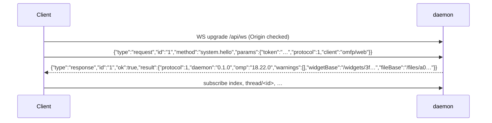

# 03 — UI ↔ daemon protocol

One WebSocket per client at `/api/ws`, JSON text frames only, for requests, responses and events (PRT-135). All types
live in `omfp-protocol` (serde), shared by daemon and UI. Plain HTTP
besides: the web bundle at `/` (DMN-008) and the user's theme at `/theme.css` (DMN-075), both without the token,
widget modules under the `widgetBase` path a client gets in `system.hello` (DMN-084, PRT-042), and the raw bytes of
workspace files under its `fileBase` path (DMN-250, PRT-150).

## Connection and authentication



| ID | Requirement |
| --- | --- |
| PRT-001 | The first client frame MUST be `system.hello`. Any other frame before a successful hello MUST close the connection with WebSocket close code 4401, and so does a hello that has not completed within 10 s (DMN-184). |
| PRT-002 | The token MUST travel in the `system.hello` payload, never in the URL (it would end up in logs and history). Comparison MUST be constant-time. |
| PRT-003 | The daemon MUST reject upgrades whose `Origin` is neither the daemon's own origin nor in the configured allow-list (DMN-140; protection against cross-site WebSocket hijacking) with `403`. An upgrade without `Origin` (not a browser: the CLI, the desktop app's theme push, tests) passes; the token check of `system.hello` (PRT-002) applies to every connection alike. |
| PRT-070 | The `Origin` match MUST be exact on scheme, host and port: the daemon's own origin is `http://<Host>` or `https://<Host>` of the upgrade request, an allow-list entry (normalized, DMN-141) matches only the identical serialized origin — no wildcard, no subdomain, no other scheme or port, not `null`. A window reached through a proxy that rewrites `Host` (e.g. `omfp desktop --connect https://omfp.example.ts.net` or a phone browser on that URL) therefore needs its origin listed; one that keeps `Host` does not. |
| PRT-004 | `protocol` is an integer. If the client's version is not supported the daemon MUST answer with error `version_mismatch` listing the supported versions, then close. |
| PRT-005 | The hello response MUST include daemon version, omp version, and warnings (e.g. `--allow-omp-mismatch` in effect). |

## Envelope

```jsonc
// client → daemon
{ "type": "request", "id": "c42", "method": "thread.prompt", "params": { "threadId": "01J…", "text": "…" } }

// daemon → client
{ "type": "response", "id": "c42", "ok": true, "result": { … } }
{ "type": "response", "id": "c42", "ok": false,
  "error": { "code": "omp_error", "message": "…", "ompCode": "session_busy", "details": { … } } }
{ "type": "event", "topic": "thread/01J…", "epoch": "e7", "seq": 1289, "event": { "kind": "omp", "frame": { … } } }
{ "type": "resync_required", "topic": "thread/01J…" }
{ "type": "transient", "topic": "thread/01J…", "event": { "kind": "live_levels", "input": 0.12, "output": 0.3 } }
{ "type": "window_request", "id": "w7", "request": { "kind": "run_command", "command": "view.switch", "args": ["ops"] } }
```

| ID | Requirement |
| --- | --- |
| PRT-010 | Every request MUST have a client-chosen `id`, unique per connection; the response echoes it. Responses MAY arrive out of request order. |
| PRT-011 | Error `code` values are a closed set: `unauthorized`, `bad_request`, `not_found`, `conflict`, `already_resolved`, `limit_reached`, `version_mismatch`, `thread_failed`, `omp_error`, `git_error`, `internal`. `omp_error` carries omp's own `code` in `ompCode` when present (DMN-071). |
| PRT-012 | Unknown `method` MUST yield `bad_request`; unknown fields in `params` MUST be ignored (forward compatibility). |
| PRT-013 | A single frame MUST NOT exceed 16 MiB. Larger payloads (huge diffs, long transcripts) MUST be paged or truncated with an explicit `truncated: true`. |

## Topics, snapshots and catch-up

Topics: `index` (workspaces with their discovered repositories, threads with their summaries, and the user's theme),
`thread/<id>` (one thread), `workspace/<id>` (git status of each repository of one workspace), `views/<id>` (the views
manifest, widget folders and widget state of one workspace, PRT-040), `job/<id>` (one job's output, PRT-041),
`jobs/<id>` (the declared jobs of one workspace and their runs, PRT-200) and `terminal/<id>` (one daemon-owned PTY
session, TRM-100).

The `index` state is `{ workspaces, threads, theme, settings, init, models }`; its events are
`workspace_upserted` / `workspace_removed`, `thread_upserted` / `thread_removed`,
`theme_changed { theme }` (`theme` is `{ css: string | null }`, DMN-075), `settings_changed { settings }` (DMN-009,
UI-097), `init_changed { init }` (PRT-095) and `models_changed { models }` (the usable models, PRT-141). `settings` is
`{ ui: { density?, fontSize?, motion?, notifications?, showXdevNotices?: boolean, fonts?: { prose?, ui?, code? }, theme?, skin?, recentThreads?, liveVoice? }, keymap: { mode: "normal" |
"insert" | "cmdline", keys, command }[], error: string | null }`: the `[ui]` and `[keymap]` tables of the daemon's
config file (absent values are defaults; `command: ""` removes a default binding), and the last reload error (the
previous settings stay). A thread summary carries `title` (`""` until the first message) and `titleSource`:
`placeholder` (the first words of the first message), `generated` or `set` (DMN-073).

```jsonc
// subscribe, optionally from a known position
{ "type": "request", "id": "c7", "method": "subscribe",
  "params": { "topic": "thread/01J…", "since": { "epoch": "e7", "seq": 1200 } } }

// answer A: catch-up from the ring buffer — events 1201.. follow as normal "event" frames
{ "type": "response", "id": "c7", "ok": true, "result": { "mode": "replay", "epoch": "e7", "fromSeq": 1201 } }

// answer B: position unknown or too old — full state, then live events after `seq`
{ "type": "response", "id": "c7", "ok": true,
  "result": { "mode": "snapshot", "epoch": "e9", "seq": 40, "state": { /* omfp_core::ThreadState */ } } }
```

| ID | Requirement |
| --- | --- |
| PRT-020 | `subscribe` with `since` inside the thread's ring buffer (same `epoch`, `seq` ≥ oldest kept) MUST replay the missing events in order; otherwise it MUST return a snapshot. Without `since`, it returns a snapshot. |
| PRT-021 | The snapshot MUST be the `omfp_core::ThreadState` produced by the daemon's reducer at exactly `seq`; applying the following events with the same reducer MUST produce the same state the daemon has (invariant tested by property tests, TST-011). |
| PRT-022 | Events for a topic MUST be delivered in strictly increasing `seq` order without gaps. When a thread's process restarts, the live subscription continues in the new `epoch` from `seq` 1 (the state carries over; the epoch's first events are the new history and process state). A client that observes a gap, or a new `epoch` starting anywhere but `seq` 1, MUST resubscribe. |
| PRT-023 | Each client has a bounded outbound queue. On overflow the daemon MUST drop that client's topic, send `resync_required` for it, and keep the connection open; the client resubscribes and gets a snapshot. |
| PRT-024 | `unsubscribe { topic }` MUST stop delivery for that topic. Closing the socket unsubscribes everything. |
| PRT-025 | The daemon MUST know which threads are being watched (at least one subscription that watches them, PRT-222) for the idle reaper (DMN-034) and for the window the user last used on a thread (DMN-060). |
| PRT-222 | **Kept, not watched**: `subscribe { topic, since?, watch? }` MUST watch a `thread/<id>` topic unless `watch` is `false`: such a subscription delivers the topic exactly like a watching one but does not count as watching the thread, so it keeps no omp from the idle reaper (DMN-356) and never makes its window the one the user last used on the thread (DMN-357). A window subscribes this way, or switches to it, for a thread it only keeps for a quick return (no widget shows it, UI-997). Absent `watch` is `true`; `watch: false` on any other topic is `bad_request` (only a thread's subscription can be kept unwatched). |
| PRT-223 | `watch { topic, watch }` (permission `Connect`, a window's connection only: `omfp_call` refuses it, AGT-041) MUST set whether this connection's live subscription of `topic` watches its thread (PRT-222), on the same subscription: no new snapshot, no replay, the stream goes on. It answers `{}`; a topic the connection is not subscribed to is `not_found`, `watch: false` on a topic other than `thread/<id>` is `bad_request` (`watch: true` on one is a no-op). Watching again makes the window the one that subscribed most recently (DMN-060); stopping starts the idle timeout as an unsubscribe does (DMN-034). A resubscription carries its own `watch`. |
| PRT-143 | `UiSettings.theme` MUST be a `BuiltinTheme`, named in kebab case: `synth`, `catppuccin`, `gruvbox`, `tokyo-night`, `nord`, `solarized`, `rose-pine`, `graphite`, `paper`, `clay`, `primer`, `accent` or `matugen` (the user theme, DMN-240) (UI-510); absent means `synth`. Any other name does not decode, so `settings.set` refuses it as `bad_request` and the config file reports it (DMN-238). |
| PRT-213 | `UiSettings.skin` MUST be a `Skin`, named in snake case: `crush` or `boring` (UI-794); absent means `crush`. Any other name does not decode, so `settings.set` refuses it as `bad_request` and the config file reports it (DMN-009). |
| PRT-228 | `UiSettings.liveVoice` and the optional `voice` of `thread.live_connect` and `thread.live_start` MUST be a `LiveVoice`, one of omp's realtime voices named as omp names them: `arbor`, `breeze`, `cove`, `ember`, `juniper`, `maple`, `sol`, `spruce` or `vale` (omp 18.22.0's `live/voices.ts`); absent leaves the voice to omp (its `live.voice` setting, else `sol`). Any other name does not decode, so `settings.set` and the live methods refuse it as `bad_request` and the config file reports it (DMN-009). |
| PRT-180 | `threads.fork { threadId, entryId? }` (permission `Manage`) MUST answer the new thread's `ThreadSummary` once its omp runs on the copy (DMN-300..DMN-302): the conversation through message entry `entryId` (an id of `thread.tree`), the whole session without it. `thread.fork` keeps forking a new session inside the same thread (DMN-072). |
| PRT-181 | `ThreadSummary.forkedFrom` MUST be absent for a thread that is no fork, else `ForkOrigin { threadId, title, entryId?, message? }`: the source thread (which may have been deleted since), its title when it was forked, the entry and the first line of its message (DMN-304). |
| PRT-182 | `threads.fork` MUST answer `bad_request` for a source without a session yet, `not_found` for an unknown thread or an entry that is no message of the source's session, and `thread_failed` (with `details.stderrTail`) when the new omp cannot start; none of them leaves a thread behind (DMN-303). |

## Event kinds on `thread/<id>`

| `event.kind` | Contents |
| --- | --- |
| `omp` | An omp frame as received (`omp_rpc::wire` types): session events, `prompt_result`, `session_settled`, subagent frames, `available_commands_update`, `notice`, `queue_update`, … |
| `history` | Initial history after process start (`get_messages`), applied by the reducer as a reset of the transcript |
| `process` | Process state change (`Stopped`, `Starting`, `Idle`, `Busy`, `Failed { exitCode, stderrTail }`) |
| `interaction_opened` / `interaction_closed` | Pending interactive request opened / answered / cancelled (DMN-050..052) |
| `presentation` | `notify`, `setStatus`, `setWidget`, `set_editor_text`, `open_url`, `setTitle` (DMN-053) |
| `thread_meta` | Title, model, thinking level, branch, git summary changed |
| `live_session` | `{ owner: { client, connection } \| null }`: the daemon opened a live session for that connection (before forwarding `live_connect` or `live_start`), or closed one omp never started (M6, DMN-100, DMN-101, DMN-109); omp's own `live_phase`, `live_transcript` and `live_end` frames arrive as `omp` events, its `live_levels` as transient frames (PRT-054) |
| `open_file` | `{ id, connection, path, line }`: the agent's `omfp_open_file` asks the window on that connection (PRT-051) to open `path` at `line` (`null` for none); the state keeps the last request as `open_file`, and the window opens each `id` once (DMN-060, UI-116) |
| `notify` | `{ id, connection, title, body }`: the agent's `omfp_notify` asks the window on that connection (PRT-051) to notify the user about the thread; the state keeps the last request as `notify`, and the window shows each `id` once (DMN-125, PRT-065, UI-215) |
| `unknown` | Unknown omp frame (DMN-042) |

## Methods

| Method | Params | Result |
| --- | --- | --- |
| `system.hello` | `token`, `protocol`, `client` | versions, warnings, `widgetBase`, `connection` (PRT-051) |
| `subscribe` / `unsubscribe` | `topic`, `since?`, `watch?` (subscribe only, PRT-222) | see above |
| `watch` | `topic`, `watch` | `{}`: the live subscription watches its thread or only keeps it (PRT-223) |
| `repos.suggest` | `query?` | `{ repos: [{ path, name, lastSeenAt }] }`: repositories seen in any workspace (DMN-021) |
| `fs.complete` | `path` | `{ entries: [{ name, path, isGitRoot }] }`: child directories on the daemon host (DMN-021) |
| `workspaces.list` | — | `{ workspaces }`: every workspace, as on `index` (PRT-091) |
| `workspaces.create` | `name?`, `link?` (a repository path: the new folder gets a link to it, DMN-020) | workspace; always a new folder under the workspaces root |
| `workspaces.update` | `workspaceId`, `name` | workspace |
| `workspaces.remove` | `workspaceId`, `force?` | `{}`; removes the repositories and deletes the folder (DMN-028) |
| `workspaces.rescan` | `workspaceId` | workspace (DMN-023; the daemon also rescans watched workspaces on its own) |
| `workspaces.add_repo` | `workspaceId`, `name?`, `source`: `link { path }` \| `worktree { repo (id or path), branch?, baseRef? }` \| `clone { url }` | workspace (DMN-024) |
| `workspaces.remove_repo` | `workspaceId`, `name`, `force?`, `deleteBranch?` | workspace (DMN-025) |
| `workspaces.status` / `.diff` | `workspaceId`, `repo` (name), `path?`, `cursor?` | status / paged diff of one repository; `status` rescans the workspace first and publishes the fresh status of all its repositories on `workspace/<id>` when it changed (what `omfp:changes` uses to refresh, UI-080) |
| `workspaces.read_file` | `workspaceId`, `path`, `knownHash?` | `{ path, kind: "text" \| "image" \| "binary", size, hash, unchanged, content?, truncated, mime?, repo?, head?, headHash?, outside }`: a file of the workspace with its `HEAD` text, or an image's `HEAD` hash (DMN-089, DMN-255); an absolute `path` outside the folder reads that file, `outside: true` (DMN-310, PRT-196) |
| `workspaces.find_file` | `workspaceId`, `query`, `threadId?`, `fuzzy?` (default false) | `{ candidates: [{ path, repo?, match: "exact" \| "suffix" \| "basename" \| "fuzzy", mentioned }], truncated }`: all workspace repositories and the folder, best first, at most 50 **after** filtering. Default strict path/name lookup; `fuzzy: true` treats query as case-insensitive path-subsequence text, whitespace ignored, empty lists files (DMN-092). Mentioned files rank first among equal matches. Strict mode finds none for an outside absolute path (DMN-312). |
| `workspaces.write_file` | `workspaceId`, `path`, `content`, `expectedHash?` | `{ path, hash, size }`; `conflict` when the file no longer has `expectedHash` (or exists without it), nothing written (DMN-090); `bad_request` for a path outside the folder (DMN-313, PRT-196) |
| `workspaces.reorder` | `workspaceId`, `beforeId?` | `{}`; the workspace goes just before `beforeId`, or last (PRT-170, DMN-281) |
| `threads.create` | Required `workspace`: `{ id }` \| `{ new: { name?, link? } }`; an explicit `new: {}` names the new folder after the title, else the first message. `prompt?` (first message), `images?` (`ImageContent[]`, the first message's images, sent with `prompt` or alone), `model?`, `thinkingLevel?`, `approvalMode?`: `always-ask` \| `always-ask-cached` \| `write` \| `yolo` (default `yolo`, DMN-074, DMN-210), `title?` (scripts and agents; otherwise generated, DMN-073) | thread; missing `workspace` is `bad_request` with both choices and creates nothing; when omp cannot start for the first message (`prompt` and/or `images`), nothing is created and the error carries `details.stderrTail` (DMN-211, DMN-212) |
| `threads.update` | `threadId`, `title?` (a `set` title, DMN-073), `approvalMode?` (as for `threads.create`; from the next start of the thread's omp) | thread |
| `threads.reorder` | `threadId`, `workspaceId?`, `beforeId?` | `{}`; the thread goes just before `beforeId`, or last, in `workspaceId` (another one moves it there and restarts its omp, DMN-283) or its own (PRT-171, DMN-282) |
| `threads.archive` / `.unarchive` / `.delete` | `threadId`, `jobs?` (`kill` \| `keep`, archive and delete only, PRT-208) | `{}`; archive stops the thread's omp process and sets `archivedAt`, unarchive clears it, delete removes the thread's records, stops its omp and removes its directory before answering (DMN-039; workspaces are never removed implicitly); `conflict` without `jobs` while runs its agent started still run (PRT-208) |
| `threads.search` | `query` | `{ results: [{ threadId, snippet }] }`: threads whose conversation text contains `query`, most recently updated first (DMN-076) |
| `threads.fork` | `threadId`, `entryId?` (a message entry of `thread.tree`) | the new thread, in the source's workspace, its omp resumed on a copy of the conversation through the entry (PRT-180, DMN-300) |
| `threads.list` | `workspaceId?`, `includeArchived?` | `{ threads }`: thread summaries, as on `index` (PRT-090) |
| `thread.prompt` | `threadId`, `text`, `images?`, `behavior?: "steer" \| "followUp"` | `{ promptId }`; completion arrives as `prompt_result` |
| `thread.steer` / `thread.follow_up` | `threadId`, `text`, `images?` | `{}` |
| `thread.abort` | `threadId` | `{ steering[], followUp[] }` (to restore into the composer) |
| `thread.queue.remove` / `.promote` | `threadId`, `message`, `queue?` | `{ removed }` / `{ promoted }` |
| `thread.set_model` / `thread.set_thinking` | `threadId`, `provider`+`modelId` / `level` | `{}`; a thread whose omp does not run stores the model and starts omp with it (DMN-339) |
| `thread.models` / `thread.thinking_levels` / `thread.commands` | `threadId` | `{ models }` / `{ levels }` / `{ commands }`; `thread.commands` never starts omp: without a running omp, the commands it last announced (DMN-358) |
| `thread.compact` | `threadId`, `instructions?` | compaction result |
| `thread.tree` / `.navigate` / `.fork` / `.label` | `threadId`, `entryId?`, … | tree / result |
| `thread.subagents` / `.subagent_messages` / `.subagent_steer` / `.subagent_cancel` | `threadId`, `subagentId`, … | `{ subagents }` / transcript page / `{}` |
| `thread.goal` / `thread.btw` / `thread.bash` | per 02 | `{ goal, state }` / `{ record }` / bash result |
| `thread.git` | `threadId` | `{ workspaceId, repos }`: the status of every repository of the thread's workspace (convenience over `workspaces.status`) |
| `thread.session` | `threadId` | `ThreadSession`: the small facts of the thread's omp session (ids, files, model, state, usage), never starting omp (PRT-125, PRT-126) |
| `thread.state` | `threadId` | omp's whole `get_state` (with its tool definitions and system prompt: tens of KB); starts omp (DMN-070) |
| `thread.restart` | `threadId` | `{}` |
| `thread.stop` | `threadId`, `cascade?` (default `false`: also the threads it spawned, AGT-071) | `{ threadIds }`: the threads whose omp process is now stopped (PRT-085) |
| `thread.live_connect` | `threadId`, `sdpOffer` (the browser peer's SDP offer: one sendrecv Opus track plus an `oai-events` data channel), `voice?` (PRT-228) | `{ sdpAnswer, voice }` once omp signaled the call (DMN-100); `conflict` while the thread has a live session (DMN-101) |
| `thread.live_start` | `threadId`, `voice?` (PRT-228) | `{ voice }` once omp's own session on the daemon's machine records (M7, DMN-109); `conflict` while the thread has a live session (DMN-101) |
| `thread.live_stop` | `threadId` | `{}`; succeeds without a session and never starts omp (DMN-102) |
| `thread.live_mute` | `threadId`, `muted` | `{ muted }`; `conflict` without a live session (DMN-102) |
| `interaction.respond` | `threadId`, `interactionId`, `response` (`value` \| `confirmed` \| `cancelled` \| `answers`) | `{}` or `already_resolved` |
| `card.answer` | `threadId`, `toolCallId`, `answer` (`{ kind: "submit", value }` \| `{ kind: "cancel" }`) | `{}` or `already_resolved` (PRT-224) |
| `theme.get` | — | `{ css }`: the user's theme CSS, `null` when none (DMN-075) |
| `theme.set` | `css` (string, at most 1 MiB, else `bad_request`; `null` restores the built-in themes) | `{}`; every client gets `theme_changed` on `index` |
| `settings.get` | — | `settings` (DMN-009, UI-097) |
| `settings.set` | `ui?` (values to set; absent ones unchanged), `keymap?` (entries replacing the ones with the same `mode` and `keys`) | the new `settings`; merged into the config file, written back with its comments and other keys (`bad_request` for an invalid value or a config file that is not valid TOML); every client gets `settings_changed` |
| `views.set` | `workspaceId`, `manifest` (AGT-010), `expected?` (the manifest it was made from; `null`: no file) | `{}`; writes `.omfp/views.json` (DMN-083); `conflict` when the file no longer holds `expected` (DMN-364) |
| `widgets.copy` | `workspaceId`, `widget` (`omfp:<name>` \| `user:<name>`), `name?` | `{ name }`: the new folder `.omfp/widgets/<name>/` (DMN-087) |
| `widgets.state_set` | `workspaceId`, `instance`, `key`, `value` (JSON; `null` deletes) | `{}`; `widget_stored` on `views/<id>` (DMN-086) |
| `widgets.compile` | `code` | `{ module }`: the ES module of a card's one-file widget (PRT-225) |
| `widgets.report` | `workspaceId`, `views` (the `{ epoch, seq }` of `views/<workspaceId>` the window rendered, `null` before it arrived), `widgets` (per instance: `reference`, `instance`, `source`, `name`, `version`, `state`, `errors`, `console`, `text`, `jobs`), `fileErrors?` (`[{ kind, file, message }]`, PRT-115), `window?` (`{ threadId, focused, activeView, defaultView, views, commands }`, PRT-122) | `{}`; replaces this connection's report (PRT-043, AGT-026) |
| `views.errors` | `workspaceId` | `ViewErrors { windows: [{ client, errors: [{ kind, file, message }] }] }`: the init file and TSX view errors of every window showing the workspace (PRT-116) |
| `jobs.start` | `workspaceId`, `command`, `replaces?` | the job: `{ id, workspaceId, command, startedAt, status }` (DMN-080); `replaces` is a job it takes the place of (DMN-215) |
| `terminals.start` | `workspaceId`, `command`, `cwd?`, `cols`, `rows` | the PTY session `{ id, workspaceId, command, cwd, cols, rows, startedAt, status }` (TRM-100) |
| `terminals.screen` | `terminalId`, `afterRevision?`, `waitMs?` (maximum 30,000) | the current plain-text screen, cursor, dimensions, alternate-screen flag, process status and revision (TRM-106) |
| `terminals.input` | `terminalId`, `data` (base64 bytes) | `{}` (TRM-101); agent activity redacts `data` (TRM-104) |
| `terminals.resize` | `terminalId`, `cols`, `rows` | `{}` (TRM-101) |
| `terminals.kill` | `terminalId` | `{}` (TRM-101) |
| `windows.list` | `workspaceId?` | `WindowList { windows: [{ windowId, client, workspaceId, threadId, focused, activeView, errors }] }`: the windows that reported, the most recently focused first (PRT-123) |
| `windows.state` | `windowId` | `WindowState`: all a window reports (PRT-123) |
| `windows.run` | `windowId?`, `workspaceId?`, `command`, `args?` | `{ windowId, command }`: the window ran the command (PRT-124) |
| `windows.check_widget` | `windowId?`, `workspaceId`, `widget` | `{ windowId, report, settled }`: the widget rendered out of sight in the window (PRT-124) |
| `windows.answer` | `requestId`, `answer` | `{}`; a window's answer to a `window_request` frame, on the connection it came on (PRT-124) |
| `jobs.kill` | `jobId` | `{}` (DMN-081); a run of a declared job too: a prompt run's turn is aborted (DMN-328), a service stays stopped (DMN-326) |
| `jobs.list` | `workspaceId` | `JobsState`: the workspace's declared jobs, as on `jobs/<id>` (PRT-202) |
| `jobs.runs` | `workspaceId`, `job`, `before?`, `limit?` | `{ runs, more }`: the job's stored runs, newest first (PRT-203) |
| `jobs.run` | `workspaceId`, `job` | the started `RunInfo` (PRT-204); `conflict` while it runs or when disabled |
| `jobs.define` | `workspaceId`, `name`, `job`, `replace?` | the `JobView` once `.omfp/jobs.json` holds it (PRT-205) |
| `jobs.remove` | `workspaceId`, `name` | `{}` once `.omfp/jobs.json` no longer holds it (PRT-206) |
| `jobs.enable` | `workspaceId`, `name`, `enabled` | the `JobView` once `.omfp/jobs.json` says so (PRT-207) |
| `activity.list` | `threadId?`, `before?`, `after?`, `limit?` | `{ entries: [{ seq, at, threadId, client, method, params, error }], more }`: the activity log, newest first (PRT-086) |
| `prompts.history` | `threadId?`, `workspaceId?`, `query?`, `limit?` | `{ prompts: [{ text, threadId, workspaceId, at }] }`: the user's prompts, the thread's first, then its workspace's, then the others (PRT-127) |
| `prompts.predict_word` | `text`, `cursor` | `{ suffix }`: omp's completion of the word ending at the caret, `null` when none (PRT-226) |
| `prompts.predict_word_feedback` | `text`, `cursor`, `suggestion`, `accepted` | `{}` once omp took the feedback (PRT-227) |
| `workspaces.mcp_servers` | `workspaceId` | `McpServers`: the MCP servers configured for the workspace, unchecked (PRT-110) |
| `thread.mcp_servers` | `threadId` | `McpServers`: the servers of the thread's workspace, checked by its running omp (PRT-111) |
| `thread.mcp_reconnect` | `threadId`, `name?` | `McpServers` after restarting the idle thread; `conflict` while it works (PRT-112) |
| `mcp.tools` | `workspaceId`, `server` | `McpTools`: the tools of a workspace's remote server, listed by the daemon itself (PRT-220) |
| `mcp.call` | `workspaceId`, `server`, `tool`, `arguments?` | `McpCallResult`: the server's `tools/call` result, called by the daemon itself (PRT-221) |
| `auth.status` | — | `AuthStatus { models }`: how many models omp can use; the first call starts an omp (PRT-140) |
| `auth.models` | — | `{ models }`: the usable models from a short-lived omp, without creating a thread (PRT-140, UI-030) |
| `auth.providers` | — | `AuthProviders { providers: [{ id, name, available, authenticated }] }`: omp's OAuth providers (PRT-129) |
| `auth.login` | `providerId` | `LoggedIn { providerId, name }` once omp stored the credential; the flow reaches the window as `login_*` window requests (PRT-130, PRT-131) |
| `auth.login_cancel` | — | `{ providerId }`: the login it cancelled, `null` when none ran (PRT-132) |
| `auth.logout` | `providerId` | `LoggedOut { providerId, removed, remainingSource }` (PRT-133) |
| `auth.importable` | — | `OmpLogins { providers: [{ providerId, oauth }] }`: standalone omp's provider logins omfp could copy (PRT-136) |
| `auth.import` | — | `OmpLogins`: the provider logins copied from standalone omp (PRT-137) |
| `oauth.callback` | `threadId?`, `url` | `{ status }` once omp's loopback OAuth listener took the pasted address (PRT-212) |

Results of omp-forwarded methods are omp's response data (`data` of its `response` frame), the `omp-rpc` wire
`*Result` type named in the method table, even where `omp-rpc` decodes the command's output to the bare list or
record (`get_available_models` → `{ models }`, not `[ModelInfo]`).

| ID | Requirement |
| --- | --- |
| PRT-030 | `thread.prompt` MUST return as soon as omp admits the prompt (omp's `prompt` response), not when the turn ends. The UI tracks completion through `prompt_result` with the same `promptId`. omp numbers requests per process, so a `promptId` is unique only within the thread's current epoch; the reducer drops prompt results when a new process starts (History). |
| PRT-031 | Every method MUST be covered by a golden-JSON test (insta snapshot of request and response) in `omfp-protocol`, so changes to the wire format are always explicit in review. |
| PRT-032 | `omfp-protocol` MUST version breaking changes by bumping `protocol`; the daemon supports the current and the previous version during a transition. |
| PRT-033 | No method may assume a human UI is on the other end: every method is usable by scripts and, later, agents (D-12). The `client` field of `system.hello` and the resulting principal are recorded as provenance on created entities (ARC-009). |
| PRT-034 | Authorization MUST be resolved once per connection into a `Principal` and checked in one place (a method → permission table), so scoped principals (per-thread agent tokens, [08](08-agent-control.md)) can be added without touching method handlers. Principals: the owner token, the agent principal of a thread's agent tools (DMN-150) and the MCP principal of the MCP server (AGT-051). |
| PRT-050 | The live voice methods (M6) MUST have exactly these shapes: `thread.live_connect { threadId, sdpOffer }` → `{ sdpAnswer, voice }`, `thread.live_stop { threadId }` → `{}`, `thread.live_mute { threadId, muted }` → `{ muted }`; they need the `Drive` permission. |
| PRT-051 | The `system.hello` result MUST carry `connection`, a number naming this connection, unique while the daemon runs: a window compares it with a live session's `owner.connection` to know whether the session (and its audio peer) is its own. |
| PRT-052 | The thread state MUST carry the live session (`live`, `null` when none) and the readable message of the last live failure (`live_error`): a `live_session` event with an owner starts a session `{ owner, phase: null, transcript: [] }` and clears `live_error`; `live_phase` sets `phase` while a session exists (the `error` phase omp repeats after `live_end` is ignored); `live_transcript` keeps one line `{ role, turn, text, final }` per role and turn in order of first appearance, a later frame replacing the line's text until a `final` one (later frames of a final line are ignored); `live_levels` changes nothing (the daemon sends them as transient frames, DMN-110, PRT-054); `live_end` and `live_session { owner: null }` clear the session, `live_end` setting `live_error` to the readable message of its `error` (DMN-104) or `null`; a process leaving `starting`/`running` clears the session. |
| PRT-053 | `thread.live_start { threadId }` (M7) MUST answer `{ voice }` and need the `Drive` permission, like the other live voice methods (PRT-050). |
| PRT-054 | A **transient frame** `{ type: "transient", topic, event }` carries a momentary value of a topic outside its event stream: it has no `seq`, is never replayed nor part of a snapshot, goes only to the connections subscribed to the topic when it happens, and is dropped (no `resync_required`) when a client's queue is full. Its `event` is a `TransientEvent`, tagged by `kind`; the only one is `live_levels { input, output }` on `thread/<id>` (DMN-110). A client hands transient frames of the topics it follows to their listeners (`Client.onTransient`) and never folds them into its model. |
| PRT-055 | The thread state MUST carry `subagents`: per subagent id, the last `subagent_lifecycle` payload (`lifecycle`) and the last `subagent_progress` payload (`progress`, its id read from the raw `AgentProgress` record), each `null` until omp sent one; finished subagents stay (omp's `thread.subagents` lists only running ones, so the UI merges both, UI-081). |
| PRT-056 | The thread state MUST carry `goal`: the `goal` of the last `goal_updated` frame (`null` when omp reported none, or never did); a `history` event keeps it, since the goal belongs to the omp session, not to the transcript. A `goal_updated` without a `goal` key does not decode (an `unknown` notice). |
| PRT-057 | The thread state MUST carry `todo_phases`: the phases of the transcript's last `todo` tool result that committed some (omp's `committedTodoPhases`: not an error, not a `view`, phases that decode; a task's `blocked` status of omp before 18.19 reads as `pending`, as omp restores it), `[]` without one; a `message_end` of such a result replaces them, and a `history` event recomputes them from its messages (omp's `getLatestTodoSnapshotIdentity`). |
| PRT-100 | A tool run MUST carry `background`: the omp background job the call became (`bash` with `async`, or auto-backgrounded), else `null` — `{ job_id, state, output, exit_code }` from the `details.async` (`{ state, jobId }`, state `running`, `completed`, `failed` or `cancelled`) and `details.exitCode` of its results: a `tool_execution_update` with a job frame replaces it (its text is `output`), and `tool_execution_end`'s start result sets it only when no update did (with `output: null`: its text is omp's notice to the model). It survives `tool_execution_end`: the job's frames keep arriving as updates after it. A frame with another state is ignored. |

## Agent tools (M10)

| ID | Requirement |
| --- | --- |
| PRT-090 | `threads.list { workspaceId?, includeArchived? }` (permission `Read`) MUST answer `{ threads }`: the thread summaries of the `index` topic after a refresh, in its order, without archived threads unless `includeArchived` is `true`, only those of workspace `workspaceId` when given (an unknown workspace lists none). It is how a client without a subscription, e.g. an agent's `omfp_call` (AGT-041), lists threads. |
| PRT-091 | `workspaces.list {}` (permission `Read`) MUST answer `{ workspaces }`: the workspaces of the `index` topic after a refresh, in its order. |
| PRT-092 | Every method of the method table MUST carry a description, its doc comment, exposed by `omfp_protocol::method_description(name)` next to `method_schemas()` (AGT-007), so the method catalogue (AGT-042) describes each method without a second list. |
| PRT-093 | A provenance's `createdBy` (ARC-009) MUST be `{ kind: "user" }`, `{ kind: "thread", threadId }` or `{ kind: "mcp" }`: the last for what the MCP principal created (AGT-051), whose MCP client is the provenance's `client`. |
| PRT-094 | An activity entry's `threadId` (PRT-086) MUST be `null` for a call of the MCP principal (AGT-053); its `client` then names the MCP client. |

## Cascade stop and activity log (M10)

| ID | Requirement |
| --- | --- |
| PRT-085 | `thread.stop { threadId, cascade? }` MUST answer `{ threadIds }`: the stopped threads, the thread first, then, with `cascade: true`, the other members of its spawned tree (AGT-070) in the order the daemon stopped them (DMN-162); `cascade` defaults to `false`. Stopping a thread that runs no process succeeds; an unknown thread is `not_found`. |
| PRT-086 | `activity.list { threadId?, before?, after?, limit? }` (permission `Read`) MUST answer `{ entries, more }` from the activity log (DMN-160), newest first: each entry `{ seq, at, threadId, client, method, params, error }` (`error` `null` for a success); `threadId` keeps the entries of that calling thread, `before` those with a smaller `seq`, `after` those with a greater one; `limit` defaults to 50 and is capped at 500; `more` tells whether entries matching the query were left out by the limit. |
| PRT-127 | `prompts.history { threadId?, workspaceId?, query?, limit? }` (permission `Read`) MUST answer `PromptHistory { prompts }` read as DMN-217 orders it: `threadId` and `workspaceId` rank the prompts (this thread's first, then this workspace's, then the rest; newest first within each), `query` filters them, `limit` (default 100, at most 1,000) cuts the list. |
| PRT-128 | A `PromptHistoryEntry` MUST carry `text`, `threadId` (the thread it was last sent to), `workspaceId` (that thread's workspace then) and `at` (when, Unix ms); each text appears once (DMN-216). |
| PRT-226 | (M17) `prompts.predict_word { text, cursor }` (permission `Read`) MUST answer `PredictedWord { suffix }`: the characters completing the word that ends at `cursor` (UTF-16 code units of `text`, a JavaScript string index), `null` when no completion applies (DMN-360). It needs no thread; a failure to start omp is `thread_failed` (DMN-362). |
| PRT-227 | (M17) `prompts.predict_word_feedback { text, cursor, suggestion, accepted }` (permission `Drive`: it changes what the predictor learned) MUST answer `{}` once omp took the feedback: `suggestion`, the suffix `prompts.predict_word` answered for that `text` and `cursor`, was accepted or typed past (DMN-360). |

## MCP servers (M13, M19)

| ID | Requirement |
| --- | --- |
| PRT-110 | `workspaces.mcp_servers { workspaceId }` (permission `Read`) MUST answer `McpServers { workspaceId, threadId: null, running: false, projectConfig, servers }`: every MCP server of the workspace folder (DMN-190), each in state `configured` or `disabled`, without starting omp. `projectConfig` is `<workspace>/.omp/mcp.json`, whether it exists or not. |
| PRT-111 | `thread.mcp_servers { threadId }` (permission `Read`) MUST answer `McpServers` for the thread's workspace with `threadId` set and `running` whether its omp process runs: when it runs, each `checkable` server was checked by that omp (DMN-191) and is `connected` (with `tools`) or `failed` (with `error`); a server omp did not answer for, and every server of a stopped thread, stays `configured`. It never starts omp. |
| PRT-112 | `thread.mcp_reconnect { threadId, name? }` (permission `Drive`) MUST reconnect the thread's MCP servers by restarting its omp process (DMN-192) and answer `McpServers` as PRT-111 does, checking only server `name` when given (the others stay `configured`), every checkable one without it. A thread that is not settled MUST be refused with `conflict` and keep running; a stopped thread is started. |
| PRT-113 | A server of `McpServers` MUST carry `name`, `transport` (`stdio`, `http` or `sse`), `target` (a stdio server's command and arguments; a remote URL without its query, fragment and user info), `source { path, workspacePath?, tool }` (the config file: absolute, and relative to the workspace folder; `omp`, `claude`, `cursor` or `vscode`), `state`, `checkable` (omp can check it: an enabled entry of the workspace's `.omp/mcp.json` whose name has no whitespace), and `tools`/`error` per PRT-114. Servers come in omp's precedence order, each name once. |
| PRT-114 | A server's `state` MUST be `configured` (enabled, not checked), `connected` (omp connected and listed its `tools`), `failed` (omp's `error`) or `disabled` (`enabled: false`): what omp's `/mcp test` saw, not its live connection, which omp 18.22.0 does not expose (M13 spike). |
| PRT-220 | (M19) `mcp.tools { workspaceId, server }` (permission `Read`) MUST answer `McpTools { workspaceId, server, tools }` with every tool the workspace's remote server `server` lists (DMN-351, all pages), in its order, each `{ name, title?, description?, inputSchema, outputSchema?, annotations? }` as sent (`inputSchema` `{ "type": "object" }` when missing; a tool without a name is skipped), without a thread or omp; errors per DMN-354. |
| PRT-221 | (M19) `mcp.call { workspaceId, server, tool, arguments? }` (permission `Drive`: tools may act on the world) MUST call the tool with `arguments` (`{}` without them) and answer `McpCallResult { content, structuredContent?, isError }`: the server's content blocks as sent, its structured content, and whether the tool reported a failure; errors per DMN-354. |
| PRT-120 | The thread state's `notices` (UI-043) MUST also hold the output of local slash commands, `{ type: "command_output", data: { text } }` (a user's `/…` prompt answered without a model turn, and background ones like `/mcp reauth` arriving later), and the URLs omp asks the client to open, `{ type: "open_url", data: { id, url, launchUrl?, instructions? } }` (besides `presentation.open_url`); unlike other notices they survive a `history` event, placed at most after its last message. |
| PRT-121 | `ThreadSummary` carries `restartPending?: RestartReason[]` (absent when empty): the thread's omp should restart to load new MCP tools or a login's models, but background work holds the restart back (DMN-204); the reasons come once each, in the order they came (DMN-228); `thread.mcp_reconnect { threadId }` (PRT-112) restarts it now. |
| PRT-170 | `workspaces.reorder { workspaceId, beforeId? }` (permission `Manage`) MUST answer `{}`; `beforeId` absent means last. |
| PRT-171 | `threads.reorder { threadId, workspaceId?, beforeId? }` (permission `Manage`) MUST answer `{}`; `workspaceId` absent means the thread's own workspace, `beforeId` absent means last. |
| PRT-172 | `Workspace` and `ThreadSummary` MUST carry `position: number`, their place in the left column from 0 (among the workspaces; among the threads of the workspace, archived ones included), the same for every client (DMN-284). |
| PRT-134 | `RestartReason` MUST be `mcp_config` (the MCP servers the thread's omp would load changed: a config file or `/mcp add`), `mcp_reauth` (a server was reauthorized with `/mcp reauth`) or `login` (a login stored a provider's credential, DMN-224): what the restart would load, so a window names it (UI-349). |

## Logging in to a provider

omp's `/login` is a TUI command; over RPC omp offers its OAuth logins as commands whose flow arrives as UI requests.
The daemon runs them on a short-lived omp of its own (DMN-219..DMN-224) and shows the flow in a window.

| ID | Requirement |
| --- | --- |
| PRT-129 | `auth.providers {}` (permission `Read`) MUST answer `AuthProviders { providers }`, omp's `get_login_providers` in omp's order: each `{ id, name, available, authenticated }` (`authenticated`: omp holds a credential for it, a login or a key from the environment or omp's config). It starts an omp (DMN-219), so it takes seconds. |
| PRT-130 | `auth.login { providerId }` (permission `Drive`) MUST log omp in to the provider (DMN-220) and answer `LoggedIn { providerId, name }` once omp stored the credential; an unknown or unavailable provider is `bad_request`, omp's failure `omp_error`, a cancelled login `conflict` (PRT-132). It answers only when the login ends (up to omp's 10 minutes). |
| PRT-131 | **The flow of a login** reaches one window (DMN-221) as `window_request` frames (PRT-124) carrying `providerId` and `name`: `{ kind: "login_url", url, launchUrl, instructions }` (open `url` in the browser; `launchUrl`, a short loopback redirect to it on the daemon's host, and `instructions` may be `null`) and `{ kind: "login_progress", message }` are notices the window does not answer; `{ kind: "login_input", message, placeholder }` asks for the code or redirect URL the provider's page shows, answered with `windows.answer { requestId, answer: { kind: "login_input", value } }`, `value: null` cancelling. |
| PRT-132 | `auth.login_cancel {}` (permission `Drive`) MUST cancel the running login (DMN-222) and answer `LoginCancelled { providerId }`, `null` when none ran; the cancelled `auth.login` fails with `conflict`. A new `auth.login` and closing the window that shows a login cancel it too. |
| PRT-133 | `auth.logout { providerId }` (permission `Drive`) MUST remove every credential omp stored for the provider (DMN-223) and answer `LoggedOut { providerId, removed, remainingSource }`: how many it removed, and what still authenticates the provider (omp's words, e.g. an environment variable), `null` when nothing does. |
| PRT-136 | `auth.importable {}` (permission `Read`) MUST answer `OmpLogins { providers }`: the providers the user's own (standalone) omp holds a login for, each once as `{ providerId, oauth }` (`oauth`: at least one of them is an OAuth, browser, login), MCP server credentials left out (DMN-229); `{ providers: [] }` when standalone omp has none, is not installed, or its store cannot be copied. No secret is ever sent. A failure is `omp_error` with omp's words. It runs omp on a private snapshot of standalone omp's store, so it takes a second or so. |
| PRT-137 | `auth.import {}` (permission `Drive`: the user, or an agent or MCP client with `Drive` acting for them) MUST copy standalone omp's provider logins into omfp's profile (DMN-230) and answer `OmpLogins { providers }`, the providers copied; `{ providers: [] }` when there was nothing to copy (nothing ran). Copying again is harmless. While a login runs it is `conflict`; a standalone store that cannot be copied is `omp_error`; another failure is `omp_error` with omp's words. |
| PRT-140 | (QA) `auth.status {}` (permission `Read`) MUST answer `AuthStatus { models }`: how many models omp can use (DMN-235), `0` on a fresh install where every thread start fails until a login. The first call starts an omp, so it takes seconds; later calls answer the count the daemon keeps current (DMN-236, DMN-237), which the `index` topic also carries (PRT-141). `auth.models {}` (permission `Read`) MUST return `{ models }`, omp's `GetAvailableModelsResult`, from a fresh short-lived login omp on every call, stopping it on success or error; it creates no thread or workspace and sends no prompt. |
| PRT-212 | `oauth.callback { threadId?, url }` (permission `Manage`) MUST relay `url`, the address a browser on any machine ended on after an OAuth sign-in omp started (`http://localhost:<port>/<path>?code=…&state=…`), to omp's loopback callback listener on the daemon's host (DMN-340..DMN-342): the sign-in of thread `threadId`'s omp (`/mcp reauth`, an `open_url` request), else, without `threadId`, the running login's (`auth.login`). It answers `OAuthCallbackRelayed { status }` (omp's 2xx); an address the guard refuses (DMN-341) is `bad_request` naming the callbacks omp waits on, no sign-in waiting `conflict`, an unknown thread `not_found`, and a listener that answers another status (`details.status`) or none `omp_error`. Windows and agents call it alike (D-17). |

Both `auth.models` and `thread.models` publish concrete result schemas for `{ models: [{ provider, id, name, … }] }`.
The entries permit upstream extension fields; the Rust wire result still carries omp's complete model descriptor.
Create a thread using `model: "<provider>/<id>"`; change an existing thread with
`thread.set_model { threadId, provider: "<provider>", modelId: "<id>" }`. `name` is only a display label.

## Thread session

An agent that wants a thread's session id or state should not have to read omp's whole `get_state` (about 35 KB with
the tool definitions and the system prompt).

| ID | Requirement |
| --- | --- |
| PRT-125 | `thread.session { threadId }` (permission `Read`) MUST answer `ThreadSession { threadId, workspaceId, cwd, roots, sessionDir, sessionId?, sessionFile?, model?, sessionModel?, thinkingLevel?, approvalMode?, process, settled, needsAttention, messageCount?, usage? }` from what the daemon holds, without starting omp (DMN-213): `cwd` is the workspace folder, `roots` the repository roots the thread's session has (`[]` before its first start), `model` (`provider/id`) and `thinkingLevel` the ones the thread was created or last set with (absent: omp's default), `process`, `settled` and `needsAttention` as on `ThreadSummary`. An unknown thread is `not_found`. |
| PRT-126 | Fields that need omp are absent when it cannot give them: `sessionId` before the thread's first start; `sessionFile` until omp wrote the session's file; `messageCount` (the messages of the session's current branch, the transcript of the `thread/<id>` topic) until the daemon loaded the session in this run (omp's history, or the session file after a failed start, DMN-337, or when the thread was shown, DMN-359); `usage { cost, tokens { input, output, cacheRead, cacheWrite, total }, context? { tokens, contextWindow, percent } }` while the thread's omp does not run (DMN-214). |
| PRT-211 | `ThreadSession.sessionModel` MUST be the `provider/id` the stored session restores (its saved model, which may be one omp cannot use), read from the session file when the thread's omp could not start (DMN-338); absent otherwise, and again once omp starts. A client tells an unusable saved model by comparing it, after `model` (which wins: omp starts with it), with `auth.models` (UI-751). |

## Views and jobs (M4)

| ID | Requirement |
| --- | --- |
| PRT-040 | `views/<workspaceId>` (DMN-082): the state is `ViewsState { manifest, error, widgets: [{ source: "workspace" \| "user", name, version, entry }], stored: { <instance>: { <key>: value } } }`; its events are `views_manifest { manifest, error }` and `views_widgets { widgets }` (each replaces those fields) and `widget_stored { instance, key, value }` (`null` removes the key). Subscribing to an unknown workspace is `not_found`. |
| PRT-041 | `job/<id>` (DMN-080): the state is `JobState { job, lines: [{ stream: "stdout" \| "stderr", text }], dropped }`; its events are `job_output { stream, text }` (appends a line) and `job_exited { code, signal, endedAt }` (the job's `status` becomes `{ state: "exited", code, signal, endedAt }`). Subscribing to an unknown job is `not_found`. |
| PRT-042 | The `system.hello` result MUST carry `widgetBase`, the path under which this daemon serves widget modules to authenticated clients (DMN-084). |
| PRT-150 | (M16) The `system.hello` result MUST carry `fileBase`, the path under which this daemon serves the raw bytes of workspace files to authenticated clients (`/files/<key>`, DMN-250): a client loads the file `path` of workspace `id` from `<fileBase>/<id>/<path>`. |
| PRT-195 | (M17) `FileContent` MUST carry `outside: boolean`: `true` for a file read by an absolute path outside the workspace folder (DMN-310), whose `path` is then that absolute path and whose `repo` names the git working tree holding it (DMN-311); a result without the field (an older daemon) reads as `false`. A client MUST NOT offer to write a file that is `outside` (UI-700). |
| PRT-196 | (M17) `workspaces.read_file` MUST accept an absolute path outside the workspace and answer that file (DMN-310); writes answer `bad_request` (DMN-313), default strict `find_file` no candidate (DMN-312). A relative path leaving the folder stays `bad_request` for all three path operations. Explicit fuzzy file-search mode treats `query` as text and never searches outside the workspace inventory (DMN-092). |
| PRT-197 | (M17) A client MUST load the raw bytes of a file outside the workspace folder from `<fileBase>/<id>/<absolute path>` (PRT-150; `//` after the id, each segment percent-encoded), as it loads a workspace file's (DMN-314). |
| PRT-043 | `widgets.report` (AGT-026) is a window's report on the workspace and user widgets of the view it shows (built-ins are not reported): each call replaces the connection's previous report (a window shows one workspace), the daemon forgets it when the connection closes, and `omfp_widget_check` reads it (DMN-063). An instance's `state` is `loading`, `rendered`, `compile_error`, `load_error` or `render_error`; `errors` are the import's, compile stand-in's or error boundary's messages (`file:line:column: message` when known), `console` the console errors and uncaught errors whose stack names the widget's module, `text` the rendered text, `jobs` its `useJob` jobs (`command`, `status`, `exitCode`, `signal`, `runs`, `startedAt`, `tail`: the last output lines). The daemon keeps at most 4,000 characters of `text`, 20 `errors`, 20 `console` entries and 10 `tail` lines per instance, each entry at most 2,000 characters. A report also carries the window's init file and TSX view errors, `fileErrors` (PRT-115). |
| PRT-060 | `ViewsState` (PRT-040) carries `keymap: [{ mode, keys, command, args? }]` and `keymapError: string \| null`, the workspace's `.omfp/keymap.json` (DMN-121); the event `views_keymap { keymap, error }` replaces both. A state without them (an older daemon) reads as no bindings and no error. |
| PRT-095 | `IndexSnapshot` carries `init: string \| null`, the version of the user's init file (DMN-185), replaced by the `index` event `init_changed { init }`; `ViewsState` (PRT-040) carries `init: string \| null`, the version of the workspace's `.omfp/init.ts`, replaced by the `views/<id>` event `views_init { init }`. A state without the field (an older daemon) reads as `null`. A client loads an init file as the ES module `<widgetBase>/init/<scope>/<version>/init.ts` (PRT-042), `<scope>` being `user` or the workspace id and `<version>` the published version (`404` without a file). |
| PRT-141 | (QA) `IndexSnapshot` carries `models: number \| null`, how many models omp can use (DMN-235), `null` until the daemon checked (the first `auth.status` does), replaced by the `index` event `models_changed { models }`. A state without the field (an older daemon) reads as `null`. It also carries `login`, the running login (`LoginActivity { providerId, name, url, instructions, progress }` or `null`, DMN-290), replaced by `login_changed { login }`; a state without it reads as `null`. |
| PRT-096 | `ViewsState` (PRT-040) carries `viewFiles: string \| null`, the version of the workspace's `.omfp/views/` (DMN-186), replaced by the `views/<id>` event `views_files { viewFiles }`; a state without the field reads as `null`. A client loads a TSX view's file as the ES module `<widgetBase>/views/<workspaceId>/<viewFiles>/<path under .omfp/views/>` (relative imports resolve to sibling files the same way). |
| PRT-115 | `widgets.report` (PRT-043) carries `fileErrors: [{ kind: "init" \| "view", file, message }]`, the runtime errors the window shows of init files and TSX views: `file` is `user` for the user's init file, else the workspace-relative path (`.omfp/init.ts`, `.omfp/views/ops.tsx`), `message` the error as the window shows it (a compile error with `file:line:column`, a throw, a render or layout error). A report without the field (an older window) has none; another `kind` is `bad_request`. The daemon keeps them per connection (DMN-195). |
| PRT-116 | `views.errors { workspaceId }` (permission `Read`, so agents call it with `omfp_call` and the method catalogue lists it, AGT-041, AGT-042) MUST answer `ViewErrors { windows: [{ client, errors }] }`: one entry per window whose latest report is about the workspace, in connection order, with its `client` (`system.hello`) and its kept `fileErrors` (DMN-195), windows without errors included with `errors: []`; an unknown workspace is `not_found`. It does not wait for windows (`omfp_views_errors` does, DMN-196). |
| PRT-122 | `widgets.report` (PRT-043) carries `window?: { threadId, focused, activeView, defaultView, views, commands }`, what the window shows besides its widgets (UI-350, UI-351): the selected thread, whether it has the focus, the view it shows and the default one (`null` without a workspace), its views in switcher order after `views.json`, the init files and their transforms (`{ id, title, source: "builtin" \| "views_json" \| "user_init" \| "workspace_init", file: "./views/<name>.tsx" \| null, widgets: [reference] \| null }`, `widgets` `null` for a TSX view the window has not rendered), and the commands registered beyond the built-ins (`{ id, title, aliases, source: "user_init" \| "workspace_init" \| "widget", widget, enabled, bindings: [{ mode, keys, args }] }`). A report without it (an older window, a script) reads as an empty state. The daemon keeps it with the report (DMN-205). |
| PRT-123 | `windows.list { workspaceId? }` and `windows.state { windowId }` (permission `Read`) MUST answer what the windows report (DMN-205): `windows.list` one `{ windowId, client, workspaceId, threadId, focused, activeView, errors }` per connection that reported (only those showing `workspaceId` with it; an unknown workspace is `not_found`), the most recently focused first, `windowId` being the connection's `system.hello` `connection` and `errors` the count of its `fileErrors` and of its widgets in an error state or with console errors; `windows.state` everything of one window: the PRT-122 fields, its `fileErrors` and its widget reports (`not_found` for a window that is gone). A window without a workspace has no views. |
| PRT-124 | **Window requests**: the daemon asks a window something with a frame `{ type: "window_request", id, request }` on that window's connection; `request` is `{ kind: "run_command", command, args }` or `{ kind: "check_widget", reference, version, timeoutMs }` (and the `login_*` requests of a login, PRT-131), and the window answers with `windows.answer { requestId: id, answer }` (permission `Connect`: only a window's connection, never `omfp_call`), `answer` being `{ kind: "ran", command }`, `{ kind: "not_run", reason: "unknown" \| "disabled" \| "failed", message }` or `{ kind: "checked", report, settled }`; an answer to a request that is not this connection's, or already answered, is `not_found`. `windows.run { windowId?, workspaceId?, command, args? }` (permission `Drive`) asks for `run_command` and answers `{ windowId, command }`, or `not_found` (no such window, unknown command), `conflict` (disabled, or no answer in time) or `bad_request` (the command failed); `windows.check_widget { windowId?, workspaceId, widget }` (permission `Drive`) asks a window showing the workspace for `check_widget` with the widget folder's current version and answers `{ windowId, report, settled }` (DMN-206, DMN-207). Neither carries code: a window runs only commands it registered. |
| PRT-065 | The thread state MUST carry `notify`, the last `notify` event's request `{ id, connection, title, body }` (`null` before one; a process change keeps it), like `open_file`; an event missing a field or with a negative `connection` does not decode and changes nothing. A window acts only on requests naming its own connection, once per `id`, so a snapshot after a resync never shows one twice. |
| PRT-080 | `views.mount { workspaceId, id, widget?, code?, props?, view?, place?: "side_tab" \| "main_tab" \| "end", panel? }` → `Mounted { id, reference, view: string \| null, panel, replaced }` (AGT-061): writes `views.json` as `views.set` does (DMN-083) and publishes it on `views/<workspaceId>` before answering. Breaking a rule of AGT-061 (both or neither of `widget` and `code`, an `id` that is no widget name, `view` or `place` with `panel`) is a `bad_request`, and so is a current `views.json` that is invalid (naming its error). |
| PRT-081 | `views.mount_update { workspaceId, id, props?, code? }` → `Mounted` (`replaced: true`) (AGT-062), written and published like PRT-080; `not_found` when no node or panel has that id. With `code`, `.omfp/widgets/<id>/` must be the mount's own folder (DMN-183), else `conflict`. |
| PRT-082 | `views.unmount { workspaceId, id }` → `Unmounted { views, removedViews, panel }` (AGT-063): the ids of the views it changed and of those it removed, and whether it removed the panel `id`; written and published like PRT-080. |
| PRT-083 | `widgets.save { name, workspaceId?, widget?, code?, replace? }` → `WidgetSaved { name, reference }` (AGT-064): `workspaceId` is required with `widget`; `bad_request` for a bad name or both or neither of `widget` and `code`, `not_found` for a missing widget, `conflict` for an existing component without `replace`. |
| PRT-084 | `widgets.library {}` → `WidgetLibrary { components: [{ name, reference, entry, files, version, description }] }` (AGT-065), by name; `entry` is `null` for a folder without one. |
| PRT-224 | (M17) `card.answer { threadId, toolCallId, answer }` (permission as `interaction.respond`) ends the wait of the thread's `omfp_card` call `toolCallId` (AGT-097) with `answer`: `{ kind: "submit", value }` (any JSON) or `{ kind: "cancel" }`, and answers `{}`; a call that does not wait (answered, timed out, cancelled, never waiting or unknown) is `already_resolved`, an unknown thread `not_found`. |
| PRT-225 | (M17) `widgets.compile { code }` (permission `Read`) MUST answer `{ module }`, `code` compiled as the widget file `card.tsx` (DMN-084, DMN-085: types stripped, JSX on the automatic runtime, an inline source map), refusing relative imports (a card is one file): a compile error is a `bad_request` whose message is `card.tsx:line:column: message`. It reads and writes no file; a window loads the module from a `blob:` URL, its bare imports resolved by the window's import map. |

## Declared jobs (M18)

The jobs a workspace declares in `.omfp/jobs.json` and their runs (DMN-320..DMN-336). A *job* is the definition, a
*run* one execution; a run's id is a job id (`job/<id>`, `jobs.kill`). What `jobs.start` starts is a *transient run*,
of no job (DMN-080).

```jsonc
// jobs/<workspaceId> state
{ "jobs": [{
    "name": "mail",
    "job": { "trigger": "schedule", "schedule": "0 8 * * 1-5", "missed": "skip", "enabled": true,
             "prompt": { "text": "Read my unread mail…", "thread": "reuse" } },
    "status": "idle", "run": null, "nextAt": 1795330800000,
    "lastRun": { "id": "01K…", "workspaceId": "01K…", "job": "mail", "trigger": "schedule", "startedBy": null,
                 "threadId": "01K…", "startedAt": 1795244400000, "endedAt": 1795244461000, "status": "succeeded",
                 "reason": null, "exitCode": null, "signal": null } }],
  "error": null }
```

| ID | Requirement |
| --- | --- |
| PRT-200 | **`jobs/<workspaceId>`** (DMN-322): the state is `JobsState { jobs: JobView[], error: string \| null }` — the jobs of the last valid `jobs.json` by name, and why the current file is refused (`null` when valid or absent; DMN-321). A `JobView` is `{ name, job, status, run, lastRun, nextAt }`: `job` the definition with its defaults filled in (`trigger`, `missed`, `restart`, `enabled`, `prompt.thread`); `status` `disabled`, `idle`, `running`, `waiting` (a service between restarts, DMN-326) or `stopped` (a service killed through the protocol, or one that ended under `on-failure` without failing); `run` the running `RunInfo` or `null`; `lastRun` the newest finished run that was not `skipped`, or `null`; `nextAt` (Unix ms) the next time of a schedule or a waiting service's restart, else `null`. Its events: `jobs_set { jobs, error }` (the file was applied or refused: replaces both), `job_updated { job }` (replaces the job of that name), and `run_started { run }` / `run_ended { run }`, which change nothing (the matching `job_updated` does) and tell clients a run started or ended, `skipped` ones included. Subscribing to an unknown workspace is `not_found`; one without a file has `jobs: []`. |
| PRT-201 | **`RunInfo`** MUST be `{ id, workspaceId, job, trigger, startedBy, threadId, command, startedAt, endedAt, status, reason, exitCode, signal }` as the store keeps it (DMN-330): `job` `null` for a transient run, `trigger` `manual`, `schedule`, `missed`, `service` or, for a transient run, `start`; `startedBy` a provenance's `createdBy` (PRT-093) or `null` for the scheduler and the supervisor; `threadId` a prompt run's thread; `command` the command a command run ran (its output is `job/<id>`), `null` for a prompt run, so a client knows each run's action even after its job changed; `endedAt`, `exitCode`, `signal` and `reason` `null` until known. |
| PRT-202 | `jobs.list { workspaceId }` (permission `Read`) MUST answer the workspace's `JobsState` as `jobs/<id>` holds it, for clients without a subscription (an agent's `omfp_call`); an unknown workspace is `not_found`. |
| PRT-203 | `jobs.runs { workspaceId, job, before?, limit? }` (permission `Read`) MUST answer `{ runs: RunInfo[], more }`: the runs the store keeps of that job (DMN-330), newest first, `skipped` ones included, only those started before the run `before` when given; `limit` defaults to 20 and is capped at 50. A job no longer declared still answers its kept runs; a workspace or job with none answers `runs: []`. |
| PRT-204 | `jobs.run { workspaceId, job }` (permission `Drive`) MUST start a run of a declared job (trigger `manual`, `startedBy` the caller's provenance) and answer its `RunInfo` once it started (a prompt run: once omp admitted the prompt, DMN-328); a stopped or waiting service starts at once with its backoff reset (DMN-326). `not_found` for an unknown job; `conflict` for a disabled job, a job whose run still runs (DMN-324) or a `reuse` thread that is busy; a prompt run whose thread cannot start fails with `thread_failed` (`details.stderrTail`, DMN-212) and is stored `failed`; a command run whose shell cannot start (its `cwd` missing) is answered as its `RunInfo`, already `failed` with the reason. |
| PRT-205 | `jobs.define { workspaceId, name, job, replace? }` (permission `Manage`) MUST write the job into `.omfp/jobs.json` (DMN-332) and answer its `JobView` once applied and published on `jobs/<id>`: `bad_request` for a name or definition breaking DMN-320 (the first rule, as `<JSON path>: <reason>`) or a current file that is invalid (naming its error); `conflict` for an existing name without `replace: true`. |
| PRT-206 | `jobs.remove { workspaceId, name }` (permission `Manage`) MUST remove the job from `.omfp/jobs.json` (DMN-332) and answer `{}` once torn down (DMN-322) and published; `not_found` for an unknown name, `bad_request` for an invalid current file. Its stored runs stay readable with `jobs.runs` until the workspace is removed. |
| PRT-207 | `jobs.enable { workspaceId, name, enabled }` (permission `Manage`) MUST set the job's `enabled` in `.omfp/jobs.json` (DMN-332: `true` removes the key, the default) and answer its `JobView` once applied; `not_found` and `bad_request` as PRT-206. |
| PRT-208 | **Closing a thread with its runs**: `threads.archive` and `threads.delete` take `jobs?: "kill" \| "keep"`. While transient runs the thread's agent started still run (DMN-162's `started_by`), a call without `jobs` MUST change nothing and answer `conflict` with `details: { runs: RunInfo[] }`; `kill` kills them as `jobs.kill` does before archiving or deleting, `keep` leaves them running (DMN-333). Runs of declared jobs never count (DMN-329). `thread.stop` takes no `jobs`: the idle reaper stops threads too (DMN-034); `cascade: true` kills them as before (AGT-071). |
| PRT-209 | **Threads a job made**: a thread a prompt run created (DMN-328) MUST carry `createdBy: { kind: "job", job }` (PRT-093 gains the kind), `job` the job's name in the thread's workspace; it belongs to no spawned tree (AGT-070). |
| PRT-210 | **Counts in the index**: `Workspace` MUST carry `jobs?: JobCounts { total, manual, schedule, service, running, failing, error }` — how many jobs the last valid file declares by trigger, how many run now, how many enabled jobs' `lastRun` failed, and whether the current file is refused — absent when the workspace declares no job and its file is not refused; a change publishes `workspace_upserted` (DMN-335). |

## No omp terminal handoff

| ID | Requirement |
| --- | --- |
| PRT-135 | **The omp terminal handoff is removed** (D-06): the protocol MUST NOT have the old singular `terminal.*` methods (an unknown method, `bad_request`), a terminal permission or a `terminal` thread process state. The independent daemon-owned PTY API uses plural `terminals.*` and the `terminal/<id>` topic (TRM-100..106). Binary WebSocket frames remain a `bad_request` response: PTY bytes are base64 in JSON in this first implementation (TRM-103). |
