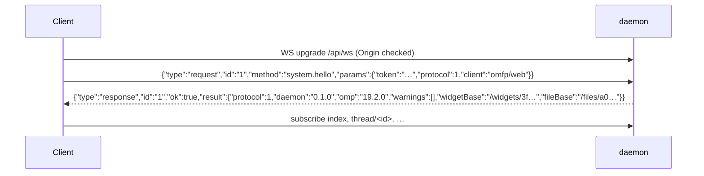

# 03 — UI ↔ daemon protocol

One WebSocket per client at `/api/ws`, JSON text frames only (PRT-135); all types live in `omfp-protocol`. Plain HTTP
besides: the web bundle at `/` (DMN-008), the user's theme at `/theme.css` (DMN-075), widget modules under
`widgetBase` (DMN-084, PRT-042) and raw workspace files under `fileBase` (DMN-250, PRT-150).

## Connection and authentication



| ID | Requirement |
| --- | --- |
| PRT-001 | The first client frame MUST be `system.hello`. Any other frame before a successful hello MUST close the connection with WebSocket close code 4401, and so does a hello that has not completed within 10 s (DMN-184). |
| PRT-002 | The token MUST travel in the `system.hello` payload, never in the URL. Comparison MUST be constant-time. |
| PRT-003 | The daemon MUST reject with `403` upgrades whose `Origin` is neither the daemon's own origin nor in the configured allow-list (DMN-140). An upgrade without `Origin` (CLI, desktop theme push, tests) passes; the `system.hello` token check (PRT-002) applies to every connection. |
| PRT-070 | The `Origin` match MUST be exact on scheme, host and port: the own origin is `http://<Host>` or `https://<Host>` of the upgrade request; an allow-list entry (DMN-141) matches only the identical origin — no wildcard, subdomain, other scheme or port, not `null`. A proxy that rewrites `Host` therefore needs its origin listed. |
| PRT-004 | `protocol` is an integer. If the client's version is not supported the daemon MUST answer with error `version_mismatch` listing the supported versions, then close. |
| PRT-005 | The hello response MUST include daemon version, omp version, and warnings (e.g. `--allow-omp-mismatch` in effect). |

## Envelope

```jsonc
// client → daemon
{ "type": "request", "id": "c42", "method": "thread.prompt", "params": { "threadId": "01J…", "text": "…" } }

// daemon → client
{ "type": "response", "id": "c42", "ok": true, "result": { … } }
{ "type": "response", "id": "c42", "ok": false,
  "error": { "code": "omp_error", "message": "…", "ompCode": "session_busy", "details": { … } } }
{ "type": "event", "topic": "thread/01J…", "epoch": "e7", "seq": 1289, "event": { "kind": "omp", "frame": { … } } }
{ "type": "resync_required", "topic": "thread/01J…" }
{ "type": "transient", "topic": "thread/01J…", "event": { "kind": "live_levels", "input": 0.12, "output": 0.3 } }
{ "type": "window_request", "id": "w7", "request": { "kind": "run_command", "command": "view.switch", "args": ["ops"] } }
```

| ID | Requirement |
| --- | --- |
| PRT-010 | Every request MUST have a client-chosen `id`, unique per connection; the response echoes it. Responses MAY arrive out of request order. |
| PRT-011 | Error `code` values are a closed set: `unauthorized`, `bad_request`, `not_found`, `conflict`, `already_resolved`, `limit_reached`, `version_mismatch`, `thread_failed`, `omp_error`, `git_error`, `internal`. `omp_error` carries omp's own `code` in `ompCode` when present (DMN-071). |
| PRT-012 | Unknown `method` MUST yield `bad_request`; unknown fields in `params` MUST be ignored (forward compatibility). |
| PRT-013 | A single frame MUST NOT exceed 16 MiB. Larger payloads (huge diffs, long transcripts) MUST be paged or truncated with an explicit `truncated: true`. |

## Topics, snapshots and catch-up

Topics: `index` (workspaces with their repositories, thread summaries, theme), `thread/<id>`, `workspace/<id>` (git
status per repository, `error` for one that could not be read, DMN-383), `views/<id>` (PRT-040), `job/<id>`
(PRT-041), `jobs/<id>` (PRT-200) and `terminal/<id>` (TRM-100).

The `index` state is `{ workspaces, threads, theme, settings, init, models }`; its events are `workspace_upserted` /
`workspace_removed`, `thread_upserted` / `thread_removed`, `theme_changed { theme }` (`{ css: string | null }`,
DMN-075), `settings_changed { settings }`, `init_changed { init }` (PRT-095) and `models_changed { models }` (PRT-141).
`settings` is `{ daemon?, ui, keymap: { mode, keys, command }[], error }`: the `[ui]` and `[keymap]` tables of the
config file, its `[daemon]` values that apply live (PRT-231) and the last reload error (DMN-009, UI-097). A thread
summary carries `title` (`""` until the first message) and
`titleSource`: `placeholder`, `generated` or `set` (DMN-073).

```jsonc
// subscribe, optionally from a known position
{ "type": "request", "id": "c7", "method": "subscribe",
  "params": { "topic": "thread/01J…", "since": { "epoch": "e7", "seq": 1200 } } }

// answer A: catch-up from the ring buffer — events 1201.. follow as normal "event" frames
{ "type": "response", "id": "c7", "ok": true, "result": { "mode": "replay", "epoch": "e7", "fromSeq": 1201 } }

// answer B: position unknown or too old — full state, then live events after `seq`
{ "type": "response", "id": "c7", "ok": true,
  "result": { "mode": "snapshot", "epoch": "e9", "seq": 40, "state": { /* ThreadState */ } } }
```

| ID | Requirement |
| --- | --- |
| PRT-020 | `subscribe` with `since` inside the thread's ring buffer (same `epoch`, `seq` ≥ oldest kept) MUST replay the missing events in order; otherwise it MUST return a snapshot. Without `since`, it returns a snapshot. |
| PRT-021 | The snapshot MUST be the thread state at exactly `seq`; applying the following events with the shared reducer MUST produce the same state the daemon has (TST-011). |
| PRT-022 | Events for a topic MUST be delivered in strictly increasing `seq` order without gaps. When a thread's process restarts, the subscription continues in a new `epoch` from `seq` 1 (the state carries over). A client that observes a gap, or a new `epoch` not starting at `seq` 1, MUST resubscribe. |
| PRT-023 | Each client has a bounded outbound queue. On overflow the daemon MUST drop that client's topic, send `resync_required` for it, and keep the connection open; the client resubscribes and gets a snapshot. |
| PRT-024 | `unsubscribe { topic }` MUST stop delivery for that topic. Closing the socket unsubscribes everything. |
| PRT-025 | The daemon MUST know which threads are being watched (at least one watching subscription, PRT-222) for the idle reaper (DMN-034) and for the window the user last used on a thread (DMN-060). |
| PRT-222 | `subscribe { topic, since?, watch? }` MUST watch a `thread/<id>` topic unless `watch` is `false`: such a subscription delivers the topic alike but keeps no omp from the idle reaper (DMN-356) and never makes its window the last used (DMN-357). Absent `watch` is `true`; `watch: false` on another topic is `bad_request`. |
| PRT-223 | `watch { topic, watch }` (permission `Connect`, window connections only, AGT-041) MUST set whether this connection's live subscription watches its thread (PRT-222) without new snapshot or replay, answering `{}`; an unsubscribed topic is `not_found`, `watch: false` on a non-thread topic `bad_request`. Effects as DMN-060, DMN-034. |
| PRT-143 | `UiSettings.theme` MUST be one of `synth`, `catppuccin`, `gruvbox`, `tokyo-night`, `nord`, `solarized`, `rose-pine`, `graphite`, `paper`, `clay`, `primer`, `accent`, `matugen` (DMN-240, UI-510); absent means `synth`. Another name is `bad_request` from `settings.set` and reported by the config file (DMN-238). |
| PRT-213 | `UiSettings.skin` MUST be `crush` or `boring` (UI-794); absent means `crush`. Another name is `bad_request` from `settings.set` and reported by the config file (DMN-009). |
| PRT-228 | `UiSettings.liveVoice` and the optional `voice` of `thread.live_connect` / `thread.live_start` MUST be one of `arbor`, `breeze`, `cove`, `ember`, `juniper`, `maple`, `sol`, `spruce`, `vale`; absent leaves the voice to omp (its `live.voice`, else `sol`). Another name is `bad_request` and reported by the config file (DMN-009). |
| PRT-231 | `Settings.daemon` and `settings.set`'s `daemon` MUST be `{ deleteArchivedAfter? }`: the config file's `[daemon] delete_archived_after` as written (`<n>m`, `<n>h`, `<n>d`, `<n>w`, `never` or `0`; DMN-395), absent when the file sets none (`7d`). Another form is `bad_request` from `settings.set`, nothing written (DMN-396). |
| PRT-180 | `threads.fork { threadId, entryId? }` (permission `Manage`) MUST answer the new thread's `ThreadSummary`, in the source's workspace, once its omp runs on a copy of the conversation through message entry `entryId` (of `thread.tree`), the whole session without it (DMN-300..DMN-302). `thread.fork` forks inside the same thread (DMN-072). |
| PRT-181 | `ThreadSummary.forkedFrom` MUST be absent for a thread that is no fork, else `ForkOrigin { threadId, title, entryId?, message? }`: the source thread (maybe deleted since), its title when forked, the entry and the first line of its message (DMN-304). |
| PRT-182 | `threads.fork` MUST answer `bad_request` for a source without a session yet, `not_found` for an unknown thread or an entry that is no message of the source's session, and `thread_failed` (with `details.stderrTail`) when the new omp cannot start; none of them leaves a thread behind (DMN-303). |

## Event kinds on `thread/<id>`

| `event.kind` | Contents |
| --- | --- |
| `omp` | An omp frame as received: session events, `prompt_result`, `session_settled`, subagent frames, `available_commands_update`, `notice`, `queue_update`, … |
| `history` | Initial history after process start, a reset of the transcript |
| `process` | Process state change (`Stopped`, `Starting`, `Idle`, `Busy`, `Failed { exitCode, stderrTail }`) |
| `interaction_opened` / `interaction_closed` | Pending interactive request opened / answered / cancelled (DMN-050..052) |
| `presentation` | `notify`, `setStatus`, `setWidget`, `set_editor_text`, `open_url`, `setTitle` (DMN-053) |
| `thread_meta` | Title, model, thinking level, branch, git summary changed |
| `live_session` | `{ owner: { client, connection } \| null }`: a live session opened for that connection, or one omp never started closed (DMN-100, DMN-101, DMN-109); omp's `live_*` frames arrive as `omp` events, `live_levels` as transient frames (PRT-054) |
| `open_file` | `{ id, connection, path, line }`: `omfp_open_file` asks the window on that connection to open `path` at `line`; kept as state `open_file`, opened once per `id` (DMN-060, UI-116) |
| `notify` | `{ id, connection, title, body }`: `omfp_notify` asks the window on that connection to notify the user (PRT-065, DMN-125, UI-215) |
| `unknown` | Unknown omp frame (DMN-042) |

## Methods

The method list, params and results are `crates/omfp-protocol/src/method.rs` and its JSON Schemas, served to agents as
`omfp://protocol/methods`; behavior beyond the shape is in the rows below and in 02. Results of omp-forwarded methods
are the `data` of omp's `response` frame, even where omp's command output is a bare list (`get_available_models` →
`{ models }`).

| ID | Requirement |
| --- | --- |
| PRT-030 | `thread.prompt` MUST return `{ promptId }` as soon as omp admits the prompt, not when the turn ends; completion arrives as `prompt_result` with the same `promptId`, unique only within the thread's current epoch. `thread.abort` answers `{ steering, followUp }`, the queued messages to restore into the composer. |
| PRT-031 | Every method MUST be covered by a golden-JSON test of request and response in `omfp-protocol`, so wire format changes are explicit in review. |
| PRT-032 | `omfp-protocol` MUST version breaking changes by bumping `protocol`; the daemon supports the current and the previous version during a transition. |
| PRT-033 | No method may assume a human UI is on the other end: every method is usable by scripts and agents (D-12). The `client` field of `system.hello` and the principal are recorded as provenance on created entities (ARC-009). |
| PRT-034 | Authorization MUST be resolved once per connection into a principal and checked against one method → permission table. Principals: the owner token, a thread's agent principal (DMN-150) and the MCP principal (AGT-051). |
| PRT-050 | `thread.live_connect { threadId, sdpOffer, voice? }` → `{ sdpAnswer, voice, context? }` (`context`: the live instructions to append, DMN-118; `conflict` while a live session exists, DMN-101), `thread.live_stop { threadId }` → `{}` (never starts omp), `thread.live_mute { threadId, muted }` → `{ muted }` (`conflict` without a session); all need `Drive`. |
| PRT-051 | The `system.hello` result MUST carry `connection`, a number unique while the daemon runs: a window compares it with a live session's `owner.connection` to know whether the session is its own. |
| PRT-052 | The thread state MUST carry `live` (`{ owner, phase, transcript, context_end }` or `null`) and `live_error`: an owned `live_session` starts a session and clears `live_error`; `live_transcript` keeps one line `{ role, turn, text, final }` per role and turn, replaced until final; `live_end` or `owner: null` clears it, `live_end` setting `live_error` from its `error` (DMN-104, DMN-105). |
| PRT-053 | `thread.live_start { threadId, voice? }` MUST answer `{ voice }` once omp's local session records (DMN-109) and need `Drive`; `conflict` while a live session exists (DMN-101). |
| PRT-054 | A **transient frame** `{ type: "transient", topic, event }` carries a momentary value outside the event stream: no `seq`, never replayed or in a snapshot, sent only to current subscribers, dropped (no `resync_required`) on a full queue. The only `TransientEvent` is `live_levels { input, output }` on `thread/<id>` (DMN-110). |
| PRT-055 | The thread state MUST carry `subagents`: per subagent id, the last `subagent_lifecycle` payload (`lifecycle`) and last `subagent_progress` payload (`progress`), each `null` until sent; finished subagents stay (UI-081). |
| PRT-056 | The thread state MUST carry `goal`: the `goal` of the last `goal_updated` frame (`null` when none); a `history` event keeps it. A `goal_updated` without a `goal` key does not decode (an `unknown` notice). |
| PRT-057 | The thread state MUST carry `todo_phases`: the phases of the transcript's last `todo` tool result that committed some (not an error, not a `view`), `[]` without one; a `blocked` task status reads as `pending`. A `message_end` of such a result replaces them; a `history` event recomputes them. |
| PRT-100 | A tool run MUST carry `background`: the omp background job the call became, else `null` — `{ job_id, state, output, exit_code }`, state `running`, `completed`, `failed` or `cancelled`. A `tool_execution_update` with a job frame replaces it; it survives `tool_execution_end`. A frame with another state is ignored. |
| PRT-229 | `ThreadSummary` carries `interruptedAt?: number` (unix ms): the daemon stopped, or the thread's omp exited on its own, while that omp was mid-turn or waiting on async work (DMN-370, DMN-377), until a resume or a message continues the turn (DMN-372, DMN-373). |
| PRT-230 | `thread.resume { threadId }` (permission `Drive`) MUST continue the interrupted turn (DMN-372) and answer `PromptResult { promptId, agentInvoked }` like `thread.prompt`; a thread without `interruptedAt` is `conflict`, an unknown one `not_found`, an omp that cannot start `thread_failed` (DMN-212). |

## Agent tools

| ID | Requirement |
| --- | --- |
| PRT-090 | `threads.list { workspaceId?, includeArchived? }` (permission `Read`) MUST answer `{ threads }`: the `index` topic's thread summaries after a refresh, in its order, archived ones only with `includeArchived: true`, only those of `workspaceId` when given (unknown lists none). |
| PRT-091 | `workspaces.list {}` (permission `Read`) MUST answer `{ workspaces }`: the workspaces of the `index` topic after a refresh, in its order. |
| PRT-092 | Every method of the method registry MUST carry a description, its doc comment, published with its schemas (AGT-007), so the method catalogue (AGT-042) describes each method without a second list. |
| PRT-093 | A provenance's `createdBy` (ARC-009) MUST be `{ kind: "user" }`, `{ kind: "thread", threadId }` or `{ kind: "mcp" }`: the last for what the MCP principal created (AGT-051), whose MCP client is the provenance's `client`. |
| PRT-094 | An activity entry's `threadId` (PRT-086) MUST be `null` for a call of the MCP principal (AGT-053); its `client` then names the MCP client. |

## Cascade stop and activity log

| ID | Requirement |
| --- | --- |
| PRT-085 | `thread.stop { threadId, cascade? }` MUST answer `{ threadIds }`: the thread first, then with `cascade: true` the rest of its spawned tree (AGT-070) in stop order (DMN-162); `cascade` defaults to `false`. Stopping a thread without a process succeeds; an unknown thread is `not_found`. |
| PRT-086 | `activity.list { threadId?, before?, after?, limit? }` (permission `Read`) MUST answer `{ entries, more }` from the activity log (DMN-160), newest first, entries `{ seq, at, threadId, client, method, params, error }`; `before`/`after` filter by `seq`; `limit` defaults to 50, capped at 500; `more` tells whether matches were left out. |
| PRT-127 | `prompts.history { threadId?, workspaceId?, query?, limit? }` (permission `Read`) MUST answer `PromptHistory { prompts }` ordered as DMN-217: this thread's, then this workspace's, then the rest, newest first within each; `query` filters; `limit` defaults to 100, at most 1,000. |
| PRT-128 | A `PromptHistoryEntry` MUST carry `text`, `threadId` (the thread it was last sent to), `workspaceId` (that thread's workspace then) and `at` (Unix ms); each text appears once (DMN-216). |
| PRT-226 | `prompts.predict_word { text, cursor }` (permission `Read`) MUST answer `PredictedWord { suffix }`: the characters completing the word ending at `cursor` (UTF-16 index), `null` when none (DMN-360). It needs no thread; failing to start omp is `thread_failed` (DMN-362). |
| PRT-227 | `prompts.predict_word_feedback { text, cursor, suggestion, accepted }` (permission `Drive`) MUST answer `{}` once omp took the feedback that `suggestion`, the suffix answered for that `text` and `cursor`, was accepted or typed past (DMN-360). |

## MCP servers

| ID | Requirement |
| --- | --- |
| PRT-110 | `workspaces.mcp_servers { workspaceId }` (permission `Read`) MUST answer `McpServers { workspaceId, threadId: null, running: false, projectConfig, servers }`: every MCP server of the workspace (DMN-190), `configured` or `disabled`, without starting omp; `projectConfig` is `<workspace>/.omp/mcp.json`, existing or not. |
| PRT-111 | `thread.mcp_servers { threadId }` (permission `Read`) MUST answer `McpServers` with `threadId` set and `running`: with a running omp each `checkable` server it checked (DMN-191) is `connected` (with `tools`) or `failed` (with `error`); others, and all of a stopped thread, stay `configured`. It never starts omp. |
| PRT-112 | `thread.mcp_reconnect { threadId, name? }` (permission `Drive`) MUST restart the thread's omp (DMN-192) and answer `McpServers` as PRT-111, checking only `name` when given. A thread that is not settled is `conflict` and keeps running; a stopped thread is started. |
| PRT-113 | A server of `McpServers` MUST carry `name`, `transport` (`stdio`, `http`, `sse`), `target` (command and args, or URL without query, fragment, user info), `source { path, workspacePath?, tool }` (`tool`: `omp`, `claude`, `cursor`, `vscode`), `state`, `checkable` (an enabled `.omp/mcp.json` entry without whitespace in its name), `tools`/`error`; in omp's precedence order, each name once. |
| PRT-114 | A server's `state` MUST be `configured` (enabled, not checked), `connected` (omp connected and listed its `tools`), `failed` (omp's `error`) or `disabled` (`enabled: false`): what omp's `/mcp test` saw, not a live connection. |
| PRT-220 | `mcp.tools { workspaceId, server }` (permission `Read`) MUST answer `McpTools { workspaceId, server, tools }`: every tool the remote server lists (DMN-351), in order, each `{ name, title?, description?, inputSchema, outputSchema?, annotations? }` (`inputSchema` `{ "type": "object" }` when missing; nameless tools skipped), without omp; errors per DMN-354. |
| PRT-221 | `mcp.call { workspaceId, server, tool, arguments? }` (permission `Drive`) MUST call the tool with `arguments` (default `{}`) and answer `McpCallResult { content, structuredContent?, isError }` as the server sent them; errors per DMN-354. |
| PRT-120 | The thread state's `notices` (UI-043) MUST also hold local slash command output, `{ type: "command_output", data: { text } }`, and URLs omp asks to open, `{ type: "open_url", data: { id, url, launchUrl?, instructions? } }`; unlike other notices they survive a `history` event, placed at most after its last message. |
| PRT-121 | `ThreadSummary` carries `restartPending?: RestartReason[]` (absent when empty): the thread's omp should restart to load new MCP tools or models, but background work holds it back (DMN-204); each reason once, in arrival order (DMN-228); `thread.mcp_reconnect` (PRT-112) restarts it now. |
| PRT-170 | `workspaces.reorder { workspaceId, beforeId? }` (permission `Manage`) MUST answer `{}`, placing the workspace just before `beforeId`, or last without it (DMN-281). |
| PRT-171 | `threads.reorder { threadId, workspaceId?, beforeId? }` (permission `Manage`) MUST answer `{}`, placing the thread before `beforeId` (absent: last) in `workspaceId` (absent: its own; another one moves it, DMN-283) (DMN-282). |
| PRT-172 | `Workspace` and `ThreadSummary` MUST carry `position: number`, their place in the left column from 0 (among workspaces; among the workspace's threads, archived included), the same for every client (DMN-284). |
| PRT-134 | `RestartReason` MUST be `mcp_config` (the MCP servers omp would load changed), `mcp_reauth` (a server was reauthorized with `/mcp reauth`) or `login` (a login stored a credential, DMN-224), so a window names it (UI-349). |

## Logging in to a provider

The daemon runs omp's OAuth logins on a short-lived omp of its own (DMN-219..DMN-224) and shows the flow in a window.

| ID | Requirement |
| --- | --- |
| PRT-129 | `auth.providers {}` (permission `Read`) MUST answer `AuthProviders { providers }` in omp's order, each `{ id, name, available, authenticated }` (`authenticated`: omp holds a credential, login, environment key or config). It starts an omp (DMN-219), so it takes seconds. |
| PRT-130 | `auth.login { providerId }` (permission `Drive`) MUST log omp in (DMN-220) and answer `LoggedIn { providerId, name }` once omp stored the credential, up to omp's 10 minutes; unknown or unavailable provider is `bad_request`, omp's failure `omp_error`, a cancelled login `conflict` (PRT-132). |
| PRT-131 | A login's flow reaches one window (DMN-221) as `window_request`s (PRT-124) with `providerId`, `name`: unanswered notices `{ kind: "login_url", url, launchUrl, instructions }` (`launchUrl`, `instructions` may be `null`) and `{ kind: "login_progress", message }`; `{ kind: "login_input", message, placeholder }` is answered with `answer: { kind: "login_input", value }`, `value: null` cancelling. |
| PRT-132 | `auth.login_cancel {}` (permission `Drive`) MUST cancel the running login (DMN-222) and answer `LoginCancelled { providerId }`, `null` when none ran; the cancelled `auth.login` fails with `conflict`. A new `auth.login` and closing the window that shows a login cancel it too. |
| PRT-133 | `auth.logout { providerId }` (permission `Drive`) MUST remove every credential omp stored for the provider (DMN-223) and answer `LoggedOut { providerId, removed, remainingSource }`: how many it removed, and what still authenticates the provider (omp's words), `null` when nothing does. |
| PRT-136 | `auth.importable {}` (permission `Read`) MUST answer `OmpLogins { providers }`: each provider standalone omp holds a login for, once, as `{ providerId, oauth }`, MCP credentials excluded (DMN-229); `[]` when there is none, omp is missing or the store cannot be copied. No secret is sent; a failure is `omp_error`. |
| PRT-137 | `auth.import {}` (permission `Drive`) MUST copy standalone omp's provider logins into omfp's profile (DMN-230) and answer `OmpLogins { providers }` copied (`[]` when nothing to copy); repeating is harmless. While a login runs it is `conflict`; an uncopyable store or other failure is `omp_error`. |
| PRT-140 | `auth.status {}` (permission `Read`) MUST answer `AuthStatus { models }`, how many models omp can use (DMN-235, `0` on a fresh install); the first call starts an omp, later ones answer the kept count (DMN-236, PRT-141). `auth.models {}` (`Read`) MUST answer `{ models }` from a fresh short-lived omp per call, creating no thread or workspace. |
| PRT-212 | `oauth.callback { threadId?, url }` (permission `Manage`) MUST relay `url`, where a browser ended an OAuth sign-in omp started, to omp's loopback listener (DMN-340..DMN-342) of thread `threadId`, else of `auth.login`, answering `OAuthCallbackRelayed { status }`. Refused address `bad_request`; nothing waiting `conflict`; unknown thread `not_found`; non-2xx/no answer `omp_error`. |

`auth.models` and `thread.models` answer `{ models: [{ provider, id, name, … }] }`. Create a thread with
`model: "<provider>/<id>"`, change one with `thread.set_model { threadId, provider, modelId }`; `name` is only a label.

## Thread session

Small session facts without omp's whole `get_state`.

| ID | Requirement |
| --- | --- |
| PRT-125 | `thread.session { threadId }` (permission `Read`) MUST answer `ThreadSession { threadId, workspaceId, cwd, roots, sessionDir, sessionId?, sessionFile?, model?, sessionModel?, thinkingLevel?, approvalMode?, process, settled, needsAttention, messageCount?, usage? }` without starting omp (DMN-213); `cwd` is the workspace folder, `roots` `[]` before the first start. Unknown thread: `not_found`. |
| PRT-126 | Fields needing omp are absent when unavailable: `sessionId` before the first start, `sessionFile` until omp wrote it, `messageCount` until the session was loaded this run (DMN-337, DMN-359), `usage { cost, tokens, context? }` while omp does not run (DMN-214). |
| PRT-211 | `ThreadSession.sessionModel` MUST be the `provider/id` the stored session restores, read from the session file when the thread's omp could not start (DMN-338), absent otherwise; a client compares it, after `model`, with `auth.models` (UI-751). |

## Views and jobs

| ID | Requirement |
| --- | --- |
| PRT-040 | `views/<workspaceId>` (DMN-082): state `ViewsState { manifest, error, widgets: [{ source: "workspace" \| "user", name, version, entry }], stored }`; events `views_manifest { manifest, error }`, `views_widgets { widgets }` (replacing those fields) and `widget_stored { instance, key, value }` (`null` removes). Unknown workspace: `not_found`. |
| PRT-041 | `job/<id>` (DMN-080): state `JobState { job, lines: [{ stream, text }], dropped }`; events `job_output { stream, text }` (appends) and `job_exited { code, signal, endedAt }` (status becomes `{ state: "exited", code, signal, endedAt }`). Unknown job: `not_found`. |
| PRT-042 | The `system.hello` result MUST carry `widgetBase`, the path under which this daemon serves widget modules to authenticated clients (DMN-084). |
| PRT-150 | The `system.hello` result MUST carry `fileBase` (`/files/<key>`, DMN-250): a client loads file `path` of workspace `id` from `<fileBase>/<id>/<path>`. |
| PRT-195 | `FileContent` MUST carry `outside: boolean`: `true` for a file read by an absolute path outside the workspace folder (DMN-310), `path` then absolute and `repo` its git working tree (DMN-311); a missing field reads as `false`. A client MUST NOT offer to write an `outside` file (UI-700). |
| PRT-196 | `workspaces.read_file` MUST accept an absolute path outside the workspace (DMN-310); `write_file` answers it `bad_request` (DMN-313), strict `find_file` no candidate (DMN-312). A relative path leaving the folder is `bad_request` for all three. Fuzzy `find_file` never searches outside (DMN-092). |
| PRT-197 | A client MUST load the raw bytes of a file outside the workspace folder from `<fileBase>/<id>/<absolute path>` (PRT-150; `//` after the id, each segment percent-encoded) (DMN-314). |
| PRT-043 | `widgets.report` (AGT-026) replaces the connection's report on its view's workspace widgets, forgotten on close (DMN-063). Per instance: `state` (`loading`, `rendered`, `compile_error`, `load_error`, `render_error`), `errors`, `console`, `text`, `jobs`. Kept: ≤4,000 chars of `text`, 20 `errors`, 20 `console`, 10 job `tail` lines, entries ≤2,000 chars. |
| PRT-060 | `ViewsState` (PRT-040) carries `keymap: [{ mode, keys, command, args? }]` and `keymapError: string \| null` from `.omfp/keymap.json` (DMN-121); `views_keymap { keymap, error }` replaces both. Missing fields read as no bindings, no error. |
| PRT-095 | `IndexSnapshot.init` and `ViewsState.init` (`string \| null`) are the versions of the user's init file (DMN-185) and `.omfp/init.ts`, replaced by `init_changed` / `views_init { init }`; missing reads as `null`. A client loads one from `<widgetBase>/init/<user \| workspace id>/<version>/init.ts` (`404` without a file). |
| PRT-141 | `IndexSnapshot` carries `models: number \| null` (DMN-235; `null` until checked), replaced by `models_changed { models }`, and `login: LoginActivity { providerId, name, url, instructions, progress } \| null` (DMN-290), replaced by `login_changed { login }`; missing fields read as `null`. |
| PRT-115 | `widgets.report` carries `fileErrors: [{ file, message }]`, the init file errors the window shows: `file` is `user` or `.omfp/init.ts`, `message` as shown (compile errors with `file:line:column`); missing means none. Kept per connection (DMN-195). |
| PRT-116 | `views.errors { workspaceId }` (permission `Read`) MUST answer `ViewErrors { windows: [{ client, errors }] }`: one entry per window whose latest report is on the workspace, in connection order, `errors: []` included (DMN-195); unknown workspace `not_found`. It does not wait (`omfp_views_errors` does, DMN-196). |
| PRT-122 | `widgets.report` carries `window?: { threadId, focused, activeView, defaultView, views, commands }` (UI-350, UI-351): `views` `{ id, title, source, widgets }` in switcher order, `commands` the non-built-in ones `{ id, title, aliases, source, widget, enabled, bindings }`. Missing reads as an empty state; kept with the report (DMN-205). |
| PRT-123 | `windows.list { workspaceId? }` (permission `Read`) MUST answer one `{ windowId, client, workspaceId, threadId, focused, activeView, errors }` per reporting window (DMN-205), most recently focused first; `windowId` is its `connection`, `errors` a count. `windows.state { windowId }` answers its PRT-122 fields, `fileErrors` and widget reports. Unknown: `not_found`. |
| PRT-124 | **Window requests** `{ type: "window_request", id, request }` go to one window's connection: `{ kind: "run_command", command, args }`, `{ kind: "check_widget", reference, version, timeoutMs }`, `login_*` (PRT-131) or `notify` (DMN-375). `windows.answer { requestId, answer }` (`Connect` only) answers with `{ kind: "ran", command }`, `{ kind: "not_run", reason: "unknown" \| "disabled" \| "failed", message }` or `{ kind: "checked", report, settled }`, else `not_found`. `windows.run` and `windows.check_widget` (`Drive`, DMN-206, DMN-207) carry no code. |
| PRT-065 | The thread state MUST carry `notify`, the last `notify` event's `{ id, connection, title, body }` (`null` before one; a process change keeps it); a malformed event changes nothing. A window acts only on requests naming its own connection, once per `id`. |
| PRT-080 | `views.mount { workspaceId, id, widget?, code?, props?, view?, place?, panel? }` → `Mounted { id, reference, view, panel, replaced }` (AGT-061): written like `views.set` (DMN-083) and published before answering. Breaking AGT-061 or an invalid current `views.json` is `bad_request`. |
| PRT-081 | `views.mount_update { workspaceId, id, props?, code? }` → `Mounted` (`replaced: true`) (AGT-062), written and published like PRT-080; `not_found` when no node or panel has that id. With `code`, `.omfp/widgets/<id>/` must be the mount's own folder (DMN-183), else `conflict`. |
| PRT-082 | `views.unmount { workspaceId, id }` → `Unmounted { views, removedViews, panel }` (AGT-063): the ids of the views it changed and of those it removed, and whether it removed the panel `id`; written and published like PRT-080. |
| PRT-224 | `card.answer { threadId, toolCallId, answer }` (permission as `interaction.respond`) ends the wait of `omfp_card` call `toolCallId` (AGT-097) with `{ kind: "submit", value }` or `{ kind: "cancel" }`, answering `{}`; a call not waiting is `already_resolved`, an unknown thread `not_found`. |
| PRT-225 | `widgets.compile { code }` (permission `Read`) MUST answer `{ module }`, `code` compiled as `card.tsx` (DMN-084, DMN-085), refusing relative imports; a compile error is `bad_request` with `card.tsx:line:column: message`. It touches no file; a window loads the module from a `blob:` URL. |

## Declared jobs

The jobs a workspace declares in `.omfp/jobs.json` and their runs (DMN-320..DMN-336). A *job* is the definition, a
*run* one execution whose id is a job id (`job/<id>`, `jobs.kill`); `jobs.start` starts a *transient run* (DMN-080).

```jsonc
// jobs/<workspaceId> state
{ "jobs": [{
    "name": "mail",
    "job": { "trigger": "schedule", "schedule": "0 8 * * 1-5", "missed": "skip", "enabled": true,
             "prompt": { "text": "Read my unread mail…", "thread": "reuse" } },
    "status": "idle", "run": null, "nextAt": 1795330800000,
    "lastRun": { "id": "01K…", "workspaceId": "01K…", "job": "mail", "trigger": "schedule", "startedBy": null,
                 "threadId": "01K…", "startedAt": 1795244400000, "endedAt": 1795244461000, "status": "succeeded",
                 "reason": null, "exitCode": null, "signal": null } }],
  "error": null }
```

| ID | Requirement |
| --- | --- |
| PRT-200 | `jobs/<workspaceId>` (DMN-322): `JobsState { jobs: JobView[], error }`; `JobView { name, job, status, run, lastRun, nextAt }`: `job` with defaults filled in, `status` `disabled`, `idle`, `running`, `waiting` or `stopped` (DMN-326), `lastRun` the newest finished run not `skipped`, `nextAt` (Unix ms) the next scheduled start or service restart, else `null`. Events: `jobs_set { jobs, error }`, `job_updated { job }`, and informational `run_started` / `run_ended { run }`. Unknown workspace: `not_found`. |
| PRT-201 | `RunInfo` MUST be `{ id, workspaceId, job, trigger, startedBy, threadId, command, startedAt, endedAt, status, reason, exitCode, signal }` (DMN-330): `job` `null` for a transient run; `trigger` `manual`, `schedule`, `missed`, `service` or `start`; `startedBy` a `createdBy` (PRT-093) or `null`; `command` `null` for a prompt run; end fields `null` until known. |
| PRT-202 | `jobs.list { workspaceId }` (permission `Read`) MUST answer the workspace's `JobsState` as `jobs/<id>` holds it, for clients without a subscription (an agent's `omfp_call`); an unknown workspace is `not_found`. |
| PRT-203 | `jobs.runs { workspaceId, job, before?, limit? }` (permission `Read`) MUST answer `{ runs, more }`: the kept runs of that job (DMN-330), newest first, `skipped` included, only before run `before` when given; `limit` defaults to 20, capped at 50. Undeclared jobs still answer kept runs; none gives `runs: []`. |
| PRT-204 | `jobs.run { workspaceId, job }` (permission `Drive`) MUST start a `manual` run and answer its `RunInfo` once started (DMN-328); a stopped or waiting service restarts with backoff reset (DMN-326). `not_found` unknown job; `conflict` disabled, running (DMN-324) or busy `reuse` thread; a thread that cannot start is `thread_failed` (DMN-212). |
| PRT-205 | `jobs.define { workspaceId, name, job, replace? }` (permission `Manage`) MUST write the job into `.omfp/jobs.json` (DMN-332) and answer its `JobView` once applied and published: `bad_request` for a name or definition breaking DMN-320 (`<JSON path>: <reason>`) or an invalid current file; `conflict` for an existing name without `replace: true`. |
| PRT-206 | `jobs.remove { workspaceId, name }` (permission `Manage`) MUST remove the job from `.omfp/jobs.json` (DMN-332) and answer `{}` once torn down (DMN-322) and published; `not_found` for an unknown name, `bad_request` for an invalid current file. Its stored runs stay readable with `jobs.runs` until the workspace is removed. |
| PRT-207 | `jobs.enable { workspaceId, name, enabled }` (permission `Manage`) MUST set the job's `enabled` in `.omfp/jobs.json` (DMN-332: `true` removes the key, the default) and answer its `JobView` once applied; `not_found` and `bad_request` as PRT-206. |
| PRT-208 | `threads.archive` and `threads.delete` take `jobs?: "kill" \| "keep"`. While transient runs the thread's agent started still run, a call without `jobs` MUST change nothing and answer `conflict` with `details: { runs }`; `kill` kills them first, `keep` leaves them (DMN-333). Declared job runs never count (DMN-329). |
| PRT-209 | A thread a prompt run created (DMN-328) MUST carry `createdBy: { kind: "job", job }` (extending PRT-093), `job` the job's name in the thread's workspace; it belongs to no spawned tree (AGT-070). |
| PRT-210 | `Workspace` MUST carry `jobs?: JobCounts { total, manual, schedule, service, running, failing, error }`, absent when the workspace declares no job and its file is not refused; a change publishes `workspace_upserted` (DMN-335). |

## No omp terminal handoff

| ID | Requirement |
| --- | --- |
| PRT-135 | The protocol MUST NOT have singular `terminal.*` methods (unknown method, `bad_request`), a terminal permission or a `terminal` thread process state (D-06). Daemon-owned PTYs use `terminals.*` and `terminal/<id>` (TRM-100..106); `terminals.screen` `waitMs` is at most 30,000. Binary WebSocket frames are `bad_request` (TRM-103). |
