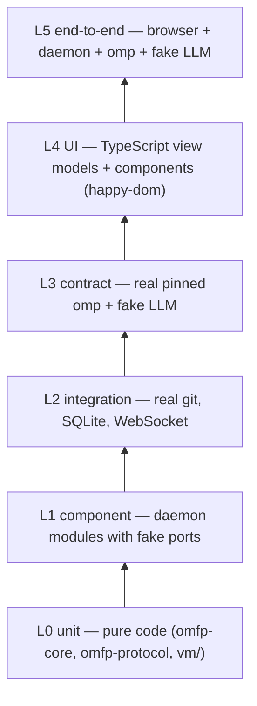

# 06 — Testing strategy (TDD)

Test-driven development is the default way of working, not an afterthought. Every requirement in these specs has an ID;
code exists because a test citing that ID asked for it.

## Process

1. **Pick a requirement** (or a bug). If it is ambiguous, fix the spec first.
2. **Red**: write the smallest test that expresses it, citing the ID (`// spec: DMN-021`). Run it and check it fails
   *for the expected reason* (assertion, not compile error or panic elsewhere).
3. **Green**: write the minimal code that passes it.
4. **Refactor** with the suite green. Remove duplication in code and tests.
5. Repeat until every acceptance criterion of the requirement is covered (happy path, boundaries, errors, transitions).

| ID | Rule |
| --- | --- |
| TST-001 | Every change that alters behavior MUST come with tests written first; a bug fix MUST start with a test that reproduces the bug. |
| TST-002 | Tests assert observable behavior (outputs, state transitions, frames on the wire, files on disk), never implementation details (private fields, call counts on internal helpers). |
| TST-003 | Tests MUST be deterministic and isolated: no sleeps (wait on conditions with timeouts), no real network beyond loopback, no real model calls, temporary directories only, port 0 for servers, injected clock and ID generators. |
| TST-004 | Every test layer below runs in parallel safely; tests needing a shared scarce resource use a nextest test group with a concurrency limit. |
| TST-005 | Mutation testing (`cargo-mutants`) is the quality gate for test strength on pure crates (no surviving mutant, TST-050); line coverage is gated only as a floor (TST-050's thresholds in `just cov`), never a goal to raise for its own sake. |

## Layers



| Layer | What | Tools | Runs in |
| --- | --- | --- | --- |
| L0 | Reducer (Rust and its TypeScript port), view-models, protocol (de)serialization, naming/slug rules, `ask` validation, ring buffer, state machines | `cargo nextest`, `proptest`, `insta`; `bun test` for TypeScript | `just test`, `just test-ts` |
| L1 | ThreadService, AgentSupervisor, WorktreeManager, interactions, idle reaper — against `FakeGit`, `FakeAgent` (scripted omp frames), `FakeClock`, `FakePty` | `tokio::test(start_paused = true)` | `just test` |
| L2 | Real `git` on temp repos, real SQLite file, real WebSocket server with a native protocol client | `omfp-testkit` | `just test` |
| L3 | Our assumptions about omp: real pinned `omp --mode rpc-ui` talking to `fake-llm` (`crates/*/tests/contract_*.rs`) | `omfp-testkit`, `fake-llm` | `just test-contract` |
| L4 | The TypeScript UI: view-model unit tests (`ui/packages/app/src/vm/`, no DOM) and component tests of the kit and the app rendered in happy-dom, queried by `data-testid` and role with Testing Library, plus normalized HTML snapshots; the client's transport suite against the test daemon | `bun test`, happy-dom (preloaded from `ui/test/dom.ts`), `@testing-library/react` + `user-event` | `just test-ts` |
| L5 | Critical user journeys on the web build | `thirtyfour` (WebDriver) + `chromedriver` + Chromium | `just test-e2e` |

| ID | Requirement |
| --- | --- |
| TST-010 | `omfp-core`'s reducer MUST have example tests for every event kind it handles, plus property tests. |
| TST-011 | Property tests MUST check at least: (a) rebuilding an assistant message from `messageUpdates: "delta"` events equals the `message_end` content for any generated message; (b) snapshot → serialize → deserialize → apply remaining events equals applying all events (PRT-021); (c) queue chips always equal the last `queue_update`. |
| TST-012 | Contract tests (L3) MUST record each scenario as a fixture file written with `just record-fixtures` and normalized so that re-recording only shows real changes (wall-clock and duration fields and token counts that follow the request size zeroed; random ids, UUIDs, session-file timestamps and temporary paths replaced). Two formats: raw omp stdout frames (`fixtures/omp/<version>/`, M0 smoke) and the daemon's reducer inputs, `omfp_core::ThreadEvent` as JSON lines (`fixtures/threads/<version>/`, recorded through the daemon's omp adapter). L0/L1/L4 tests replay the thread fixtures, so the whole stack is tested against real omp output without starting omp. `fixtures/states/<version>/` holds, per thread fixture, the Rust reducer's state after each event (`just gen-states`), which the TypeScript reducer must reproduce exactly (D-04). |
| TST-013 | Contract tests MUST fail fast with a clear message if `omp --version` differs from the pinned version (DMN-001). |
| TST-014 | L1 fakes MUST be driven by the same fixture format as TST-012, so a fake never invents frames omp does not send. |
| TST-105 | The contract scenario `local_command_output` (`/dirs` over `prompt`: one `command_output`, no `prompt_result`) MUST be recorded as a fixture, so the reducer goldens of both ports cover command-output notices (PRT-120). |
| TST-106 | A contract test (`contract_daemon.rs`) MUST create a thread in each of omp's approval modes (`always-ask`, `always-ask-cached`, `write`, `yolo`) through the real daemon and the pinned omp and get a fake LLM reply from each, and MUST see a value omp refuses (`ask`) answered `bad_request` with no thread or workspace left behind (DMN-210). |
| TST-015 | The fake launcher MUST play omp's live voice sequence (M6) with frames the pinned omp sends (the no-credential sequence of the contract tests, the phases, transcripts and end of the real call recorded in S-09): `live_connect` answers a canned SDP answer after `connecting` and `listening` (plus any scripted frames), or fails like omp after a session started (`connecting`, `error`, `live_end { error }`, `error`); `live_mute` moves to `muted`/`listening` and fails without a session; `live_stop` ends an active session with `live_end`. |
| TST-051 | (M7) The fake launcher MUST play `live_start` like `live_connect` (TST-015) and answer `{ voice }`; its scripted frames may hold `live_levels` and a `speaking` phase, as the pinned omp sends for `live_start` sessions. |
| TST-052 | (M9) Transcript performance harness (`e2e/tests/perf.rs`): headless Chromium against a fake-launcher daemon with a 10,000-message history (prose, Markdown with code blocks, tool calls with results) and omp's streaming frames. A probe installed before the page's scripts counts React commits and component renders per transcript item, frames, long tasks and WebSocket handling time. Tests assert structure only (counts, never times). An ignored benchmark in the same file prints the timings (first open, DOM size, scroll top to bottom, thread switch, streaming at 100 events/s); `just bench` runs it (TST-115). |
| TST-100 | The transcript benchmark (TST-052) MUST switch away from the long thread and back three times while recording, printing per switch the time to the DOM and to paint, the WebSocket messages handled with the text they carried (the probe adds it up: a thread snapshot when the thread was not followed, UI-335), the long tasks and the commits. It also runs, whole, on a 200-message thread streaming for 1 s in `just test-e2e` (`the_transcript_benchmark_runs_on_a_short_thread`), so its code keeps working. |
| TST-107 | Big files (`e2e/tests/perf.rs`, UI-118): a test opens a 20,000-line file (long lines among them) in `omfp:file` in headless Chromium, read-only, after a steady scroll and in its middle, then in the unified diff against `HEAD`, and asserts the structure only: `.cm-scroller` is the element that scrolls, the box around it is a layout root (`contain: strict`), and the DOM stays bounded (elements under `.cm-content`, `.cm-line`s). Ignored benchmarks (`just bench`, TST-115: `benchmark_file_chromium`; `benchmark_file_webkit`: `WebKitWebDriver` under `xvfb-run`, wheel turns by `xdotool`) print for a small file, two 1,000-line files (a changed line in every 20; one rewritten block) and the 20,000-line file, in the diff, the read-only view and vim's normal mode while editing: the DOM size, frame intervals, dropped frames and long tasks of a steady scroll and of wheel turns, and the input-to-frame latency of `j`, `k`, PageDown and PageUp. |
| TST-108 | The view switch test (`e2e/tests/view_switch.rs`, headless Chromium, fake launcher, the private bundle) MUST hold back the reads of a workspace widget's file (`useFile`) for 500 ms with a script installed before the page's, switch away from the widget's view and back, then through enough views that it is no longer kept and back, and MUST see the widget's text the moment its view shows both times (UI-390, UI-392), printing the time from the tab's click to the text; its `benchmark_view_switch` (`just bench`, TST-115) prints the same for any bundle (`OMFP_WEB_BUNDLE`), asserting nothing. |
| TST-115 | (QA) Benchmarks are the e2e tests named `benchmark_*`: they print timings, assert nothing and are `#[ignore]`d; `just bench` runs them all by hand (release build, one at a time, on a bundle of their own or `OMFP_WEB_BUNDLE`; not in `just ci`). No other test is ignored: the WebKitGTK scroll test (UI-042) runs in `just test-e2e` with the dev shell's `OMFP_WEBKIT_WEBDRIVER`, and a wall-clock measurement asserting a duration is no test (TST-003). |
| TST-117 | (QA) Every protocol method's daemon answer MUST decode as its declared result type (`Method::Result`): L2 tests (`method_results.rs`, fake launcher and fake git) for the methods the daemon answers itself, the contract test (`contract_method_results.rs`, the pinned omp) for those it forwards to omp, so the schemas generated from those types (AGT-007) describe what the daemon really sends. |
| TST-109 | An L0 test (`ui/packages/app/test/kit-forks.test.ts`) MUST fail when an app source file writes a class only a kit component of UI-440 writes (its base class or a `__part` of it), which is how a copy of the component's markup shows. |
| TST-060 | (M8) Contract scenarios (`contract_subagents_tree.rs`, real daemon + pinned omp + fake LLM): a blocking `task` subagent is listed by `thread.subagents` while it runs, kept by the reducer once finished, and its transcript reads incrementally with `fromByte`/`nextByte`; navigating to a user message returns `editorText` and reloads the branch; label sets and clears; fork from an entry stores the new session; goal create/drop reach the thread state. |
| TST-080 | (M10) Agent-control journeys drive the pinned omp as an orchestrating agent with `fake-llm`: steps whose tool calls need ids only the daemon knows (workspaces, threads) are gated and released with `FakeLlm::release_gate_with`, the ids read from the earlier tool results the held request carries; threads running beside each other answer `any_order` steps matched on their last user message, and a gated step held until a stop keeps a thread running deterministically. |

Fake-launcher journeys with thread history queue it with `push_run_for` for that workspace cwd and obtain the process
with `Journey::fake_process` (or `fake_thread` for another browser driver). Neither fixture playback nor emitted
frames/call inspection may depend on launch order: `auth.models` can start a short-lived omp before the thread's omp.
The retained-notice settings journey uses the same cwd-targeted history and thread-specific process lookup, and
counts only that thread's launches when checking that presentation changes never restart its omp.

## Fake LLM (`fake-llm`)

An OpenAI-compatible server (axum) that answers from a script, making omp runs deterministic.

- `GET /v1/models` lists the scripted model.
- `POST /v1/chat/completions` with `stream: true` answers with SSE chunks of the next script step.
- Each step: optional match on the request (substring in the last user message or tool result), then a reply made of
  text chunks, tool calls (`id`, `name`, JSON arguments), finish reason; optionally an HTTP error (429/500) or a delay to
  test retries and streaming.
- Every received request is recorded and exposed in-process (and at `GET /__requests`) for assertions.
- Steps answer in order. An `any_order` step (with a match) may answer a matching request that arrives while earlier
  steps still wait, for agents running side by side (a background subagent next to its parent, M6b).
- An unexpected request (script exhausted or no match) answers 500 and fails the test with the request body.

omp runs in an isolated environment (`omfp_testkit::OmpEnv`): its own `HOME`, agent directory (`PI_CODING_AGENT_DIR`,
see upstream `environment-variables.md`), XDG directories and working directory, with provider credentials removed
from the environment, the host's ambient AWS credentials included (TST-022). The agent directory holds a `models.yml`
with a custom provider (shape from upstream `models.md`):

```yaml
providers:
  fake:
    baseUrl: http://127.0.0.1:<port>/v1
    auth: none
    api: openai-completions
    models:
      - id: scripted
        name: Scripted
        reasoning: false
        input: [text]
        contextWindow: 128000
        maxTokens: 8192
```

and a `config.yml` setting `modelRoles.default: fake/scripted`; omp is launched with `--model fake/scripted`.

Daemon contract/E2E fixtures are placed explicitly in `<data-dir>/omp-profile/agent` before startup; that fixture
setup is not a production import path. ARC-021's regression additionally keeps two physically separate profiles,
checks fresh startup without importing a configured standalone profile, exercises real pinned omp credential
storage/logout with inert login/MCP credentials and project model selection through the fake LLM, and compares
file-content snapshots (including standalone XDG state and native addon extraction) in both directions. The
user-requested copy (DMN-229, DMN-230) has its own contract tests against the pinned omp, one with the standalone
store at `$XDG_DATA_HOME/omp/agent.db` and one at `~/.omp/agent/agent.db` with a `~/.env` naming another
`XDG_DATA_HOME`: a standalone home holding an inert API key and an inert `mcp:` OAuth credential stored with real
`omp auth import`, plus standalone `config.yml`/`models.yml`/`mcp.json`; `auth.importable` lists only the provider,
`auth.import` copies only its key into the fresh profile (a second copy leaves one), none of the standalone files reach
the profile, no snapshot directory is left in `<data-dir>/login/`, and the standalone tree, its XDG roots and the
directory the `.env` names hash the same before and after each call. No test reads the real user's credentials,
completes external OAuth or calls real models.

DMN-073's rolling-title regressions use `FakeLauncher` and paused time: admission thresholds and cooldown boundaries,
idle silence, bounded context with both conversation roles, digression/shift confirmation, cosmetic deduplication,
single-flight calls, explicit-title races, generation failure and index/session-name publication. The existing
pinned-omp print-mode contract exercises the shared launcher against the loopback fake LLM, never a paid model.

Spike S-02 found that omp always runs a background model-catalog discovery at startup: the shared catalog
(`catalog.stencil.so`) and the model lists of keyless providers. No setting turns it off entirely
(`disabledProviders` removes the keyless providers but not the shared catalog). Contract tests therefore run omp behind
`omfp_testkit::DenyProxy`, an HTTP(S) proxy set in `HTTP_PROXY`/`HTTPS_PROXY` (loopback excluded with `NO_PROXY`) that
refuses and records every connection. The discovery requests fail at once, so runs stay offline and deterministic.

The no-usable-model login contract removes the fake provider and disables implicit keyless providers (`local`, `web`,
`ollama`, `llama.cpp`, `lm-studio`, `apple`) in its isolated `config.yml`. An empty credential store alone does not
guarantee an empty usable-model list; discovery depends on the host and catalog. The contract still checks startup's
`thread_failed` response and stderr, the zero model count, provider discovery and logout without stored credentials.

UI-389's documented login/logout commands and isolated configuration are traced to their executable UI workflows and
the pinned-omp profile contract. Documentation prose and path spelling are reviewed with the change, not pinned by
source-text assertions.

| ID | Requirement |
| --- | --- |
| TST-020 | `fake-llm` itself is developed test-first: its own tests check SSE framing, tool-call chunking and request recording. |
| TST-021 | Contract tests MUST run omp behind the deny proxy and fail when omp tries to reach a host outside `omfp_testkit::KNOWN_DISCOVERY_HOSTS`. That list is reviewed on every omp upgrade. |
| TST-022 | The isolated omp environment MUST hide every credential the host offers omp: it removes the `*_API_KEY`, `*_TOKEN`, `AWS_*`, `OMP_*` and `PI_*` variables and sets `AWS_EC2_METADATA_DISABLED=true`. omp takes an EC2 host (its DMI vendor) for an instance-role credential and then counts Amazon Bedrock's models as usable (219 of `amazon-bedrock`, 5 of `bedrock-mantle`), so on GitHub's AWS-hosted runners a fresh profile otherwise reports 224 usable models instead of 0 (#106). |

## UI testing

| ID | Requirement |
| --- | --- |
| TST-030 | Transport suite: the client's transport (the TypeScript client's WebSocket transport, the only one, UI-001) MUST pass hello, auth failure, subscribe/snapshot, replay and reconnect tests under `bun test` against a real daemon (`crates/omfp-daemon/examples/test_daemon.rs`, fake launcher and fake git, started by `just test-ts`). |
| TST-031 | Components get `data-testid` attributes for L4/L5 selectors; tests never select by CSS class or text that is likely to change. |
| TST-110 | (QA) A journey MUST measure an element's box (size, position, opacity) only at rest: `Journey::settled` (`e2e/src/lib.rs`) waits until the element shows and every finite animation on it, inside it or around it has ended; infinite ones (spinners, glows) are not waited for. An overlay's entrance (`omfp-pop`) scales it from 98 %, so a 44 px control measures 43 px until it ends: the touch journey (E2E-36) failed so under a parallel run, and failed every time with animations slowed down. |
| TST-111 | (QA) A journey MUST NOT act on a window that has not settled. `Journey::connected` (`e2e/src/lib.rs`) waits until the page shows its view, the connection banner is gone and the left column is no longer `aria-busy` (the `index` topic is live, UI-023): connected comes a round trip before the index, whose first render can still move the focus — the "+ workspace" field took it from the `:` line of `:theme light`, so both desktop journeys (E2E-38, E2E-41) typed `:` into that field and failed under a loaded machine. `e2e/tests/loading.rs` holds back the answer to the `index` subscription with a script installed before the page's until the test releases it: the column is `aria-busy` meanwhile, and a `:` line opened then keeps the focus when the index arrives. After a resize, a journey measures what a `ResizeObserver` decides only once it followed the width: the composer journey (E2E-41) waits until the composer is `data-tight` exactly below 34rem (UI-481); read right after a resize (1280 ↔ 1100 px), 34 of 73 reads saw the old class, and the busy actions wrapped at 1100 px. A failed wait (`Journey::until`) reports the page's text, the element that has the focus and the browser's console; the in-process daemon logs to the journey's output (warnings and errors, or `RUST_LOG`). |
| TST-116 | (QA) The journeys' Chromium MUST be a desktop with a mouse: headless Chromium alone reports `hover: none` and no fine pointer, so every journey and its shots got the touch rules (UI-205: every thread row's ×, no ages); `e2e::chrome` passes `--blink-settings=primaryHoverType=2,availableHoverTypes=2,primaryPointerType=4,availablePointerTypes=4`, the responsive journey checks `(hover: hover) and (pointer: fine)` at the wide frame, and the touch journeys (E2E-36, E2E-37, E2E-39) still emulate touch over CDP on top. A journey clicking a control that a hover shows or moves MUST first move the mouse over its row (`Journey::hover`), as a user does: a WebDriver click computes its point before moving the pointer, and the × the move reveals shifts the row's "spawned by" filter 23 px left, so the click missed it (E2E-20 failed every time). |
| TST-032 | HTML snapshots of the TypeScript component tests MUST be normalized (generated ids and timestamps stripped) so they only change when markup really changes. |
| TST-033 | The desktop build has a smoke test: `omfp desktop` with `OMFP_SMOKE=1` under a virtual X server (`xvfb-run`, never the user's display) starts an in-process daemon (DMN-004), opens the window on it and polls the page with `eval_with_callback` every 100 ms until the shell is connected and shows its main area (`[data-testid=view]`, or the first run's `[data-testid=welcome]` when omp can use no model, UI-500; without `[data-testid=connection-banner]`), with `OMFP_SMOKE_SCHEME=dark\|light`, the page's `prefers-color-scheme` is that scheme, and with `OMFP_SMOKE_WAIT=<CSS selector>`, an element matches it; it then prints `OMFP_SMOKE_READY <state>`, closes the window like the user and exits 0, or exits 1 after 60 s (180 s on macOS, TST-090). `OMFP_SMOKE=local` does the same on the local daemon, found or started in the background: a second test runs it twice on one data directory and checks that the first window's daemon outlives it and that the second window reuses it (ARC-003, UI-005). Two more run the window on a private session bus (`dbus-daemon`) with a stub settings portal: dark at startup, and dark switched to light by `SettingChanged` (UI-195). One frames a page the test serves on another loopback port in `omfp:web` (a panel of the user's init file) and waits until the page's `postMessage` reached the window: the frame loaded in WebKitGTK, the page was requested once (its sandboxed `top.location` change requested nothing) and the window's URL is still the daemon's (UI-677). On Linux another framed page loads a tiny H.264 MP4 and reports its decoded 16 × 16 frame (or its media error) to the window; the smoke succeeds only after decoding while the shell remains responsive (ENV-030, UI-541). |
| TST-061 | The daemon's tray icon has an integration test (`crates/omfp/tests/daemon_tray.rs`, `just test-desktop`, no display): `omfp daemon --tray` runs on a private session bus (`dbus-daemon --session`, never the user's) with a stub `org.kde.StatusNotifierWatcher`; the test checks the registration (the item's name and pid), the item's properties (`Status`, `Title`, `IconPixmap`, `ToolTip`, `Menu`), the menu read with dbusmenu `GetLayout`, and that `Event(<Quit>, "clicked")` stops the daemon cleanly (exit 0, `daemon.json` gone). Two more runs check the single log line and the late registration without a watcher, and a daemon without a session bus. Every window test (TST-033) runs with a session bus address that does not exist unless the test starts its own. |
| TST-090 | (M11) On macOS the window tests of TST-033 run without a virtual display, on the logged-in user's GUI session (from an SSH session too; GitHub's macOS runners are logged in), and the integration tests that need D-Bus (the settings portal, TST-061) are Linux only. Their smoke deadline is 180 s instead of 60 s: on a locked screen WKWebView throttles the page and a window takes about 30 s to get ready, which put the macOS-only run at the 60 s limit. A macOS-only run checks what WKWebView brings: `RTCPeerConnection` (live voice over WebRTC, UI-188), `navigator.mediaDevices` (the embedded Info.plist, UI-251), the window's `Notification` with permission `granted` (UI-252), and the data directory's `webview/store-id` (UI-250). The microphone dialog and a delivered notification need a human (07, M11). |
| TST-091 | (M11) The menu bar item has an integration test on macOS (`crates/omfp/tests/menu_bar.rs`, `just test-desktop`): `omfp daemon --tray` logs `in the menu bar`, LaunchServices lists the process as an accessory app (`lsappinfo` `ApplicationType` `UIElement`), and SIGTERM stops it cleanly (exit 0, `daemon stopped`, no panic, no `no menu bar item`, `daemon.json` gone). The menu is the shared model of the Linux tray (unit tests in `tray.rs`); clicking it needs a human (07, M11). |

The Linux desktop smoke suite also opens an active WAV tab on a fake-launcher daemon, closes the window, restores it on
the same origin and data directory, and closes it before a third start. Each start must answer the smoke probe; the
first two require actual muted playback or the UI-542 message, and the last two check the persisted tab was removed.
The Linux window process has an outer deadline so a blocked WebKit event loop fails the test rather than wedging CI.

The desktop viewer matrix opens and restores MP4/H.264, WebM, Ogg video, Matroska/APV, WAV, MP3, Ogg Vorbis, Opus,
FLAC and M4A/AAC, a two-page PDF, PNG, JPEG, GIF, WebP and a large image, Markdown and MDX, CSV and TSV, and JSON, JSONC and
YAML, in WebKitGTK (`test-desktop`) and in WKWebView (`macos`, TST-092). Media must play or show UI-542; PDF text,
zoom and page navigation, large-image zoom, pan and HEAD comparison, and Markdown relative images and links are
exercised in the real desktop webview. Each restored tab is closed and removed from storage, then opened and closed
again before the next file; every phase reads the state the previous window left in storage, so a write the window's
exit loses (UI-250) fails it. macOS retains its temporary WebKit store across the launches and removes it afterwards.

## End-to-end scenarios (L5)

Kept few and focused on journeys; everything else belongs to lower layers.

| ID | Scenario |
| --- | --- |
| E2E-01 | "+ workspace" with a repository's path typed with the path field's completion → a new workspace holding a link to it opens a draft thread → send the first message → the thread is created, the streamed reply renders (the agent's cwd is the workspace folder) → thread idle. |
| E2E-02 | Prompt triggers a tool needing approval → approve in UI → tool card completes. |
| E2E-03 | `ask` with two questions (single + multi) → answer → agent continues with the answers (checked on `fake-llm` recorded request). |
| E2E-04 | Reload the page mid-stream → transcript continues without gaps or duplicates. |
| E2E-05 | Queue a follow-up while busy → remove it → queue a steer → Esc leaves the composer and the turn keeps running → `Ctrl-C` in normal mode aborts → text restored in composer. Then `Ctrl-C`: type a draft → `Ctrl-C` clears it; queue a follow-up while busy → `Ctrl-C` twice → the turn is aborted, the queue and the composer are empty. |
| E2E-06 | Agent edits a file → the Workspace panel shows the repository dirty and the Changes panel shows the diff. |
| E2E-07 | (Removed with the terminal, D-06.) Open thread in `omp` terminal → `/exit` → back in app with history reloaded. |
| E2E-08 | In a workspace, link two repositories from two different places with the path field's completion → `/` search by either repository's name finds the thread. |
| E2E-09 | Workspace folders (D-11): link an external repo from the UI → it appears in the Workspace panel and the agent's next turn has its `AGENTS.md`; a scripted agent runs `git worktree add` and `ln -s` in the workspace → both appear live; remove the link → `/remove-dir` is sent and the repo disappears. |
| E2E-10 | Agent widgets (M4, M5b): a scripted agent writes `.omfp/widgets/tests/index.tsx` charting a daemon job's output, checks it with `omfp_widget_check` (no window shows it yet: the answer says so and that it compiles), mounts it with `omfp_ui_mount { id: "tests", widget: "./widgets/tests", place: "end" }` and checks it again → it appears live, the second check reports what the window rendered and the job running, and its progress moves as the job prints; a syntax error saved into it shows in place (file, line) and the next save recovers. |
| E2E-11 | Views (M4): an invalid `views.json` shows the default view and the error banner, fixing the file recovers; with two views in the manifest, the mode line's view tabs (UI-301) show one then the other. |
| E2E-12 | Adding widgets (M4; Edit layout is gone, UI-303): `:widget add omfp:todos` → `views.json`'s default view gets it as the last side tab and the view shows its tab (before: in edit mode the user moved a widget and hid another, the widget picker added one); `:widget copy omfp:workspace`, then a change to the copy's source → the workspace shows the modified copy in place of the built-in. |
| E2E-13 | Files (M5c): the path of a scripted agent's `read` card opens the file in a tab next to the chat; `i`, an edit and `:w` change the file on disk; while the tab is read-only the agent rewrites the file and the view reloads; a save based on a stale version shows the conflict view and writes nothing; a changed file's path in `omfp:changes` opens the file against `HEAD` in the unified merge view. A bare file name with one match in a linked repository (`:open theme.ts`) opens that file directly; one with two matches opens the picker, where the arrows and Enter open the chosen one in place of the bare name's tab; in a view without `main` both open files are tabs of the floating panel. |
| E2E-14 | Live voice (M6), headless Chromium with a fake microphone (`--use-fake-device-for-media-stream --use-fake-ui-for-media-stream`) against a daemon on the fake launcher (its canned SDP answer is no real peer: the peer never connects, so the panel stays `connecting`; the journey checks the UI states and the commands omp receives, not audio, and the states after `connected` are left to the component tests of UI-181..UI-184): the mic button starts a session, the panel shows `connecting` and the scripted transcript, Space mutes (omp receives `live_mute`), Esc ends it (`live_stop`); a session another client started shows with an end button that stops it; a scripted no-credential failure shows the `openai-codex` login message. Screenshots of the panel states: `omfp-live-*.png`. |
| E2E-20 | Agent control (M10 acceptance, `e2e/tests/orchestrator.rs`, TST-080): a scripted orchestrating thread creates two workspaces and spawns a thread with a prompt in each through `omfp_call` (their provenance names it), waits for both with `omfp_thread_wait` (both `done` with their last reply), then mounts a dashboard (`omfp_ui_mount`, inline code, a new view) showing both threads' states through the SDK with a button that sends the orchestrator a prompt (`thread.prompt` via `useCall`), and the activity log widget beside it (`omfp:activity`). In the browser: the dashboard shows both threads idle; the click reaches the orchestrator (its next model request's user message), which prompts both threads again, and the dashboard follows them live (both running, one back to idle); the activity log lists the agent's two `workspaces.create`, `threads.create`, `views.mount` and `thread.prompt`, not the user's prompt; "spawned by" on the orchestrator's row (2) keeps its three-thread tree in the left column; `:stop!` stops the orchestrator and both threads (the running one too; the dashboard shows them stopped, "Stopped 3 threads"), an unrelated thread keeps running. Screenshots `omfp-m10-orchestrator-*.png`. |
| E2E-21 | Background work (M12, `e2e/tests/journeys.rs`): a scripted agent runs `bash` with `async` through the pinned omp; its card runs marked background with the job's last output line, the header shows `1 in background`, pressing it shows the default view's Background tab with the running job; released, the job completes: the card succeeds, the row is done, the badge goes, and the agent answers the job's delivered result. |
| E2E-22 | Init files (`e2e/tests/init.rs`): a workspace's `.omfp/init.ts` written after the window opened adds a view, a command and its binding `g h` → the keys switch to that view; `:describe-key` then `g h` names the command, its description and the workspace's init file as where it was bound; a syntax error saved into the file shows the `init-error` banner with the file's position while the window keeps working; fixing it removes the banner and brings the binding back. |
| E2E-23 | Views of init files (`e2e/tests/init.rs`): a workspace's `.omfp/init.ts` uses `views.json`'s views plus a computed view and a TSX view `./views/ops.tsx` → the computed view appears among the mode line's tabs and refuses `:widget add` naming the init file. `Space v` fuzzy filtering shows Ops with its `1` hint; Escape keeps the original view, a numeric choice switches, and Up wraps before Enter chooses the TSX view with its `main` slot. A splitter key resizes it; a syntax error in `ops.tsx` shows `view-file-error` with the file's position and the default view; fixing it restores the TSX view with the window's sizes. |
| E2E-26 | Which-key and the Space menu (`e2e/tests/keys.rs`): in normal mode `Space` shows the which-key panel at once with the leader's groups (`threads`, `help`, …) and `h → help…`; `h` turns it into the `Space h` panel; `k` picks `:describe-key`, which opens while the panel closes, and Escape closes it; `g` alone shows the `g` panel after the delay, and Escape closes it without running anything; `Space Space` opens the command line. |
| E2E-27 | Opened URLs and command output (`e2e/tests/opened_url.rs`, fake launcher): the thread's omp sends an `open_url` request → the window shows the toast `omp opened <host> in the browser` with Open and Copy, and the transcript a card with the URL and the loopback note; the user sends `/dirs` (the fake answers with `command_output`) → a command-output card with the text as omp wrote it. |
| E2E-28 | The agent's verification loop (`e2e/tests/windows.rs`): a workspace `init.ts` adds a view → over the protocol (as an agent's `omfp_call`) `windows.list` names the window and `windows.state` lists the view with its source and the window's thread; `windows.run view.switch ["solo"]` shows it in the window and an unknown command is refused; `windows.check_widget` of a widget no view shows reports its render error from the window's out-of-sight mount, which leaves nothing on screen, then, once the file is fixed, what it renders. |
| E2E-29 | Large paste (`e2e/tests/journeys.rs`): in a thread's composer the user types `Summarize:` and a space, and pastes 40 lines → the composer shows the chip `Pasted text #1 · 41 lines` and the text `Summarize: [Paste #1, +41 lines]`; Send → the fake LLM gets the whole text (its step matches `Summarize: pasted row 1`), the transcript's user message shows every row and no token, and the chip is gone. |
| E2E-30 | Prompt history (`e2e/tests/journeys.rs`): the user sends `first prompt` and `second prompt` to a thread (fake LLM answers each), types `half typed`, then `Up` shows `second prompt`, `Up` `first prompt`, `Down` `second prompt` and `Down` `half typed` again. |
| E2E-31 | Long messages by keyboard (`e2e/tests/scroll.rs`, fake launcher, headless Chromium): a thread whose history has one assistant reply several windows tall between short messages; with the focus on the message before it, `j` focuses the long reply, more `j` presses scroll down through it in steps with the focus kept, until its end shows and `j` focuses the next message; `k` then focuses the long reply showing its end, and `k` presses scroll it up to its top; `Ctrl-d` scrolls half a window and keeps the focus while its message shows. |
| E2E-35 | Unsaved edits kept (`e2e/tests/files.rs`, in E2E-13's journeys, headless Chromium): with the file opened from the `read` card edited and unsaved, the chat's tab hides the file (still mounted, not rendered) and shows the transcript; back on the file's tab the editor shows the user's text, still in edit mode and unsaved, takes the keys again in vim's normal mode, and `i`, Esc and `:w` save it. In a view without `main`, a file of the floating panel edited and unsaved, minimise hides it (still mounted) and restore shows the edit, still unsaved (UI-400, UI-401, UI-403). |
| E2E-37 | The composer on a phone (`e2e/tests/phone_composer.rs`, headless Chromium): a busy thread's window emulates a 360 × 800 touch phone over Chrome's debugging protocol (`Emulation.setDeviceMetricsOverride` with `mobile`, `Emulation.setTouchEmulationEnabled`, so `(pointer: coarse)` matches) → the page's viewport meta has `interactive-widget=resizes-content` (UI-424), the composer is in its touch form (`data-touch`) with no key hints or chips, its text area has autocorrect, capitals and the spell check on and `enterkeyhint=enter` (UI-421..UI-423), and its buttons (mic, Abort, Queue, Steer) sit on one row; with the keyboard open (the viewport 480 px tall, as `resizes-content` makes it) Enter between two words makes a new line and sends nothing, the buttons stay on one row, the composer area is at most 160 px and the transcript at least 150 px tall, and nothing overflows sideways. It keeps shots (`omfp-phone-composer-{busy,keyboard}.png`) for a look by eye. |
| E2E-36 | A touch phone (`e2e/tests/responsive.rs`, headless Chromium with CDP touch emulation and `mobile` metrics, so `pointer: coarse` and `hover: none` match): at 412 × 915 the frame is `mobile`; the compact header's title is at least 120 px wide; the header's `⋯` popover stays inside the window and every control in it is at least 44 px tall; in the threads panel no shown button or input is under half opacity, the workspace menu, Delete workspace…, a row's delete `×` and the collapse chevron are at least 44 × 44 px, and inputs are 16 px or more; the Delete workspace dialog's buttons are at least 44 px tall and carry no key chip. Turned to 915 × 412, the frame stays `mobile` with its bottom bar and a compact header, and does not overflow. Shots `omfp-touch-*.png` for a look by eye. |
| E2E-38 | The desktop layout (`e2e/tests/desktop_layout.rs`, headless Chromium, omp and git for real): a thread's workspace links a dirty checkout as `infra-terraform-modules-shared-configuration` that another workspace with a thread links too, and a clean one; at 1920, 1440 and 1100 px wide (the wide frame) every repository row of `omfp:workspace` has no two of its parts (name, kind, git status, remove, branch, origin, the `also in` warning) overlapping, none past the row or cut, and nothing in the widget scrolls sideways (UI-453); the side slot's tabs sit on one row in a bar at most 2.6rem tall (UI-452). At 1100 px, two panels mounted with `views.mount { panel: true }` open below the header and the side tab bar, inside the window, each title bar in sight (not covered by the other panel); widened to 1920 px they follow, still below the (now taller) header (UI-454). Shots `omfp-desktop-<width>.png`, `omfp-desktop-{1100,1920}-panels.png`. |
| E2E-39 | Commands on a phone (`e2e/tests/phone_commands.rs`, headless Chromium emulating a 412 × 915 touch phone over Chrome's debugging protocol, as E2E-37): the frame is `mobile` and its mode line shows no mode pill (UI-465); the area bar's Commands button opens the commands sheet, which covers the window, with rows at least 44 px tall and a close button at least 44 × 44 px (UI-460..UI-462); typing `help` in its search leaves fewer rows (UI-463), and the `:help` row closes the sheet and opens the help panel; the `:theme` row closes it and opens the `:` line on `theme` and a space with its completions, and the `theme dark` completion switches to the dark scheme (UI-464); the browser's back closes an open sheet, leaving the app (UI-461). Shots `omfp-phone-commands-{bar,sheet,search,help,cmdline}.png` for a look by eye. |
| E2E-40 | Turns and result images (`e2e/tests/transcript_turns.rs`, headless Chromium on the fake launcher): a thread resumes a history of two turns, the first a `read` of a PNG (its result carrying the image), an `eval` and a reply, each step with thinking, the second a user message and its answer; the transcript shows `◆ Assistant` twice, once per turn, the first turn's two later messages continuing it without a name line or an article of their own (UI-470, UI-471); the PNG shows decoded as a 10rem-tall thumbnail under the collapsed `read` card, labelled `Open image from read plot.png` (UI-472, UI-473); Enter on it opens the full view with the image's alt text, Escape closes it and the focus is back on the thumbnail (UI-474). Shots `omfp-transcript-turns.png` and `omfp-tool-image-full.png`. |
| E2E-41 | The composer at desktop widths (`e2e/tests/desktop_layout.rs`, headless Chromium, omp for real on the fake LLM): a thread whose first reply is long enough to scroll the transcript, idle, then busy on a held second reply; at 1920, 1440, 1280 and 1100 px wide (the wide frame) the composer's visible buttons sit on one row, the primary send button last with its right edge on the bar's content edge, no key hint is cut or drawn over a button (UI-480, UI-481), and between idle and busy the primary keeps its distance from the composer's right and bottom edges and the composer its height. Then, at 1920 px with Changes selected in the side slot, pressing the header's workspace chip selects the Workspace tab (UI-484). Shots `omfp-composer-<width>-{idle,busy}.png`. |
| E2E-42 | A subagent in Background (`e2e/tests/subagents.rs`, headless Chromium, omp for real): the agent delegates with a blocking `task` whose subagent's answer the fake LLM holds → the header's badge reveals the default view's Background tab with the subagent's row `running`; a click on the row opens (`aria-expanded`) its detail under it with its task in the transcript and a steer field, the row's Cancel the only one (UI-490, UI-491); released, the row turns `completed`, the transcript reads the subagent's answer and the steer field goes; no widget tab or floating panel opened (UI-493). Shots `omfp-subagent-{running,done}.png`. |
| E2E-43 | The first run (`e2e/tests/first_run.rs`, headless Chromium, fake launcher): with omp able to use no model (`FakeLauncher::set_usable_models(0)`) the window asks `auth.status` once and shows the welcome instead of the view, with `Log in to a provider` and the threads column (UI-500, UI-502, DMN-235); the button opens the provider picker, which stays within the viewport and scrolls its list, and whose rows — a logged-in provider and an unavailable one with long names and ids among them — each hold their whole text, the id line under the name, without overlapping one another, the longest name wrapping (UI-382); picking Anthropic logs in, and the daemon's second check (now 3 models, DMN-236) replaces the welcome with the view and a `Logged in to …` toast (UI-501, UI-503). With the fake's default model the window shows its normal frame, no welcome (UI-504). Shots `omfp-first-run-welcome.png`, `omfp-first-run-picker.png`, `omfp-first-run-logged-in.png`, `omfp-first-run-with-a-model.png`. |
| E2E-44 | Built-in themes (`e2e/tests/journeys.rs`, headless Chromium): the page starts on `data-theme="synth"`; `:theme catppuccin dark` writes `theme = "catppuccin"` to the config file and shows Mocha's base as `--omfp-surface` in the dark scheme; each palette set with `settings.set`, in light and dark, shows its official background with no contrast guard override (shots `omfp-theme-<theme>-<scheme>.png`); `:theme accent` is kept by the daemon but Chromium, without a system accent, shows Synth; a user theme set with `theme.set` under Gruvbox shows only once `:theme matugen` chooses it, over Synth, `:theme gruvbox` brings Gruvbox's primary back, a user theme changed meanwhile shows on the next `:theme matugen`, and clearing it under `matugen` shows Synth (UI-510..UI-513, DMN-239, DMN-240). |
| E2E-45 | The window's messages (`e2e/tests/messages.rs`, headless Chromium on the fake launcher): two threads, the second selected; the first one's omp exits, so a `failed` notice shows in the mode line and goes after 8 s (UI-192); `:messages` then lists it (UI-521, UI-522): one line in the error tone, `◆ notice`, `failed`, with its time as `HH:MM:SS`; Escape closes the dialog and the mode line's messages button opens it again (UI-523). Shot `omfp-messages.png`. |
| E2E-51 | (M16) Video and audio files (`e2e/tests/media.rs`, headless Chromium on the fake launcher): a 2 s WAV tone written by the test and a few frames of a 64 × 48 canvas the browser records as WebM (`MediaRecorder`), opened with `:open`, show in `omfp:file`'s players (UI-541) from `<fileBase>/<workspaceId>/<path>?v=<hash>` (DMN-250); the audio's metadata loads (2 s) and it seeks to 1.5 s (DMN-252), the video's frames are 64 px wide and the player fits the panel. Shots `omfp-media-audio.png`, `omfp-media-video.png`. |
| E2E-52 | (M16) PDF documents (`e2e/tests/pdf.rs`, headless Chromium on the fake launcher): a two-page PDF the test writes by hand (all ASCII, so the daemon reads it as text), opened with `:open`, shows in `omfp:file`'s PDF viewer (UI-547) from `<fileBase>/<workspaceId>/<path>?v=<hash>` (DMN-250) with the bundle's worker `/pdfjs/pdf.worker.min.mjs` (UI-543): the first page's canvas is drawn (its blue box's pixels), its text layer holds the page's text (UI-546), the indicator says `1 / 2` and `2 / 2` once scrolled to the end (UI-545), and Zoom in widens the pages and releases Fit width (UI-544). Shot `omfp-pdf.png`. |
| E2E-53 | (M16) Images (`e2e/tests/image.rs`, headless Chromium on the fake launcher): the workspace folder is a repository of the daemon's fake git (`Journey::git`) whose `HEAD` holds a 9 MB BMP the test writes by hand, blue, changed in the working copy (its right half red); opened with `:open`, it shows from `<fileBase>/<workspaceId>/<path>?v=<hash>` over the 8 MiB cap (UI-548) fitted to the panel (UI-549); Zoom in and 100% grow it, a drag pans it (UI-551), Ctrl with the wheel zooms it without zooming the page (UI-550); Diff shows `HEAD` from `?rev=HEAD&v=<headHash>` (DMN-255) next to the working copy (UI-553, UI-554) and, switched, under a slider whose cut follows the range input (UI-555). Shots `omfp-image-fit.png`, `omfp-image-split.png`, `omfp-image-slider.png`. |
| E2E-57 | A Markdown file's preview (`e2e/tests/file_viewers.rs`, headless Chromium on the fake launcher): a repository linked into the thread's workspace holds `docs/guide.md` (a heading, a list, a table, a relative link to `next.md`) and `docs/next.md`; `:open app/docs/guide.md` shows the rendered preview without an editor (UI-560); the link opens `app/docs/next.md` in its own selected tab, previewed too (UI-561); back on the guide, the `Preview` toggle shows the source in the editor. Shots `omfp-file-viewer-markdown.png`, `omfp-file-viewer-markdown-source.png`. |
| E2E-58 | A CSV file's table (`e2e/tests/file_viewers.rs`, headless Chromium on the fake launcher): a 40,000-row CSV of about 2.3 MB (quoted notes with commas) in a linked repository; `:open app/data/items.csv` shows the table under the header `name`, `count`, `note` with fewer than 200 rows rendered (UI-563, UI-565), its line saying the file is too large to read whole; two clicks on `count` sort it descending, `999` first (UI-564); scrolled to row 20,000, that row is rendered, still fewer than 200, and the header sits at the top of the table's box; the toggle shows the source in the editor. Shot `omfp-file-viewer-table.png`. |
| E2E-59 | JSON and YAML trees (`e2e/tests/file_viewers.rs`, headless Chromium on the fake launcher): a linked repository holds `package.json`, `ci.yaml` and an invalid `broken.json`; `:open app/package.json` shows the tree with the root open on `.name`, `.scripts`, `.files` (UI-567); a click on `scripts` opens it, and its Path button copies `.scripts` with a success toast (UI-568); `ci.yaml` shows `.on` and `.jobs`; `broken.json` says it cannot show as a tree, a comma or a closing brace being expected at line 3, column 3, over its source in the editor (UI-569). Shots `omfp-file-viewer-tree.png`, `omfp-file-viewer-tree-error.png`. |
| E2E-60 | Reordering the left column (`e2e/tests/reorder.rs`, headless Chromium on the fake launcher): workspaces `alpha` (threads a1, a2) and `beta` (b1) made over the protocol show in creation order (DMN-280); WebDriver pointer actions (press, a first 8 px move, then the target's upper part, release) drag a2 before a1, a1 onto beta's b1 (it moves there and is not unread, DMN-284) and beta's section by its name above alpha (UI-621, UI-622); `Alt-ArrowDown` on the focused a1 puts it after b1, the live region says `Moved a1 to position 2 of 2 in beta` and the focus stays on it (UI-624, UI-625); after a reload the column shows the same order (UI-620, DMN-284). Shots `omfp-reorder.png`, `omfp-reorder-reloaded.png`. |
| E2E-66 | Fork a thread (`e2e/tests/fork.rs`, headless Chromium, omp for real on the fake LLM): a thread with two turns; *Fork from here* on its second question (UI-660, UI-661) selects a new thread whose title is `<title> (fork)`, whose header says `Forked from <title> at “second question”` (UI-664) and whose transcript holds the first turn and the second question only; its row carries the fork mark (UI-665); the fork answers a prompt of its own while the source keeps its four messages; the lineage selects the source again. Shots `omfp-fork-{source,forked}.png`. |
| E2E-62 | A login started elsewhere (`e2e/tests/first_run.rs`, headless Chromium, fake launcher): another protocol connection (as an agent's `omfp_call`) calls `auth.login` for a provider; when omp opens the provider's page and reports progress, the window, which did not start it, shows the progress toast `Logging in to <name>… finish in your browser` with the progress message and the page's toast `Log in to <name> at <host>` with omp's instructions, Open and Copy; once the login ends both go. |
| E2E-63 | Finished background work (`e2e/tests/background.rs`, headless Chromium, fake launcher): the journey identifies the thread's omp by its session directory, not launch order (model discovery starts a separate omp), and reports one running background job, then seven that finish (omp's recorded `bash` frames with `async`; the running one first, so the badge, which shows nothing while nothing runs, stays in place while the window applies the frames); the badge shows Background with the running job first, the five most recently finished in sight and `Finished (2)` collapsed, which expands to the two oldest; Clear finished leaves the running job alone, and after a reload Background still shows only it. |
| E2E-67 | A web frame (`e2e/tests/web_frame.rs`, headless Chromium, pinned omp): the test serves a page on another loopback port; the scripted agent mounts `omfp:web { url, title: "Preview" }` with `omfp_ui_mount` and the frame loads it under its URL with the sandbox of UI-672; inside the frame the page shows in its own origin, cannot read the window (`parent.document` throws) and gets no referrer, and its script's `top.location` change leaves the window where it was; Reload requests the page again and it loads, the window's URL unchanged (UI-670..UI-673, UI-679). Shot `omfp-web-frame.png`. |
| E2E-70 | (M17) A file outside the workspace folder (`e2e/tests/outside_files.rs`, headless Chromium, omp for real on the fake LLM): a git repository outside the workspace (as an agent's worktree elsewhere) has a committed `README.md` changed since and an untracked `notes.txt`; the scripted agent `read`s the README by its absolute path; a click on the read card's path opens it in a tab (UI-702) previewed, its absolute path and its worktree's chip in the bar, the note `Outside the workspace: this file can be read here, not edited.` and no Edit (UI-700, DMN-310); Diff shows the changed line against that worktree's `HEAD` (DMN-311, UI-704); `:open <absolute path of notes.txt>` opens it read-only in the editor with the note (UI-701). Shots `omfp-outside-file.png`, `omfp-outside-file-diff.png`, `omfp-outside-file-open.png`. |
| E2E-71 | (M17) A reusable terminal (`e2e/tests/terminal.rs`, headless Chromium, omp for real on the fake LLM): the scripted agent mounts `omfp:terminal` with a shell command that disables echo and prompts for a password; xterm.js shows the prompt, sends `secret` and Enter through the PTY, then shows `Accepted:6` without showing the secret (TRM-101, TRM-103, TRM-105). Shot `omfp-terminal-password.png`. |
| E2E-72 | (M18) Workspace jobs (`e2e/tests/jobs.rs`, headless Chromium, omp for real on the fake LLM): `jobs.define` declares a command job `greet` in a thread's workspace; the workspace's section shows a collapsed `Jobs (1)` row after `+ thread`, without marks (nothing runs or failed) and its section header's thread count flush right, the menu and delete hidden until hovered, then in its place (UI-740, UI-020); expanding it lists `greet`, whose row pressed reveals `omfp:jobs` in a closable tab of the main slot (UI-741) with the `greet` row expanded, showing its command (UI-742); Run makes its last run `succeeded`, and its run expands to the output `hello-from-job` (UI-743, DMN-327); the tab's × goes back to the thread. The scripted agent then starts a transient run with `omfp_call` `jobs.start`; `:archive` opens the dialog listing that run's command (UI-744, PRT-208); *Keep them running* archives the thread and `job/<id>` still says `running` (DMN-333). Shots `omfp-jobs-run-output.png`, `omfp-jobs-close-runs.png`. |
| E2E-73 | (M17) A thread whose saved model is unavailable (`e2e/tests/unavailable_model.rs`, headless Chromium on the fake launcher, whose every start without `--model` fails with omp's `SessionModelRestoreError`): its session file holds a question and an answer saved with `anthropic/claude-opus-5-5`; opening the thread starts no omp, yet the answer shows, the thread `stopped` (DMN-359, UI-998); sending a message fails omp's start, the answer still shows (DMN-337), the thread is `failed`, the header says `The saved model anthropic/claude-opus-5-5 is unavailable…`, its model selector is marked unavailable and Log in shows (UI-751); no launch used another model. Picking `fake/scripted` starts omp with `--model fake/scripted` on the thread's session (DMN-339): the note goes, the thread is idle, the answer still shows and the selector shows `Scripted`. Shots `omfp-unavailable-model.png`, `omfp-unavailable-model-resumed.png`. |
| E2E-74 | (M17) Copying omp's logins from the welcome (`e2e/tests/import_logins.rs`, headless Chromium, omp for real on the fake LLM): a synthetic standalone omp home holds an inert `anthropic` API key stored with real `omp auth import`; omfp's profile is a fresh install (no usable model: no `models.yml`, `config.yml` enabling only `anthropic/claude-sonnet-4-5` and disabling the keyless providers); the daemon's `user_omp_env` is the standalone environment. The window shows the welcome with `welcome-import` reading `Use my omp logins (anthropic)` (shot `import-logins-welcome`); pressing it shows the success toast `Copied omp's logins: anthropic`, the welcome goes and the view shows (UI-505, UI-506, DMN-229, DMN-230); no stray network, no model calls. |
| E2E-75 | (M17) The chat's images open zoomable (`e2e/tests/chat_images.rs`, headless Chromium on the fake launcher): a thread's history has a user message with a 1600 × 1000 image attached and a `read` of the same image; the message's image shows decoded at most 32rem wide, a button labelled `Open the attached image` (UI-475, UI-476); a click opens a dialog over 90 % of the window, fitted below 100 % and wider than in the transcript, `100%` shows its 1600 pixels, a Ctrl-wheel event (500 px up) over the viewer zooms it to 272 % and is prevented (UI-474, UI-549, UI-550); Escape closes it, the focus back on the image; the `read` thumbnail opens the same viewer, whose Zoom in zooms. Shots `omfp-chat-image-{transcript,fitted,actual,wheel,tool}.png`. |
| E2E-76 | (M17) Mermaid diagrams (`e2e/tests/diagrams.rs`, headless Chromium, omp for real on the fake LLM): the reply holds a `mermaid` flowchart and an unfinished one. Mermaid draws the flowchart in the transcript, its four nodes labelled `Plan`, `Build`, `Ship?` and `Done` and filled with `--omfp-primary-container` (UI-981); switched to the dark scheme it is drawn again, in the dark `--omfp-primary-container`. `Source` (`aria-pressed`) shows the fenced code and back. The unfinished one stays code, with `Diagram not drawn: …` under it (UI-983), and none of Mermaid's working elements stays under `<body>`. Repeating the reply draws both diagram instances without duplicate SVG IDs. Shots `omfp-diagram-light.png`, `omfp-diagram-dark.png`. |
| E2E-77 | (M17) Cards in the chat (`e2e/tests/cards.rs`, headless Chromium, omp for real on the fake LLM): the agent calls `omfp_card` with `code` (a button per option), `wait: true`; the open card draws the widget in state `waiting` and the thread's row shows it awaiting the user. Clicking `blue` submits it, and the agent's next request carries `{"status":"submitted","value":"blue"}`; a second waiting card cancelled with the card's own Cancel gives `{"status":"cancelled"}`. Once the turn ends both cards collapse; after a reload, opening the first card mounts the widget again, in state `submitted`, showing `Picked blue`. Shots `omfp-card-waiting.png`, `omfp-card-answered.png`. |

Issue #57's thread-search journey (`e2e/tests/keys.rs`, fake launcher) runs at 1400 and 900 px: fuzzy filtering and
arrows preview threads, Escape restores the original and Enter confirms; `Space t` focuses the selected row and
`za` collapses its workspace; `/` finds a message outside the virtualized window in the current conversation, paints
the occurrence as the current custom highlight and clears every highlight on Escape (UI-736).
Its histories are bound to each workspace cwd with `push_run_for`, so draft/header model-discovery launches cannot
consume a conversation fixture; the same search/preview assertions run with the combined pre-first-prompt picker.

Issue #57's workspace-file journey (`e2e/tests/files.rs`) uses real git and the pinned omp with a fake LLM. Two
repositories and the workspace folder contain files with the same basename. `Space f` lists all three with
repository/folder context; a fuzzy query spanning repository, folder and basename selects the intended file and
Enter opens its real contents.

## Traceability

| ID | Requirement |
| --- | --- |
| TST-040 | `cargo xtask spec-trace` MUST list every requirement ID in `docs/specs/*.md` and the sources citing it (`spec: <ID>` in Rust or TypeScript sources or the justfile; `target/`, `node_modules/` and hidden directories but `.github/` are skipped), and fail on IDs cited but missing from the specs. `docs/specs/milestones.toml` lists each milestone's requirements: once a milestone is marked `done`, any of them without a citation fails `just ci`. |
| TST-114 | (QA) A citation counts as a test of its requirement only where something runs it: `cargo xtask spec-trace` MUST list apart (`not run:`) the citations of Rust tests with an `#[ignore]` among the attributes under the marker, of TypeScript tests right under it that are `.skip`/`.todo`, of justfile recipes `just ci` does not run (`ci`, the recipes of `ci_recipes` and their dependencies run; the release packages do not) and of justfile comments outside any recipe, and MUST count none of them as coverage: a done milestone's requirement cited only there fails with those places named. |

## Commands

| Command | Runs |
| --- | --- |
| `just test` | L0, L1, L2 (Rust) — fast, every change (`just ci` runs them once, instrumented, in `cov`) |
| `just test-contract` | L3 against the pinned omp (needs the dev shell) |
| `just test-ts` | `bun run test` in `ui/`: L0 TypeScript (the reducer against the golden states, client session/model tests), L4 (view models, kit and app component tests with the happy-dom preload), the client transport suite against the test daemon; the component tests with coverage and TST-050's view-model gate (summary in `target/bun-coverage/gate.txt`) |
| `just gen-ts` / `just gen-states` | regenerate the TypeScript protocol types (`ui/packages/protocol/src/generated.ts`) / the golden reducer states (`fixtures/states/<version>/`); `just test` fails while either is stale |
| `just test-e2e` | L5 on a release web bundle of its own (TST-074): `OMFP_WEB_BUNDLE` when set, else one built into a temporary directory; screenshots in a new directory per run (TST-113) |
| `just bench` | the e2e benchmarks (`benchmark_*`, ignored elsewhere) by hand: timings printed, nothing asserted (TST-115) |
| `just test-desktop` | the `omfp` crate with `--features desktop`: the desktop unit tests and the window tests of TST-033 under `xvfb-run` (on macOS on the user's screen, with the menu bar test, TST-090, TST-091), one at a time (on its own web bundle, as `just test-e2e`) |
| `just check` | `lint` (`fmt --check`, `clippy -D warnings`, Biome, `tsc`), `check-versions`, `spec-trace`, `deny` (`cargo deny check`), `check-workflow` (TST-070..TST-073, TST-075, TST-076, TST-092, TST-112) |
| `just package` | `nix build` of the packages `omfp` and `omfp-headless` (ENV-030..ENV-033; on macOS with `Applications/omfp.app`, ENV-041) |
| `just mutants` | `cargo mutants` on `omfp-core`, `omfp-protocol`, `fake-llm`, `xtask` (`--in-diff` for changed code) |
| `just mutants-gate` | TST-050: `cargo mutants` on `omfp-core` and `omfp-protocol`; fails on a surviving mutant (report in `target/mutants.out`) |
| `just cov` | TST-050: the fast Rust tests of `just test` under `cargo llvm-cov` (`just ci` runs them only here); fails under the Rust thresholds (HTML report in `target/llvm-cov/html`, summary in `target/llvm-cov/gate.txt`) |
| `just ci` | the recipes of the justfile's `ci_recipes` — `check`, `test-ts`, `test-contract`, `test-e2e`, `test-desktop`, `package`, `mutants-gate`, `cov` — in one run, on one web bundle (TST-113): what CI runs, as one command |

| ID | Requirement |
| --- | --- |
| TST-050 | Gates for `just ci`, on every push (CI jobs `mutants`, `cov` and `test-ts`, not nightly: the 139 mutants of the two crates take ~4 min on 3 local jobs, coverage under a minute): no surviving mutants in `omfp-core` and `omfp-protocol` (`just mutants-gate`; exceptions listed with a reason as `exclude_re` in `.cargo/mutants.toml`, none today); line coverage of the fast tests (no omp) ≥ 90% for `omfp-core`, `omfp-protocol` and the TypeScript view models (`ui/packages/app/src/vm/`, `bun test --coverage` of the component tests in `just test-ts`), ≥ 75% for `omfp-daemon` (`just cov`; measured at the gate's introduction: 97.4%, 98.6%, 96.2%, 92.3%). |
| TST-113 | (QA) `just ci` MUST do each expensive step once: it runs the recipes of `ci_recipes` in one `just` run (each dependency once) through `with-web-bundle`, so `test-e2e` and `test-desktop` serve one release bundle built into a temporary directory (TST-074; `package` builds its own in Nix); the fast Rust tests run once, instrumented, in `cov` (no `test` recipe or CI job besides), and the component tests once, with coverage, in `test-ts`. Journeys take screenshots only into `OMFP_SCREENSHOT_DIR` (`e2e::screenshot_dir`), which `just test-e2e` sets to a new `/tmp/omfp-shots-XXXXXX` per run unless given and prints, never fixed names in `/tmp` that runs share. |

## Continuous integration

GitHub Actions (`.github/workflows/ci.yml`) runs `just ci` for every push to `master`, every pull request and by hand
(the `ci/macos` label's run, TST-092), split into parallel jobs: `web` (`just build-web`, uploaded as the `web-bundle`
artifact), `check`, `test-ts`,
`test-contract`, `test-e2e` and `test-desktop` (both after `web`, on its artifact), `package`, `mutants` and `cov` (the
fast Rust tests, TST-050). Each recipe job sets up Nix with
the local action `.github/actions/dev-shell` and runs one `nix develop -c just <recipe>`, so a job fails exactly where
the same recipe fails locally. The aggregate `required CI` job runs without the dev shell after the blocking jobs and
is the one status required by branch protection; mutation testing still runs and reports failures, but is not on that
gate's critical path. The setup and the secret it needs are described in
[01 — Continuous integration](01-dev-environment.md#continuous-integration).

| ID | Requirement |
| --- | --- |
| TST-070 | CI MUST run on pushes to `master` and on pull requests; each recipe job sets up the dev shell and runs only `nix develop -c just <recipe>`; together the jobs run every recipe `just ci` depends on and none it does not (but `build-web`). `just check-workflow` (`.github/check-workflow.ts`) checks this against `just --dump` (TST-112). |
| TST-071 | The workflow and its local action MUST pass `actionlint` (in the dev shell, run by `just check-workflow`), and every action MUST be pinned by a major tag or a commit SHA, on a maintained release. |
| TST-072 | Caches: the Nix store (the dev shell, with Bun's install cache `OMFP_BUN_CACHE`, and the packages) comes from the `omfp` Cachix cache (ENV-034), which only pushes to `master` fill (`skipPush` otherwise); `Swatinem/rust-cache` keeps the cargo registry and `target/` per job, keyed on `Cargo.lock`, the manifests, `rust-toolchain.toml` and `rustc -vV` (prefix `v1-rust`: the `v0` caches held the git checkouts), saved on `master` only. A job whose builds never use `target/` passes the dev-shell action `target-cache: "false"`: it restores the `test-ts` job's cargo cache (the same key and paths) for the registry and saves none of its own. The `mutants` job does so (cargo mutants builds in copies of the tree without `target/`, so its own cache was only a second copy of the registry, ~0.94 GB). sccache on the Actions cache was measured instead of the per-job caches and dropped: slower jobs on warm caches and rate-limited cache writes (#92). The git checkouts (omp-rpc's `oh-my-pi` repository: a ~0.7 GB git database and its ~0.1 GB checkout, the same in every job) are one cache of their own instead of a copy in every job's (#124): `actions/cache` on `/var/tmp/cargo-git` (`actions/cache` keys an entry on its path and takes no relative path out of the workspace, so one absolute path lets the Linux and macOS jobs share it), keyed on `Cargo.lock`'s git sources and `rust-toolchain.toml` (cargo names the directories after hashes of the URLs), restored by every Rust job; `$CARGO_HOME/git` is a symlink to it, which rust-cache stores as the link alone. On `master` the `dev-shell` job, which every other job waits for, fills it when it misses (`fill-cargo-git: "true"`: `cargo update --workspace --locked` clones and checks out the git dependencies without the registry's crates) and saves it; no other job saves it, and a job that misses it clones into it. The action reports each Rust job's cargo cache in the job summary when the job ends: the exact key hit, whether the job has a cache of its own, the sizes of `target/` and `CARGO_HOME`, and whether the git checkouts were restored, with their size. Every recipe job hands the setup action the `CACHIX_AUTH_TOKEN` secret (empty on forks: read only). `just check-workflow` checks the saving rule, that the cache a job without one restores is saved by a job that always runs, the mutation job's input, the report, and for the git checkouts their key, the restore in every Rust job, the one save on `master` by the `dev-shell` job alone and the link made after rust-cache. |
| TST-073 | The web bundle MUST be built once per run: the `web` job uploads `ui/packages/app/dist`, and the e2e and desktop jobs need it and serve its artifact through `OMFP_WEB_BUNDLE`. |
| TST-074 | `just test-e2e` and `just test-desktop` MUST serve a web bundle no other process writes: `OMFP_WEB_BUNDLE` when set, else a release bundle built into a temporary directory (`build-web <out>`, `OMFP_WEB_OUT` of `build.ts`), never `ui/packages/app/dist`, which another `just build-web` deletes and rebuilds (a journey then gets a 404 page). `build.ts` writes its generated entries per process (`.entries-<pid>`), so concurrent builds do not delete each other's. |
| TST-075 | Disk: every recipe job on a Linux runner MUST pool the runner's disk into a Btrfs `/nix` with `wimpysworld/nothing-but-nix` (`rampage`: the preinstalled SDKs, browsers and Docker are deleted in the background) before installing Nix, and Nix builds in `/nix/build` (a cold cache builds omp, Bun's cache and the packages from source, which filled the root disk of the private runner). The Rust jobs bind-mount `target/` and the shared git checkouts `/var/tmp/cargo-git` (TST-072) from that volume and keep `CARGO_HOME` on it (the purge deletes `~/.cargo`, also while cargo fetches into it). The purge also deletes every system font, and Chromium's renderer crashes without any: the e2e browsers read only the dev shell's fonts (`OMFP_E2E_FONTCONFIG_FILE`, 01). The Cachix daemon pushes each path as soon as it is built, so a job that fails later still fills the cache for its rerun; a failed download from a cache falls back to building the path (`fallback = true`). |
| TST-076 | The `dev-shell` job MUST only set up the dev shell (no recipe), and every other Linux recipe job MUST `needs:` it, so a cold Cachix cache builds the Linux dev shell (omp from source) once per run instead of in every job; the aggregate `required CI` job runs directly on the runner after its dependencies. The dev-shell action MUST put `CARGO_HOME` on the Nix volume (`/var/tmp/nothing-but-nix`, TST-075). `just check-workflow` checks both. |
| TST-112 | (QA) `just check-workflow` MUST know every job that runs a recipe, not only the last one: each recipe `just ci` runs needs a job without `if:` (one that runs on every pull request; the `macos` job runs only on pull requests labeled `ci/macos`, TST-092), and TST-073's rules hold for every job running `test-e2e` or `test-desktop`. Its tests (`.github/check-workflow.test.ts`, run by the recipe) check that the repository's workflows pass and that a copy of `ci.yml` without the Linux `test-desktop` job, without the `package` job, with a job running a recipe `just ci` does not, or with a desktop job not serving the shared bundle fails. |
| TST-118 | (QA) Pull requests MUST expose one aggregate job named `required CI`, the only status required by `master` branch protection. It MUST run with `always()` after `check`, `test-ts`, `test-contract`, `test-e2e`, Linux `test-desktop`, `package` and `cov`, and MUST fail unless every one succeeded, so a failed or skipped dependency cannot let auto-merge proceed. The full `mutants` job MUST still run and report its result but MUST NOT block this aggregate gate; it is deliberately off the PR critical path. `just check-workflow` MUST reject a missing or weakened aggregate job. |
| TST-092 | (M11) One job (`macos`) MUST run `just test-desktop` and `just package` on GitHub's arm64 macOS runner (`macos-15`), after `web` on its bundle, on pushes to `master`, on runs by hand (`workflow_dispatch`) and on pull requests labeled `ci/macos` only (macOS minutes cost ten Linux minutes); it is advisory, `required CI` (TST-118) does not wait for it. Adding the label to a pull request MUST start it: `.github/workflows/ci-macos-label.yml`, on `pull_request` `labeled` only, runs `ci.yml` by hand on the pull request's branch (`gh workflow run`, `actions: write`) when the added label is `ci/macos` and the branch is in this repository; `ci.yml` itself does not run on `labeled`, so another label neither cancels the pull request's running CI (its concurrency group) nor adds a skipped `required CI` check, which branch protection would count as passed. The run by hand is no check of the pull request, whose own run shows the job skipped: in a run by hand the job MUST report itself as the commit status `macOS (ci/macos)` of its commit (the branch's head, the pull request's), `pending` as its first step and its result (`success`, `failure`, `error` when cancelled) as its last, which runs whatever happened, with `statuses: write` on that job only. `just check-workflow` checks the job's condition, the run by hand, the commit status and the label workflow. The dev-shell action skips the Linux disk pooling there and makes `/nix/build`. |
