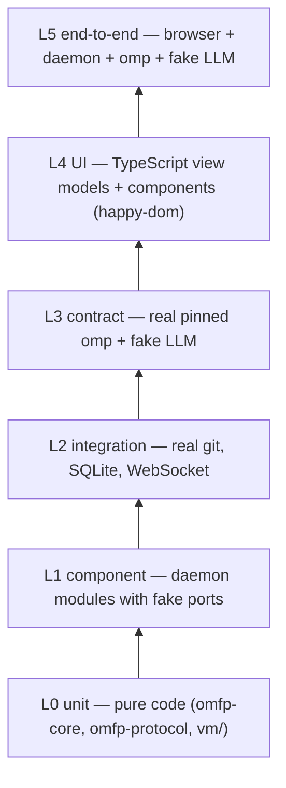

# 06 — Testing strategy (TDD)

Test-driven development is the default way of working, not an afterthought. Every requirement in these specs has an ID;
code exists because a test citing that ID asked for it.

## Process

1. **Pick a requirement** (or a bug). If it is ambiguous, fix the spec first.
2. **Red**: write the smallest test that expresses it, citing the ID (`// spec: DMN-021`). Run it and check it fails
   *for the expected reason* (assertion, not compile error or panic elsewhere).
3. **Green**: write the minimal code that passes it.
4. **Refactor** with the suite green. Remove duplication in code and tests.
5. Repeat until every acceptance criterion of the requirement is covered (happy path, boundaries, errors, transitions).

Rules of the process (no test can check them, so they are not requirement rows):

- **TST-001**: every change that alters behavior MUST come with tests written first; a bug fix MUST start with a test
  that reproduces the bug.
- **TST-002**: tests assert observable behavior (outputs, state transitions, frames on the wire, files on disk), never
  implementation details (private fields, call counts on internal helpers).
- **TST-003**: tests MUST be deterministic and isolated: no sleeps (wait on conditions with timeouts), no real network
  beyond loopback, no real model calls, temporary directories only, port 0 for servers, injected clock and ID
  generators.
- **TST-004**: every test layer below runs in parallel safely; only recipes whose tests share a scarce resource
  (`just test-desktop`, `just bench`) run them one at a time (`--test-threads 1`).
- **TST-005**: mutation testing (`cargo-mutants`) is the quality gate for test strength on pure crates (no surviving
  mutant, TST-050); line coverage is gated only as a floor (TST-050's thresholds in `just cov`), never a goal to raise
  for its own sake.

## Layers



| Layer | What | Tools | Runs in |
| --- | --- | --- | --- |
| L0 | Reducer (Rust and its TypeScript port), view-models, protocol (de)serialization, naming/slug rules, `ask` validation, ring buffer, state machines | `cargo nextest`, `proptest`, `insta`; `bun test` for TypeScript | `just test`, `just test-ts` |
| L1 | The supervisor, workspaces, jobs, interactions and the idle reaper against `FakeLauncher`/`FakeProcess` (scripted omp frames) and `FakeGit`, with paused time | `tokio::test(start_paused = true)` | `just test` |
| L2 | Real `git` on temp repos, real SQLite file, real WebSocket server with a native protocol client | `omfp-testkit` | `just test` |
| L3 | Our assumptions about omp: real pinned `omp --mode rpc-ui` talking to `fake-llm` (`crates/*/tests/contract_*.rs`) | `omfp-testkit`, `fake-llm` | `just test-contract` |
| L4 | The TypeScript UI: view-model unit tests (`ui/packages/app/src/vm/`, no DOM) and component tests of the kit and the app rendered in happy-dom, queried by `data-testid` and role with Testing Library, plus normalized HTML snapshots; the client's transport suite against the test daemon | `bun test`, happy-dom (preloaded from `ui/test/dom.ts`), `@testing-library/react` + `user-event` | `just test-ts` |
| L5 | Critical user journeys on the web build | `thirtyfour` (WebDriver) + `chromedriver` + Chromium | `just test-e2e` |

| ID | Requirement |
| --- | --- |
| TST-010 | `omfp-core`'s reducer MUST have example tests for every event kind it handles, plus property tests. |
| TST-011 | Property tests MUST check at least: (a) rebuilding an assistant message from `messageUpdates: "delta"` events equals the `message_end` content for any generated message; (b) snapshot → serialize → deserialize → apply remaining events equals applying all events (PRT-021); (c) queue chips always equal the last `queue_update`. |
| TST-012 | Contract tests (L3) MUST record each scenario as a fixture file written with `just record-fixtures` and normalized so that re-recording only shows real changes (wall-clock and duration fields and token counts that follow the request size zeroed; random ids, UUIDs, session-file timestamps and temporary paths replaced). Two formats: raw omp stdout frames (`fixtures/omp/<version>/`, M0 smoke) and the daemon's reducer inputs, `omfp_core::ThreadEvent` as JSON lines (`fixtures/threads/<version>/`, recorded through the daemon's omp adapter). L0/L1/L4 tests replay the thread fixtures, so the whole stack is tested against real omp output without starting omp. `fixtures/states/<version>/` holds, per thread fixture, the Rust reducer's state after each event (`just gen-states`), which the TypeScript reducer must reproduce exactly (D-04). |
| TST-013 | Contract tests MUST fail fast with a clear message if `omp --version` differs from the pinned version (DMN-001). |
| TST-014 | L1 fakes MUST be driven by the same fixture format as TST-012, so a fake never invents frames omp does not send. |
| TST-105 | The contract scenario `local_command_output` (`/dirs` over `prompt`: one `command_output`, no `prompt_result`) MUST be recorded as a fixture, so the reducer goldens of both ports cover command-output notices (PRT-120). |
| TST-106 | A contract test (`contract_daemon.rs`) MUST create a thread in each of omp's approval modes (`always-ask`, `always-ask-cached`, `write`, `yolo`) through the real daemon and the pinned omp and get a fake LLM reply from each, and MUST see a value omp refuses (`ask`) answered `bad_request` with no thread or workspace left behind (DMN-210). |
| TST-015 | The fake launcher MUST play omp's live voice sequence (M6) with frames the pinned omp sends (the no-credential sequence of the contract tests, the phases, transcripts and end of the real call recorded in S-09): `live_connect` answers a canned SDP answer after `connecting` and `listening` (plus any scripted frames), or fails like omp after a session started (`connecting`, `error`, `live_end { error }`, `error`); `live_mute` moves to `muted`/`listening` and fails without a session; `live_stop` ends an active session with `live_end`. |
| TST-051 | (M7) The fake launcher MUST play `live_start` like `live_connect` (TST-015) and answer `{ voice }`; its scripted frames may hold `live_levels` and a `speaking` phase, as the pinned omp sends for `live_start` sessions. |
| TST-052 | (M9) Transcript performance harness (`e2e/tests/perf.rs`): headless Chromium against a fake-launcher daemon with a 10,000-message history (prose, Markdown with code blocks, tool calls with results) and omp's streaming frames. A probe installed before the page's scripts counts React commits and component renders per transcript item, frames, long tasks and WebSocket handling time. Tests assert structure only (counts, never times). An ignored benchmark in the same file prints the timings (first open, DOM size, scroll top to bottom, thread switch, streaming at 100 events/s); `just bench` runs it (TST-115). |
| TST-100 | The transcript benchmark (TST-052) MUST switch away from the long thread and back three times while recording, printing per switch the time to the DOM and to paint, the WebSocket messages handled with the text they carried (the probe adds it up: a thread snapshot when the thread was not followed, UI-335), the long tasks and the commits. It also runs, whole, on a 200-message thread streaming for 1 s in `just test-e2e` (`the_transcript_benchmark_runs_on_a_short_thread`), so its code keeps working. |
| TST-107 | Big files (`e2e/tests/perf.rs`, UI-118): a test opens a 20,000-line file (long lines among them) in `omfp:file` in headless Chromium, read-only, after a steady scroll and in its middle, then in the unified diff against `HEAD`, and asserts the structure only: `.cm-scroller` is the element that scrolls, the box around it is a layout root (`contain: strict`), and the DOM stays bounded (elements under `.cm-content`, `.cm-line`s). Ignored benchmarks (`just bench`, TST-115: `benchmark_file_chromium`; `benchmark_file_webkit`: `WebKitWebDriver` under `xvfb-run`, wheel turns by `xdotool`) print for a small file, two 1,000-line files (a changed line in every 20; one rewritten block) and the 20,000-line file, in the diff, the read-only view and vim's normal mode while editing: the DOM size, frame intervals, dropped frames and long tasks of a steady scroll and of wheel turns, and the input-to-frame latency of `j`, `k`, PageDown and PageUp. |
| TST-108 | The view switch test (`e2e/tests/view_switch.rs`, headless Chromium, fake launcher, the private bundle) MUST hold back the reads of a workspace widget's file (`useFile`) for 500 ms with a script installed before the page's, switch away from the widget's view and back, then through enough views that it is no longer kept and back, and MUST see the widget's text the moment its view shows both times (UI-390, UI-392), printing the time from the tab's click to the text; its `benchmark_view_switch` (`just bench`, TST-115) prints the same for any bundle (`OMFP_WEB_BUNDLE`), asserting nothing. |
| TST-115 | (QA) Benchmarks are the e2e tests named `benchmark_*`: they print timings, assert nothing and are `#[ignore]`d; `just bench` runs them all by hand (release build, one at a time, on a bundle of their own or `OMFP_WEB_BUNDLE`; not in `just ci`). No other test is ignored: the WebKitGTK scroll test (UI-042) runs in `just test-e2e` with the dev shell's `OMFP_WEBKIT_WEBDRIVER`, and a wall-clock measurement asserting a duration is no test (TST-003). |
| TST-117 | (QA) Every protocol method's daemon answer MUST decode as its declared result type (`Method::Result`): L2 tests (`method_results.rs`, fake launcher and fake git) for the methods the daemon answers itself, the contract test (`contract_method_results.rs`, the pinned omp) for those it forwards to omp, so the schemas generated from those types (AGT-007) describe what the daemon really sends. |
| TST-119 | (M9) A daemon restart MUST be testable over the same data directory: the supervisor's component tests (`supervisor/tests/interrupted.rs`) open a second store, thread records and supervisor with a fake launcher of their own on the first one's data directory, the L2 tests (`method_results.rs`, `TestDaemon::restart`) shut a whole daemon down and start another on it, and a fake-launcher journey (`Journey::restart_fake`, `e2e/src/lib.rs`) starts the new daemon on the same address, so the page reconnects by itself, as after an upgrade. |
| TST-109 | An L0 test (`ui/packages/app/test/kit-forks.test.ts`) MUST fail when an app source file writes a class only a kit component of UI-440 writes (its base class or a `__part` of it), which is how a copy of the component's markup shows. |
| TST-060 | (M8) Contract scenarios (`contract_subagents_tree.rs`, real daemon + pinned omp + fake LLM): a blocking `task` subagent is listed by `thread.subagents` while it runs, kept by the reducer once finished, and its transcript reads incrementally with `fromByte`/`nextByte`; navigating to a user message returns `editorText` and reloads the branch; label sets and clears; fork from an entry stores the new session; goal create/drop reach the thread state. |
| TST-080 | (M10) Agent-control journeys drive the pinned omp as an orchestrating agent with `fake-llm`: steps whose tool calls need ids only the daemon knows (workspaces, threads) are gated and released with `FakeLlm::release_gate_with`, the ids read from the earlier tool results the held request carries; threads running beside each other answer `any_order` steps matched on their last user message, and a gated step held until a stop keeps a thread running deterministically. |

## Fake LLM (`fake-llm`)

An OpenAI-compatible server (axum) that answers from a script, making omp runs deterministic.

- `GET /v1/models` lists the scripted model.
- `POST /v1/chat/completions` with `stream: true` answers with SSE chunks of the next script step.
- Each step: optional match on the request (substring in the last user message or tool result), then a reply made of
  text chunks, tool calls (`id`, `name`, JSON arguments), finish reason; optionally an HTTP error (429/500) or a delay to
  test retries and streaming.
- Every received request is recorded and exposed in-process (and at `GET /__requests`) for assertions.
- Steps answer in order. An `any_order` step (with a match) may answer a matching request that arrives while earlier
  steps still wait, for agents running side by side (a background subagent next to its parent, M6b).
- An unexpected request (script exhausted or no match) answers 500 and fails the test with the request body.

omp runs in an isolated environment (`omfp_testkit::OmpEnv`): its own `HOME`, agent directory (`PI_CODING_AGENT_DIR`,
see upstream `environment-variables.md`), XDG directories and working directory, with provider credentials removed
from the environment, the host's ambient AWS credentials included (TST-022). The agent directory holds a `models.yml`
with a custom provider (shape from upstream `models.md`):

```yaml
providers:
  fake:
    baseUrl: http://127.0.0.1:<port>/v1
    auth: none
    api: openai-completions
    models:
      - id: scripted
        name: Scripted
        reasoning: false
        input: [text]
        contextWindow: 128000
        maxTokens: 8192
```

and a `config.yml` setting `modelRoles.default: fake/scripted`; omp is launched with `--model fake/scripted`.

Daemon contract and E2E fixtures place omp's profile files in `<data-dir>/omp-profile/agent` before startup; that is no
production import path. No test reads the real user's credentials, completes an external OAuth login or calls a real
model.

omp always runs a background model-catalog discovery at startup (S-02) that no setting turns off, so contract tests run
omp behind `omfp_testkit::DenyProxy`, an HTTP(S) proxy in `HTTP_PROXY`/`HTTPS_PROXY` (loopback excluded with
`NO_PROXY`) that refuses and records every connection.

| ID | Requirement |
| --- | --- |
| TST-020 | `fake-llm` itself is developed test-first: its own tests check SSE framing, tool-call chunking and request recording. |
| TST-021 | Contract tests MUST run omp behind the deny proxy and fail when omp tries to reach a host outside `omfp_testkit::KNOWN_DISCOVERY_HOSTS`. That list is reviewed on every omp upgrade. |
| TST-022 | The isolated omp environment MUST hide every credential the host offers omp: it removes the `*_API_KEY`, `*_TOKEN`, `AWS_*`, `OMP_*` and `PI_*` variables and sets `AWS_EC2_METADATA_DISABLED=true`, so that a fresh profile on an EC2-hosted CI runner reports no usable model. |

## UI testing

| ID | Requirement |
| --- | --- |
| TST-030 | Transport suite: the client's transport (the TypeScript client's WebSocket transport, the only one, UI-001) MUST pass hello, auth failure, subscribe/snapshot, replay and reconnect tests under `bun test` against a real daemon (`crates/omfp-daemon/examples/test_daemon.rs`, fake launcher and fake git, started by `just test-ts`). |
| TST-031 | Components get `data-testid` attributes for L4/L5 selectors; tests never select by CSS class or text that is likely to change. |
| TST-110 | A journey MUST measure an element's box (size, position, opacity) only at rest: `Journey::settled` waits until the element shows and every finite animation on it, inside it or around it has ended; infinite ones (spinners, glows) are not waited for. |
| TST-111 | A journey MUST NOT act on a window that has not settled: `Journey::connected` waits until the page shows its view, the connection banner is gone and the left column is no longer `aria-busy` (UI-023), and a `:` line opened while the index loads keeps the focus. After a resize a journey waits for what a `ResizeObserver` decides (the composer's `data-tight`, UI-481). A failed wait (`Journey::until`) reports the page's text, the focused element and the browser's console. |
| TST-116 | The journeys' Chromium MUST be a desktop with a mouse (`(hover: hover) and (pointer: fine)`); touch journeys (E2E-36, E2E-37, E2E-39) emulate touch over CDP on top. A journey clicking a control that a hover shows or moves MUST first move the mouse over its row (`Journey::hover`). |
| TST-032 | HTML snapshots of the TypeScript component tests MUST be normalized (generated ids and timestamps stripped) so they only change when markup really changes. |
| TST-033 | The desktop build has a smoke test: `omfp desktop` with `OMFP_SMOKE=1` under `xvfb-run` (never the user's display) starts an in-process daemon (DMN-004), waits until the shell is connected and shows its view (or the welcome, UI-500), honoring `OMFP_SMOKE_SCHEME=dark\|light` and `OMFP_SMOKE_WAIT=<CSS selector>`, prints `OMFP_SMOKE_READY <state>`, closes the window and exits 0, or exits 1 after 60 s (180 s on macOS, TST-090). `OMFP_SMOKE=local` uses the local daemon, found or started in the background, and a second window reuses it (ARC-003, UI-005). Other smoke runs check the settings portal's color scheme (UI-195), `omfp:web` framing (UI-677) and, on Linux, H.264 decoding (ENV-030, UI-541). |
| TST-061 | The daemon's tray icon has an integration test (`crates/omfp/tests/daemon_tray.rs`, `just test-desktop`, no display): `omfp daemon --tray` runs on a private session bus (`dbus-daemon --session`, never the user's) with a stub `org.kde.StatusNotifierWatcher`; the test checks the registration (the item's name and pid), the item's properties (`Status`, `Title`, `IconPixmap`, `ToolTip`, `Menu`), the menu read with dbusmenu `GetLayout`, and that `Event(<Quit>, "clicked")` stops the daemon cleanly (exit 0, `daemon.json` gone). Two more runs check the single log line and the late registration without a watcher, and a daemon without a session bus. Every window test (TST-033) runs with a session bus address that does not exist unless the test starts its own. |
| TST-090 | (M11) On macOS the window tests of TST-033 run without a virtual display, on the logged-in user's GUI session (from an SSH session too; GitHub's macOS runners are logged in), and the integration tests that need D-Bus (the settings portal, TST-061) are Linux only. Their smoke deadline is 180 s instead of 60 s: on a locked screen WKWebView throttles the page and a window takes about 30 s to get ready, which put the macOS-only run at the 60 s limit. A macOS-only run checks what WKWebView brings: `RTCPeerConnection` (live voice over WebRTC, UI-188), `navigator.mediaDevices` (the embedded Info.plist, UI-251), the window's `Notification` with permission `granted` (UI-252), and the data directory's `webview/store-id` (UI-250). The microphone dialog and a delivered notification need a human (07, M11). |
| TST-091 | (M11) The menu bar item has an integration test on macOS (`crates/omfp/tests/menu_bar.rs`, `just test-desktop`): `omfp daemon --tray` logs `in the menu bar`, LaunchServices lists the process as an accessory app (`lsappinfo` `ApplicationType` `UIElement`), and SIGTERM stops it cleanly (exit 0, `daemon stopped`, no panic, no `no menu bar item`, `daemon.json` gone). The menu is the shared model of the Linux tray (unit tests in `tray.rs`); clicking it needs a human (07, M11). |

## End-to-end scenarios (L5)

Kept few and focused on journeys; everything else belongs to lower layers. Each test file's doc comment holds the
steps; the rows each journey cites specify the behavior.

| ID | Scenario |
| --- | --- |
| E2E-01 | "+ workspace" with a linked repository, first message, streamed reply, thread idle (`e2e/tests/journeys.rs`). |
| E2E-02 | A tool needing approval is approved in the window and its card completes (`e2e/tests/journeys.rs`). |
| E2E-03 | An `ask` with a single and a multiple choice question is answered and the agent gets the answers (`e2e/tests/journeys.rs`). |
| E2E-04 | Reloading the page mid-stream continues the transcript without gaps or duplicates (`e2e/tests/journeys.rs`). |
| E2E-05 | Queued follow-ups and steers, Esc and `Ctrl-C` abort, draft restored and cleared (`e2e/tests/journeys.rs`). |
| E2E-06 | An agent's edit shows the repository dirty and its diff in Changes (`e2e/tests/journeys.rs`). |
| E2E-08 | Two linked repositories; `/` search finds the thread by either repository's name (`e2e/tests/journeys.rs`). |
| E2E-09 | Linking, agent-made worktrees and symlinks, and unlinking show live in the Workspace panel (`e2e/tests/journeys.rs`). |
| E2E-10 | An agent writes, checks and mounts a widget, then fixes it after a reported error (`e2e/tests/widgets.rs`). |
| E2E-11 | An invalid `views.json` falls back with a banner; several views switch from the mode line (`e2e/tests/widgets.rs`). |
| E2E-12 | `:widget add` and `:widget copy` change `views.json` and the copy reloads on edit (`e2e/tests/widgets.rs`). |
| E2E-13 | A file opened from a tool card is edited, saved, reloaded on outside change and guarded against stale saves (`e2e/tests/files.rs`). |
| E2E-14 | Live voice with a fake microphone: panel states, mute and stop (`e2e/tests/live.rs`). |
| E2E-20 | An orchestrating agent creates workspaces, spawns and waits for threads, and mounts a dashboard (`e2e/tests/orchestrator.rs`). |
| E2E-21 | A background `bash` job shows in its card, the header and the Background tab until it completes (`e2e/tests/journeys.rs`). |
| E2E-22 | A workspace `init.ts` adds a view, a command and a key; `:describe-key` names it; errors show and recover (`e2e/tests/init.rs`). |
| E2E-23 | Init files compute views among `views.json`'s, and `Space v` filters them (`e2e/tests/init.rs`). |
| E2E-26 | Which-key panels for `Space` and `g`, and `:describe-key` from them (`e2e/tests/keys.rs`). |
| E2E-27 | omp's opened URLs show a toast and a card; command output shows as a notice (`e2e/tests/opened_url.rs`). |
| E2E-28 | An agent inspects and drives a window through `windows.*` (`e2e/tests/windows.rs`). |
| E2E-29 | A large paste becomes a chip and is sent whole (`e2e/tests/journeys.rs`). |
| E2E-30 | Prompt history with `Up`/`Down` keeps the half-typed draft (`e2e/tests/journeys.rs`). |
| E2E-31 | A long message is read by keyboard in steps with the focus kept (`e2e/tests/scroll.rs`). |
| E2E-35 | Unsaved edits survive switching tabs (`e2e/tests/files.rs`). |
| E2E-37 | The composer on a phone with the on-screen keyboard (`e2e/tests/phone_composer.rs`). |
| E2E-36 | A touch phone: compact frame, popovers inside the window, touch-sized controls (`e2e/tests/responsive.rs`). |
| E2E-38 | The desktop layout at 1920, 1440 and 1100 px with long repository names (`e2e/tests/desktop_layout.rs`). |
| E2E-39 | The commands sheet on a phone (`e2e/tests/phone_commands.rs`). |
| E2E-40 | Transcript turns with thinking, tools and result images (`e2e/tests/transcript_turns.rs`). |
| E2E-41 | The composer's controls at desktop widths, idle and busy (`e2e/tests/desktop_layout.rs`). |
| E2E-42 | A running subagent in Background, expanded to its transcript (`e2e/tests/subagents.rs`). |
| E2E-43 | The first run with no usable model shows the welcome and logs in (`e2e/tests/first_run.rs`). |
| E2E-44 | Built-in themes in light and dark from `:theme` and the config file (`e2e/tests/journeys.rs`). |
| E2E-45 | A failed thread's notice in the mode line and in `:messages` (`e2e/tests/messages.rs`). |
| E2E-51 | Video and audio files play in `omfp:file` (`e2e/tests/media.rs`). |
| E2E-52 | A PDF shows with pages, zoom and text (`e2e/tests/pdf.rs`). |
| E2E-53 | A large image zooms, pans and compares with `HEAD` (`e2e/tests/image.rs`). |
| E2E-57 | A Markdown file's preview with relative links (`e2e/tests/file_viewers.rs`). |
| E2E-58 | A large CSV as a virtual sorted table under a sticky header (`e2e/tests/file_viewers.rs`). |
| E2E-59 | JSON and YAML as trees with paths; invalid JSON as text with its error (`e2e/tests/file_viewers.rs`). |
| E2E-60 | Reordering workspaces and threads in the left column by dragging (`e2e/tests/reorder.rs`). |
| E2E-66 | Forking a thread from a user message (`e2e/tests/fork.rs`). |
| E2E-62 | A login started by another connection shows its progress in the window (`e2e/tests/first_run.rs`). |
| E2E-63 | Finished background jobs in the Background tab (`e2e/tests/background.rs`). |
| E2E-67 | `omfp:web` frames a page in its own origin (`e2e/tests/web_frame.rs`). |
| E2E-70 | A file outside the workspace folder opens with its diff (`e2e/tests/outside_files.rs`). |
| E2E-71 | A reusable terminal runs a command through the PTY without echoing a password (`e2e/tests/terminal.rs`). |
| E2E-72 | Workspace jobs defined, run and shown in the left column (`e2e/tests/jobs.rs`). |
| E2E-73 | A thread whose saved model is unavailable stays readable and picks another model (`e2e/tests/unavailable_model.rs`). |
| E2E-74 | Copying a standalone omp login from the welcome (`e2e/tests/import_logins.rs`). |
| E2E-75 | The chat's images open zoomable (`e2e/tests/chat_images.rs`). |
| E2E-76 | Mermaid fences draw as diagrams; an unfinished one stays code (`e2e/tests/diagrams.rs`). |
| E2E-77 | A card in the chat draws a widget and submits the user's choice to the waiting agent (`e2e/tests/cards.rs`). |
| E2E-78 | Word completion ghost text accepted with Tab (`e2e/tests/word_completion.rs`). |
| E2E-79 | Closing a mounted tab writes `views.json` without it (`e2e/tests/mount.rs`). |
| E2E-80 | A turn cut by a daemon restart shows the interruption notice with Resume (`e2e/tests/interrupted.rs`). |

## Traceability

| ID | Requirement |
| --- | --- |
| TST-040 | `cargo xtask spec-trace` MUST list every requirement ID defined in `docs/specs/*.md` (the first cell of a table row, with a requirement prefix: `ARC`, `ENV`, `DMN`, `PRT`, `UI`, `TRM`, `TST`, `AGT` or `E2E`; decisions `D-`, spikes `S-` and milestones are no requirements) and the sources citing it (`spec: <ID>` in Rust or TypeScript sources or the justfile; `target/`, `node_modules/`, `docs/`, `fixtures/` and hidden directories but `.github/` are skipped), and fail `just ci` on every requirement nothing cites and on every ID cited but defined in no spec. |
| TST-114 | (QA) A citation counts as a test of its requirement only where something runs it: `cargo xtask spec-trace` MUST list apart (`not run:`) the citations of Rust tests with an `#[ignore]` among the attributes under the marker, of TypeScript tests right under it that are `.skip`/`.todo`, of justfile recipes `just ci` does not run (`ci`, the recipes of `ci_recipes` and their dependencies run; the release packages do not) and of justfile comments outside any recipe, and MUST count none of them as coverage: a requirement cited only there fails with those places named. |

## Gates

The justfile lists every recipe (`just --list`); `just ci` runs what CI runs.

| ID | Requirement |
| --- | --- |
| TST-050 | Gates for `just ci`, on every push: no surviving mutants in `omfp-core` and `omfp-protocol` (`just mutants-gate`; exceptions with a reason as `exclude_re` in `.cargo/mutants.toml`); line coverage of the fast tests (no omp) ≥ 90% for `omfp-core`, `omfp-protocol` and the TypeScript view models (`ui/packages/app/src/vm/`, in `just test-ts`), ≥ 75% for `omfp-daemon` (`just cov`). |
| TST-113 | `just ci` MUST do each expensive step once: it runs the recipes of `ci_recipes` in one `just` run (each dependency once), so `test-e2e` and `test-desktop` serve one release bundle built into a temporary directory (TST-074); the fast Rust tests run once, instrumented, in `cov`, and the component tests once, with coverage, in `test-ts`. Journeys take screenshots only into `OMFP_SCREENSHOT_DIR`, which `just test-e2e` sets to a new `/tmp/omfp-shots-XXXXXX` per run unless given. |

## Continuous integration

GitHub Actions (`.github/workflows/ci.yml`) runs each recipe of `just ci` as its own job through `nix develop -c just
<recipe>`, so a job fails exactly where the same recipe fails locally. The secret it needs is described in
[01 — Continuous integration](01-dev-environment.md#continuous-integration).

| ID | Requirement |
| --- | --- |
| TST-070 | CI MUST run on pushes to `master` and on pull requests; each recipe job sets up the dev shell and runs only `nix develop -c just <recipe>`; together the jobs run every recipe `just ci` depends on and none it does not. `just check-workflow` (`.github/check-workflow.ts`) checks this against `just --dump` (TST-112). |
| TST-071 | The workflow and its local action MUST pass `actionlint` (in the dev shell, run by `just check-workflow`), and every action MUST be pinned by a major tag or a commit SHA, on a maintained release. |
| TST-072 | Caches: the Nix store comes from the `omfp` Cachix cache (ENV-034), filled by pushes to `master` and, on pull requests from this repository, by the `dev-shell` job alone; `Swatinem/rust-cache` keeps the cargo registry and `target/` per job, saved on `master` only, and a job that never uses `target/` (`target-cache: "false"`, e.g. `mutants`) restores the `test-ts` job's cache and saves none. The cargo git checkouts are one shared cache at `/var/tmp/cargo-git`, saved on `master` by the `dev-shell` job alone and restored by every Rust job; each Rust job reports its cache hits and sizes in the job summary. `just check-workflow` checks these rules. |
| TST-073 | The e2e and desktop jobs MUST build their own web bundle (`with-web-bundle`, TST-074) and wait for no job but `dev-shell`: no `OMFP_WEB_BUNDLE`, no artifact. |
| TST-074 | `just test-e2e` and `just test-desktop` MUST serve a web bundle no other process writes: `OMFP_WEB_BUNDLE` when set, else a release bundle built into a temporary directory (`build-web <out>`, `OMFP_WEB_OUT` of `build.ts`), never `ui/packages/app/dist`, which another `just build-web` deletes and rebuilds (a journey then gets a 404 page). `build.ts` writes its generated entries per process (`.entries-<pid>`), so concurrent builds do not delete each other's. |
| TST-075 | Disk: every recipe job on a Linux runner MUST pool the runner's disk into a Btrfs `/nix` with `wimpysworld/nothing-but-nix` before installing Nix, build in `/nix/build`, and keep `target/`, `/var/tmp/cargo-git` and `CARGO_HOME` on that volume; the e2e browsers read only the dev shell's fonts (`OMFP_E2E_FONTCONFIG_FILE`), since the purge deletes the system's. Cachix pushes each path as soon as it is built, and a failed download falls back to building (`fallback = true`). |
| TST-076 | The `dev-shell` job MUST only set up the dev shell (no recipe), and every other Linux recipe job MUST `needs:` it, so a cold Cachix cache builds the Linux dev shell (omp from source) once per run instead of in every job; the aggregate `required CI` job runs directly on the runner after its dependencies. The dev-shell action MUST put `CARGO_HOME` on the Nix volume (`/var/tmp/nothing-but-nix`, TST-075). `just check-workflow` checks both. |
| TST-112 | (QA) `just check-workflow` MUST know every job that runs a recipe, not only the last one: each recipe `just ci` runs needs a job without `if:` (one that runs on every pull request; the `macos` job runs only on pull requests labeled `ci/macos`, TST-092), and TST-073's rules hold for every job running `test-e2e` or `test-desktop`. Its tests (`.github/check-workflow.test.ts`, run by the recipe) check that the repository's workflows pass and that a copy of `ci.yml` without the Linux `test-desktop` job, without the `package` job, with a job running a recipe `just ci` does not, with a desktop job waiting for another job's web bundle, or with a job other than `dev-shell` pushing to Cachix on pull requests fails. |
| TST-118 | (QA) Pull requests MUST expose one aggregate job named `required CI`, the only status required by `master` branch protection. It MUST run with `always()` after `check`, `test-ts`, `test-contract`, `test-e2e`, Linux `test-desktop`, `package` and `cov`, and MUST fail unless every one succeeded, so a failed or skipped dependency cannot let auto-merge proceed. The full `mutants` job MUST still run and report its result but MUST NOT block this aggregate gate; it is deliberately off the PR critical path. `just check-workflow` MUST reject a missing or weakened aggregate job. |
| TST-092 | One advisory job (`macos`) MUST run `just test-desktop` and `just package` on GitHub's arm64 macOS runner on a web bundle of its own (TST-073), on pushes to `master`, on runs by hand and on pull requests labeled `ci/macos` only; `required CI` (TST-118) does not wait for it. Adding the label MUST start it (`ci-macos-label.yml` runs `ci.yml` by hand on the branch), and that run reports itself as the commit status `macOS (ci/macos)`, `pending` first and its result last. `just check-workflow` checks the job's condition, the run by hand, the status and the label workflow. |
