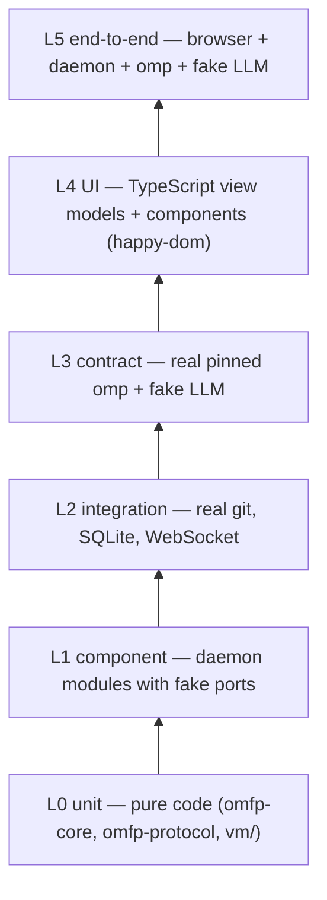

# 06 — Testing strategy (TDD)

Test-driven development is the default way of working, not an afterthought. Every requirement in these specs has an ID;
code exists because a test citing that ID asked for it.

## Process

1. **Pick a requirement** (or a bug). If it is ambiguous, fix the spec first.
2. **Red**: write the smallest test that expresses it, citing the ID (`// spec: DMN-021`). Run it and check it fails
   *for the expected reason* (assertion, not compile error or panic elsewhere).
3. **Green**: write the minimal code that passes it.
4. **Refactor** with the suite green. Remove duplication in code and tests.
5. Repeat until every acceptance criterion of the requirement is covered (happy path, boundaries, errors, transitions).

| ID | Rule |
| --- | --- |
| TST-001 | Every change that alters behavior MUST come with tests written first; a bug fix MUST start with a test that reproduces the bug. |
| TST-002 | Tests assert observable behavior (outputs, state transitions, frames on the wire, files on disk), never implementation details (private fields, call counts on internal helpers). |
| TST-003 | Tests MUST be deterministic and isolated: no sleeps (wait on conditions with timeouts), no real network beyond loopback, no real model calls, temporary directories only, port 0 for servers, injected clock and ID generators. |
| TST-004 | Every test layer below runs in parallel safely; tests needing a shared scarce resource use a nextest test group with a concurrency limit. |
| TST-005 | Mutation testing (`cargo-mutants`) is the quality gate for test strength on pure crates; coverage is a signal, not a goal. |

## Layers



| Layer | What | Tools | Runs in |
| --- | --- | --- | --- |
| L0 | Reducer (Rust and its TypeScript port), view-models, protocol (de)serialization, naming/slug rules, `ask` validation, ring buffer, state machines | `cargo nextest`, `proptest`, `insta`; `bun test` for TypeScript | `just test`, `just test-ts` |
| L1 | ThreadService, AgentSupervisor, WorktreeManager, interactions, idle reaper — against `FakeGit`, `FakeAgent` (scripted omp frames), `FakeClock`, `FakePty` | `tokio::test(start_paused = true)` | `just test` |
| L2 | Real `git` on temp repos, real SQLite file, real WebSocket server with a native protocol client | `omfp-testkit` | `just test` |
| L3 | Our assumptions about omp: real pinned `omp --mode rpc-ui` talking to `fake-llm` (`crates/*/tests/contract_*.rs`) | `omfp-testkit`, `fake-llm` | `just test-contract` |
| L4 | The TypeScript UI: view-model unit tests (`ui/packages/app/src/vm/`, no DOM) and component tests of the kit and the app rendered in happy-dom, queried by `data-testid` and role with Testing Library, plus normalized HTML snapshots; the client's transport suite against the test daemon | `bun test`, happy-dom (preloaded from `ui/test/dom.ts`), `@testing-library/react` + `user-event` | `just test-ts` |
| L5 | Critical user journeys on the web build | `thirtyfour` (WebDriver) + `chromedriver` + Chromium | `just test-e2e` |

| ID | Requirement |
| --- | --- |
| TST-010 | `omfp-core`'s reducer MUST have example tests for every event kind it handles, plus property tests. |
| TST-011 | Property tests MUST check at least: (a) rebuilding an assistant message from `messageUpdates: "delta"` events equals the `message_end` content for any generated message; (b) snapshot → serialize → deserialize → apply remaining events equals applying all events (PRT-021); (c) queue chips always equal the last `queue_update`. |
| TST-012 | Contract tests (L3) MUST record each scenario as a fixture file written with `just record-fixtures` and normalized so that re-recording only shows real changes (wall-clock and duration fields and token counts that follow the request size zeroed; random ids, UUIDs, session-file timestamps and temporary paths replaced). Two formats: raw omp stdout frames (`fixtures/omp/<version>/`, M0 smoke) and the daemon's reducer inputs, `omfp_core::ThreadEvent` as JSON lines (`fixtures/threads/<version>/`, recorded through the daemon's omp adapter). L0/L1/L4 tests replay the thread fixtures, so the whole stack is tested against real omp output without starting omp. `fixtures/states/<version>/` holds, per thread fixture, the Rust reducer's state after each event (`just gen-states`), which the TypeScript reducer must reproduce exactly (D-04). |
| TST-013 | Contract tests MUST fail fast with a clear message if `omp --version` differs from the pinned version (DMN-001). |
| TST-014 | L1 fakes MUST be driven by the same fixture format as TST-012, so a fake never invents frames omp does not send. |
| TST-015 | The fake launcher MUST play omp's live voice sequence (M6) with frames the pinned omp sends (the no-credential sequence of the contract tests, the phases, transcripts and end of the real call recorded in S-09): `live_connect` answers a canned SDP answer after `connecting` and `listening` (plus any scripted frames), or fails like omp after a session started (`connecting`, `error`, `live_end { error }`, `error`); `live_mute` moves to `muted`/`listening` and fails without a session; `live_stop` ends an active session with `live_end`. |
| TST-051 | (M7) The fake launcher MUST play `live_start` like `live_connect` (TST-015) and answer `{ voice }`; its scripted frames may hold `live_levels` and a `speaking` phase, as the pinned omp sends for `live_start` sessions. |
| TST-052 | (M9) Transcript performance harness (`e2e/tests/perf.rs`): headless Chromium against a fake-launcher daemon with a 10,000-message history (prose, Markdown with code blocks, tool calls with results) and omp's streaming frames. A probe installed before the page's scripts counts React commits and component renders per transcript item, frames, long tasks and WebSocket handling time. Tests assert structure only (counts, never times). An ignored benchmark in the same file prints the timings (first open, DOM size, scroll top to bottom, thread switch, streaming at 100 events/s) and is not part of `just ci`. |
| TST-060 | (M8) Contract scenarios (`contract_subagents_tree.rs`, real daemon + pinned omp + fake LLM): a blocking `task` subagent is listed by `thread.subagents` while it runs, kept by the reducer once finished, and its transcript reads incrementally with `fromByte`/`nextByte`; navigating to a user message returns `editorText` and reloads the branch; label sets and clears; fork from an entry stores the new session; goal create/drop reach the thread state. |
| TST-080 | (M10) Agent-control journeys drive the pinned omp as an orchestrating agent with `fake-llm`: steps whose tool calls need ids only the daemon knows (workspaces, threads) are gated and released with `FakeLlm::release_gate_with`, the ids read from the earlier tool results the held request carries; threads running beside each other answer `any_order` steps matched on their last user message, and a gated step held until a stop keeps a thread running deterministically. |

## Fake LLM (`fake-llm`)

An OpenAI-compatible server (axum) that answers from a script, making omp runs deterministic.

- `GET /v1/models` lists the scripted model.
- `POST /v1/chat/completions` with `stream: true` answers with SSE chunks of the next script step.
- Each step: optional match on the request (substring in the last user message or tool result), then a reply made of
  text chunks, tool calls (`id`, `name`, JSON arguments), finish reason; optionally an HTTP error (429/500) or a delay to
  test retries and streaming.
- Every received request is recorded and exposed in-process (and at `GET /__requests`) for assertions.
- Steps answer in order. An `any_order` step (with a match) may answer a matching request that arrives while earlier
  steps still wait, for agents running side by side (a background subagent next to its parent, M6b).
- An unexpected request (script exhausted or no match) answers 500 and fails the test with the request body.

omp runs in an isolated environment (`omfp_testkit::OmpEnv`): its own `HOME`, agent directory (`PI_CODING_AGENT_DIR`,
see upstream `environment-variables.md`), XDG directories and working directory, with provider credentials removed
from the environment. The agent directory holds a `models.yml` with a custom provider (shape from upstream `models.md`):

```yaml
providers:
  fake:
    baseUrl: http://127.0.0.1:<port>/v1
    auth: none
    api: openai-completions
    models:
      - id: scripted
        name: Scripted
        reasoning: false
        input: [text]
        contextWindow: 128000
        maxTokens: 8192
```

and a `config.yml` setting `modelRoles.default: fake/scripted`; omp is launched with `--model fake/scripted`.

Spike S-02 found that omp always runs a background model-catalog discovery at startup: the shared catalog
(`catalog.stencil.so`) and the model lists of keyless providers. No setting turns it off entirely
(`disabledProviders` removes the keyless providers but not the shared catalog). Contract tests therefore run omp behind
`omfp_testkit::DenyProxy`, an HTTP(S) proxy set in `HTTP_PROXY`/`HTTPS_PROXY` (loopback excluded with `NO_PROXY`) that
refuses and records every connection. The discovery requests fail at once, so runs stay offline and deterministic.

| ID | Requirement |
| --- | --- |
| TST-020 | `fake-llm` itself is developed test-first: its own tests check SSE framing, tool-call chunking and request recording. |
| TST-021 | Contract tests MUST run omp behind the deny proxy and fail when omp tries to reach a host outside `omfp_testkit::KNOWN_DISCOVERY_HOSTS`. That list is reviewed on every omp upgrade. |

## UI testing

| ID | Requirement |
| --- | --- |
| TST-030 | Transport suite: the client's transport (the TypeScript client's WebSocket transport, the only one, UI-001) MUST pass hello, auth failure, subscribe/snapshot, replay and reconnect tests under `bun test` against a real daemon (`crates/omfp-daemon/examples/test_daemon.rs`, fake launcher and fake git, started by `just test-ts`). |
| TST-031 | Components get `data-testid` attributes for L4/L5 selectors; tests never select by CSS class or text that is likely to change. |
| TST-032 | HTML snapshots of the TypeScript component tests MUST be normalized (generated ids and timestamps stripped) so they only change when markup really changes. |
| TST-033 | The desktop build has a smoke test: `omfp desktop` with `OMFP_SMOKE=1` under a virtual X server (`xvfb-run`, never the user's display) starts an in-process daemon (DMN-004), opens the window on it and polls the page with `eval_with_callback` every 100 ms until the shell is connected and shows a view (`[data-testid=view]` without `[data-testid=connection-banner]`, e2e's `connected()`), and, with `OMFP_SMOKE_SCHEME=dark\|light`, the page's `prefers-color-scheme` is that scheme; it then prints `OMFP_SMOKE_READY <state>`, closes the window like the user and exits 0, or exits 1 after 60 s (180 s on macOS, TST-090). `OMFP_SMOKE=local` does the same on the local daemon, found or started in the background: a second test runs it twice on one data directory and checks that the first window's daemon outlives it and that the second window reuses it (ARC-003, UI-005). Two more run the window on a private session bus (`dbus-daemon`) with a stub settings portal: dark at startup, and dark switched to light by `SettingChanged` (UI-195). |
| TST-061 | The daemon's tray icon has an integration test (`crates/omfp/tests/daemon_tray.rs`, `just test-desktop`, no display): `omfp daemon --tray` runs on a private session bus (`dbus-daemon --session`, never the user's) with a stub `org.kde.StatusNotifierWatcher`; the test checks the registration (the item's name and pid), the item's properties (`Status`, `Title`, `IconPixmap`, `ToolTip`, `Menu`), the menu read with dbusmenu `GetLayout`, and that `Event(<Quit>, "clicked")` stops the daemon cleanly (exit 0, `daemon.json` gone). Two more runs check the single log line and the late registration without a watcher, and a daemon without a session bus. Every window test (TST-033) runs with a session bus address that does not exist unless the test starts its own. |
| TST-090 | (M11) On macOS the window tests of TST-033 run without a virtual display, on the logged-in user's GUI session (from an SSH session too; GitHub's macOS runners are logged in), and the integration tests that need D-Bus (the settings portal, TST-061) are Linux only. Their smoke deadline is 180 s instead of 60 s: on a locked screen WKWebView throttles the page and a window takes about 30 s to get ready, which put the macOS-only run at the 60 s limit. A macOS-only run checks what WKWebView brings: `RTCPeerConnection` (live voice over WebRTC, UI-188), `navigator.mediaDevices` (the embedded Info.plist, UI-251), the window's `Notification` with permission `granted` (UI-252), and the data directory's `webview/store-id` (UI-250). The microphone dialog and a delivered notification need a human (07, M11). |
| TST-091 | (M11) The menu bar item has an integration test on macOS (`crates/omfp/tests/menu_bar.rs`, `just test-desktop`): `omfp daemon --tray` logs `in the menu bar`, LaunchServices lists the process as an accessory app (`lsappinfo` `ApplicationType` `UIElement`), and SIGTERM stops it cleanly (exit 0, `daemon stopped`, no panic, no `no menu bar item`, `daemon.json` gone). The menu is the shared model of the Linux tray (unit tests in `tray.rs`); clicking it needs a human (07, M11). |

## End-to-end scenarios (L5)

Kept few and focused on journeys; everything else belongs to lower layers.

| ID | Scenario |
| --- | --- |
| E2E-01 | "+ workspace" with a repository's path typed with the path field's completion → a new workspace holding a link to it opens a draft thread → send the first message → the thread is created, the streamed reply renders (the agent's cwd is the workspace folder) → thread idle. |
| E2E-02 | Prompt triggers a tool needing approval → approve in UI → tool card completes. |
| E2E-03 | `ask` with two questions (single + multi) → answer → agent continues with the answers (checked on `fake-llm` recorded request). |
| E2E-04 | Reload the page mid-stream → transcript continues without gaps or duplicates. |
| E2E-05 | Queue a follow-up while busy → remove it → abort with queued steer → text restored in composer. Then `Ctrl-C`: type a draft → `Ctrl-C` clears it; queue a follow-up while busy → `Ctrl-C` twice → the turn is aborted, the queue and the composer are empty. |
| E2E-06 | Agent edits a file → the Workspace panel shows the repository dirty and the Changes panel shows the diff. |
| E2E-07 | Open thread in `omp` terminal → `/exit` → back in app with history reloaded. |
| E2E-08 | In a workspace, link two repositories from two different places with the path field's completion → `/` search by either repository's name finds the thread. |
| E2E-09 | Workspace folders (D-11): link an external repo from the UI → it appears in the Workspace panel and the agent's next turn has its `AGENTS.md`; a scripted agent runs `git worktree add` and `ln -s` in the workspace → both appear live; remove the link → `/remove-dir` is sent and the repo disappears. |
| E2E-10 | Agent widgets (M4, M5b): a scripted agent writes `.omfp/widgets/tests/index.tsx` charting a daemon job's output, checks it with `omfp_widget_check` (no window shows it yet: the answer says so and that it compiles), adds it to the view with `omfp_view_add` and checks it again → it appears live, the second check reports what the window rendered and the job running, and its progress moves as the job prints; a syntax error saved into it shows in place (file, line) and the next save recovers. |
| E2E-11 | Views (M4): an invalid `views.json` shows the default view and the error banner, fixing the file recovers; with two views in the manifest, the frame's switcher shows one then the other. |
| E2E-12 | Layout editing (M4): in edit mode the user moves a widget and hides another → `views.json` changes accordingly; the widget picker adds a widget; `:widget copy omfp:workspace`, then a change to the copy's source → the workspace shows the modified copy in place of the built-in. |
| E2E-13 | Files (M5c): the path of a scripted agent's `read` card opens the file in a tab next to the chat; `i`, an edit and `:w` change the file on disk; while the tab is read-only the agent rewrites the file and the view reloads; a save based on a stale version shows the conflict view and writes nothing; a changed file's path in `omfp:changes` opens the file against `HEAD` in the unified merge view. A bare file name with one match in a linked repository (`:open theme.ts`) opens that file directly; one with two matches opens the picker, where the arrows and Enter open the chosen one in place of the bare name's tab; in a view without `main` both open files are tabs of the floating panel. |
| E2E-14 | Live voice (M6), headless Chromium with a fake microphone (`--use-fake-device-for-media-stream --use-fake-ui-for-media-stream`) against a daemon on the fake launcher (its canned SDP answer is no real peer: the peer never connects, so the panel stays `connecting`; the journey checks the UI states and the commands omp receives, not audio, and the states after `connected` are left to the component tests of UI-181..UI-184): the mic button starts a session, the panel shows `connecting` and the scripted transcript, Space mutes (omp receives `live_mute`), Esc ends it (`live_stop`); a session another client started shows with an end button that stops it; a scripted no-credential failure shows the `openai-codex` login message. Screenshots of the panel states go to `/tmp/omfp-live-*.png`. |
| E2E-20 | Agent control (M10 acceptance, `e2e/tests/orchestrator.rs`, TST-080): a scripted orchestrating thread creates two workspaces and spawns a thread with a prompt in each through `omfp_call` (their provenance names it), waits for both with `omfp_thread_wait` (both `done` with their last reply), then mounts a dashboard (`omfp_ui_mount`, inline code, a new view) showing both threads' states through the SDK with a button that sends the orchestrator a prompt (`thread.prompt` via `useCall`), and the activity log widget beside it (`omfp:activity`). In the browser: the dashboard shows both threads idle; the click reaches the orchestrator (its next model request's user message), which prompts both threads again, and the dashboard follows them live (both running, one back to idle); the activity log lists the agent's two `workspaces.create`, `threads.create`, `views.mount` and `thread.prompt`, not the user's prompt; "spawned by" on the orchestrator's row (2) keeps its three-thread tree in the left column; `:stop!` stops the orchestrator and both threads (the running one too; the dashboard shows them stopped, "Stopped 3 threads"), an unrelated thread keeps running. Screenshots `omfp-m10-orchestrator-*.png`. |
| E2E-21 | Background work (M12, `e2e/tests/journeys.rs`): a scripted agent runs `bash` with `async` through the pinned omp; its card runs marked background with the job's last output line, the header shows `1 in background`, pressing it shows the default view's Background tab with the running job; released, the job completes: the card succeeds, the row is done, the badge goes, and the agent answers the job's delivered result. |

## Traceability

| ID | Requirement |
| --- | --- |
| TST-040 | `cargo xtask spec-trace` MUST list every requirement ID in `docs/specs/*.md` and the sources citing it (`spec: <ID>` in Rust or TypeScript sources or the justfile; `target/`, `node_modules/` and hidden directories are skipped), and fail on IDs cited but missing from the specs. `docs/specs/milestones.toml` lists each milestone's requirements: once a milestone is marked `done`, any of them without a citation fails `just ci`. |

## Commands

| Command | Runs |
| --- | --- |
| `just test` | L0, L1, L2 (Rust) — fast, every change |
| `just test-contract` | L3 against the pinned omp (needs the dev shell) |
| `just test-ts` | `bun run test` in `ui/`: L0 TypeScript (the reducer against the golden states, client session/model tests), L4 (view models, kit and app component tests with the happy-dom preload), the client transport suite against the test daemon |
| `just gen-ts` / `just gen-states` | regenerate the TypeScript protocol types (`ui/packages/protocol/src/generated.ts`) / the golden reducer states (`fixtures/states/<version>/`); `just test` fails while either is stale |
| `just test-e2e` | L5 on a release web bundle of its own (TST-074): `OMFP_WEB_BUNDLE` when set, else one built into a temporary directory |
| `just test-desktop` | the `omfp` crate with `--features desktop`: the desktop unit tests and the window tests of TST-033 under `xvfb-run` (on macOS on the user's screen, with the menu bar test, TST-090, TST-091), one at a time (on its own web bundle, as `just test-e2e`) |
| `just check` | `lint` (`fmt --check`, `clippy -D warnings`, Biome, `tsc`), `check-versions`, `spec-trace`, `check-wasm`, `deny` (`cargo deny check`), `check-workflow` (TST-070..TST-073, TST-075, TST-076, TST-092) |
| `just package` | `nix build` of the packages `omfp` and `omfp-headless` (ENV-030..ENV-033; on macOS with `Applications/omfp.app`, ENV-041) |
| `just mutants` | `cargo mutants` on `omfp-core`, `omfp-protocol`, `fake-llm`, `xtask` (`--in-diff` for changed code) |
| `just mutants-gate` | TST-050: `cargo mutants` on `omfp-core` and `omfp-protocol`; fails on a surviving mutant (report in `target/mutants.out`) |
| `just cov` | TST-050: `cargo llvm-cov` over the fast tests of `omfp-core`, `omfp-protocol`, `omfp-daemon` and `bun test --coverage` of `ui/packages/app`; fails under the thresholds (HTML report in `target/llvm-cov/html`, summary in `target/llvm-cov/gate.txt`) |
| `just ci` | `check`, `test`, `test-ts`, `test-contract`, `test-e2e`, `test-desktop`, `package`, `mutants-gate`, `cov`: what CI runs, as one command |

| ID | Requirement |
| --- | --- |
| TST-050 | Gates for `just ci`, on every push (CI jobs `mutants` and `cov`, not nightly: the 139 mutants of the two crates take ~4 min on 3 local jobs, coverage under a minute): no surviving mutants in `omfp-core` and `omfp-protocol` (`just mutants-gate`; exceptions listed with a reason as `exclude_re` in `.cargo/mutants.toml`, none today); line coverage of the fast tests (no omp) ≥ 90% for `omfp-core`, `omfp-protocol` and the TypeScript view models (`ui/packages/app/src/vm/`, `bun test --coverage` of `ui/packages/app`), ≥ 75% for `omfp-daemon` (`just cov`; measured at the gate's introduction: 97.4%, 98.6%, 96.2%, 92.3%). |

## Continuous integration

GitHub Actions (`.github/workflows/ci.yml`) runs `just ci` for every push to `master` and every pull request, split into
parallel jobs: `web` (`just build-web`, uploaded as the `web-bundle` artifact), `check`, `test`, `test-ts`,
`test-contract`, `test-e2e` and `test-desktop` (both after `web`, on its artifact), `package`, `mutants` and `cov`
(TST-050). Each job sets up Nix with
the local action `.github/actions/dev-shell` and runs one `nix develop -c just <recipe>`, so a job fails exactly where
the same recipe fails locally. The setup and the secret it needs are described in
[01 — Continuous integration](01-dev-environment.md#continuous-integration).

| ID | Requirement |
| --- | --- |
| TST-070 | CI MUST run on pushes to `master` and on pull requests; each job sets up the dev shell and runs only `nix develop -c just <recipe>`; together the jobs run every recipe `just ci` depends on and none it does not (but `build-web`). `just check-workflow` (`.github/check-workflow.ts`) checks this against `just --dump`. |
| TST-071 | The workflow and its local action MUST pass `actionlint` (in the dev shell, run by `just check-workflow`), and every action MUST be pinned by a major tag or a commit SHA, on a maintained release. |
| TST-072 | Caches: the Nix store (the dev shell, with Bun's install cache `OMFP_BUN_CACHE`, and the packages) comes from the `omfp` Cachix cache (ENV-034), which only pushes to `master` fill (`skipPush` otherwise); `Swatinem/rust-cache` keeps the cargo registry and `target/` per job, keyed on `Cargo.lock`, the manifests, `rust-toolchain.toml` and `rustc -vV`, saved on `master` only. Every job hands the setup action the `CACHIX_AUTH_TOKEN` secret (empty on forks: read only). |
| TST-073 | The web bundle MUST be built once per run: the `web` job uploads `ui/packages/app/dist`, and the e2e and desktop jobs need it and serve its artifact through `OMFP_WEB_BUNDLE`. |
| TST-074 | `just test-e2e` and `just test-desktop` MUST serve a web bundle no other process writes: `OMFP_WEB_BUNDLE` when set, else a release bundle built into a temporary directory (`build-web <out>`, `OMFP_WEB_OUT` of `build.ts`), never `ui/packages/app/dist`, which another `just build-web` deletes and rebuilds (a journey then gets a 404 page). `build.ts` writes its generated entries per process (`.entries-<pid>`), so concurrent builds do not delete each other's. |
| TST-075 | Disk: every job on a Linux runner MUST pool the runner's disk into a Btrfs `/nix` with `wimpysworld/nothing-but-nix` (`rampage`: the preinstalled SDKs, browsers and Docker are deleted in the background) before installing Nix, and Nix builds in `/nix/build` (a cold cache builds omp, Bun's cache and the packages from source, which filled the root disk of the private runner). The Rust jobs bind-mount `target/` from that volume and keep `CARGO_HOME` on it (the purge deletes `~/.cargo`, also while cargo fetches into it). The purge also deletes every system font, and Chromium's renderer crashes without any: the e2e browsers read only the dev shell's fonts (`OMFP_E2E_FONTCONFIG_FILE`, 01). The Cachix daemon pushes each path as soon as it is built, so a job that fails later still fills the cache for its rerun; a failed download from a cache falls back to building the path (`fallback = true`). |
| TST-076 | The `dev-shell` job MUST only set up the dev shell (no recipe), and every other job on a Linux runner MUST `needs:` it, so a cold Cachix cache builds the Linux dev shell (omp from source) once per run instead of in every job; the dev-shell action MUST put `CARGO_HOME` on the Nix volume (`/var/tmp/nothing-but-nix`, TST-075). `just check-workflow` checks both. |
| TST-092 | (M11) One job (`macos`) MUST run `just test-desktop` and `just package` on GitHub's arm64 macOS runner (`macos-15`), after `web` on its bundle, on pushes to `master` only (macOS minutes cost ten Linux minutes); the dev-shell action skips the Linux disk pooling there and makes `/nix/build`. |
