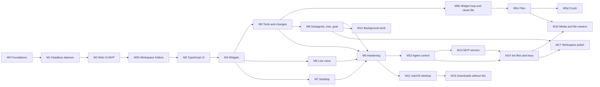

# 07 — Roadmap

Milestones and spikes, one line each. The requirements a milestone delivered are rows in the other specs, each cited by
a running test (TST-040); the narrative, spike measurements and acceptance lists are in git history
(`git log -p -- docs/specs/07-roadmap.md`). New work is tracked in GitHub issues.

## Milestones

| ID | Name | Status | Outcome |
| --- | --- | --- | --- |
| M0 | Foundations | done | Cargo workspace, justfile, `cargo xtask spec-trace`, minimal `fake-llm`, dev shell and CI |
| M1 | Headless daemon | done | Daemon running one omp per thread over RPC, SQLite store and the WebSocket protocol, tested against the pinned omp |
| M2 | Web UI MVP | done | First browser UI: threads, transcript, composer, interactive requests (Dioxus, replaced in M3) |
| M2b | Workspace folders | done | Workspaces are folders whose top-level entries are repositories, discovered by scanning (D-11) |
| M3 | TypeScript UI | done | React 19 + React Aria UI bundled and tested with Bun, TypeScript client and reducer port (D-18) |
| M4 | Widgets | done | Workspace and built-in widgets as ES modules served by the daemon, views file, SDK and kit (D-19) |
| M5 | Tools and changes | done | Tool cards from recorded fixtures, changes and diffs of the workspace's repositories |
| M5b | Widget loop and views file | done | Mode line; the agent checks and places its widgets; views file edited live |
| M5c | Files | done | CodeMirror 6 file viewer and editor with vim keys and diffs |
| M5d | Crush | done | The visual design of 09 applied to the shell and the kit (D-20) |
| M6 | Live voice | done | omp's realtime voice over WebRTC, SDP relayed by the daemon, with the thread as context |
| M6b | Widget builder | done | The main agent delegates widget building to an omp `task` subagent shipped by the daemon |
| M7 | Desktop | done | `omfp desktop` with Tauri 2: finds or starts the local daemon, many windows on one daemon (D-15, D-16) |
| M8 | Subagents, tree, goal | done | Subagents, session tree, fork, label, goal, btw and compact as daemon commands and built-in widgets |
| M8b | Notices and theme contrast | done | Notices for threads that need the user, finish or fail while unfocused; contrast-checked themes |
| M8c | Narrow windows, splitters, workspace keys | done | Usable at half a screen and on a phone; resizable areas; workspace key bindings |
| M9 | Hardening | done | Origin allow-list (D-13), performance and safety gates, CI on Nix, omp upgrade playbook, interrupted-thread marks |
| M10 | Agent control | done | Every protocol method as an agent tool plus `omfp_call`, through host tools and the MCP server (D-17) |
| M11 | macOS desktop | done | The desktop app on Apple silicon: dev shell, WKWebView window, background daemon, menu bar item (S-15) |
| M12 | Background work | done | omp's background jobs visible and controllable from the window |
| M13 | MCP servers | done | MCP servers of a workspace's threads, their state and restart; omp exposes no MCP state over RPC, so the daemon reads the config files and drives `/mcp` commands |
| M14 | Init files, keys and fixes | done | User and workspace `init.ts` files, key bindings and commands in code |
| M15 | Downloads without Nix | done | Release packages (Flatpak, tarball, signed `.dmg`, zip, `SHA256SUMS`) drafted by a tag |
| M16 | Media and file viewers | done | Raw workspace files served by the daemon; images, audio, video, PDF, CSV and other viewers in `omfp:file` |
| M17 | Workspace polish | done | Terminal sessions, unavailable saved models, remote OAuth, boring skin, browser tabs, Mermaid, cards in the chat, word completion, live voice choice, and smaller fixes |
| M18 | Workspace jobs | done | Jobs declared in `.omfp/jobs.json`, run by hand, on a schedule or as services (D-21) |
| M19 | Workspace MCP tools for widgets | done | Widgets call a workspace's remote MCP tools through the daemon, with no thread (D-22) |

## Spikes

| ID | Question | Answer |
| --- | --- | --- |
| S-01 | Does `omp-rpc` compile for `wasm32-unknown-unknown`? | Yes, as-is (moot since D-18) |
| S-02 | Can omp run offline and deterministically against `fake-llm`? | Yes; background catalog discovery cannot be disabled, so tests run behind a deny proxy (06) |
| S-03 | Which code highlighter for the web bundle and the desktop webview? | highlight.js through lowlight, one lazy chunk per grammar, colored by theme tokens |
| S-04 | Does a Tauri 2 desktop window work on NixOS in the dev shell? | Yes, on nixpkgs WebKitGTK behind a `desktop` feature, with `glib-networking` for TLS |
| S-05 | Does `dx` use the dev shell's `wasm-bindgen`? | Yes (moot since D-18) |
| S-06 | Can a transcript of variable-height items be virtualized while streaming at the bottom? | Yes; only user scrolling unpins the bottom |
| S-07 | Do `/add-dir`, `/remove-dir`, root context files and a per-thread MCP file work over RPC? | Yes; context files of `--add-dir` roots load only when the session is bound at launch |
| S-08 | Workspaces from pull requests? | Dropped: the agent does it with `gh` or `git fetch` |
| S-09 | Does omp's `live_connect` work from a WebRTC peer in Chromium and the desktop webview? | Yes in Chromium, including a real call; needs an `openai-codex` login |
| S-10 | Workspace folders of linked and cloned repositories: what does omp see? | Child repos only through `--add-dir`; symlinks are never resolved; tools work through them (D-11) |
| S-11 | Preact or React 19 with React Aria Components? | React 19: Preact needs workarounds on React Aria internals (D-18) |
| S-12 | Workspace widgets: TSX compiled by the daemon with `oxc`, or buildless `htm`? | Both work; `oxc` chosen (D-19) |
| S-13 | CodeMirror 6 for the file viewer, editor and diffs? | Yes: lazy chunks, live theme tokens, vim next to the app keymap |
| S-14 | Can the main agent delegate widget building to an omp `task` subagent? | Yes, if the agent definition carries the widgets knowledge; shipped with `--extension` |
| S-15 | Does the desktop work on macOS (aarch64-darwin)? | Yes, with small platform modules for settings, tray and webview storage (M11) |
| S-17 | Can the Tauri desktop window show a page that refuses framing (Google sign-in) as a child webview over omfp's UI? | In progress: yes on Linux; a real Google account signs in on WebKitGTK; `add_child` ignores position on Linux, so the host moves the webviews into a `gtk::Overlay`; new-window links do nothing (`spikes/tauri-child-webview/README.md`) |

## Manual checks

Done by hand once per platform change; not recorded by a test:

- M11: the microphone dialog of `omfp.app`, a notification while the window has no focus, the menu bar π and its menu.
- M15: the downloaded `.dmg` opens a window after Gatekeeper's prompt.

## Later (noted, not scheduled)

- Helix-style modal editing in the composer (UI-095 keeps a keymap with modes).
- Sharing agent-made widgets across workspaces and machines.
- Web content in widgets: a daemon proxy (`/proxy/<port>/…`) so `localhost` means the daemon's machine when it is
  remote; sites that refuse framing through their API with a `useFetch` that goes through the daemon.
- Resuming interrupted threads by themselves once the daemon is up (a setting); a warning before a planned stop.
- Daemon service: a NixOS module and a launchd agent for macOS.
- Release packages: Flathub, Intel Macs, arm64 Linux.
- Events inside omfp (a thread finished, a file changed) as job triggers; chaining jobs.
