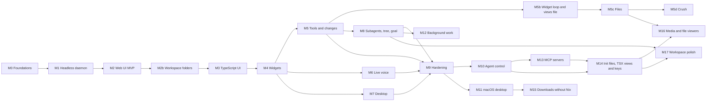

# 07 — Roadmap

Each milestone ends when its acceptance criteria pass in `just ci` and every requirement ID in its scope is traced to a
test (TST-040). Spikes are time-boxed experiments whose outcome updates the specs; their code is thrown away or turned
into tests.

## Spikes

| ID | Question | Outcome feeds | Result |
| --- | --- | --- | --- |
| S-01 | Does `omp-rpc` (tag of the pinned omp) compile for `wasm32-unknown-unknown`? If not: fork with an optional `client` feature, or vendor the generated `wire.rs` with a script that copies it from the tag. | ARC-011 | **Done (M0):** compiles as-is; `omfp-core` depends on it directly. |
| S-02 | omp against `fake-llm`: custom `openai-completions` provider streams text and tool calls; which `config.yml` keys make a run offline and deterministic (catalog refresh, update check, title, memory, advisor); how to detect stray network access. | TST-020/021, 06 fake LLM section | **Done (M0):** text round trip works; background catalog discovery cannot be disabled, so tests run behind a deny proxy with a list of known discovery hosts (06). |
| S-03 | Code highlighting in the web bundle and the desktop webview: candidate libraries, bundle size and speed on a 5k-line file. | UI-090 | **Done (M5):** highlight.js 11.12 core through lowlight 3.3, each grammar a lazily `import()`ed chunk, `hljs-*` classes colored by the theme's role tokens in kit.css (light, dark, matugen and hand-written themes apply without rebuilding), tokens rendered as React elements (no `dangerouslySetInnerHTML`), Markdown fences through react-markdown's `code` component (not `rehype-highlight`, which bundles 37 grammars). Measured (Bun 1.4.4 minify + splitting, gzip): lowlight 10 KiB in the main chunk, 0.3–4 KiB per grammar, 40 KiB for 30 languages; Shiki 4.6 (JavaScript regex engine, CSS-variables theme) 56 KiB core, 1–40 KiB per grammar (ruby 182 KiB), 313 KiB for 30. On a 5k-line TypeScript file lowlight takes 44 ms in Chromium 157 and 51 ms in WebKitGTK 2.54, Shiki 242 ms and 1.7 s; hast → React 5 ms vs 108 ms. Shiki's finer TextMate scopes collapse onto our ~12 role colors anyway. The app bundle was 276 KiB gzip of the 3 MiB budget before M5. |
| S-04 | Tauri 2 desktop on NixOS in the dev shell: window opens (webkitgtk), the web bundle connects to the local daemon, xterm.js works in the webview. | UI-001, TRM-021 | **Done (M7):** works with Tauri 2.12 on nixpkgs WebKitGTK 2.54 (ABI 4.1) behind a `desktop` feature of `omfp` (without it the binary links no WebKit and keeps its size; with it +10.9 MB, +12.6 s clean release build). The dev shell needs only `pkg-config`, `webkitgtk_4_1`, `libsoup_3`, plus `glib-networking` with an explicit `GIO_EXTRA_MODULES` for `https://` ("TLS support is not available" without it); no Tauri CLI, no JS: `build.rs` (`tauri_build::build()`), a minimal `tauri.conf.json` (no windows, `csp: null`) and an RGBA `icons/icon.png`. A window on the daemon's own `http://127.0.0.1:<port>/#token=…` runs the real app (WebSocket, fonts, `/theme.css`, import map, kit, sdk, CodeMirror with vim), connected 234–423 ms after opening; `isSecureContext` is true, `RTCPeerConnection` is missing (S-09: the desktop uses omp's `live_start`), notifications are denied unless the window allows them in its permission handler. Tauri injects its IPC into the remote page but its ACL refuses every command without capabilities, so `--connect` pages get no native access. WebKit keys `localStorage` by origin, port included: a random daemon port loses it at every restart, so ARC-003 binds the configured port first. One process per window (≈266 MiB PSS each, ≈115 MiB for an extra window in one process) avoids single-instance IPC (D-Bus) and confines a WebKit crash to its window. The detached daemon (own process group, stdin `/dev/null`, log file) survives the window, Ctrl-C and terminal hangup; two windows started at once end on one daemon (the data directory's lock decides). Smoke test: `eval_with_callback` polling until the shell is connected, 4.9 s under `xvfb-run` (3 s of it Xvfb), 1.8–2.0 s under headless weston; no DMABUF/compositing variable needed. `cargo deny` with `omfp/desktop` passes (only advisory: unmaintained `proc-macro-error`, transitive). The xterm.js part was dropped with the terminal (deferred). |
| S-05 | `dx` 0.7.10 + nixpkgs `wasm-bindgen-cli` 0.2.130: pin `wasm-bindgen = "=0.2.130"` in the workspace and check `dx build --platform web` uses the shell's binary without downloading another. | 01 | **Done (M0):** `dx build -p omfp-ui --platform web` uses the shell's wasm-bindgen; nothing downloaded. dx 0.7.10 panics on glob `default-members`, so the workspace sets none. |
| S-06 | Transcript virtualization in Dioxus with variable-height items, streaming at the bottom. | UI-042 | **Done (M2):** in headless Chromium 157 a 10,000-message transcript keeps 7–13 items (≈150–400 nodes) in the DOM: unmeasured items count as 120 px, measured heights come from `onresize` per item, two spacers stand for the rest. Bottom pinning holds through streaming; only user scrolling (wheel up, ArrowUp/PageUp/Home, pointer or touch drag) unpins — layout-driven scroll events must not, or the bottom is lost while streaming — and reaching the bottom pins again. The container exposes `data-pinned`. **WebKitGTK 2.54 (M9):** a wheel notch scrolls smoothly, 1–30 px per frame, touchpads send small deltas, and scroll events arrive at the next frame, after renders and after the wheel event: re-pinning on any scroll event within 32 px of the bottom (the first smooth-scroll frame, or the late scroll event of a follow) let the next streamed delta pull the view back and cancel the smooth scroll. Now any move up from where the last scroll or follow left the view unpins, noticed by the scroll event or by the next follow, whichever comes first, unless the view is clamped to the very end; only moving down into the 32 px, or a clamp to the end, pins again; a scroll event without movement changes nothing (`e2e/tests/scroll.rs`, its WebKitGTK case with real X wheel input through `xdotool`). |
| S-07 | Multi-workspace threads: `/add-dir` and `/remove-dir` over RPC (idle and busy); repo-level context files (`AGENTS.md`) and rules picked up from `--add-dir` roots when cwd is the thread home; injecting a per-thread MCP server through `<home>/.omp/mcp.json` (08). | DMN-029, DMN-030, 08 | **Done (M1):** `/add-dir` over RPC is a local command (no model turn) that adds the root live; `AGENTS.md` of every `--add-dir` root reaches the model, but only when the session is bound at launch (`--session-dir … --continue`, DMN-030); `<home>/.omp/mcp.json` is honored and its headers are sent. `/add-dir` while the thread is busy is still unverified against real omp (DMN-029). |
| S-08 | Workspaces from PRs: fetching a PR head (GitHub via `gh`, generic `refs/pull/N/head`), storing PR metadata, detecting merged/closed PRs. | DMN-024 | **Postponed** with PR repositories (M5 scope check, see "Later"). |
| S-09 | Live voice through omp's `live_connect`: a WebRTC peer (Opus sendrecv track + `oai-events` data channel) in Chromium and in the desktop webview (webkitgtk), SDP relayed by the daemon; secure-context requirements for the microphone. | M6 | **Done:** in headless Chromium 157 the whole `live_connect` path works, including a real call on the user's `openai-codex` login (offer → `listening` ~1.8 s, reply audio ~0.9 s after the end of speech; the candidate-less offer is fine; omp checks only that `sdpOffer` is non-empty). Without the login omp answers `live_end`/`response` with `No Codex OAuth credential is available for a live call.` (to be shown as "live voice needs an `openai-codex` login in omp"). nixpkgs WebKitGTK 2.54 (6.0 and 4.1) is built without WebRTC (`RTCPeerConnection` undefined): the desktop (M7) uses `live_start` (omp owns the local mic and speakers and sends `live_levels`). macOS's WKWebView has WebRTC and, with the embedded Info.plist, `getUserMedia` (S-15): the macOS desktop window (M11) uses `live_connect` like a browser, `liveSupport` already preferring WebRTC over `local=1` (UI-188, UI-251). `getUserMedia` needs `localhost`/`127.0.0.1` or HTTPS (on a LAN IP `navigator.mediaDevices` is undefined: detect `!isSecureContext`). Rules: show `listening` only once the peer is connected (earlier speech is lost); mute = disable the local track + `live_mute { muted }`; derive `speaking` on the client; idle on `live_end`; keep transcripts per role and turn (a user final can arrive after assistant partials); send `live_stop` on peer failure, teardown and client disconnect; one session per thread. Spectrum: 64 log-spaced bars on a canvas from Web Audio analysers (mic + remote) or from `live_levels`, ~+4 % of a core at 60 fps, static meter under reduced motion. Prototype `/tmp/omfp-s09/`. |
| S-10 | Workspace folders (D-11 revised): cwd = a non-git folder whose top-level entries are repos (real clones and symlinks to external repos); context files, roots, tools through symlinks, `--append-system-prompt`, `--config` overlays. | D-11, DMN-022..030 | **Done:** without `--add-dir` omp shows nothing about child repos (no context files, no roots); with `--add-dir <ws>/<name>` (symlink path) their `AGENTS.md` load and `<workspace-roots>` lists them under the symlink path, live `/add-dir` too; omp never resolves the symlink. `read`/`write`/`bash` through a symlink work and change the external target; no path refusal. Roots saved in a session are merged with the flags on `--continue`: dropping a flag does not detach, `/remove-dir` does. `--append-system-prompt` lands verbatim at the very end of the prompt and disables every `APPEND_SYSTEM.md` (user, cwd `.omp/`; a repo's `.omp/APPEND_SYSTEM.md` is never read). A `--config` overlay with `workspace.additionalDirectories` equals `--add-dir`. A non-git cwd causes no warning. Tests: `crates/omfp-daemon/tests/contract_workspace_folder.rs`. |
| S-11 | Preact + `preact/compat` with React Aria Components: dialog (focus trap), menu, popover, combobox (`/` commands), tabs, listbox, virtualized list; keyboard, focus and portal event behaviour in Chromium and WebKitGTK; bundle size and streaming render cost vs React 19 on the same screens. | D-18, UI-092, UI-093 | **Done (M3):** React 19 chosen. Preact 10 crashes in React Aria's collection document (global `document` for DOM nodes); Preact 11 passes every check only with three workarounds on React Aria internals (missing `createElementNS`/`remove()` in its collection document, `{...e}` losing native keyboard event fields, effect cleanups after paint leaving the trigger `inert` on focus restore) and events inside portals do not bubble to JSX ancestors. React 19 passes every keyboard, focus, portal, `/` completion and virtualized-transcript check in headless Chromium 157 and WebKitGTK 2.54 (WebKitWebDriver + MiniBrowser under xvfb-run) with no workaround. Sizes (gzip): React 19 145 KB vs Preact 11 87 KB. Streaming 100 updates/s for 10 s: both 600 frames without long tasks; React uses 1.5–4× more script time, still with headroom. WebKitGTK does not scroll a focused container on PageUp: the transcript must handle PageUp/PageDown/Home/End itself. `bun build` needs no Node. |
| S-12 | Loading agent widgets (M4): the daemon serves `<workspace>/.omfp/widgets/<name>/` as ES modules — TSX transpiled in Rust with `oxc` vs buildless `htm` modules —; one shared React through an import map; hot reload; errors in place. | M4, 08 | **Done:** both strategies pass all 17 checks in headless Chromium 157 and WebKitGTK 2.54 (import map with dynamic `import()`, one React instance with hooks and context shared, reload when a relative import changes, syntax/render/top-level/bad-import errors shown in place and recovered on the next save). Chosen: **oxc** (`=0.158.0` pinned: weekly breaking releases) for `.ts/.tsx/.jsx` with JSX via `react/jsx-runtime`, cached by mtime+size, ~0.15 ms per 200-line widget, compile errors as a stand-in module that renders line/column and exports `compileError`; `.js` (e.g. `htm`) served as-is by the same route. Cost: +3 MB stripped binary, 59 new crates, licences allowed. URLs carry a version hash (`/widgets/<name>/<version>/<file>`), not `?v=`, so relative imports and failed imports reload reliably; state kept outside the module (`useStored`) survives reloads, component-local state does not (React Refresh not tried). Reload after a push renders in under 20 ms; the 1 s poll dominates for edits outside agent tool calls. TypeScript elides unused-as-value imports, so a wrong kit import surfaces as an undefined variable unless imports are checked against the kit/sdk exports. |
| S-13 | CodeMirror 6 for the file viewer/editor and diffs: React 19, theme from `--omfp-*` tokens, `@replit/codemirror-vim` next to the app keymap, `@codemirror/merge`, lazy chunks, big files, Chromium and WebKitGTK. | M5c, UI-110..116 | **Done:** all 15 checks pass in headless Chromium 157 and WebKitGTK 2.54. Nothing loads before the first open; first open costs ~147 KiB gzip (core 93 + vim/commands/search 55) plus 1–40 KiB per language (markdown ~70 with html/css), merge 9.6 KiB only for diffs. Token changes recolour the editor and merge views live. A 20k-line file keeps ~80 lines in the DOM, jumps to a line in ~20 ms. Vim: the editor must own Esc (an Esc that only cancels a pending operator otherwise leaks to the app keymap); Esc in plain normal mode hands focus back to the app; `:w`/Ctrl-S call the save callback; the app treats the editor as a text field, and the mode line should show vim's mode (`vim-mode-change`) while it has focus. `readOnly` keeps motions; `i` is intercepted to switch to editing. Side-by-side merge scrolls in its own container. All packages MIT, exact versions in the spike report; `bun build` only. |
| S-14 | Can the main agent delegate building a widget to an omp `task` subagent (omp 18.18.6)? Host tools, host URIs and the appended prompt in a subagent; shipping an agent definition from the daemon's data dir; subagent frames on the RPC stream; model and cost. | M6b, AGT-029, DMN-106..108 | **Done:** yes, if the definition carries the widgets knowledge. A subagent gets neither the parent's RPC host tools (registered per session; unknown names in `tools:` are dropped) nor `--append-system-prompt`, but it reaches host URIs (`omfp://…` reads hit the host every time, process-wide registry). `--extension <dir>` ships `<dir>/agents/*.md` without touching the workspace or `~/.omp` (`agentSource: "user"`, `model` kept); `--plugin-dir` works too but is fragile. Without `blocking` an RPC task runs detached and its result returns as an `async-result` follow-up turn. `model: "@smol"` resolves through the user's roles, else the parent's model. Host tools without `loadMode` are only `xd://` devices of the parent. Chosen: `--extension <data-dir>/omp`, `tools: read, write, edit, glob, grep`, `@smol`, background, a read-only `omfp://widgets/check/<name>` for checking, placement by the parent with `omfp_view_add`. Runs and scripts: `/tmp/omfp-s14/` (`RESULT.md`). |
| S-15 | omfp's desktop on macOS (aarch64-darwin): the flake and dev shell, the Tauri window on WKWebView (rendering, WebSocket, fonts, theme, color scheme, WebRTC, microphone, notifications, storage per data directory), the background daemon, the tray as a menu bar item, the smoke test, packaging and signing. | M11, ENV-040..042, UI-250..254, DMN-170, DMN-171, TST-090..092 | **Done:** it works with small, local changes. The flake evaluates and omp builds for darwin; `nix develop` needed nixpkgs' `pre-commit` without its .NET-SDK tests. Tauri compiles unchanged against the SDK (AppKit, WebKit); three Linux-only paths (the gio settings portal, the gio tray, WebKitGTK's `data_directory`) get macOS counterparts. The window renders the whole app from the daemon's URL; `prefers-color-scheme` follows the system appearance without portal code; `isSecureContext` holds on `127.0.0.1`; `RTCPeerConnection` exists (unlike WebKitGTK), `navigator.mediaDevices` only once the binary embeds an Info.plist with `NSMicrophoneUsageDescription` (TCC then asks once per app, attributed to `dev.omfp.desktop` in an ad-hoc signed `.app`, never from an SSH session); web notifications are denied (wry has none). WKWebView ignores `data_directory`: a data store identifier per data directory keeps `localStorage` apart (macOS 14). The background daemon detaches (`process_group(0)`, reparented to launchd) and survives the window and the SSH session; `omfp daemon --tray` runs Tauri's AppKit loop on the main thread with the daemon on another, an accessory app with an `NSStatusItem` (AppKit handles must stay on the main thread: a drop on the daemon thread panicked and hung the shutdown). `OMFP_SMOKE=1` passes from SSH on the logged-in session without a virtual display. `nix build .#omfp` gives `bin/omfp` and `Applications/omfp.app` (a Mach-O binary wrapper); Gatekeeper rejects the ad-hoc bundle but Nix-store files carry no quarantine. Report and screenshots: `/tmp/omfp-s15/`. |

## M0 — Foundations (done)

Scope: Cargo workspace with all crates as empty shells; `justfile`; `cargo xtask spec-trace`; `fake-llm` minimal;
`omfp-testkit` with temp git repos and isolated omp agent dir; spikes S-01, S-02, S-05.

Acceptance:

- `just ci` is green in the dev shell (with empty-but-compiling crates).
- `omfp-core` and `omfp-protocol` build for `wasm32-unknown-unknown`.
- Version test: the omp tag in `flake.lock`, the `omp-rpc` git tag in `Cargo.toml`, and `omp --version` agree (ENV-010).
- Contract test "hello": omp `rpc-ui` + `fake-llm` answers a prompt with scripted text; frames recorded as fixture.

Requirements traced for this milestone are listed in `milestones.toml`.

## M1 — Headless daemon (done)

Scope: DMN-001..072 except host tools beyond `open_in_editor` (now `omfp_open_file`) and PR workspaces (DMN-022, after S-08); PRT-001..034;
JSON Schemas for protocol methods (AGT-007); ThreadState reducer for messages, tools, queue, process state, interactions;
spike S-07; the single `omfp` binary with the `daemon` subcommand (D-15). At the end of M1 the project is renamed to
**omfp** (crates, binary, docs).

Acceptance:

- A native protocol client (test) creates two managed workspaces in two different repositories, creates one thread on
  both (cwd = thread home, one `--add-dir` per workspace), prompts, and receives streamed events that the reducer turns into the
  expected transcript; attaching a third workspace live sends `/add-dir`.
- Approval and `ask` round trip through the protocol (contract scenario with approval mode `always-ask`).
- Disconnect mid-stream and resubscribe with `since` → replay with no gaps; with an evicted position → snapshot that
  equals the daemon's state.
- Process crash → `Failed` with stderr tail; next prompt restarts and history reloads.
- Idle reaper stops an unwatched settled thread (L1 with paused time).

Result: all acceptance scenarios pass as L3 contract tests against real omp 18.18.6 (`crates/omfp-daemon/tests/
contract_daemon.rs`), the supervisor runs L1 tests on a fake launcher replaying the recorded fixtures with paused time,
and the server runs L2 tests with a native WebSocket client. `omfp daemon` serves `system.hello` and publishes
`daemon.json`. Known limits from omp-rpc 18.18.6: no exit code on crash (DMN-035), no drain window on shutdown
(DMN-005), prompt ids unique per process epoch (PRT-030). Open: `/add-dir` on a busy thread (S-07), PR workspaces
(S-08), `terminal.*` (later removed, PRT-135).

## M2 — Web UI MVP (done)

Scope: UI-001..003, UI-010..012, UI-020..025, UI-030, UI-040..043, UI-050 (fallback card only), UI-060..064,
UI-070..073, UI-091..092; daemon serves the web bundle.

Acceptance: E2E-01, E2E-02, E2E-03, E2E-04, E2E-05, E2E-08 pass.

Result: the journeys run in `e2e/` (L5: headless Chromium, in-process daemon serving the release bundle, real omp
18.18.6, fake LLM), next to the transport suite in Chromium (`just test-wasm`); both are part of `just ci`. `just serve`
builds the bundle and runs the daemon with omfp's isolated omp profile (ARC-021). The protocol client lives in its own crate
(`omfp-client`); every method's result is decoded into its declared type by L2 tests and, for the methods forwarded to
omp that the UI uses, by an L3 test. Known gaps: no browser test for the countdown ticking (UI-073); "answered
elsewhere" covers only what happened while watching live; adding a pull request waits for
S-08.

## M2b — Workspace folders (done: daemon and protocol)

Scope: the revised D-11 — DMN-020..030 (workspace folders, discovered repositories, add/remove repo, rescan, root sync,
launch with `--append-system-prompt`), ARC-008, the protocol methods of 03 for workspaces and `threads.create`, UI-020,
UI-022, UI-023, UI-025, UI-030; migration 3 (each existing thread gets a new owned workspace folder holding symlinks to
the directories of its old workspaces, old managed worktrees stay where they are).

Acceptance: E2E-09 (create a thread in a new workspace → link an external repo from the UI → the repo appears in the
Workspace panel and the agent's next turn has its `AGENTS.md`; a scripted agent runs `git worktree add` and `ln -s` in
the workspace → both appear live; remove the link → `/remove-dir` sent and the repo disappears); L1 tests for scanning
with `FakeGit`; L3 test that a launch carries the user's `APPEND_SYSTEM.md` after the daemon's text.

M2b's UI part (UI-020..030 under the new model, E2E-09) is delivered by M3 on the new stack (D-18); M2b closes with the
daemon, protocol and their tests.

Result: migration 3 moves every thread into its own new workspace folder holding links to its old directories (L2 test
on a database built with migrations 1+2; L3 test that omp resumes a session with its history after the cwd changes).
omp starts in the workspace with one `--add-dir` per repo and the conventions text plus the user's `APPEND_SYSTEM.md`
(`conventions.rs`); rescans run at startup, after workspace methods and after every finished tool run; omp refuses
`/add-dir` and `/remove-dir` while streaming, so a busy thread's root sync waits until it settles (DMN-029). Hidden
entries are not repositories (DMN-022). The Dioxus UI got only the minimal changes; E2E-09 moves to M3.

## M3 — TypeScript UI (done)

Scope (D-18): replace the Dioxus UI and `omfp-client` with a TypeScript web app — React 19 with React Aria Components (S-11), Bun for bundling and tests, no
Node toolchain; TypeScript protocol types generated from the JSON Schemas (AGT-007) and checked in CI; a TypeScript
client (transport, session with replay/snapshot/resync and backoff, model) passing the transport suite against a real
daemon (TST-030); the reducer ported to TypeScript and checked against golden states produced by the Rust reducer for
every fixture (D-04); parity with M2 (every UI-0xx row M2 covered) plus the workspace-folder UI of M2b. The `omfp`
binary stays in Rust and embeds or serves the bundle (DMN-008).

Acceptance: E2E-01..05, E2E-08, E2E-09 pass on the new UI (the L5 harness stays in Rust); component tests for the
shell; the Dioxus crate and `omfp-client` are deleted.

Progress (framework-agnostic foundation): `ui/` is a Bun workspace (strict `tsc`, Biome, `bun test`; dependencies from
`ui/bun.lock`, see ENV-001) with `@omfp/protocol` (types and the method table generated from the daemon's JSON
Schemas by `just gen-ts`, plus the envelope and topics), `@omfp/core` (the reducer port, reproducing the Rust
reducer's state after every event of every thread fixture, `fixtures/states/<version>/`, `just gen-states`) and
`@omfp/client` (WebSocket transport, session, model; the transport suite runs against the test daemon in
`just test-ts`). `just test` fails while the generated types or the golden states are stale.

Result: `ui/packages/kit` (`@omfp/kit`: React Aria wrappers styled only by token CSS, built-in light/dark tokens in a
cascade layer so a user theme always wins, Markdown through react-markdown without raw HTML) and `ui/packages/app`
(`@omfp/app`): a frame (connection banner, view switcher, keymap with vim defaults and the `:` command line, safety
net for pending interactions, notifications, live region) around one default **view** — a layout tree of
`row`/`col`/`tabs`/`stack` in the `views.json` shape of M4 — rendered from a widget registry under error boundaries:
`omfp:threads`, `omfp:header`, `omfp:workspace`, `omfp:chat` (`omfp:transcript`, `omfp:interactions`,
`omfp:composer`). Widgets read state only through the SDK hooks of `ui/packages/app/src/sdk` (the seed of M4's
`omfp/sdk`); model changes reach React as one snapshot per animation frame (UI-012). The daemon keeps the global theme
(`theme.get`/`theme.set`, `/theme.css`, the watched `$XDG_CONFIG_HOME/omfp/theme.css`, `omfp theme set`,
`contrib/matugen/`), the config file with the UI settings (DMN-009, UI-097), generates thread titles with one omp
print-mode run (`omp -p --no-session --no-tools --no-title … --model @smol`, DMN-073) and defaults new threads to
`yolo` (DMN-074); the agent renames its thread with the `set_thread_title` host tool. The `omfp` binary moved to
`crates/omfp`; `omfp-ui` (Dioxus) and `omfp-client` are deleted with their pins (ENV-012 retired). `just build-web`
bundles with `bun build` into `ui/packages/app/dist`; E2E-01..05, 08, 09 and journeys for the keymap and a live theme
change pass in headless Chromium. Known gaps: the dialog focus trap's backward wrap is checked only in browsers
(happy-dom does not wrap Shift+Tab); pull-request grouping and repositories wait for S-08.

Issue #53 extends DMN-073 with conversation-driven rolling titles: four messages / 400 characters per reconsideration,
five-minute attempt spacing, bounded earlier/recent context, two consecutive candidates before changing topics,
cosmetic deduplication and explicit-title precedence. Fake-model regressions use paused time; no idle timer or paid
model is involved. The initial and refreshed titles share the isolated print-mode launcher and session-name path.

## M4 — Widgets (agent-made UI, from 08) (done)

Scope: D-17's UI part brought forward, as designed in [08](08-agent-control.md#agent-made-ui-views-and-widgets-m4): a
**views manifest** per workspace (`.omfp/views.json`: several views, each a layout tree of `row`/`col`/`tabs`/`stack`
with widget references and props), edited by the agent as a file and by the user from the UI; **widgets** as React
components (built-in `omfp:*`, workspace `./widgets/<name>`, user library `user:<name>`) running in the window under
error boundaries, with the SDK as hooks (full protocol, tool-run output, daemon jobs, storage) and the shell's kit and
theme; the daemon serves and transpiles workspace widgets and pushes changes found on rescan and poll. The
conversation is a widget (`omfp:chat`: transcript, interactions, queue, composer, with its parts), as are the header
and the workspace panel, all copyable; only a thin frame (left column, connection, view switcher, keymap and command
line, and a safety net that shows pending interactions no widget renders) stays outside the manifest. Agents learn it
from the daemon's `--append-system-prompt` note, `omfp://docs/widgets` and the manifest schema. Spike S-12 first.
Requirements: AGT-010..025, DMN-062, DMN-080..087, PRT-040..042, UI-100..106, E2E-10..12. Not in M4 (08, "Later"):
`useAgent`, `useFile`/`workspaces.read_file`, the widget-state and job host tools, `:widget save`, dashboards and
windows outside the workspace view; `omfp:changes` is M5.

Acceptance: a scripted agent writes a widget that charts test results from a daemon job and adds it to a view in
`views.json` → it appears live; an invalid manifest shows the default view and the error; the user moves and hides
widgets and `views.json` changes; a built-in widget copied into the workspace and modified replaces the original there;
two views switch from the shell.

Result: E2E-10..12 pass in headless Chromium against real omp and the fake LLM — a scripted agent writes
`.omfp/widgets/tests/index.tsx` (a progress bar over a daemon job via `useJob`) and adds it to `views.json`, and it
appears and advances live; an invalid manifest shows the default view and a banner, and fixing the file recovers; layout
editing (Move menu, hide, add from a picker, resize) writes `views.json`; `:widget copy` copies a built-in into the
workspace where it replaces the original; a syntax error shows in place and recovers. Widgets are compiled by oxc
`=0.158.0` with imports checked against the real `omfp/sdk` / `omfp/kit` exports and served under a per-start key
handed out in `system.hello` (D-19). omp 18.18.6 streams partial `bash` output, so `useToolRun` is live. Left out by the
scope check (08 lists them as later): `useAgent`, `useFile`, the agent's job and widget-state host tools, `jobs.list`,
`:widget save`, pointer drag, dashboards outside the workspace view.

## M5 — Tools and changes (done)

Scope: specialized tool cards in the transcript (UI-050..052) from recorded fixtures — `bash`, `read`, `edit`/`write`,
`grep`/`glob`/`find`/`ast_grep`, `todo`, `web_search`/`fetch`, `ask`, `task` (subagent name, task and live progress;
the subagent panel it would link to is M8); the **`omfp:changes`** widget (UI-080, DMN-026): per repository of the
current workspace, changed files with +/− counts and a diff view, in the default view as a tab next to
`omfp:workspace`; code highlighting (UI-090, after S-03) in Markdown code blocks, the diff view and tool results whose
language is known.

Moved out by the scope check:

- PR repositories (DMN-024 `pr`, S-08) → "Later": worktrees and similar are the agent's job, the agent can run
  `gh pr checkout` or `git fetch origin pull/N/head` itself, and GitHub cannot be tested offline; pending a user
  decision.
- `open_in_editor` (DMN-060/061) → M7: it was only useful from a desktop window on the daemon's machine; without the
  desktop it could only return an error. It later became `omfp_open_file`, which opens the file in omfp itself.

Acceptance: E2E-06 (the agent edits a file → `omfp:changes` shows the diff); every specialized card has
fixture-driven tests for success, error and streaming states; highlighting follows the theme (light, dark, a custom
theme).

Result: nine contract scenarios (`crates/omfp-daemon/tests/contract_tool_cards.rs`) record the shapes of `read` (file,
directory, URL), `edit` (hashline input, omp's diff), `write`, `grep`, `glob`, a failing `bash` (exit code in
`details.exitCode`), `todo`, `web_search` (a SearXNG endpoint on loopback), `task` (a blocking subagent run with its
progress frames) and a cancelled `ask`; in omp 18.18.6 `find` (semantic search, on only when `find.enabled` is `on` or a native judge model is configured) and
`ast_grep` / `ast_edit` (`astGrep.enabled`, `astEdit.enabled`, off by default) exist but are off in the default test
configuration, and there is no `fetch` tool (`read` fetches URLs), so those keep the fallback card for now. Each specialized card (`ui/packages/app/src/vm/tool-view.ts`,
`widgets/chat/tool-cards.tsx`) is tested in its streaming, success and error states from those fixtures; `web_search`
engine failures and URL reads that could not be fetched end with `isError: false` in omp, so the cards read
`details.error` / `details.method` and show them as failed. `omfp:changes` follows the `workspace/<id>` topic and asks
`workspaces.status` (which rescans and republishes) after each `edit`/`write`/`bash` end of the selected thread and from
its refresh button; the kit gained `Diff`, `Code`'s `language` and `languageOfPath`. Highlighting is lowlight (S-03) in
Markdown fences, diffs and tool results with a known language. E2E-06 (a scripted agent rewrites a tracked file → the
Workspace tab shows the repository dirty, the Changes tab shows `+1 −0` and the diff) also checks that keywords take the
theme's primary color in light, dark and a custom theme. A tool run's end also refreshes `workspace/<id>`'s git status
(DMN-023): an edit of a tracked file is invisible to the poll's cheap check. Specialized card headers leave the
arguments their subject shows (and a `write`'s content) out of the argument summary. Known gaps: the `write` card shows
the written content, not a diff (omp sends no old text); the edit card
is covered by fixtures, but the journey edits with `write` because a hashline `edit` needs the file's tag from a
`read`; grep results list file paths as text (they became clickable in M5c, UI-116).

## M5b — Widget loop and views file (done)

Scope (the user's second round of changes after M5): a mode line in the frame (UI-098); the agent checks and places
widgets without a browser — window reports (AGT-026) behind the host tools `omfp_widget_check` (DMN-063) and
`omfp_view_add` (DMN-064; later replaced by `omfp_ui_mount`, DMN-064 removed), built-in widget sources and docs as `omfp://` URIs named in the prompt note (DMN-062,
AGT-024); `useJob` with a status, separate stdout and stderr and its runs (AGT-019); `views.json` always present in a
workspace, written at creation and at startup, `:view-reset` (DMN-088, UI-107; DMN-030 narrowed to repositories); the
`write` card shows the first lines of the content (UI-053).

Acceptance: E2E-10's scripted agent checks its widget with `omfp_widget_check` and adds it with `omfp_view_add` (later `omfp_ui_mount`);
headless screenshots of the mode line in both modes and of a collapsed `write` card.

## M5c — Files (done)

Scope (the user's third round of changes, items 3 and 6): a file viewer and editor for quick edits on CodeMirror 6
(S-13; 00 now lists only an IDE as a non-goal): the daemon reads and writes workspace files with a hash check and the
`HEAD` text (`workspaces.read_file` / `.write_file`, DMN-089, DMN-090); the built-in `omfp:file` widget (UI-110..114)
with vim editing, saves refused on conflict, and the whole-file diff against `HEAD` (unified or side by side); files
open as closable tabs of the view's `main` slot or in a floating panel (UI-115); file paths in assistant Markdown, tool
cards and `omfp:changes` open them, and `:open` opens a focused or typed path (UI-116); `Space f` searches all workspace files (UI-731). `omfp:changes` shows the CodeMirror merge view
(UI-080); the SDK gains `useFile` and `useOpenFile` (AGT-027) and the kit `CodeEditor` and `CodeDiff`. The theme and
config polls apply a change only once the file settled, so a non-atomic writer such as matugen is never read halfway
(DMN-091).

Acceptance: E2E-13; headless screenshots of a read-only file tab, editing in vim insert mode, the unified diff and the
conflict view.

## M5d — Crush (done)

Scope (D-20): the visual design of [09](09-design.md) (UI-120..UI-174) applied to the shell and the kit, in slices.
Foundation: every design token in the one `--omfp-*` namespace (the kit's earlier size, radius, line-height and spacing
tokens migrated, no aliases), the Synth palette as the built-in light and dark themes, colors derived from the roles
(gradients with the close-hue fallback, ok/warn mixed toward the surface), IBM Plex Serif and Commit Mono bundled
(WOFF2 latin subsets with their OFL licences, served at `/fonts/` with the bundle), `[ui] font_size` defaulting to 17 px
and the new `[ui] motion` (`full` / `reduced` / `none`, capped by `prefers-reduced-motion`, `data-motion` on `<html>`),
key chips (UI-148). Then: every kit component restyled with all its states and the `/kit` gallery (UI-149..UI-173)
with its screenshot test (UI-174); the frame (left column, mode line, command line, banners, notifications, dialogs);
the chat (transcript, tool, approval and ask cards, composer); the side widgets and the file editor.

Acceptance: every UI-120..UI-174 cited by a test or the screenshot test; headless screenshots of the real app at the
defaults (Synth light and dark, a matugen theme, motion `none`) compared by eye with `docs/specs/design/crush-default-*`.

Result: the foundation, the kit with the `/kit` gallery (Synth and matugen forest, light and dark, every text pair at
AA; the pixel baselines were dropped afterwards, the gallery is reviewed by eye), and the frame, chat and side slices were applied in
parallel and checked by the 23 E2E journeys. Merging the slices broke 8 journeys, all fixed: the side panel's Add button
under the path-field completion, interaction cards losing their test hooks, `+n −m` counts split in two elements, a
smooth-scroll rule that re-pinned the transcript, and a mode-pill animation that briefly showed a window scrollbar
(`.omfp-app { overflow: hidden }`). Light `success`/`warning` were darkened (`#225f23`, `#7e4600`) to reach 4.5:1. The
real app was compared with the reference shots in Synth light and dark; the matugen theme is covered by the gallery,
not by app screenshots.

## M6 — Live voice (done)

omp 18.18.6 exposes its `/live` realtime voice over RPC (`docs/rpc.md` → "Live Voice Sub-Protocol"): the realtime
model talks with the user and delegates work into the thread as ordinary turns. `live_connect` takes a WebRTC SDP offer
from the client's own peer, so audio stays in the browser or desktop webview (works with a remote daemon), while
`live_start` would use the daemon machine's microphone. Draft-only dictation (`dictation_*`) uses the daemon machine's
microphone only.

Scope: spike S-09 first (WebRTC `live_connect` from Chromium and from the desktop webview; `getUserMedia` needs a
secure context: `localhost`/`127.0.0.1` or HTTPS through the deployer's proxy); protocol methods `thread.live_connect`
/ `.live_stop` / `.live_mute`; reducer state for `live_phase` and `live_transcript` (levels are client-side for
`live_connect`); UI: mic button in the composer, phase indicator, live transcript, mute and stop, stop on peer
disconnect; one live session per thread (omp allows one per process).

Acceptance: tests for the command plumbing and frames (the realtime model itself cannot be faked offline, so the
contract test covers the failure path and frame decoding); a manual check with a real OpenAI realtime key, recorded in
the spike result.

Result: the daemon relays `thread.live_connect` / `.live_stop` / `.live_mute` to the thread's omp, one session per
thread, stopped when the owning connection closes or omp exits, with omp's failures as readable messages (DMN-100..104,
PRT-050..052); the Rust and TS reducers keep the session's owner, phase and transcript per role and turn, checked
against golden states of the recorded no-credential sequence, and the contract test covers that path and omp's cheap
errors against the pinned omp (the realtime model cannot run offline). The fake launcher plays omp's live sequence
(TST-015). In the browser the SDK's `LiveClient` (`useLive()`) holds the window's one session: the microphone, a peer
with one sendrecv Opus track and the `oai-events` channel, the remote voice on an `<audio>` element and Web Audio
analysers, behind an injectable `LiveMedia` so component tests drive the peer's `connectionstatechange`. The composer's
mic button starts and ends a session (outside a secure context it starts nothing and says why); the live panel above
the composer shows the kit's spectrum (64 log-spaced canvas bars from the analysers, role tokens only, a static meter
below motion `full`), the latest line per role and `● listening · spc mute · esc end`, with the S-09 rules: `connecting`
until the peer is connected, mute = disabled local track + `live_mute`, `speaking` derived from the remote level,
`live_stop` on the end key, a failed or closed peer, a thread switch and unload, the peer closed once the state shows
the end; another window's session shows with an end button and no audio; failures show the daemon's message
(UI-180..UI-186, component tests on a fake peer for every state and transition). E2E-14 runs the mic button, the
scripted transcript, mute, end, another client's session and the login message in headless Chromium with a fake
microphone against a fake-launcher daemon; its canned answer never connects the peer, so the connected states are
covered by the component tests only (screenshots in `/tmp/omfp-live-*.png`, the panel states in the `/kit` gallery).
The real call (audio both ways, `listening`/`speaking` on a connected peer, mute heard on the other side, answers about
the thread) was verified by the user by hand on an `openai-codex` login. Since omp gives the
realtime model only its live prompt, the daemon sends omp's bundled prompt followed by the thread's title and its most
recent user and assistant turns as `instructions` on `live_connect`, so the voice knows the thread (DMN-105).

## M6b — Widget builder (done)

The main agent delegates building a widget to an omp `task` subagent instead of writing it itself (S-14).

Result: the daemon writes the `widget-builder` agent to `<data-dir>/omp/agents/widget-builder.md` at startup (only when
it changed) and passes `--extension <data-dir>/omp` to every omp (DMN-107). The definition (`read, write, edit, glob,
grep`, `@smol`, background) carries the widgets facts generated from the same text as the widgets note, with relative
paths, and the check loop through the new read-only host URI `omfp://widgets/check/<name>` (DMN-108), which returns the
`omfp_widget_check` report (AGT-029). The widgets note tells the main agent to delegate once the user agrees, keep
talking and place the widget with `omfp_view_add` (later replaced by `omfp_ui_mount`, DMN-064 removed) when the result arrives; the host tools are registered `essential`
so they are direct tools of the main agent (DMN-106). A contract test runs the pinned omp on the fake LLM: the main
agent starts the builder in the background, the builder writes the widget and reads its check report from the
daemon, and the main agent places it from the follow-up turn (the fake LLM's `any_order` steps make the concurrent
requests deterministic).

## M7 — Desktop (done)

Scope: ARC-003, DMN-004, UI-004, UI-005, TST-033, `omfp desktop` with Tauri 2 (D-18): finds or starts the local daemon
in the background and opens one more window on it (D-15/D-16), or with `--connect <url>` opens a window on a remote daemon; watches the client-side theme file and pushes it (UI-091); live voice in the desktop window through omp's `live_start`, since WebKitGTK has no WebRTC (S-09); spike S-04 (Tauri on NixOS, webkitgtk) first.
`open_in_editor`, moved here from M5, is no longer part of M7: it became `omfp_open_file` (DMN-060), which opens the
file in the omfp window the user last used on the thread, web and desktop alike, with no external editor.

Acceptance: desktop smoke test passes under `xvfb-run`; a second `omfp desktop` opens another window on the same daemon,
each window selecting a different thread; a browser attaches to the same daemon and sees the same threads.

Result: `omfp desktop [--connect URL] [--token T] [--data-dir D] [-- daemon args]` is the `omfp` binary built with
its `desktop` feature (Tauri 2.12 on WebKitGTK 4.1, S-04; without the feature nothing links WebKit), one window per
process (D-16). Without `--connect` it resolves the data directory and bind address as `omfp daemon` would (command
line, then the config file), finds the running daemon with `discover`, or starts `omfp daemon` detached: its own
process group, stdin `/dev/null`, output appended to `<data-dir>/daemon.log`, reaped by a thread while the window
lives; on the configured or default `127.0.0.1:7420` first, so the window's origin and `localStorage` survive daemon
restarts, and on a random port of the same interface only when that port is taken (never replacing an explicit
`--bind`; ARC-003 amended). The window loads the daemon's own UI at `http://<addr>/#token=…&local=1` with no assets,
no IPC and no capabilities, keeps its web storage in `<data-dir>/webview`, allows the UI's notifications, and the
command prints the browser URL with the token (UI-004). With `--connect`, the window opens `<url>/#token=…` without
`local=1`, and the theme file of this machine (`$XDG_CONFIG_HOME/omfp/theme.css`) is followed and sent to that daemon
with `theme.set` (removal clears it); a local daemon follows the file itself (UI-091). The window follows the
desktop's color scheme from the settings portal (`org.freedesktop.appearance color-scheme`, read at startup and on
`SettingChanged`, over gio's D-Bus API), which WebKitGTK 4.1 ignores on its own (UI-195). Live voice picks its path per
window (UI-188): `live_connect` where WebRTC exists, else omp's own `thread.live_start` session when `local=1` says the
window runs on the daemon's machine (DMN-109, PRT-053), its spectrum drawn from omp's `live_levels`, which the daemon
relays as transient frames outside the event log (DMN-110, PRT-054, UI-189), else the mic button says why; the fake
launcher plays `live_start` (TST-051). The smoke test (TST-033) runs the window under `xvfb-run` with `OMFP_SMOKE=1`
on an in-process daemon (DMN-004) and polls the page with `eval_with_callback` until the shell is connected, then
closes the window; a second test runs `OMFP_SMOKE=local` twice on one data directory: the first window's background
daemon outlives it and the second window reuses it (UI-005). `just test-desktop` runs them in `just ci`, `just lint`
adds the desktop clippy run, `cargo deny` checks the Tauri crates, and `just desktop` tries it. The dev shell gains
`pkg-config`, `webkitgtk_4_1`, `libsoup_3`, `glib-networking` and `GIO_EXTRA_MODULES`; the icon is the `◆` mark in the
Synth gradient, rendered headlessly from `crates/omfp/icons/icon.html`. Screenshots (`/tmp/omfp-desktop-*.png`): two
desktop windows on one daemon showing different threads, and Chromium on the same daemon with the same threads.
Packaging the flake's `omfp` package (wrapped with glib-networking, bundled `web/` and `omp`) is left to M9.

## M8 — Subagents, tree, goal (done)

Scope: UI-081..083 (as built-in widgets); daemon commands for subagents, tree, fork, label, goal, btw, compact; reducer
support for subagent progress frames and goal updates.

Acceptance: contract scenarios for a `task` tool spawning a subagent (scripted), fork from an entry, navigate with
`editorText` restored; tests for each widget.

Result: the daemon's subagent, tree, fork, label, goal, btw and compact commands forward to omp (in place since M2);
new is that a successful `fork` or `navigate_tree` makes the daemon read `get_state` and `get_messages` again and record
a `history` event, since omp announces no event for a branch change (DMN-111). The shared reducer, in Rust and the TS
port, keeps the subagents' lifecycle and progress (PRT-055), the session's `goal` from `goal_updated` (PRT-056) and
`todo_phases` from the last todo result that changed the list, recomputed on history (PRT-057). Three built-in widgets,
not in the default view and added through the widget picker (since M14 with `:widget add`, UI-300): `omfp:subagents` (UI-081) merges the reducer's roster with
omp's running `thread.subagents` and reads a subagent's transcript incrementally with steer and cancel (merged into
`omfp:background` by M14's QA fixes, UI-490..UI-493); `omfp:todos`
(UI-082) shows the goal and one border box per phase; `omfp:tree` (UI-083) shows the session tree with go-here,
summarize-and-go, fork and label, and a returned `editorText` becomes the thread's composer draft. The contract scenarios
(TST-060) run a scripted `task` subagent (seen running behind a fake-LLM gate, then its transcript paged by `fromByte`),
navigate with `editorText`, label, fork from an entry, and create and drop a goal against the pinned omp.

## M8b — Notices and theme contrast (done)

Scope (user requests after M7): a thread you are not on that needs you, fails or finishes a turn while the window has
focus gets a notice in the mode line instead of nothing (system notifications stay for an unfocused window); widgets
send the same notices through the SDK; user themes whose roles miss AA as text are corrected by a contrast guard.

Result: the mode-line notice `◆ <thread> needs you | failed | finished its turn` (UI-192, UI-193) with `:notice`
or a click to jump, cleared on visit or after 8 s, newest first with a `+n` count; `useNotify()` in `omfp/sdk`
(UI-194) goes through the same `host.notices.notify` the frame uses, ready for an agent tool.
The contrast guard (UI-196) measures, whenever the theme or scheme changes, every role omfp uses as text against the
surfaces it sits on and moves only the failing ones in OKLab lightness toward `on-surface` until they reach 4.5:1 (3:1
for `outline`), plus the labels on filled buttons and pills; Synth and the matugen forest fixture are untouched, a Dux
Solarized preset (`?theme=dux-solarized` in the gallery, from the user's theme) becomes readable in light and dark.

## M8c — Narrow windows, splitters, workspace keys (done)

Scope (user requests): omfp usable at half a desktop screen and on a phone; areas resizable without edit mode; key
bindings an agent can add for one workspace; a help panel listing every key.

Result: under ~1100 px of frame width the left column folds into a strip (`space t`) and the chat header keeps one row
with the other actions in a `⋯` menu; under ~700 px one area at a time from a bottom bar (Threads · Chat · Side), view
rows and box columns as tabs, 44 px targets, the composer above the virtual keyboard (UI-200..207, UI-209). Splitters
between areas and next to the left column are always active, sized per window, reset by double click (UI-206, UI-208).
`<workspace>/.omfp/keymap.json`, read and validated by the daemon and pushed on the views topic, binds keys to built-in or
widget commands in that workspace only, over the global `[keymap]` (UI-210..212, DMN-120..122, PRT-060, AGT-030..031).
`?` / `:help` lists every effective binding and `:` command with a filter (UI-198). A failing `toEqual` on React
elements made Bun's diff walk the fiber graph to gigabytes and the OOM killer took the session down: tests compare
counts, ids or text, never DOM elements (AGENTS.md).

Logo (UI-220..222): `omfπ` in Commit Mono Bold, `π` (omp's letter) in the gradient — the wordmark in the left column,
the mark `[π]` in the strip and as the desktop icon, `π` alone as the favicon; `just brand` regenerates the SVGs in
`docs/brand/`, the kit's outlines and the PNG images from the bundled font. In the UI the `π` takes the theme's
gradient, so user themes and the contrast guard apply; the files use a fixed gradient readable on light and dark.

## M9 — Hardening

Scope:

- `Origin` allow-list configuration for deployments behind a tunnel or reverse proxy (D-13).
- Performance: 10k-message transcript stays responsive (S-06); streaming at 100 events/s without dropped frames.
- Coverage and mutation gates enforced (TST-050).
- CI on Nix (GitHub Actions or similar) running `just ci`.
- omp upgrade playbook rehearsed once on a real release (ENV-020).

Acceptance: all of the above documented and green in CI.

Origin allow-list (done): `[daemon] allowed_origins` / `--allowed-origin` (replacing the unchecked
`allow_origin`), exact `http(s)://host[:port]` entries normalised as browsers send them, invalid entries and wildcards
refused at startup, a refused upgrade logged with the hint (DMN-140, DMN-141, PRT-070).

Performance (done): measured on the React UI (headless Chromium 157, Ryzen 9 7900X), 10,000 messages keep 8–9 items
(~180 elements) in the DOM, first open takes ~180 ms, and scrolling top to bottom in 600 frames and streaming 100
events/s for 10 s and 60 s drop no frames (0.7 ms of script per event, from 5.6 ms). Fixed: a per-render `getItemKey`
that made the virtualizer re-lay out all items, every visible row re-rendering per event (view models now keep derived
values by identity), the streaming reply re-parsed whole per delta (now per top-level Markdown chunk), the header
following the whole thread state, and a commit per event storing the pinned scroll position. Tests assert structure only
(UI-190, UI-191, TST-052); the benchmark is `just build-web && cargo test -p e2e --release --test perf -- --ignored
--nocapture`.

Coverage and mutation gates (done, TST-050): `just mutants-gate` (`cargo mutants` on `omfp-core` and `omfp-protocol`)
and `just cov` (`cargo llvm-cov` and `bun test --coverage`, thresholds checked from the JSON and LCOV summaries) are part
of `just ci` and run on every push as the CI jobs `mutants` and `cov`. The first run left 7 of 139 mutants alive
(closing confirm, input, editor and ask dialogs by id; `ProtocolError`'s message; a failed response carrying a `result`;
`-` and `_` in topic ids), now killed by tests; coverage was 97.4% (core), 98.6% (protocol), 92.3% (daemon) and 96.2%
(view models).

## M10 — Agent control (done)

Scope: the rest of [08](08-agent-control.md) (D-17): every protocol method as an agent tool, plus `omfp_call`, through
the tool registry adapters (RPC host tools, `omfp://` host URIs, MCP server); widgets mounted by agents in dashboards and
windows beyond the workspace layout; the component library shared across workspaces with save, list and "save as
component"; full access by default; provenance, cascade stop and an activity log of agent-originated actions; limits
opt-in.

Acceptance: an orchestrating thread (scripted with `fake-llm`) creates two workspaces, spawns two threads, waits for
both, and mounts a dashboard widget that shows both threads' live state and has a button whose click reaches the
orchestrator; the same tools work over MCP from an omp session outside omfp.

Result: agents control omfp through one tool registry (AGT-040..045): `omfp_call` reaches every protocol method, its
catalogue is readable at `omfp://protocol/methods`, `omfp_thread_wait` waits for another thread, and what an agent
creates records its thread as provenance; `threads.list` and `workspaces.list` fill the gap the `index` topic left for
tools. `omfp_ui_mount` / `_update` / `_remove` put inline or existing widgets into views (a new view is a dashboard) or
floating panels, `omfp_component_save` / `_list` use the user library (AGT-060..066). "Spawned by" filters the thread
list, `:stop!` stops a thread with everything it spawned and their jobs, and an activity log of agent calls (thread or
MCP client) has its widget `omfp:activity` (AGT-070..072). The same registry is an MCP server at `/mcp` (AGT-050..054):
both the stateless 2026-07-28 revision and the session-based ones omp 18.18.6 speaks, the daemon token as bearer,
`omfp mcp config` printing the `mcp.json` entry; omp offers MCP tools as `xd://mcp__…` devices. Acceptance: E2E-20
(an orchestrator creates two workspaces and threads, waits, mounts a live dashboard whose button reaches it, then a
cascade stop) and the MCP contract test (an omp outside omfp creating a thread through `omfp_call`).

## M11 — macOS desktop

Scope: the desktop app on macOS (aarch64-darwin) as spike S-15 designed it: the flake and dev shell on darwin
(ENV-040), the window on WKWebView with its storage per data directory, the microphone and live voice over WebRTC,
native notifications and the system's color scheme (UI-250..UI-253), the tray as a menu bar item (DMN-171, UI-254),
the data directory in `~/Library/Application Support` (DMN-170), the package with `omfp.app`, ad-hoc signed
(ENV-041), and the macOS tests in CI (TST-090..TST-092, ENV-042). Linux behaviour does not change.

Acceptance: on a Mac, `nix develop` works; `nix build .#omfp` gives `bin/omfp` and `Applications/omfp.app`;
`just test-desktop` passes (the smoke and reuse tests without a virtual display, the WKWebView checks, the menu bar
item); by hand once: the microphone dialog of `omfp.app`, a notification while the window has no focus, and the menu
bar π and its menu.

Design: one code base with platform modules. `tray.rs` keeps the tray model (status, menu, window command) and its
tests; `tray/sni.rs` is the Linux StatusNotifierItem, `tray/macos.rs` the menu bar item. `desktop.rs` keeps the window;
the settings-portal follower (`desktop/portal.rs`) is Linux only, and `desktop/macos.rs` adds the data store
identifier and the page's `Notification`. Notifications: the window has no IPC and WKWebView no web notifications, so
the window replaces
`Notification` with an initialization script whose notifications reach it as cancelled `omfp-notify:` navigations;
the window posts them with `NSUserNotificationCenter` (`objc2-foundation`, safe bindings, `forbid(unsafe_code)` kept).
The daemon's index was the other candidate (the tray process could post on a thread that starts needing you), but it
would duplicate the page's routing (focus, `[ui] notifications`, agent and widget notices) and notify while the window
shows the thread; `tauri-plugin-notification` would add notify-rust and a plugin for the same deprecated API without
click handling. `UNUserNotificationCenter` needs an app bundle around the running executable, which `omfp desktop`
from the shell does not have.

Later (S-15 step 9, not in M11): a single-instance app with Cmd-N windows (D-16 on macOS); a LaunchAgent for start at
login. The downloadable `.dmg` with Developer ID signing, the hardened runtime and notarization is M15's.

## M12 — Background work (done)

Scope: what omp runs in the background, visible and controllable from the window. omp 18.18.6 runs `bash` with `async`
(or auto-backgrounded after 60 s) as a job: the call ends at once with `details.async = { state: "running", jobId }`
and the job's output and final state arrive as `tool_execution_update` frames after `tool_execution_end`. Both
reducers keep the job on its tool run (PRT-100); its card runs, marked background, with the last output line, then
shows the final output and exit code (UI-270); the built-in `omfp:background` lists the thread's jobs and subagents
with state, duration and last line, stops a job (a steer asking the agent: the RPC has no kill command) and cancels a
subagent (UI-271..UI-273), in the default view after Workspace and Changes; the header's `N in background` badge
reveals it (UI-274). Also in M12: the composer's keys swapped — `alt+enter` is a new line, `shift+enter` steers, and an
auto-repeated Enter sends nothing (UI-060, UI-061); M14 changed them again: Enter steers while the agent works and
Shift-Enter queues (UI-061, UI-063).

Result: the fixture `async_bash_tool_call` was recorded from the pinned omp and the fake LLM (an async `bash` whose job
settles after the call's end, then omp delivers the job's result as a new turn), so the reducers, the cards and the
widget are tested on real frames; E2E-21 runs the same through the window. omp's job frames carry no times, so a job's
duration is measured from when the window first saw it; the call's own result is omp's notice to the model, not job
output. Workspaces with a `views.json` of their own keep it: `:widget add omfp:background` or an agent's mount adds the new tab.

## M13 — MCP servers (done)

Scope: see the MCP servers of the current workspace's threads, their state, and restart them. Each thread's omp runs in
the workspace folder, so it loads the workspace's `.omp/mcp.json`, omfp's `<data-dir>/omp-profile/agent/mcp.json` and the configs
it imports from other tools. The daemon lists them (DMN-190, `workspaces.mcp_servers`, PRT-110), has the thread's omp
check each of its own (DMN-191, `thread.mcp_servers`, PRT-111) and reconnects by restarting the thread (DMN-192,
`thread.mcp_reconnect`, PRT-112); the built-in `omfp:mcp` shows a border box per server with its state, tools, error and
config file, Reconnect, Reload all and Check again (UI-290..UI-294), offered by the widget picker (since M14 by
`:widget add omfp:mcp`, UI-300).

Spike (contract harness on the pinned omp, fake LLM, a Streamable HTTP stub server on loopback and a stdio command
that does not exist): omp 18.18.6 has no RPC command or frame with its MCP state. `get_state.dumpTools` lists no MCP
tool (omp mounts them as `xd://mcp__<server>_<tool>` devices); the only trace of the live manager is a `notice`
(`source: "xdev"`, `xd://: mounted mcp__stub_ping, …`) that the `tools.xdevNotices` setting and quiet startup turn
off, and startup failures go only to omp's log file. Over `prompt`, the `/mcp` subcommands run as local commands
(`agentInvoked: false`) answering `command_output` frames: `/mcp list` prints the omp-native project and user files
(`name | type | enabled | location [scope]`), `/mcp test <name>` opens a fresh connection to an omp-native server and
answers `Server "<name>" connected (N tools).` or `Connection to "<name>" failed: <error>`, `/mcp reconnect` is refused
(`requires OAuth or browser flows only available in the TUI client`) and `/mcp reload` only re-sends the command list
(the stub saw no new `initialize`).

Result: the most reliable design those facts allow. The daemon reads the files omp reads, in omp's precedence order
(omp's own, Claude Code, Cursor, VS Code, the root fallbacks), for the configured list and each server's source; a
running thread checks each server of omp's own files with `/mcp test`, whose reply is parsed (one check at a time per
thread, since the frames carry no id); imported servers stay `configured`, and a stopped thread is not started to check.
Reconnect is a restart of the idle thread (refused with `conflict` while it works), after which omp connects every
server and the daemon checks again. A check is a second connection, not the thread's own, and spawns a stdio server
once more: hence `omfp:mcp` is not in the default view. Tested on the fake launcher (L2, `tests/mcp_servers.rs`) and
against the pinned omp with the stub server (L3, `tests/contract_mcp_servers.rs`: connected with 2 tools, the missing
command failed with omp's `ENOENT`, a user-scope server checked, an imported one left configured, and a reconnect that
re-initializes the stub).

## M14 — Init files, TSX views, keys and fixes (done)

Scope: let the user and agents shape the window in code. `init.ts` files, the user's (`$XDG_CONFIG_HOME/omfp/init.ts`,
next to the theme) and the workspace's (`.omfp/init.ts`), run in every window (DMN-185, PRT-095, UI-260): through
`InitApi` (AGT-079) they register commands and bindings (UI-261, UI-262), build views with the views API (`views.load`,
transforms, the workspace's repos, UI-267), follow thread events (UI-266), and their errors never break the window
(UI-263); `:describe-key` and `:describe-command` say where a key or command comes from (UI-264, UI-265). A view may be
a TSX file, `./views/<name>.tsx` (AGT-074, DMN-186, PRT-096, UI-268). Edit layout is removed (UI-303): `:widget add`
adds a widget to the view (UI-300), the mode line shows the view tabs and `Space v`, `] v` and `[ v` switch views (UI-301, UI-302).
Agents learn the window from `omfp://docs` and `omfp://docs/shell` (DMN-198), `omfp://keymap` (DMN-199, UI-305), check
init files and TSX views with `omfp_widget_check` (DMN-197) and read the windows' runtime errors with `views.errors` and
`omfp_views_errors` (UI-304, PRT-115, PRT-116, DMN-195, DMN-196, AGT-073, AGT-075, AGT-076, AGT-078). A which-key panel
shows the keys after a waiting prefix, and `Space` opens the leader menu at once (UI-320..UI-326). Fixes: recent threads
stay subscribed (UI-335, TST-100), the `:` menu scrolls to its highlighted option (UI-336), the composer's text starts at
its chips (UI-337), thinking reads as light secondary text (UI-338), a workspace's path is its name's tooltip (UI-339),
the thread header shows one workspace chip (UI-340), Changes marks the workspace's own repository (UI-341), groups the
clean repositories in one collapsed row (UI-342) and keeps each repository's head on one line (UI-343), and the view
is remembered per thread (UI-367). MCP
follow-ups: local command output shows as a card (PRT-120, UI-345, TST-105), URLs omp opens show as toasts and in the
card (UI-346, UI-347), `omfp:mcp` offers Reauthorize (UI-348), and the daemon restarts a free thread by itself to load
new or reauthorized MCP tools (DMN-200..DMN-204, PRT-121, UI-349, AGT-080). Agent feedback: `approvalMode` takes
omp's values only, `threads.create` leaves nothing behind when the new thread's omp cannot start, and start errors carry
omp's stderr tail (DMN-210..DMN-212, TST-106); `thread.session` answers a thread's session id, file, model, state and
usage without omp's whole state and without starting omp (PRT-125, PRT-126, DMN-213, DMN-214, AGT-085). Jobs: the
widget docs and agent notes say what a `useJob` command runs in (shell, folder, the daemon's environment, limits,
retention; AGT-087), and `useJob(command, { key })` keeps one job per key, the daemon replacing the previous one
(AGT-086, DMN-215, UI-355, UI-356). Large pastes become chips in the composer, like omp's TUI paste markers: an atomic
`[Paste #N, …]` token expanded on send, editable and removable, kept in the draft, `Ctrl+Shift+V` for a raw paste
(UI-357..UI-360, E2E-29). The agent's verification loop: windows report their thread, focus, views (with where each
comes from) and added commands (PRT-122, UI-350, UI-351, DMN-205), agents read them with `windows.list`/`windows.state`
and `omfp_windows` (PRT-123, AGT-081), run a command in a window with `windows.run`/`omfp_window_run` (PRT-124,
DMN-206, UI-352, UI-354, AGT-082), and `omfp_widget_check` renders a widget no window shows out of sight and names the
views that already hold it (DMN-207..DMN-209, UI-353), documented step by step (AGT-083, AGT-084). The composer walks
a prompt history with `Up`/`Down` like omp's TUI, kept by the daemon since omp records no RPC prompt: the thread's
prompts first, then the workspace's, then the rest (DMN-216..DMN-218, PRT-127, PRT-128, UI-361..UI-364, E2E-30).
`j`/`k` page through a transcript message taller than the window before moving on, and `Ctrl-d`/`Ctrl-u` and
`PageDown`/`PageUp` scroll the transcript keeping the focus while its message shows (UI-370, UI-371, E2E-31). Widgets
build their controls from the kit, whose popovers follow the theme, not from native `<select>` or popup `<input>`s,
whose opened lists the platform draws: the widget docs and notes say so with the `Select` pattern (AGT-088),
`omfp_widget_check` warns about each native control left (AGT-089), and the root's `color-scheme` and `accent-color`
keep those at least in the light or dark scheme (UI-374). Big files: the box CodeMirror scrolls in is a layout root,
so in `omfp desktop` (WebKitGTK) a scroll step or a key lays out that box instead of the whole window (UI-118, TST-107).
Logging in: omp's `/login` is TUI-only and `omp --mode rpc-ui` exits without a usable model. The no-usable-model
contract disables implicit keyless providers in its temporary profile; an empty credential store alone does not
guarantee startup fails. The daemon runs omp's OAuth logins on a short-lived omp of its own started with a catalog model
(`auth.providers`, `auth.login`, `auth.login_cancel`, `auth.logout`, PRT-129..PRT-133, DMN-219..DMN-223), shows the flow
in the calling window (the URL to open, progress, a paste-code dialog; `:login`, `:logout`, Log in on start errors, a
failed thread's header and an empty model selector, UI-380..UI-389) and restarts the running threads once free so they
list the new models (DMN-224).
Switching views keeps the last two views of the workspace mounted, hidden in React's `<Activity>` with their effects
paused and their commands and widget reports gone, and the SDK's data hooks show their last result while they refresh:
switching back to a widget whose call takes 500 ms shows its content in 4–5 ms instead of 503–546 ms (UI-390..UI-392,
TST-108). The tabs of a view and the floating file panel keep their content mounted the same way, and the editor
comes back from a hide as it was, so an unsaved file edit survives showing another tab or minimising the panel
(UI-400..UI-403, E2E-35). Built-in themes: Catppuccin, Gruvbox, Tokyo Night, Nord, Solarized and Rosé Pine map
their official palettes onto the roles in light and dark, and `accent` follows the macOS desktop window's system
accent (UI-510..UI-512); `[ui] theme` keeps the choice daemon-wide (DMN-238..DMN-240, PRT-143), `:theme <theme>
[<scheme>]` sets it (UI-513), the gallery shows and contrast-checks every theme (UI-514), and a user theme still wins
(E2E-44).

Acceptance: a workspace `init.ts` written after the window opened adds a view, a command and its binding, and a syntax
error shows the banner until the fix (E2E-22); `init.ts` views computed from the repositories and a TSX view render and
recover from errors (E2E-23); `Space` shows the leader menu and its groups run their commands (E2E-26); an `open_url`
from omp shows a toast with the URL and `/dirs` shows a command-output card (E2E-27); an agent lists the window, switches its view and checks a widget out of
sight, error then fixed, through the protocol (E2E-28).

Result: done. Init files and TSX views are ES modules the daemon compiles and serves per version, so a save re-runs them
in every window without a reload; the views API works on the manifest the window would show, so init files compose with
`views.json` instead of replacing it. With Edit layout gone, views are changed by files (`views.json`, `init.ts`, TSX
views) or `:widget add`, which agents and users share. omp 18.18.6 applies a reauthorized credential only on the next
connection and `/mcp reload` reconnects nothing, so the daemon restarts the thread (same session) once no background
job, subagent, dialog or turn holds it back.

## M15 — Downloads without Nix

Scope: release packages for people who do not use Nix ([01 — Release packages](01-dev-environment.md#release-packages),
ENV-060..ENV-065): a headless tarball and a desktop Flatpak for x86_64 Linux and `omfp.app` for arm64 Macs as a `.dmg`
and a `.zip`, each with the pinned omp's official release build and the web bundle, built by scripts in the dev shell
(`just package-linux`, `just package-flatpak`, `just package-macos`) and attached with `SHA256SUMS` to a draft GitHub
release by `.github/workflows/release.yml` on a `v*` tag. The app is signed ad-hoc unless the Apple Developer secrets
are set; then it is signed with a Developer ID under the hardened runtime, notarized and stapled. In the Flatpak, omp,
git and the shells of jobs run on the host (`flatpak-spawn --host`).

Release notes come from the tagged version's dated section of `CHANGELOG.md`, maintained under `Unreleased` until
release preparation. The draft step refuses missing or empty notes; it no longer derives user-facing notes from
Conventional Commits or needs the repository's full history.

Acceptance: `just package-linux` gives a tarball whose `omfp daemon` starts and serves the UI with its bundled omp on a
plain glibc 2.34+ system (checked on an Ubuntu 22.04 root file system, outside Nix); `just package-macos` gives an app
with no `/nix/store` reference in any Mach-O whose `omfp daemon` serves the UI from `Contents/Resources/web` with
`Contents/MacOS/omp`; `just package-flatpak` gives a bundle that installs into a Flatpak installation of its own and
whose window renders the shell (`OMFP_SMOKE`) under `xvfb-run` with omp run on the host; the release workflow passes
`just check-workflow`; a first tag drafts a release with the three packages (waits for GitHub Actions); by hand once:
the downloaded `.dmg` opens a window after Gatekeeper's prompt.

Design: omp's own releases publish Bun single-file executables for every platform (`omp-<os>-<arch>`, with
`SHA256SUMS.txt`), the same version the flake builds from source, so the packages download the pinned one and check it
against the hashes kept in the repository rather than building omp. The Linux binary is linked with cargo-zigbuild
against glibc 2.34's symbols: built against Nix's glibc it needed GLIBC_2.34 and, through weak references in std
(`pidfd_spawnp`), GLIBC_2.39, which an older loader reports at every start. The macOS binary needs only nixpkgs'
libiconv relinked to the system's. The app bundle has no wrapper: `Contents/MacOS/omfp` run without arguments opens
`omfp desktop`, and the daemon also looks for the web bundle in `Contents/Resources` (non-code in `Contents/MacOS` breaks
code signing). Linux desktop: a Flatpak rather than a `.deb` (WebKitGTK 4.1 differs across distributions) or an
AppImage (which would bundle it): the GNOME runtime brings WebKitGTK 4.1 and the dev shell's glibc version, so the
binary built in the dev shell runs there with the runtime's loader. omp has to reach the user's tools, so the sandbox
keeps only the window and the daemon, and the daemon starts omp, git and jobs through the development portal; the
bundled omp runs from the app's deployment on the host (`app-path`), so it is always the pinned one. Not done: Flathub,
Intel Macs, arm64 Linux.

## M16 — Media and file viewers

Scope: `omfp:file` shows more than text and small images. The daemon serves the raw bytes of workspace files over
HTTP ([02 — Files of a workspace](02-daemon.md#files-of-a-workspace-m5c), DMN-250..DMN-254) under the secret
`fileBase` of `system.hello` (PRT-150), and the SDK's `useFileUrl(path)` (UI-540) gives a file's URL to widgets.
`omfp:file` plays video and audio files in the browser's players (UI-541, UI-542) and shows PDF documents in the kit's
pdf.js viewer, with zoom, a page indicator and selectable text (UI-543..UI-547). Images of any size zoom and pan, and
compare with their `HEAD` version, which the daemon serves under `?rev=HEAD` (DMN-255), side by side or under a slider
(UI-548..UI-555). Text formats show rendered while the file is read-only, with a toggle back to the source
([04 — File viewers](04-ui.md#file-viewers-m16)): Markdown files (`.md`, `.markdown`, `.mdx`) as the app's Markdown
preview (UI-560), their relative links opening the files they name next to them (UI-561) and their relative images
loaded from the daemon's raw-file URL when the SDK serves one, else named by their alt text (UI-562); CSV and TSV
files as a table under a sticky header, sorted by a click on a column's header, with only the rows in view rendered
(UI-563..UI-565), parsed by a small RFC 4180 parser (UI-566); JSON, JSONC and YAML files as a tree of their values
whose nodes copy their path or value (UI-567, UI-568, UI-570), YAML parsed by the SDK's `parseYaml` (UI-571), a file
that does not parse showing its error over its source (UI-569).

Acceptance: a media element, an image or `fetch` loads a workspace file of any size by URL alone, seeks with byte
ranges, revalidates with its validators; a wrong key, a path leaving the workspace and a missing file are `404`; a
WAV and a WebM opened with `:open` load and seek in their players (E2E-51); a PDF opened with `:open` draws its pages
with their text and follows the scroll and the zoom (E2E-52); an image over 8 MiB changed since `HEAD` zooms, pans and
compares with `HEAD` (E2E-53); the component tests of the viewers pass; journeys open a Markdown file of a workspace,
follow its relative link and toggle to the source (E2E-57), and open a CSV file larger than the daemon reads, sort it,
scroll it under its header and toggle to the source (E2E-58), and open JSON and YAML files as trees and an invalid
JSON file as its source with the error's place (E2E-59).

Design: media elements and `` cannot send the token in a header, and the token must never travel in a URL
(PRT-002), so the route uses a capability URL like widget modules (DMN-084): a random key made at startup, given only
to authenticated clients, distinct from the widget key so a widget module's URL in an error report opens no files.
A cookie was rejected (cookies are per host, not per port, so two daemons on one machine would share it) and so were
signed per-file URLs with an expiry (a long video's range requests outlive any short expiry, and every URL would
need a round trip first). A leaked file URL opens the workspace files until the daemon restarts, never the
protocol. Files are served with `Content-Security-Policy: sandbox`, so a workspace's HTML or SVG opened at its URL
cannot read the window's token from the origin's storage.

The text viewers are chosen by the file's extension in one small table of the widget's folder (`viewers.tsx`), each
viewer in its own file, so the built-in stays copyable (AGT-021) and other viewers join without touching the editor's
code. The Markdown preview reuses the kit's renderer, which gained the folder relative links and images resolve
against (`linkBase`) and a component for relative images; the raw-file route's hook is looked up at run time, so the
preview does not depend on it at compile time. CSV is parsed in the widget's folder (`csv.ts`, about sixty lines)
rather than with a dependency: the format is small, and a widget folder imports only `react`, `omfp/sdk` and
`omfp/kit`. The table renders its rows with the SDK's virtualizer (`@tanstack/react-virtual`, as the transcript).
JSON is parsed by the widget too (`structured.ts`): `JSON.parse` neither gives an error's place in every engine nor
keeps keys in order and numbers as written, nor takes JSONC. YAML is not: anchors, block scalars, tags and flow
collections make a correct parser a project of its own, so the SDK's `parseYaml` wraps the `yaml` package (no
dependencies of its own, YAML 1.2, errors with their place, alias bombs capped), loaded as a chunk on first use so
the bundle's first load does not grow; it is in the SDK because a widget folder imports only `react`, `omfp/sdk` and
`omfp/kit`, and agents' widgets get it as well.

## M17 — Workspace polish

In progress: smaller things that make working across threads smoother.

Scope: **the order of the left column**, chosen by the user and kept by the daemon so every window shows it (DMN-280..DMN-285,
PRT-170..PRT-172, UI-620..UI-627): drag a workspace section by its head or a thread row to another place, a thread onto
another workspace to move it there; a long press first on touch screens; `Alt-ArrowUp`/`Alt-ArrowDown` (and with Shift,
into the previous or next workspace) on the focused row or section; every move announced.

Design: explicit `position` columns (migration 11) rather than ordered lists, because the `index` topic upserts
workspaces and summaries one by one: each carries its place, counted from 0 by the daemon, and a reorder republishes
only what moved, without touching `updatedAt`. Methods name the place relatively (`beforeId`, absent: last), so two
windows reordering at once compose; a `beforeId` gone meanwhile is a conflict. Moving a thread changes its omp's cwd,
so it runs under the restart routine's locks: refused while a turn runs, else the omp restarts in the new folder at
once. The column is not a React Aria collection (its rows are plain buttons with vim-style keys), so the drag is a
small pointer implementation (pointer events, measured boxes) rather than `useDragAndDrop`, which also keeps it
drivable by WebDriver's pointer actions. New workspaces and threads go last.

Acceptance: E2E-60 — in headless Chromium, WebDriver pointer actions drag a thread within its workspace, a thread onto
another workspace and a section; `Alt-ArrowDown` moves the focused thread and is announced; a reload shows the same
order.

Scope: **forking a thread into a new one** ([02 — Forking a thread](02-daemon.md#forking-a-thread-m17), DMN-300..DMN-306,
PRT-180..PRT-182, [04 — Forking a thread](04-ui.md#forking-a-thread-m17), UI-660..UI-666): *Fork from here* on a user
message of the transcript, on a message entry of `omfp:tree` and `:fork` on the focused message or entry make a new
thread in the same workspace with the conversation up to that message; the original is untouched. The new thread's
header and its row in the left column say where it comes from.

Acceptance: `contract_thread_fork` against the pinned omp (a fork at a user message resumes up to it in a new thread
with one session file of its own, goes on and keeps its session across a restart; the source's session, transcript
and files are unchanged) and E2E-66 on headless Chromium with omp for real.

Design: omp's RPC `fork` moves the running session onto a new file of its own session directory, so it cannot fork a
thread without changing it; copying or cutting the session JSONL in the daemon would re-implement omp's format (title
slot, blob references, migrations, labels, the tool results answering the entry, artifacts). The new thread's omp
therefore starts once with `--fork <source session file>` into its own `--session-dir`, then, for a fork at an entry,
runs `fork { entryId }` there, and the daemon deletes the full copy. The transcript knows no entry ids: the window finds
a message's entry in `thread.tree` by role and timestamp on the current branch, as omp's own transcript actions do.

A login the window did not start (an agent's `auth.login` through `omfp_call`, another window's) shows in every window
as its own does: the `index` topic carries the running login with its page and progress (DMN-290), and the window
shows its progress toast with Cancel and its page's toast with Open and Copy until it ends (UI-640, E2E-62).

`omfp:background` no longer grows with every finished job and subagent: what runs comes first, the five most recently
finished stay in sight (a failed one until it is opened), the older ones collapse under `Finished (N)`, and Clear
finished hides them from the window, remembered across reloads (UI-641..UI-643, E2E-63).

Web frames: `omfp:web { url, title? }` and the kit's `WebFrame` show a web page — a dashboard, docs, a local dev
server's preview — in a sandboxed frame under a toolbar (URL, Reload, Open in browser); agents place it with
`omfp_ui_mount { widget: "omfp:web", props: { url } }` (UI-670..UI-679, E2E-67). Design: the frame gets its own origin
(`allow-same-origin` with `allow-scripts`) only because the daemon's origin and its loopback aliases are refused,
since a frame of the window's origin could lift its sandbox and read the token; no `allow-top-navigation`, so the page
cannot navigate the window. Whether a site refuses framing (`X-Frame-Options`, CSP `frame-ancestors`) cannot be
detected from outside, so a hint shows when no `load` came in 10 s, and on demand. The desktop window's navigation
handler cannot tell a frame from the page, so it lets other `http(s)` pages load and the top-level page turns back to
the daemon's (opening the URL in the system's browser) as soon as its load starts. Not done: a daemon proxy
(`/proxy/<port>/…`) for a remote daemon's `localhost`, the pages of sites that refuse framing (see Later).

Durations are never negative: a background job that started less than a second ago showed `-181 ms`, because its row
was computed against the last one-second tick while the job was dated by a later reading of the clock. Each render now
reads the window's monotonic clock once for both, and every shown duration is clamped at 0 (UI-680, UI-681).

The header's cost counts the subagents, as omp's status line does: `$0.3800 (+$1.27)`, the session's own cost and its
subagents' in parentheses, both named in its tooltip (UI-690). The session's own adds to its assistant messages what
omp spent outside the transcript (titles, judgments), which only `get_session_stats` reports: `thread.session` is read
on mount and whenever the thread settles while omp runs, so a window reloaded while the thread's omp is stopped misses
that part until it runs again (UI-691). The subagents' is the larger of their completed `task` results and their
progress frames, which carry what each one spent so far, running ones included (UI-692).

The busy turn now reads as one lifecycle instead of disconnected cards (UI-693..UI-695): a compact row immediately
above the composer names and times the current intent and owns Abort; streamed thinking says `Thinking…` before it
settles to `Thought`; live edit/write cards open their preview, then fold on success. Explicit disclosure choices win
across settling, historical cards do not animate, and the new intent shimmer runs only at full motion.

Files outside the workspace folder open read-only ([02 — Files outside the workspace
folder](02-daemon.md#files-outside-the-workspace-folder-m17), DMN-310..DMN-315, PRT-195..PRT-197,
[04](04-ui.md#files-outside-the-workspace-folder-m17), UI-700..UI-705, E2E-70): an agent working in a git worktree
outside its workspace names its files by absolute paths, and clicking one in a tool card said it was outside the
workspace folder. `workspaces.read_file` and the raw file route now read any absolute path the user's account may read
(`outside: true`, with `HEAD` from the git working tree holding it); `workspaces.write_file` still refuses it, and a
relative path still may not leave the folder. Design: reading reveals nothing an agent of the same token-protected
daemon could not read (D-17); writes stay where the workspace's rescans, git status and conflict checks see them.

## M18 — Workspace jobs (planned)

Scope: jobs a workspace declares in `.omfp/jobs.json` (D-21, [02 — Declared jobs](02-daemon.md#declared-jobs-m18),
DMN-320..DMN-336): one-shot jobs run by hand, jobs on a cron schedule, services kept running; each a shell command or a
prompt to a new or reused thread. The daemon schedules and supervises them and keeps their runs in its store; an agent
asked to "read my mail every morning" declares a `schedule` job with a `prompt`, one asked to watch something declares
a `service`. The protocol ([03 — Declared jobs](03-protocol.md#declared-jobs-m18), PRT-200..PRT-210): the `jobs/<id>`
topic, `jobs.list`, `jobs.runs`, `jobs.run`, `jobs.define`, `jobs.remove`, `jobs.enable`, the counts on the `index`
topic, the choice to stop or keep a thread's transient runs when it is archived or deleted, threads made by a job. The
window ([04 — Workspace jobs](04-ui.md#workspace-jobs-m18), UI-740..UI-749): counts by the workspace's name in the
left column, `omfp:jobs`, `:job-run` and the other job commands, the dialog when closing a thread with its runs, init
files' `omfp.jobs` and run events; omp's background `bash` runs called *background commands* so that *job* means only
these. Agents and widgets: `useJobs` and the docs (AGT-090, AGT-091).

Acceptance (to write as tests when the milestone starts): contract tests of the scheduler on a fake clock (a schedule
due, missed and skipped while running; a service restarted with its backoff and not after a kill; a file edited, made
invalid and removed while jobs run); a prompt job against the pinned omp and the fake LLM in a new and a reused thread;
an E2E journey in headless Chromium — the counts by a workspace's name, `omfp:jobs` running a job and showing its
output, archiving a thread whose agent started a transient run and choosing *Keep them running*.

Design: the definitions live in the folder because they belong to the workspace like its views; the runs are daemon
state, so a second daemon showing the folder starts from the file with no history. One run per job, a missed schedule
skipped unless the job asks for one catch-up run, services restarted with a backoff and never after the user killed
them. Events inside omfp (a thread finished, a file changed) as triggers are left for later: a watcher is a `service`
that listens itself.

Init files never declare jobs: they run in each open window (none open, nothing runs; two open, two of everything),
while a job must run once, whether or not a window is open. They are the window's glue with jobs — a key or command
that runs one, a view or panel showing them, a notice when a run fails — and nothing more: a listener's side effect
runs once per open window, so chaining jobs (B after A) belongs to the daemon's triggers (later), not to `on`.

## Reusable terminal sessions

M17 adds daemon-owned PTY sessions and the copyable `omfp:terminal` widget (#80, TRM-100..106, E2E-71); its default
command execs the daemon's `$SHELL`, and a `shell` prop picks another (#96, TRM-107). This is a
general command surface for interactive CLIs, reusable and inspectable by agents; it does not take over an omp session.

The earlier omp terminal handoff remains removed (D-06, PRT-135): the user did not rely on TUI-only commands, so its
singular `terminal.*` methods, permission and thread process state were never built. TRM-001..022 and E2E-07 remain
in [05](05-terminal.md) and [06](06-testing.md) as removed rows; the independent PTY API reuses `terminal/<id>`.

## Later (noted, not scheduled)

- Helix-style modal editing in the composer (UI-095 keeps a keymap with modes, so it fits later).
- PR repositories (DMN-024 `pr`, spike S-08; moved out of M5): fetching a PR head into a worktree and tracking the PR.
  The agent can already do it with `gh pr checkout` or `git fetch origin pull/N/head`, and GitHub cannot be tested
  offline; the user decided to leave it to the agent (no UI).
- Web content in widgets (idea, to discuss): sites that allow framing show in `omfp:web` (M17: a dev server,
  Storybook, Grafana); a daemon proxy (`/proxy/<port>/…`) would make `localhost` mean the daemon's machine when the
  daemon is remote. Sites that refuse framing (Linear, GitHub, Google) need their API instead: a `useFetch` that goes
  through the daemon (no CORS, keys kept by the daemon) so a widget can list and update Linear issues with the kit;
  the real pages only in a desktop webview (M7).
