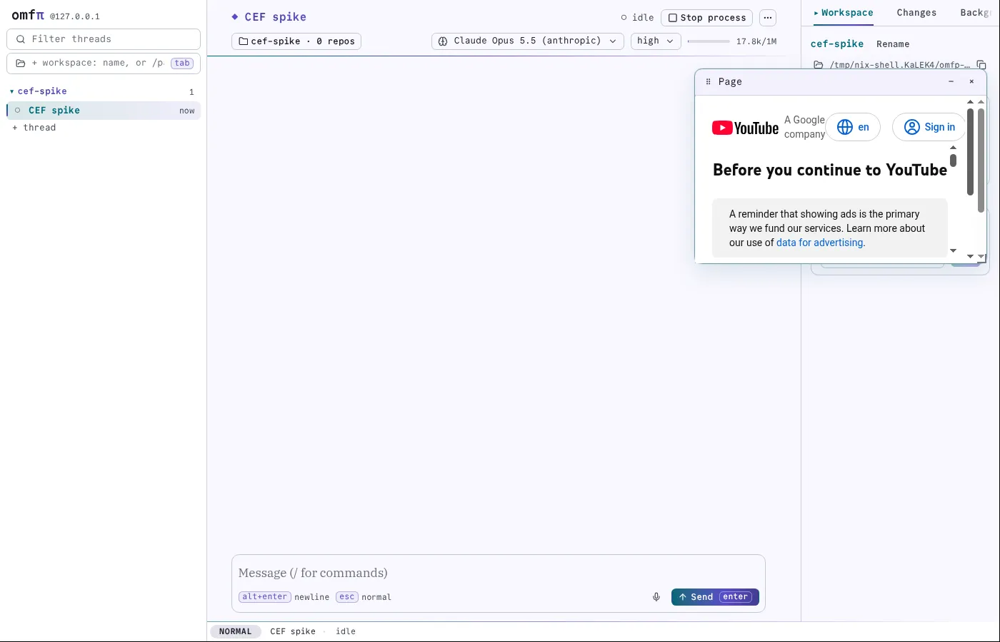
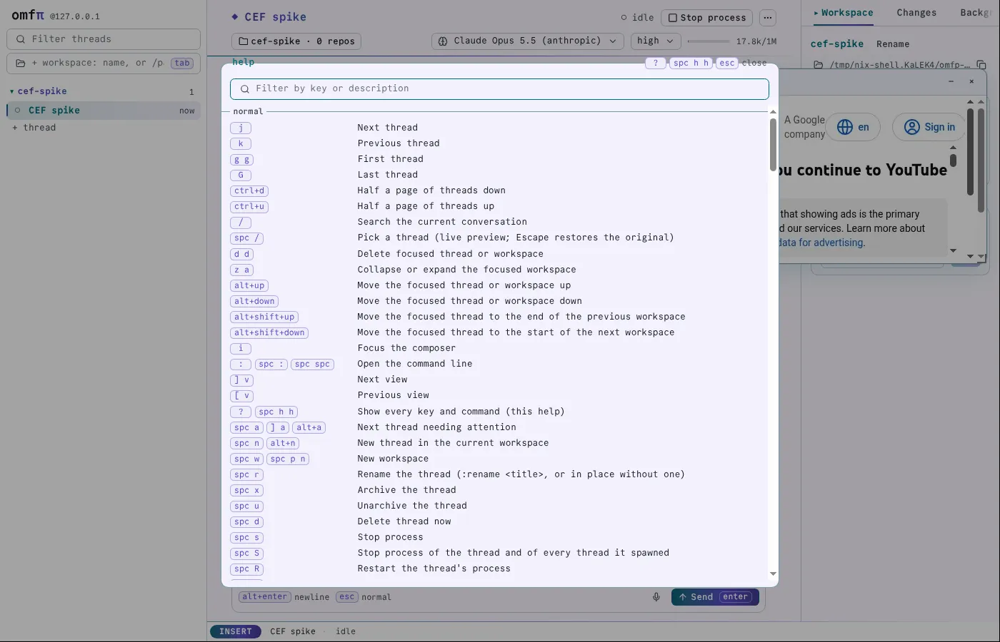

# Spike S-16: web pages in widgets on prebuilt CEF

Can omfp's desktop show real web pages inside widgets, with Google sign-in and YouTube working, while omfp's own UI
(the `:` line, dialogs, toasts) stays on top of them, without building Chromium? Result in
[07-roadmap.md](../../docs/specs/07-roadmap.md) (S-16). This directory is the prototype; nothing of omfp's code changes.

## How it works

- `omfp-cef-spike` (Rust, [cef-rs](https://github.com/tauri-apps/cef-rs) 156.7.0) runs CEF 156.0.31 (Chromium 156)
  from Spotify's prebuilt binaries, which cef-rs's build script downloads (about 1 GB, once). No Tauri: CEF's Views
  framework makes the window. All browsers are Alloy style; a Chrome-style window cannot host several overlay
  BrowserViews ([cef#3790](https://github.com/chromiumembedded/cef/issues/3790)).
- The window's main browser loads omfp's UI from the daemon (local or remote). Before omfp loads, the host adds a CDP
  binding (`Runtime.addBinding`) and injects [`src/bridge.js`](src/bridge.js) (`Page.addScriptToEvaluateOnNewDocument`).
- A widget renders a placeholder, `<div data-omfp-cef-browser="<id>" data-url="<url>">`
  ([`widget/index.tsx`](widget/index.tsx)). Every frame the bridge reports each placeholder through the binding:
  - its shown rectangle, cut by the viewport and by every ancestor that clips overflow (a floating panel's body);
  - whether it shows (`checkVisibility`);
  - whether anything of the page covers it, found by sampling a 5 × 5 grid with `elementFromPoint`.
- The host keeps one embedded browser per placeholder: a `BrowserView` added with `CefWindow::AddOverlayView` and
  moved to the reported rectangle. [`src/slots.rs`](src/slots.rs) is the state machine, with unit tests.
- When something covers a placeholder, the browser freezes:
  1. the host captures it (`Page.captureScreenshot`, JPEG);
  2. the bridge shows the capture in the placeholder;
  3. the host hides the native view, so the dialog shows on top.

  Uncovered, the capture goes and the view shows again.

## Run it

Inside omfp's dev shell (`nix develop`):

```sh
bun spikes/cef-browser/demo.ts [url]   # an isolated daemon, a workspace with the widget in a floating panel, the window
xvfb-run -a -s '-screen 0 1400x900x24' nix shell nixpkgs#imagemagick -c bun spikes/cef-browser/check.ts /tmp/shots
```

[`run.sh`](run.sh) builds and starts `omfp-cef-spike`; on NixOS it puts the libraries CEF loads on `LD_LIBRARY_PATH`.
`OMFP_CEF_TRACE=1` prints the host's actions; `--sandbox` (after `--` for the demo) turns Chromium's sandbox on. The
demo's daemon is the `omfp` on PATH, with a temporary data directory, workspaces root and HOME, and a placeholder
`ANTHROPIC_API_KEY`, which only gets past the welcome screen.

## What `check.ts` measured (headless, Xvfb, software rendering)

| Step | Result |
| --- | --- |
| omfp's UI in CEF | Renders and connects as in Chromium. |
| YouTube in a floating panel | Drawn at the panel's body, clipped to it, and moved with it. |
| Help dialog (`?`) over the panel | Frozen 62–142 ms after the key; the dialog shows on top of the capture. |
| Escape | Live again 16–109 ms later. |
| Codecs (`MediaSource.isTypeSupported`) | VP9, AV1 and Opus yes; H.264 and AAC no. |
| Video (`watch?v=aqz-KE-bpKQ`, muted) | 854 × 480, 153 frames in 4.9 s, none dropped. |





## By hand on niri (Wayland)

On a niri session (pike), `demo.ts … -- --ozone-platform=wayland` ran on native Wayland, without Xwayland.

- **Clicks.** They reach the embedded page.
- **The first window floated.** cef-rs's `WindowDelegate` answers `can_resize`, `can_maximize` and `can_minimize` with
  0 by default, so niri opened the window floating; host.rs now answers 1.
- **Panel controls froze the page.** A floating panel's own controls (its resize corner) counted as covering the page,
  which stayed frozen. The bridge now ignores the panel around the placeholder, and the widget leaves a strip below
  the page for the resize corner.
- **Panel order.** omfp stacks floating widget panels at one `z-index`, in mount-id order, and never raises a clicked
  one. A panel mounted after the browser's covers it, and the page freezes; one mounted before stays under it.

## Replacing Tauri: what [`probe.ts`](probe.ts) found

`probe.ts` drives the demo on Xvfb with real X input (xdotool) and reports what the desktop would have to redo
without Tauri/wry. Alloy style, CEF 156.0.31, Linux:

| Concern | Found | What the host would need |
| --- | --- | --- |
| Keyboard focus | A click in the page gives it the keys: `?` there does not open omfp's help. A click on omfp takes them back, and `?` opens it. | Nothing for focus. omfp's keys do not reach it while a page has focus, as in a browser tab. |
| Notifications | `Notification.requestPermission()` never answers; `new Notification()` fires `error`. | The page shim with a nonce that macOS uses today (`notification_script`), posting through D-Bus (`org.freedesktop.Notifications` or the portal) with gio. |
| WebRTC, microphone | `RTCPeerConnection` and `getUserMedia` exist; secure context on `127.0.0.1`. | A `CefPermissionHandler` for the microphone. Live voice could use WebRTC as in the web app, not omp's `live_start` (S-09). |
| Zoom (UI-281, UI-283) | Ctrl+= changes nothing: Alloy has no Chrome accelerators. | A `CefKeyboardHandler` and `SetZoomLevel`, replacing #202's script handlers. |
| Downloads (UI-791) | A `blob:` download of omfp's page is not saved. | A `CefDownloadHandler` keeping today's rule: save to Downloads, number the name. |
| File picker | `<input type=file>` opens no window. | A `CefDialogHandler`, e.g. the portal's FileChooser over D-Bus. |
| Popups (`window.open`) | Creates a browser, a DevTools target, but no visible window. | `OnBeforePopup` applying DMN-182 (other sites go to the system browser). |
| Context menu | None on right click. | Alloy draws none by default: `CefContextMenuHandler`, or none (omfp has its own menus). |
| Window | Resizable once `can_resize` is set. `GetLinuxWindowProperties` is called, but neither its WM class nor `--class` set `WM_CLASS` on Xvfb. | The Wayland app id is still to check on niri, for rules on `app-id="omfp"`. |
| Sandbox | `--sandbox` starts. The renderers run without `--no-sandbox` on NixOS (user namespaces). | Packaging: zypak in the Flatpak, `chrome-sandbox` where namespaces are off. |
| One window per process (D-16) | A second host on the same profile prints "Opening in existing browser session" and exits: Chromium's process singleton relays it to the first. | The first process opens the window (`OnAlreadyRunningAppRelaunch`), or one profile per process. D-16 changes either way. |
| Memory | omfp plus one YouTube page: 13 processes, 1.4 GiB of summed RSS (shared pages counted more than once). | Each embedded page is one more renderer. |
| Size | `libcef.so` is 1.48 GB as shipped (with symbols), 278 MB stripped. The runtime files are 333 MB, 115 MB with zstd -19. | Today's Tauri desktop adds 10.9 MB (S-04). nixpkgs' `cef-binary` failed to build 156 (its `patchelf` expects `libEGL.so`, which the minimal distribution lacks): pin CEF ourselves. |
| One binary (D-15) | CEF re-runs the executable with `--type=…` for its processes. | `omfp` handles `--type=` before clap and links `libcef.so`, or the desktop becomes its own binary. |

Free with Chromium: WebRTC, VP9/AV1/Opus without system GStreamer plugins (H.264 and AAC stay missing in Spotify's
builds), `localStorage` per data directory (`root_cache_path`, no macOS data store id), Wayland without Xwayland
(unlike Tauri's CEF runtime). Probably free: the colour scheme from the settings portal, which Chromium reads itself on
Linux; it is not checkable on Xvfb.

Still to do by hand: the tray on macOS (today Tauri's `tray-icon`; on Linux it is our own SNI over gio), the macOS
app menu, the `.app` with CEF's framework and signed helpers, the desktop tests (TST-033, TST-090).

## Not covered

- Google sign-in with a real account (needs a person and an account).
- macOS.
- The Flatpak and the other packages.
- Page zoom: the rectangles assume CSS pixels equal the window's DIPs.
