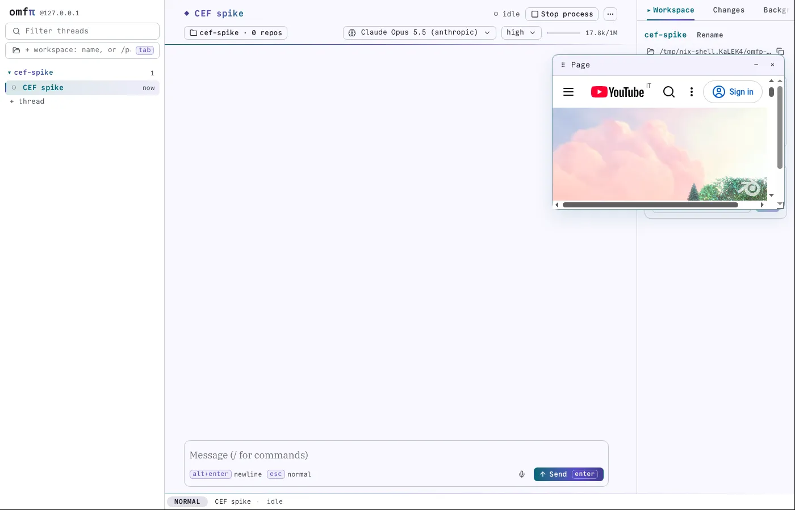

# Spike S-16: web pages in widgets on prebuilt CEF

Can omfp's desktop show real web pages inside widgets, with Google sign-in and YouTube working, while omfp's own UI
(the `:` line, dialogs, toasts) stays on top of them, without building Chromium? Result in
[07-roadmap.md](../../docs/specs/07-roadmap.md) (S-16). This directory is the prototype; nothing of omfp's code changes.

## How it works

- `omfp-cef-spike` (Rust, [cef-rs](https://github.com/tauri-apps/cef-rs) 156.7.0) runs CEF 156.0.31 (Chromium 156)
  from Spotify's prebuilt binaries, which cef-rs's build script downloads (about 1 GB, once). No Tauri: CEF's Views
  framework makes the window. All browsers are Alloy style; a Chrome-style window cannot host several overlay
  BrowserViews ([cef#3790](https://github.com/chromiumembedded/cef/issues/3790)).
- The window's main browser loads omfp's UI from the daemon (local or remote). Before omfp loads, the host adds a CDP
  binding (`Runtime.addBinding`) and injects [`src/bridge.js`](src/bridge.js) (`Page.addScriptToEvaluateOnNewDocument`).
- A widget renders a placeholder, `<div data-omfp-cef-browser="<id>" data-url="<url>">`
  ([`widget/index.tsx`](widget/index.tsx)). Every frame the bridge reports each placeholder through the binding:
  - its shown rectangle, cut by the viewport and by every ancestor that clips overflow (a floating panel's body);
  - whether it shows (`checkVisibility`);
  - whether anything of the page covers it, found by sampling a 5 × 5 grid with `elementFromPoint`.
- The host keeps one embedded browser per placeholder: a `BrowserView` added with `CefWindow::AddOverlayView` and
  moved to the reported rectangle. [`src/slots.rs`](src/slots.rs) is the state machine, with unit tests.
- When something covers a placeholder, the browser freezes:
  1. the host captures it (`Page.captureScreenshot`, JPEG);
  2. the bridge shows the capture in the placeholder;
  3. the host hides the native view, so the dialog shows on top.

  Uncovered, the capture goes and the view shows again.

## Run it

Inside omfp's dev shell (`nix develop`):

```sh
bun spikes/cef-browser/demo.ts [url]   # an isolated daemon, a workspace with the widget in a floating panel, the window
xvfb-run -a -s '-screen 0 1400x900x24' nix shell nixpkgs#imagemagick -c bun spikes/cef-browser/check.ts /tmp/shots
```

[`run.sh`](run.sh) builds and starts `omfp-cef-spike`; on NixOS it puts the libraries CEF loads on `LD_LIBRARY_PATH`.
`OMFP_CEF_TRACE=1` prints the host's actions. The demo's daemon is the `omfp` on PATH, with a temporary data
directory, workspaces root and HOME, and a placeholder `ANTHROPIC_API_KEY`, which only gets past the welcome screen.

## What `check.ts` measured (headless, Xvfb, software rendering)

| Step | Result |
| --- | --- |
| omfp's UI in CEF | Renders and connects as in Chromium. |
| YouTube in a floating panel | Drawn at the panel's body, clipped to it, and moved with it. |
| Help dialog (`?`) over the panel | Frozen 62–142 ms after the key; the dialog shows on top of the capture. |
| Escape | Live again 16–109 ms later. |
| Codecs (`MediaSource.isTypeSupported`) | VP9, AV1 and Opus yes; H.264 and AAC no. |
| Video (`watch?v=aqz-KE-bpKQ`, muted) | 854 × 480, 153 frames in 4.9 s, none dropped. |




## Not covered

- Google sign-in with a real account (needs a person and an account).
- macOS.
- Chromium's sandbox (`no_sandbox` here), the Flatpak, packaging.
- Keyboard focus moving between omfp and an embedded page.
- Popups, downloads, permissions.
- Page zoom: the rectangles assume CSS pixels equal the window's DIPs.
